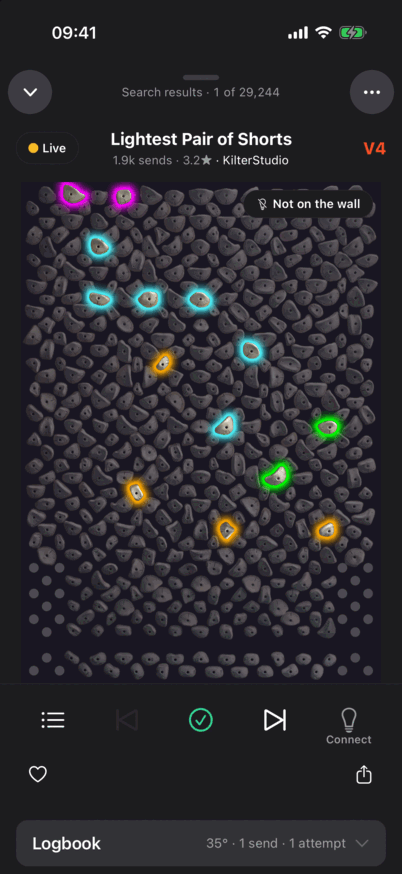

# AI Design Guidelines — Velvet Send

The system spec for Boardsesh UI. **"Velvet Send"** is the design language of the mobile app
(`packages/mobile`); the web app renders the same palette in dark only. Tokens live in
`packages/mobile/src/theme/` and `@boardsesh/velvet-tokens`: they are the source of truth, this doc
explains them. Screen specs live elsewhere:

- [mobile-chrome.md](./mobile-chrome.md): glass size ladder, header and tab bars, filter capsules and sheets, the wall button, the full UI-variant and glass-capability model.
- [mobile-large-screen-layout.md](./mobile-large-screen-layout.md): iPad, Android tablet, web desktop.
- [mobile-motion.md](./mobile-motion.md): springs, timings, haptics, Queue Undo.
- [mobile-accessibility.md](./mobile-accessibility.md): hold shapes, Large Content Viewer, per-screen accessibility behaviour.
- [web-velvet-send.md](./web-velvet-send.md): how `packages/web` consumes the tokens.

Every table between a `<!-- velvet-tokens:... -->` marker pair is generated from the token sources by
`vp run docs:velvet-tokens`. Do not edit them by hand; `vp run check:velvet-tokens` fails CI on drift.

---

## Design philosophy

Boardsesh follows the media apps people already know (Apple Music, Spotify). A screen has one
obvious thing to play, one row of obvious things to tap and quiet chrome around them. Judge a screen
by its hierarchy, never by its control count: a dense row of controls is fine when each one reads at
a glance.

- **Violet brand, platform-native chrome.** The colour comes from the logo (the V11–V16 grade purples); silhouettes, elevation, motion and type follow the platform.
- **One violet across light and dark.** Dark mode lifts the tint and brightens fills; it is not a different palette.
- **Read the theme, never the raw constants.** Colour, type, spacing, radii and motion come from `useTheme()`. The constants in `theme/` are inputs to the provider; using them directly bypasses variants and dark mode.
- **Accessible by construction.** Colours are chosen against documented WCAG ratios (recorded in `colors.ts`), interactive tiers sit at or above the 44pt touch floor, and text honours Dynamic Type.
- **Climbing content carries the colour.** Grades, board art, photos and primary actions are coloured; tabs and toolbar symbols stay neutral.

## The two UI variants

The app renders in one resolved `variant` (`theme/resolve-ui-variant.ts`). The brand palette and
component APIs are identical in both; surfaces, elevation, motion and type follow the variant.

- **`liquidGlass`**: Apple's look (floating glass capsules, soft corners, HIG type, reanimated springs). Every iPhone by default, including iOS before 26, where the glass degrades to blur; opt-in on Android.
- **`material`**: Material 3 (opaque tonal surfaces, ripple, nav indicator pill, M3 type and corners). Android and the Expo browser app by default; on iOS only a legacy saved choice or the stories harness. There is no in-app picker.

Variant (aesthetic) is separate from capability (real iOS 26 glass or a fallback): Liquid Glass on an
older iPhone is the variant with degraded chrome, not Material. Cross-variant components expose one
prop API and route internally; never hand-write `variant === '…'`. Prefer, in order: a token resolved
in the provider (`theme.actionColors`, `theme.chartColors`, `theme.radii`, `theme.textStyles`),
`createVariantComponent` for a whole-subtree swap, `selectByVariant` for a one-off
(`vp run check:mobile-variants` blocks raw compares in `src/components/`). Glass is for controls over
rich backgrounds; UIKit-owned headers and tabs stay native, and glass never goes behind content cards
or inside other glass (HIG Materials). Full model: [mobile-chrome.md](./mobile-chrome.md#ui-variants-and-glass-capability).

---

## Color — Velvet Send palette

Read colours from `useTheme()`: `brandColors` for the brand, `systemColors` for surfaces and labels.

### Brand colours

`brandColors` holds light values; `brandColorsDark` overrides the roles that must change to stay legible
on near-black. `tint` aliases `primary`.

<!-- velvet-tokens:brand:start -->

| Role            | Light     | Dark      | Use                                                                        |
| --------------- | --------- | --------- | -------------------------------------------------------------------------- |
| `primary`       | `#6D28D9` | `#A78BFA` | Brand **foreground**: text, icons, links, borders                          |
| `primaryFill`   | `#6D28D9` | `#7C3AED` | Brand **filled** surface/button background                                 |
| `primaryStrong` | `#5B21B6` | `#A78BFA` | Brand foreground on a tonal violet wash (the player wall button)           |
| `onPrimary`     | `#FFFFFF` | `#FFFFFF` | Text/icon sitting on `primaryFill`                                         |
| `accent`        | `#FF8A3D` | `#FF8A3D` | Warm amber spark for highlights; **fill-only, always pair with dark text** |
| `onAccent`      | `#16111F` | `#16111F` | The dark ink that pairs with `accent`; same in both schemes                |
| `success`       | `#047857` | `#34D399` | Success states                                                             |
| `warning`       | `#B45309` | `#FBBF24` | Warnings                                                                   |
| `error`         | `#C81E1E` | `#F87171` | Destructive actions                                                        |
| `live`          | `#B45309` | `#FBBF24` | This climb is lit / now on the wall                                        |
| `historyFill`   | `#475569` | `#64748B` | The wall kiosk's "viewing history" bar                                     |

<!-- velvet-tokens:brand:end -->

**Foreground vs fill.** In dark mode the tint lifts to `#A78BFA` as a foreground, while filled buttons use
a brighter `#7C3AED` so white text clears AA. Contrast: white on `#6D28D9` is 7.10:1; `#A78BFA` is 5.12:1 on
`#2C2C2E` and 6.25:1 on `#1C1C1E`; white on `#7C3AED` is 5.70:1; `#7C3AED` as a foreground on `#2C2C2E` is
2.45:1, under the 3:1 a control needs. `accent` amber is fill-only with `onAccent` ink (8.95:1).

**Settings rows and controls.** Row titles, values and chevrons use `label` / `secondaryLabel` /
`tertiaryLabel`, never the accent. On iOS that means fixed `PlatformColor` styles
(`settings-row-styles.ios.ts`), because a hierarchical style follows the tint inside a row `Button`.
Controls (Toggle, Slider, menu Picker value, plain text button) use the `primary` tint
(`brandControlTint`); `primaryFill` only under white text (filled buttons, selected segment, badges).

### Velvet Send v2 roles

Roles say what a colour is for, so a screen never reaches for violet to mean "selected" or "status".
Read them from `useTheme()`; each resolves once per variant and scheme in `theme/variants/variant-tokens.ts`.

**Accent means tappable.** Violet text and icons only on things you can tap: a link, a text button, a
bar glyph that does something (`systemColors.accent`, which adapts to Increase Contrast on iOS). The
board you're on, a selected row and a status are never violet text. HIG Color: _"if you use your brand
color to indicate that a borderless button is interactive, using the same or similar color to stylize
noninteractive text is confusing."_

- **Surfaces (`theme.surfaces`).** Two page styles, each a `{ page, card, tile }` ladder: `plain` (a feed, a shelf, a climb list: `systemBackground` / `secondarySystemBackground` / `tertiarySystemBackground`) and `grouped` (inset-grouped rows like Settings: the `…Grouped…` trio). iOS resolves base vs elevated itself, so a page drawn in a sheet steps up (the React Navigation ground in dark is `surfaces.plain.page`, not a static `#000`). Material and Liquid Glass off iOS take the same steps from their own ladders.
- **Selection (`theme.selection`).** `{ text: label, checkmark: accent, fill: primary at 18% }`. The title stays `label`, set semibold with `<Text emphasized>`; an accent checkmark marks it; a violet wash sits behind the row (the current climb's look in the Climbs list, on every variant). A surface, not violet text. Selection is a state, not a link.
- **Status (`theme.status`).** `{ fill: tertiaryFill, label: secondaryLabel }`: a quiet pill for something you can't tap ("Ready to review", "On it").
- **Guards.** `no-violet-selection.test.ts` (a selection flag choosing `brandColors.primary`: use `theme.selection`) and `no-text-opacity-dim.test.ts` (a `StyleSheet` opacity on a `<Text>`: use `tone`). Their allowlists only shrink.
- **Scroll edges.** iOS 26 draws its own (no forced pre-26 blur, `useHeaderBlurEffect`). HIG Layout: _"Instead of applying a solid or semi-opaque background color beneath controls, use a scroll edge effect to visually elevate controls above content."_

### System colours (surfaces and labels)

`theme.systemColors` resolves by platform and variant, always with the same keys: **iOS + Liquid Glass**
reads Apple `PlatformColor` names (adapting to light, dark and accessibility settings with no app
code); **Android + Liquid Glass** reads the violet-tinted `androidFallbackColors` (iOS Liquid Glass also
reads these as plain strings for `chartColors` and `sheetSurface`); **Material on any platform** reads
`materialSurfaces`.

<!-- velvet-tokens:ios-system:start -->

| Key                          | iOS `PlatformColor`                | Meaning                                                       |
| ---------------------------- | ---------------------------------- | ------------------------------------------------------------- |
| `background`                 | `systemBackground`                 | Screen base                                                   |
| `secondaryBackground`        | `secondarySystemBackground`        | Cards, sheets                                                 |
| `tertiaryBackground`         | `tertiarySystemBackground`         | A step above the card                                         |
| `groupedBackground`          | `systemGroupedBackground`          | Grouped-list base                                             |
| `secondaryGroupedBackground` | `secondarySystemGroupedBackground` | Card that sits on `groupedBackground` (a Form row)            |
| `tertiaryGroupedBackground`  | `tertiarySystemGroupedBackground`  | A block inside a grouped card                                 |
| `elevatedSurface`            | `tertiarySystemBackground`         | Raised tile (selected segmented pill, elevated bar)           |
| `label`                      | `label`                            | Primary text                                                  |
| `secondaryLabel`             | `secondaryLabel`                   | Secondary text                                                |
| `tertiaryLabel`              | `tertiaryLabel`                    | Tertiary text                                                 |
| `separator`                  | `separator`                        | Hairlines, dividers                                           |
| `fill`                       | `systemFill`                       | Small control fills (segmented tracks)                        |
| `error`                      | `systemRed`                        | Destructive foreground and selected favourite hearts          |
| `tertiaryFill`               | `tertiarySystemFill`               | Large grouped backgrounds; `fill` is for small controls       |
| `accent`                     | brand tint (DynamicColorIOS)       | Interactive foreground; on iOS it adapts to Increase Contrast |

<!-- velvet-tokens:ios-system:end -->

<!-- velvet-tokens:android-fallback:start -->

| Key                   | Light                     | Dark                        | Meaning                                                       |
| --------------------- | ------------------------- | --------------------------- | ------------------------------------------------------------- |
| `background`          | `#F4F1FB`                 | `#0F0B16`                   | Screen base                                                   |
| `secondaryBackground` | `#FFFFFF`                 | `#181225`                   | Cards, sheets                                                 |
| `tertiaryBackground`  | `#FFFFFF`                 | `#221A32`                   | A step above the card                                         |
| `groupedBackground`   | `#F4F1FB`                 | `#0F0B16`                   | Grouped-list base                                             |
| `elevatedSurface`     | `#FFFFFF`                 | `#221A32`                   | Raised tile (selected segmented pill, elevated bar)           |
| `label`               | `#16111F`                 | `#F5F2FB`                   | Primary text                                                  |
| `secondaryLabel`      | `#5B5563`                 | `#A9A2B6`                   | Secondary text                                                |
| `tertiaryLabel`       | `#8E8898`                 | `#6E687C`                   | Tertiary text                                                 |
| `separator`           | `rgba(60, 55, 75, 0.18)`  | `rgba(180, 168, 205, 0.2)`  | Hairlines, dividers                                           |
| `fill`                | `rgba(109, 40, 217, 0.1)` | `rgba(199, 184, 232, 0.12)` | Small control fills (segmented tracks)                        |
| `accent`              | `#6D28D9`                 | `#A78BFA`                   | Interactive foreground; on iOS it adapts to Increase Contrast |

<!-- velvet-tokens:android-fallback:end -->

#### Material surfaces: "Graphite"

Pure grey neutrals (R = G = B). Material reads as Boardsesh through the accent, filled CTAs and
selected-state containers, not a tinted page. The container ladder (`materialSurfaceContainers`) feeds
Paper's `elevation.level1–5` and the Compose Host's `surfaceContainer*` roles: `low` is level1, `base`
level2 (the MiniPlayer ground), `high` level3, `level4`, `highest` level5. The MiniPlayer card is
`secondaryBackground`, its separator `outlineVariant`.

<!-- velvet-tokens:material-surfaces:start -->

| Key                   | Dark                        | Light                 |
| --------------------- | --------------------------- | --------------------- |
| `background`          | `#0E0E0E`                   | `#F2F2F2`             |
| `secondaryBackground` | `#1E1E1E`                   | `#FFFFFF`             |
| `tertiaryBackground`  | `#262626`                   | `#FFFFFF`             |
| `groupedBackground`   | `#0E0E0E`                   | `#F2F2F2`             |
| `elevatedSurface`     | `#262626`                   | `#FFFFFF`             |
| `label`               | `#EDEDED`                   | `#1A1A1A`             |
| `secondaryLabel`      | `#B0B0B0`                   | `#5A5A5A`             |
| `tertiaryLabel`       | `#8F8F8F`                   | `#686868`             |
| `separator`           | `rgba(255, 255, 255, 0.12)` | `rgba(0, 0, 0, 0.12)` |
| `fill`                | `rgba(255, 255, 255, 0.10)` | `rgba(0, 0, 0, 0.08)` |
| `accent`              | `#A78BFA`                   | `#6D28D9`             |

<!-- velvet-tokens:material-surfaces:end -->

<!-- velvet-tokens:material-containers:start -->

| Container | Dark      | Light     |
| --------- | --------- | --------- |
| `lowest`  | `#121212` | `#EEEEEE` |
| `low`     | `#161616` | `#EAEAEA` |
| `base`    | `#1A1A1A` | `#E4E4E4` |
| `high`    | `#262626` | `#DFDFDF` |
| `level4`  | `#2A2A2A` | `#DCDCDC` |
| `highest` | `#2E2E2E` | `#D9D9D9` |

<!-- velvet-tokens:material-containers:end -->

**The violet budget.** On Material violet is spent only on: (1) accent foreground (links, active nav
label, focus ring, spinners); (2) one filled `primaryFill` CTA per region, plus switch, radio and
checkbox on-states; (3) opaque tonal containers for a selected or current state (nav pill and Stepper
`secondaryContainer` `#E6DAF8` / `#3C2467`, selected chips and segments, tonal buttons, the connected
MiniPlayer; `primaryContainer` `#EADDFF` / `#4F378B`, ink `#21005D` / `#EADDFF`); (4) the selected
climb-row wash; (5) data (heat ramp, grade colours, holds, playlist swatch). Everything else is grey.

**Tertiary-label placement.** `tertiaryLabel` clears 4.5:1 only on the lower steps. Dark: page, card,
lowest, low, base, high. Light: page, card, lowest, low. Never above that; use `secondaryLabel`.
`material-theme-contrast.test.ts` pins every pairing in this section.

**Compose, nav bar, www.** `ComposeHost` seeds Android Compose from `primaryFill` plus `composeSurfaceColorOverrides`,
so menus and dialogs sit on the same greys. The Android phone nav bar overlays tab roots at `m3.surface` 92% dark /
85% light so it can hide on scroll. `theme.m3` exposes the MD3 role palette on Material only. www stays violet on
purpose (`packages/web/app/theme/theme-config.ts`; video renders read the frozen `marketingSurfaces`).

### Data ramp (`theme.heatRamp`)

Hold heatmap, few to many: **single violet hue, luminance-ordered, never a role hue** (Start / Hand /
Finish / Foot already own green, cyan, magenta and amber). No near-white stop; `heat-ramp.test.ts` holds
it monotonic with at least 1.3:1 between neighbours. Grade mode uses `V_GRADE_COLORS` instead.

| Scheme | 1 (few)   | 2         | 3         | 4         | 5 (many)  |
| ------ | --------- | --------- | --------- | --------- | --------- |
| Dark   | `#4C1D95` | `#6D28D9` | `#8B5CF6` | `#A78BFA` | `#C4B5FD` |
| Light  | `#C4B5FD` | `#A78BFA` | `#7C3AED` | `#5B21B6` | `#2E1065` |

### Helpers and overlays

`withAlpha(color, alpha)` alpha-applies a hex (other inputs pass through); `blendOpaque(fg, bg, alpha)` gives an
opaque hex for surfaces floating over content. `ios-colors.ts` holds fixed hexes for spots outside the provider;
prefer the theme. `overlays` are fixed across schemes for chips over photos: `scrim` `rgba(0,0,0,0.6)`, `onScrim`
`#FFFFFF`; `photoDim` 0.15, `photoDimFocused` 0.3, `photoDimScan` 0.4 dim a photograph under marks drawn on it.

---

## Typography

Two scales with the same keys, resolved by `theme.textStyles[variant]`: Apple HIG (Liquid Glass) and M3
Roboto (Material). System font only (San Francisco, Roboto). Values are `fontSize / fontWeight / lineHeight`.

<!-- velvet-tokens:type-scale:start -->

| Variant key   | HIG (Liquid Glass) | M3 (Material) | Note                            |
| ------------- | ------------------ | ------------- | ------------------------------- |
| `largeTitle`  | 34 / 700 / 41      | 28 / 400 / 36 |                                 |
| `title1`      | 28 / 700 / 34      | 24 / 400 / 32 |                                 |
| `title2`      | 22 / 700 / 28      | 22 / 400 / 28 |                                 |
| `title3`      | 20 / 600 / 25      | 22 / 500 / 28 |                                 |
| `headline`    | 17 / 600 / 22      | 16 / 500 / 24 |                                 |
| `body`        | 17 / 400 / 22      | 16 / 400 / 24 |                                 |
| `callout`     | 16 / 400 / 21      | 16 / 400 / 24 |                                 |
| `subheadline` | 15 / 400 / 20      | 14 / 400 / 20 |                                 |
| `footnote`    | 13 / 400 / 18      | 12 / 400 / 16 |                                 |
| `caption1`    | 12 / 400 / 16      | 11 / 500 / 16 |                                 |
| `caption2`    | 11 / 400 / 13      | 11 / 500 / 16 |                                 |
| `label`       | 17 / 400 / 22      | 14 / 500 / 20 | Every top-bar and header button |

<!-- velvet-tokens:type-scale:end -->

`label` is the type of every top-bar and header button (UIKit bar-item size; M3 `labelLarge`). The HIG
scale sets `largeTitle`/`title1`/`title2` bold (a brand choice; HIG's default is regular); M3 keeps them regular.

- **Always render through `Text`** (`components/Text.tsx`), never raw `RNText`: it resolves the variant scale and defaults colour to the adaptive `label` (RN's default is non-adaptive black).
- **`tone`**: `primary` (default), `secondary`, `tertiary` resolve to `label`, `secondaryLabel`, `tertiaryLabel`. Step text down with a tone, never `opacity`, which mixes into the ground and ignores Increase Contrast. An explicit `color` wins.
- **`emphasized`**: the style's emphasized weight (`emphasizedWeights`). Liquid Glass follows HIG's Emphasized column: Bold for `largeTitle`, `title1`, `title2`, Semibold elsewhere. Material uses M3 Expressive: Medium for display, headline, title large and body roles, Bold for title medium and labels. Use it instead of a `fontWeight` override; Bold Text steps it up once more.
- **Dynamic Type ramps.** On iOS each variant scales on the UIKit text style of the same name (`dynamicTypeRamp`, `theme/dynamic-type.ts`); `label` scales on `body`. React Native's single `fontScale` table matches body only up to xxxLarge (AX3: 2.643 against body's 2.353). JS layout sized around non-body text, or body above xxxLarge, uses `textFontScale(variant, fontScale, Platform.OS)`. The ramp follows the `Text`'s `variant`, not its final size. An `Icon` beside footnote or caption text takes `textVariant`. Threshold switches (`fontScale > 1.3`) stay on `fontScale`.
- **Uncapped by default.** Content `Text` and native `Button` accept the full accessibility range: grow and wrap, no blanket cap. Fixed-height chrome opts into a cap (`CHROME_LABEL_MAX_FONT_SCALE` 1.2) and a Large Content Viewer. Never write numeric `fontSize` literals; use `useTypographyStyles`. A number that changes in place takes `<Text numeric>` (tabular figures).
- **Buttons.** `size="large"` is the single filled call to action of a full-screen form, gate or dead end (auth submit, "Sign in to join", retry on a full-screen error); everything else is `medium`; `small` inside cards. iOS labels are semibold when the drawn style is prominent; Android is M3 `labelLarge` (14/500).
- **Section headers** are sentence case: footnote semibold in `secondaryLabel` on Liquid Glass, titleSmall in `onSurfaceVariant` on Material. Never uppercase UI strings with a locale-blind `toUpperCase()`.

**A V-grade is never cut.** "V" always renders with its number (`V1`, `V14`, `V5+`), never "V…" or
"V1…". When a grade doesn't fit, change the layout, not the grade:

- **Rows and headers.** The climb name or title shrinks; the grade keeps its width (see the climb
  rows, the queue capsule and the play drawer header).
- **Charts.** Run the labels through `buildGradeBarLabels`
  (`packages/mobile/src/lib/chart/grade-bar-labels.ts`). It prints a label whole when it fits,
  stacks a both-formats label ("V6" over "7A") when it doesn't, and only then labels fewer bars.
  An unlabelled bar still carries its grade in its colour and in the tap tooltip. The `YouCharts`
  bar charts take `gradeAxis` for a grade x-axis; never hand a grade to gifted-charts' own `label`,
  which boxes it to one bar and ellipsizes.

The Font half of a both-formats label may stack or drop out on a cramped surface. The V-grade token
stays whole.

---

## Spacing, radii, shadows, opacity

Read via `theme.spacing`, `theme.borderRadius`, `theme.shadows`, `theme.opacity` (`theme/tokens.ts`). Spacing is a 4pt grid.

<!-- velvet-tokens:spacing:start -->

| Token | px  |
| ----- | --- |
| `0`   | 0   |
| `1`   | 4   |
| `2`   | 8   |
| `3`   | 12  |
| `4`   | 16  |
| `5`   | 20  |
| `6`   | 24  |
| `8`   | 32  |
| `10`  | 40  |
| `12`  | 48  |
| `16`  | 64  |

<!-- velvet-tokens:spacing:end -->

<!-- velvet-tokens:radii:start -->

| Token  | pt   |
| ------ | ---- |
| `none` | 0    |
| `sm`   | 4    |
| `md`   | 8    |
| `lg`   | 12   |
| `xl`   | 16   |
| `full` | 9999 |

<!-- velvet-tokens:radii:end -->

Cards stay `lg` (12) and pills and capsules `full` in both variants. Spread `cardCorners` (12pt plus
`borderCurve: 'continuous'`) into every card-shaped container so no screen mixes 12 and 16pt cards; never put a
continuous curve on a circle or capsule. Climb list rows use a 16pt gutter (`CLIMB_ROW_GUTTER`). The one
corner that varies is the button, `theme.radii.button`: 10dp on Liquid Glass, 20dp on Material.
Shadows `xs`…`xl` carry iOS shadow keys and Android `elevation` (1, 2, 4, 8, 12).

<!-- velvet-tokens:opacity:start -->

| Token      | Value |
| ---------- | ----- |
| `subtle`   | 0.7   |
| `peek`     | 0.62  |
| `disabled` | 0.5   |

<!-- velvet-tokens:opacity:end -->

---

## Components

In `packages/mobile/src/components/`, each with a story (`dev/stories/<id>`). Reach for these before
hand-rolling a heading, row, pill or placard. Props and edge cases are in each file's header.

- **`ShelfHeader` / `ShelfSection`**: the heading of a shelf (Home sections, picker groups). Title 3 emphasized, a VoiceOver heading, 16pt gutter, no minimum height; "See all" is accent text with a chevron reaching its target through its own padding. `ShelfSection` adds `children` and owns spacing: 8pt header to content, 28pt to the next shelf.
- **`TextAction`**: a borderless accent text button that adds no height to its row. Negative-margin padding brings the target to 44pt (Liquid Glass) or 48dp (Material); not `hitSlop`, which Fabric ignores outside the parent's bounds. `reach` (`even` / `up` / `down`) says where the extra height goes so stacked actions don't overlap.
- **`InsetGroupedList`**: the inset-grouped `Card`. Rows run to its edges and own the 16pt gutter; hairlines inset to where the text starts; rows clip to its corners. Other rows build from `insetGroupedRowStyles`.
- **`ArtRow`**: a row of an `InsetGroupedList` leading with art (board, playlist, icon) in a 36 or 44pt slot. `titleVariant` headline (Home rows) or body (a list to choose from, such as the board picker). `selected` takes `theme.selection` and reports to assistive tech; an element accessory (a ⋯ button) sits beside the row's target, not inside it; a long press also needs `longPressAccessibilityLabel`. Presses dip in opacity, never scale.
- **`StatusPill`**: something you can't tap. `theme.status` fill, caption 1 emphasized; it never shrinks or truncates, so put it beside text that can.
- **`EmptyState`**: `screen` fills and centres, `section` centres inside a longer page, `quiet` is one secondary footnote line at the gutter with a trailing `TextAction`, for a shelf that came back empty.
- **`BoardThumbnail`** (`components/boards/`): a board's bare art in a 36×44 or 44×56 slot (or a square), keeping its aspect ratio with a `separator` hairline and no tile; spray walls show the cached photo, else a camera glyph.
- **Other primitives** (`components/index.ts`): `Text`, `Button`, `Card`, `ListRow`, `Avatar`, `Badge`, `Separator`, `SectionHeader`, `Sheet`, `ModalSheet`, `GlassSurface`, `Icon`, `SegmentedControl`, `Toast`, `SwitchRow`. Prefer them over raw RN host components. Touch feedback goes through `PressableSurface` (Material ripple on Android, scale or opacity spring on iOS), never a hand-rolled `AnimatedPressable`.

---

## Layout, chrome and large screens

Chrome metrics: [mobile-chrome.md](./mobile-chrome.md). Large screens: [mobile-large-screen-layout.md](./mobile-large-screen-layout.md). Two product rules stay here.

### Nothing over the climb

The rendered climb is the one thing a climber reads from across the room, so no status or decoration is drawn over the
board art (#7000). A tester found the "Not on the wall" badge from #6939 distracting on the climb, and it showed beside a
Live pill that said the opposite.

New status goes beside the art instead: the header's back chip, the top bar's second line (the caption), or the
action bar's rows, like the wall button's "Disconnect board" (`WallControlButton`). The 2.7 preview-first card
(`PlayerPreviewTip`) docks under the board as the first section above Logbook, never on it.

Allowed over the board, and nothing else:

1. Cards that take the board over: a workout's rest and "Workout done", the end of a list, and Switch board.
2. Corner badges on thumbnails.
3. The MoonBoard grid letters.
4. The reset-zoom button.

The wall button's states and the frost, swipe and "is it lit" model: [mobile-chrome.md](./mobile-chrome.md#the-wall-button-is-it-lit).

### Content hierarchy and brand accents

Boardsesh keeps the native tab bar and toolbar symbols neutral while climbing content supplies
colour through grade labels, board drawings, photos and primary actions. [HIG
Color](https://developer.apple.com/design/human-interface-guidelines/color) supports adaptive
monochrome chrome and purposeful colour; it also permits coloured selected tabs. Neutral tabs are
our product treatment, not a prohibition on selected-tab colour.

On Liquid Glass, Profile's all-board send total uses adaptive `systemColors.accent`, and its board
comparison initially shows one row before "Show all". Material keeps a neutral total and three
collapsed rows. These are Boardsesh hierarchy choices, not an Apple-prescribed row count; expansion
stays virtualized and the all-board total remains independent of progress filters.

Neutral tiles in session summaries and Profile's period comparison use `systemColors.tertiaryFill`
on Liquid Glass, leaving visual emphasis to the actual values and semantic highlights. Material
keeps `systemColors.fill`. Do not apply a violet background to every content card.

The Profile Logbook and climbs Filters sheet (capsule row, sections, SwiftUI `Form` body): [mobile-chrome.md](./mobile-chrome.md#logbook-and-climbs-filter-sheets).

---

## Motion and haptics

Springs (`theme/animations.ts`): `snappy` 20/300/0.7 for controls and press feedback, `interactive`
20/250/1.0 for dragging, `gentle` 15/150/1.0 for sheets and layout, `bouncy` 10/200/0.7 for celebrations.
Timings: `instant` 50ms, `fast` 150ms, `normal` 250ms, `slow` 350ms. `theme.motion.standard` / `.emphasized`
carry the variant's `withTiming` easing and duration (build with `timingFor`). Reduce Motion is honoured everywhere.

Haptics (`lib/haptics.ts`), per Apple's "Playing haptics": sparingly, only for what the climber just did.
(1) Only the local climber's own action buzzes. (2) A plain button gets none; the press state is the feedback.
(3) A toggle gets `hapticSelection()`. (4) An outcome gets one notification haptic, from its toast
(`showToast` plays it; callers must not also). Presets, Queue Undo timing and the rest: [mobile-motion.md](./mobile-motion.md).

## Iconography

Use `Icon` with a semantic `IconName`; `iconMap` maps each to an SF Symbol (iOS, compile-time checked) and a
Material Community glyph (Android). Filled pairs use `name` / `name.fill`. On Liquid Glass chrome (tabs, neutral
glass header controls, action-sheet rows) icons are `label` when enabled and `secondaryLabel` when inactive;
carry state with shape, labels, badges or fills before reaching for brand colour. Colour stays where colour is
the content: destructive, warning/error, success summaries, connected-light state, grade colours, chart series,
filled primary buttons, and glass controls over photos where white is required.

## Dark mode

iOS + Liquid Glass follows the native trait collection with no app code. Android and Material pick
`*[colorScheme]` from `androidFallbackColors` / `materialSurfaces` and `brandColorsDark`. Components written
against the theme get dark mode for free: no `isDark ? a : b`. `theme.setThemeOverride('light' | 'dark' | 'system')`
also drives `Appearance.setColorScheme` (needs `userInterfaceStyle: 'automatic'`). The Expo browser app starts
dark when no choice is saved, with a black `color-scheme: dark` shell so it never flashes white.

## Accessibility defaults

- **Text.** Full Dynamic Type range on content; capped chrome exposes a Large Content Viewer; Bold Text applies live. Use `AccessibleTextInput` (and `AccessibleBottomSheetTextInput` in sheets).
- **Colour is never the only signal.** With Differentiate Without Color on, Classic board art gives uncustomised hold roles distinct shapes (start up-triangle, hand circle, finish square, foot down-triangle); state carries shape or label before colour.
- **Contrast.** `systemColors.accent` adapts to Increase Contrast; the iOS `AccentColor` asset has contrast variants (`#4C1D95` light, `#C4B5FD` dark) and needs a new binary. Pairings are pinned by `material-theme-contrast.test.ts`.
- **Touch and motion.** 44pt targets on Liquid Glass, 48dp on Material; Reduce Motion replaces slides and shrinks with fades or steps.
- **Layout.** Readable columns max 672pt on iPad; Start/End spacing and directional SF Symbols prepare for RTL (board hold coordinates stay physical); above font scale 1.3 segmented controls become scrollable tabs.
- **Device QA is required** for UIKit/SwiftUI layout and gestures: iPhone/iPad AX1–AX5 with Bold Text, VoiceOver/TalkBack, RTL and Reduce Motion. Linux tests cannot validate them. Details: [mobile-accessibility.md](./mobile-accessibility.md).

## Web

Dark only, with the foreground/fill violet split never collapsed: [web-velvet-send.md](./web-velvet-send.md).
