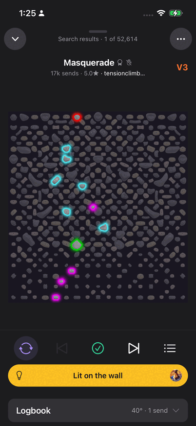
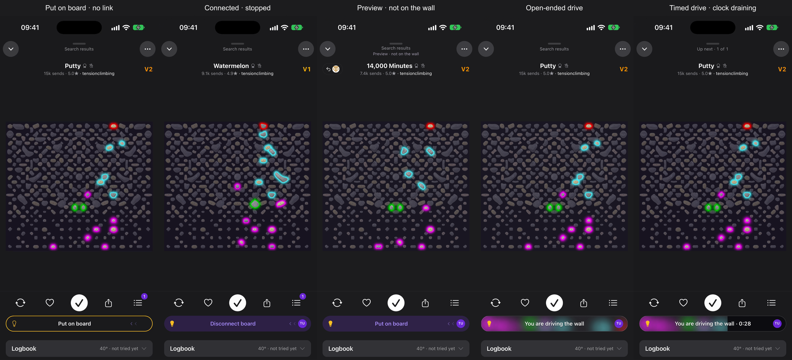

# AI Design Guidelines — Velvet Send

A self-contained reference for AI agents building or restyling Boardsesh UI to match the
design language. **"Velvet Send"** is the design language, and it lives in the mobile app
(`packages/mobile`). Every token in this document is sourced from the live code under
`packages/mobile/src/theme/` — treat that directory as the single source of truth and this doc as
its explanation.

> **Web is on Velvet Send too, in dark only.** The Next.js app (`packages/web`) renders this palette
> via `packages/web/app/theme/theme-config.ts` + `app/components/index.css` (kept in sync by a parity
> test). www is a marketing surface now, so it has ONE scheme — the light values and the colour-mode
> switch are gone. The brand hexes and colour helpers are still shared with mobile through
> `@boardsesh/velvet-tokens`, which keeps both halves because **mobile still renders light**. See
> [Web (consuming Velvet Send)](#web-consuming-velvet-send) at the end for the web-specific wiring.

---

## Design philosophy

Velvet Send is a violet brand identity rendered through **platform-native chrome**. The colour comes
from the Boardsesh logo (built from the V11–V16 climbing-grade purples); the structure comes from
each platform's own design system.

- **Platform-native, not lowest-common-denominator.** The app renders in one of two variants —
  **Liquid Glass** (Apple's look) or **Material 3**. The variant is the _aesthetic_; it is distinct
  from whether the device can render real iOS 26 glass _chrome_ (see "Aesthetic vs. capability"
  below). The brand palette and the component APIs are identical across both; the silhouettes,
  elevation, motion and type scale follow whichever variant you're in. A control is the same product
  in both variants, drawn the way that platform draws controls.
- **One violet across light and dark.** The brand reads violet in every scheme. Dark mode lifts the
  tint and brightens fills so the same identity stays legible on near-black — it is not a different
  palette.
- **Read the theme, never the raw constants.** Components get colour, type, spacing, radii and motion
  from `useTheme()`. The exported constants in `theme/` are inputs to the provider; consuming them
  directly bypasses variant resolution and dark mode.
- **Accessible by construction.** Brand and label colours are chosen against documented WCAG ratios
  (recorded in `colors.ts`). Interactive tiers sit at or above the 44pt touch floor. Text honours
  Dynamic Type.

---

## The two UI variants

Source: `packages/mobile/src/theme/resolve-ui-variant.ts`, `providers/theme-provider.tsx`.

The whole app renders in one resolved `variant`:

| Variant       | When                                                  | Look                                                                                     |
| ------------- | ----------------------------------------------------- | ---------------------------------------------------------------------------------------- |
| `liquidGlass` | Every iPhone by default; opt-in on Android            | Apple Liquid Glass — floating glass capsules, soft corners, HIG type, reanimated springs |
| `material`    | Android and the Expo browser app by default; on iOS only a legacy saved choice or the dev stories harness | Material 3 — elevation, ripple, nav active-indicator pill, M3 type and corners           |

The user's stored preference is `UiVariantPreference` = `'auto' | 'liquidGlass' | 'material'`.
There is no in-app picker: it was removed on 2026-06-28 (6af5f43df1). A value saved before then
still resolves, and the dev stories harness (`dev/stories/use-story-appearance.ts`) is the only
remaining `setUiVariant` caller.
`'auto'` resolves against the **platform**, not glass capability — Liquid Glass on every iPhone
(including iOS < 26), Material on Android:

```ts
export function resolveUiVariant(preference: UiVariantPreference, autoPrefersGlass: boolean): UiVariant {
  if (preference === 'liquidGlass') return 'liquidGlass';
  if (preference === 'material') return 'material';
  return autoPrefersGlass ? 'liquidGlass' : 'material'; // 'auto'; caller passes Platform.OS === 'ios'
}
```

Change it with `theme.setUiVariant(next)`. Every option is selectable on every platform — any phone
can opt into Liquid Glass. Material is drawn opaque (M3 tonal surfaces) on **every** platform when
chosen, so a user who picks Material gets a real M3 app, not a glass app with the blur turned off.

### Aesthetic vs. capability

The `variant` chooses the _aesthetic_; a separate, synchronous **capability** check decides whether
real iOS 26 glass _chrome_ is used or a fallback stands in. Keep the two apart — Liquid Glass on an
older iPhone is the variant with the chrome degraded, not Material.

- `useGlassCapability()` → iOS 26 only (the native `GlassView` / `GlassContainer` API is present).
- `useTabChrome()` (pure core: `resolveTabChrome` in `src/hooks/tab-chrome.ts`) is the canonical
  answer for the tab chrome, and `useBottomChromeMetrics` keys tab-bar geometry on it so the layout
  math matches the bar actually on screen:
  - `nativeTabBar` (`useNativeTabBar()`): Liquid Glass on any iPhone or iPad, iOS 18 included, gets
    the system UIKit tab bar through `NativeTabs` (HIG, Tab bars); on iPad it adapts to a sidebar.
    Material, Android and the JS tablet shell keep the JS `Tabs` + `MaterialTabBar` / rail.
  - **Android phones hide the bar on scroll** (M3 hide-on-scroll, the counterpart of iOS 26's
    minimize). On a top-level tab root the bar is drawn over the content, and scrolling down 24dp
    slides it off screen while the MiniPlayer card drops onto the gesture inset with all its
    controls. Scrolling up 24dp, reaching the top, switching tabs or changing route brings it back.
    It never hides on pushed sub-routes (the bar sits in flow there), on tablets, on filter boards,
    with the keyboard open or with TalkBack or another accessibility service on. Reduce Motion
    swaps it without the slide. The card, the rest pill, the connectivity banner, the Discover
    create button, the Start button, snackbars and toasts move with it on one shared value
    (`tabBarHiddenProgress`, `TabBarHideFollower`); `bottom` never animates. The bottom-chrome
    metrics describe the shown bar, as on iOS. Kill switch: `tab-bar-hide-on-scroll-kill`.
  - **Fades in where it overlays** (Spotify's bar): on those tab roots the bar is `m3.surface` at 92% in dark
    and 85% in light behind the icons, labels and gesture inset (`material.navBar.overlaySurfaceAlpha`),
    so content is faint there
    and never legible. A 24dp fade above its top edge runs from clear to that same fill, so content dissolves into the
    bar; it takes no touches and slides away with the bar. No blur, no top hairline, no shadow. The
    in-flow bar on sub-routes stays opaque, and the MiniPlayer card is always opaque and draws over
    the fade.
  - `liquidGlassTabBar`: the iOS 26 extras on that bar, also gated on `useGlassCapability()` —
    minimize-on-scroll. Climbs stays an ordinary labelled tab, the rightmost one, like Apple
    Music's Search tab, not a separated `role="search"` tab. On an iOS 27 iPhone it is the
    prominent tab, so it stays on screen when the bar collapses.
  - `nativeAccessory`: the `BottomAccessory` platter carries the bar's climb (iOS 26 only), on
    iPhone and iPad alike: the climb you last opened, a preview included, or the queue's current
    climb when that changed later (`useBarClimb`; see
    [The MiniPlayer shows your last pick](climb-lists-and-queue.md#the-miniplayer-shows-your-last-pick-owner-decision-a-2026-11-02)).
    The Lock Screen, the Climbs wall capsule and the board history sheet still show the wall's climb.
    Like Apple Music's platter, it shows a 32pt thumbnail and the climb name over a byline (grade ·
    sends, or grade · rating when nobody has sent it), and fills the frame UIKit gives it, with
    Music's insets (artwork 16pt in, last control ~30pt from the right edge). Open
    (`regular`), the lightbulb and the tick sit at the trailing edge. Collapsed (`inline`) there is
    one 44pt control slot: the pick's own bulb (Put on board for the pick) while the pick is unlit
    on a board with lights; otherwise the bulb while a board is bound and nobody holds it, otherwise
    the tick (you hold it, a teammate does, or no board is bound). The bulb is drawn solid like Music's
    controls, and outlined when off while Differentiate Without Color is on. Both placements put a
    connection mark on the thumbnail's top-trailing corner: a 14pt neutral disc (`CornerStatusDisc`,
    shared with `BoardDriverAvatar`'s badge) with a 9pt glyph. `lightbulb.fill` in amber
    (`brandColors.warning`) is an LED board you hold, `pin.fill` in the brand tone is a board with
    no lights you hold, `person.fill` in secondary label is a teammate holding it, and no mark
    (kept mounted at opacity 0, because UIKit snapshots the platter between placements) means free.
    The shape carries the state, so it survives Differentiate Without Color; amber only ever means
    lit LEDs. The collapsed platter's climb link also speaks the connection as its accessibility
    value, plus "Driving the wall" while this phone drives; the open one doesn't, because its bulb
    already does.
    Wherever it is false, including the native bar on iOS 18, the floating JS `PersistentQueueBar`
    carries the same climb, positioned above whichever bar is on screen.
- Surfaces degrade in `GlassSurface` via `useEffectiveSurfaceMode()`: `glass` (iOS 26) → `blur`
  (iOS < 26 frosted) → `material`/`solid` (Android, Reduce Transparency). `Button` uses native
  SwiftUI on iOS, native Compose on Android, and Paper on web; the iOS outlined/tonal tier explicitly
  falls back to a bordered control when native glass is unavailable.

**Glass material.** Custom toolbar islands over ordinary app content use `glassEffectStyle="regular"`.
[HIG Materials](https://developer.apple.com/design/human-interface-guidelines/materials) reserves clear
Liquid Glass for controls over visually rich backgrounds; being a floating toolbar is not enough.
Keep UIKit-owned headers and tabs native, and avoid adding glass behind content cards or layering it
inside an existing glass surface. Older-iOS blur, Material and Reduce Transparency fallbacks retain
their existing surfaces.

**Component routing rule.** Cross-variant components expose one public prop API and route internally
on `theme.variant`; call sites never change. Don't hand-write the `variant === '…'` branch — use the
shared primitives in `packages/mobile/src/theme/variants/` (full decision tree + four-axis model in
its `README.md`):

```tsx
// Whole subtree differs → createVariantComponent (renders the chosen impl as JSX,
// so each gets its own fiber/hook list and a live variant flip can't crash).
export const Card = createVariantComponent('Card', { liquidGlass: CardGlass, material: CardMaterial });

// A single value differs → selectByVariant (a typed Record<UiVariant, T>; a new
// variant is a compile error at the call site).
const iconColor = selectByVariant(variant, { liquidGlass: systemColors.label, material: brandColors.primary });
```

Three rungs, in order of preference: (1) a **token** resolved once in the provider when the value has a
designer-facing name (`theme.actionColors`, `theme.chartColors`, `theme.sectionCaption`,
`theme.radii`, `theme.textStyles`); (2) **`createVariantComponent`** for a whole-subtree swap;
(3) **`selectByVariant`** for a local one-off. A CI guard (`vp run check:mobile-variants`) blocks raw
`variant === 'material'` / `=== 'liquidGlass'` compares from regrowing in `src/components/`.

---

## Color — Velvet Send palette

Source: `packages/mobile/src/theme/colors.ts`. **Read colours from `useTheme()`** —
`brandColors` for the brand, `systemColors` for surfaces/labels. The raw exports below are what the
provider resolves from; the file's own rule: _"All color access should go through
`useTheme().systemColors` — never consume [the constants] directly."_

Every table between a `<!-- velvet-tokens:... -->` marker pair in this doc (colour, type scale, spacing, radii, opacity) is generated from the token sources by `vp run docs:velvet-tokens`. Do not edit them by hand; `vp run check:velvet-tokens` fails CI when they drift.

### Brand colours

`brandColors` holds the light-scheme values; `brandColorsDark` overrides the roles that need to change
to stay legible on near-black. The provider picks the set per scheme and exposes it as
`theme.brandColors`. `tint` is an alias of `primary`. The table is generated from `@boardsesh/velvet-tokens`.

<!-- velvet-tokens:brand:start -->

| Role            | Light     | Dark      | Use                                                                        |
| --------------- | --------- | --------- | -------------------------------------------------------------------------- |
| `primary`       | `#6D28D9` | `#A78BFA` | Brand **foreground**: text, icons, links, borders                          |
| `primaryFill`   | `#6D28D9` | `#7C3AED` | Brand **filled** surface/button background                                 |
| `primaryStrong` | `#5B21B6` | `#A78BFA` | Brand foreground on a tonal violet wash (the player wall button)           |
| `onPrimary`     | `#FFFFFF` | `#FFFFFF` | Text/icon sitting on `primaryFill`                                         |
| `accent`        | `#FF8A3D` | `#FF8A3D` | Warm amber spark for highlights; **fill-only, always pair with dark text** |
| `onAccent`      | `#16111F` | `#16111F` | The dark ink that pairs with `accent`; same in both schemes                |
| `success`       | `#047857` | `#34D399` | Success states                                                             |
| `warning`       | `#B45309` | `#FBBF24` | Warnings                                                                   |
| `error`         | `#C81E1E` | `#F87171` | Destructive actions                                                        |
| `live`          | `#B45309` | `#FBBF24` | This climb is lit / now on the wall                                        |
| `historyFill`   | `#475569` | `#64748B` | The wall kiosk's "viewing history" bar                                     |

<!-- velvet-tokens:brand:end -->

**Role split matters.** Foreground brand (`tint`/`primary`) and filled-surface brand (`primaryFill`)
are different values in dark mode: the dark violet is too low-contrast as a foreground on near-black,
so the tint lifts to `#A78BFA` while filled buttons use a brighter `#7C3AED` so white text still
clears AA.

Documented contrast (from `colors.ts`):

- Light: white-on-`#6D28D9` = 7.10:1; black-on-`#FF8A3D` accent = 8.95:1.
- Dark: `#A78BFA` tint = 5.12:1 on the iOS sheet / elevated grouped card (`#2C2C2E`) and 6.25:1 on
  `#1C1C1E`; white-on-`#7C3AED` = 5.70:1. `#7C3AED` itself is only 2.45:1 on `#2C2C2E`, below the 3:1 a
  control needs.

**Settings rows and controls.** Settings row titles, values and chevrons use `label` /
`secondaryLabel` / `tertiaryLabel`, never the accent; accent text is for actions and links only. On
iOS that means fixed `PlatformColor` styles (`settings-row-styles.ios.ts`), not a hierarchical style,
which follows the tint inside a row `Button`. Controls (Toggle / Switch track, Slider, menu Picker
value, plain text button) use the `primary` tint (`brandControlTint`); `primaryFill`
(`brandAccentColor`) only under white text (filled buttons, the selected segment, badges).

### System colours (surfaces & labels)

`theme.systemColors` resolves by **platform and variant**:

- **iOS + Liquid Glass** → Apple `PlatformColor` (`systemBackground`, `label`, `separator`,
  `systemFill`, …); the accent is the brand violet through `DynamicColorIOS`. These adapt to light/dark and accessibility settings natively — no app
  code needed.
- **Android (Liquid Glass fallback)** → `androidFallbackColors[light|dark]` (the violet-tinted ladder below).
  iOS Liquid Glass also reads these as plain strings (`chartColors`, `sheetSurface`), so they stay.
- **Any platform + Material** → `materialSurfaces[light|dark]` ("Graphite": pure greys, violet only
  on action and state — see below).

The resolved set always has the same keys. The tables below are generated from the code:

**iOS** reads these `PlatformColor` names:

<!-- velvet-tokens:ios-system:start -->

| Key                          | iOS `PlatformColor`                | Meaning                                                       |
| ---------------------------- | ---------------------------------- | ------------------------------------------------------------- |
| `background`                 | `systemBackground`                 | Screen base                                                   |
| `secondaryBackground`        | `secondarySystemBackground`        | Cards, sheets                                                 |
| `tertiaryBackground`         | `tertiarySystemBackground`         | A step above the card                                         |
| `groupedBackground`          | `systemGroupedBackground`          | Grouped-list base                                             |
| `secondaryGroupedBackground` | `secondarySystemGroupedBackground` | Card that sits on `groupedBackground` (a Form row)            |
| `tertiaryGroupedBackground`  | `tertiarySystemGroupedBackground`  | A block inside a grouped card                                 |
| `elevatedSurface`            | `tertiarySystemBackground`         | Raised tile (selected segmented pill, elevated bar)           |
| `label`                      | `label`                            | Primary text                                                  |
| `secondaryLabel`             | `secondaryLabel`                   | Secondary text                                                |
| `tertiaryLabel`              | `tertiaryLabel`                    | Tertiary text                                                 |
| `separator`                  | `separator`                        | Hairlines, dividers                                           |
| `fill`                       | `systemFill`                       | Small control fills (segmented tracks)                        |
| `error`                      | `systemRed`                        | Destructive foreground and selected favourite hearts          |
| `tertiaryFill`               | `tertiarySystemFill`               | Large grouped backgrounds; `fill` is for small controls       |
| `accent`                     | brand tint (DynamicColorIOS)       | Interactive foreground; on iOS it adapts to Increase Contrast |

<!-- velvet-tokens:ios-system:end -->

**Android (Liquid Glass fallback)** reads these hexes:

<!-- velvet-tokens:android-fallback:start -->

| Key                   | Light                     | Dark                        | Meaning                                                       |
| --------------------- | ------------------------- | --------------------------- | ------------------------------------------------------------- |
| `background`          | `#F4F1FB`                 | `#0F0B16`                   | Screen base                                                   |
| `secondaryBackground` | `#FFFFFF`                 | `#181225`                   | Cards, sheets                                                 |
| `tertiaryBackground`  | `#FFFFFF`                 | `#221A32`                   | A step above the card                                         |
| `groupedBackground`   | `#F4F1FB`                 | `#0F0B16`                   | Grouped-list base                                             |
| `elevatedSurface`     | `#FFFFFF`                 | `#221A32`                   | Raised tile (selected segmented pill, elevated bar)           |
| `label`               | `#16111F`                 | `#F5F2FB`                   | Primary text                                                  |
| `secondaryLabel`      | `#5B5563`                 | `#A9A2B6`                   | Secondary text                                                |
| `tertiaryLabel`       | `#8E8898`                 | `#6E687C`                   | Tertiary text                                                 |
| `separator`           | `rgba(60, 55, 75, 0.18)`  | `rgba(180, 168, 205, 0.2)`  | Hairlines, dividers                                           |
| `fill`                | `rgba(109, 40, 217, 0.1)` | `rgba(199, 184, 232, 0.12)` | Small control fills (segmented tracks)                        |
| `accent`              | `#6D28D9`                 | `#A78BFA`                   | Interactive foreground; on iOS it adapts to Increase Contrast |

<!-- velvet-tokens:android-fallback:end -->

#### Material surfaces: "Graphite"

Material surfaces (`materialSurfaces`) are the same shape, with **pure grey neutrals** (R = G = B,
chroma 0). Material reads as Boardsesh through the accent, the filled CTAs and the selected-state
containers, not through a tinted page. The container ladder is hand-set in `colors.ts`
(`materialSurfaceContainers`); Paper's `elevation.level1–5` and the Compose Host's
`surfaceContainer*` roles read the same table.

<!-- velvet-tokens:material-surfaces:start -->

| Key                   | Dark                        | Light                 |
| --------------------- | --------------------------- | --------------------- |
| `background`          | `#0E0E0E`                   | `#F2F2F2`             |
| `secondaryBackground` | `#1E1E1E`                   | `#FFFFFF`             |
| `tertiaryBackground`  | `#262626`                   | `#FFFFFF`             |
| `groupedBackground`   | `#0E0E0E`                   | `#F2F2F2`             |
| `elevatedSurface`     | `#262626`                   | `#FFFFFF`             |
| `label`               | `#EDEDED`                   | `#1A1A1A`             |
| `secondaryLabel`      | `#B0B0B0`                   | `#5A5A5A`             |
| `tertiaryLabel`       | `#8F8F8F`                   | `#686868`             |
| `separator`           | `rgba(255, 255, 255, 0.12)` | `rgba(0, 0, 0, 0.12)` |
| `fill`                | `rgba(255, 255, 255, 0.10)` | `rgba(0, 0, 0, 0.08)` |
| `accent`              | `#A78BFA`                   | `#6D28D9`             |

<!-- velvet-tokens:material-surfaces:end -->

The container ladder (`materialSurfaceContainers`) is what Paper's `elevation.level1–5` and the Compose Host's `surfaceContainer*` roles read. `low` is level1, `base` level2, `high` level3, `level4` level4 and `highest` level5. `base` is the MiniPlayer ground; the card is `secondaryBackground` (dark `#1E1E1E`, light `#FFFFFF`), and the separator is `outlineVariant`.

<!-- velvet-tokens:material-containers:start -->

| Container | Dark      | Light     |
| --------- | --------- | --------- |
| `lowest`  | `#121212` | `#EEEEEE` |
| `low`     | `#161616` | `#EAEAEA` |
| `base`    | `#1A1A1A` | `#E4E4E4` |
| `high`    | `#262626` | `#DFDFDF` |
| `level4`  | `#2A2A2A` | `#DCDCDC` |
| `highest` | `#2E2E2E` | `#D9D9D9` |

<!-- velvet-tokens:material-containers:end -->

**The violet budget.** On Material, violet is spent only on:

1. Accent foreground: links, the active nav label (`m3.secondary`), the focus ring, spinners.
2. One filled `primaryFill` CTA per region, plus switch, radio and checkbox on-states.
3. Opaque tonal containers for a selected or current state only: the nav pill and Stepper
   (`secondaryContainer` `#E6DAF8` / `#3C2467`), selected chips and segments, tonal buttons, the
   connected MiniPlayer, the wall-control tonal pill. `primaryContainer` is `#EADDFF` / `#4F378B`.
   Their ink is `#21005D` / `#EADDFF`.
4. The selected climb-row wash.
5. Data: the heat ramp, grade colours, holds, the playlist swatch.

Everything else is grey: page, cards, containers, fills, tracks, hairlines, ripples (`onSurface` at
10%), the lifetime-record stat tiles (`containers.high`) and the unknown-grade chart mark
(`#B4B4B4` / `#5E5E5E`).

**Tertiary-label placement.** `tertiaryLabel` clears 4.5:1 only on the lower steps. Dark: page, card,
lowest, low, base and high (4.68:1); never on level4 or highest. Light: page, card, lowest and low
(4.63:1); never on base or above. Put tertiary text on a higher container and it fails AA; use
`secondaryLabel` there instead. `material-theme-contrast.test.ts` pins every pairing in this
section (labels, outline, accent, the nav label over the overlay bar, the ladder order, chroma 0).

**The Android phone nav bar** overlays its tab roots so it can hide on scroll: it is `m3.surface` at
92% in dark and 85% in light (`material.navBar.overlaySurfaceAlpha`), with a 24dp fade above its top
edge (see `useTabChrome()` above). Dark needs the extra cover so the violet active label stays 4.5:1
over white content scrolling under it.

**Compose.** `ComposeHost` seeds every Android Compose Host from `primaryFill` and passes
`colorOverrides` for the surface, container, text and outline roles (`composeSurfaceColorOverrides`),
so Compose menus, dialogs and text fields sit on the same greys as the RN surfaces around them.

**www stays violet on purpose.** The marketing site keeps its own violet ladder in
`packages/web/app/theme/theme-config.ts`; only the app went neutral. The marketing video renders read
the frozen pre-Graphite values from `marketingSurfaces`, so already-cut footage still matches.

When the Material variant is active, `theme.m3` also exposes the full MD3 colour-role palette
(`primaryContainer`, `onSurfaceVariant`, `outlineVariant`, the `elevation.level0–5` ladder) for app
components that need to match Paper components without re-deriving roles. Liquid Glass never reads it.

### Data ramp (`theme.heatRamp`)

The hold heatmap's five stops, few → many. **Data ramp: single violet hue, luminance-ordered, never
a role hue.** Start / Hand / Finish / Foot already own green, cyan, magenta and amber on the wall, so a
green-to-red ramp reads as hold roles. Luminance carries the order, which keeps it readable for every
colour-vision type; the hottest stop is always the one with the most contrast against the sheet.

| Scheme | 1 (few)   | 2         | 3         | 4         | 5 (many)  |
| ------ | --------- | --------- | --------- | --------- | --------- |
| Dark   | `#4C1D95` | `#6D28D9` | `#8B5CF6` | `#A78BFA` | `#C4B5FD` |
| Light  | `#C4B5FD` | `#A78BFA` | `#7C3AED` | `#5B21B6` | `#2E1065` |

No near-white stop at either end: on the board photo a near-white hold reads as an unheated grey one.
`heat-ramp.test.ts` holds it strictly monotonic in luminance with at least 1.3:1 between neighbours.
Resolved in `variant-tokens.ts` (`resolveHeatRamp`); the renderer's hold-state map and the legend
read the same array. Grade mode is the exception: it colours by the app's grade colours
(`V_GRADE_COLORS`), because a grade already has a colour everywhere else in the app.

### Static iOS colour constants

`packages/mobile/src/theme/ios-colors.ts` holds fixed hexes (`systemRed` `#FF3B30`, `systemGreen`
`#34C759`, `starGold` `#FFB800`, …) for the rare spots where a value is needed outside the provider —
animated styles, default props. Prefer `theme.systemColors` / `theme.brandColors` everywhere else.

### Colour helpers

From `colors.ts`:

- `withAlpha(color, alpha)` — applies an alpha to a `#RGB`/`#RRGGBB` hex, returning `rgba(...)`. Any
  non-hex input (already-`rgba()`, named colour, `PlatformColor`) is returned unchanged so it never
  produces an invalid colour.
- `blendOpaque(foreground, background, alpha)` — alpha-composites two hexes into an **opaque**
  `#RRGGBB`. For surfaces that float over arbitrary content and must stay opaque (e.g. a
  variant-tinted toast pill) where a translucent `rgba()` would let content bleed through.

### Overlays (fixed across schemes)

`tokens.ts` → `overlays`: `scrim` = `rgba(0,0,0,0.6)`, `onScrim` = `#FFFFFF`. Intentionally fixed
across light/dark — these are for chips/buttons over arbitrary content (board images, photos) that
need stable contrast regardless of the user's scheme. `photoDim` (`rgba(0,0,0,0.15)`) and
`photoDimFocused` (`rgba(0,0,0,0.3)`) are the light dims laid over a photograph under marks drawn on it (the
spray-wall hold editor's rings), so a busy wall recedes; the focused one is for while one mark is
picked out. `photoDimScan` (`0.4`) is the heavier dim under the spray scan step's band,
while the photo waits on the detector.

---

## Velvet Send v2 roles

Colour roles that say what a colour is for, so a screen never reaches for violet to mean "selected"
or "status". Read them from `useTheme()`. Each resolves once per variant and scheme in
`packages/mobile/src/theme/variants/variant-tokens.ts`; components never branch on `variant` to
pick them.

**Violet text and icons only on things you can tap.** A link, a text button, a bar glyph that does
something: `systemColors.accent`. The board you're on, a selected row, a status: never violet. HIG
Color: _"if you use your brand color to indicate that a borderless button is interactive, using the
same or similar color to stylize noninteractive text is confusing."_

### Surfaces (`theme.surfaces`)

Two page styles, each a `{ page, card, tile }` ladder. `plain` is a page of content (a feed, a shelf,
a climb list); `grouped` is a page of inset-grouped rows, like Settings.

| Role   | `plain` on iOS Liquid Glass | `grouped` on iOS Liquid Glass      |
| ------ | --------------------------- | ---------------------------------- |
| `page` | `systemBackground`          | `systemGroupedBackground`          |
| `card` | `secondarySystemBackground` | `secondarySystemGroupedBackground` |
| `tile` | `tertiarySystemBackground`  | `tertiarySystemGroupedBackground`  |

The iOS colours resolve base vs elevated by themselves, so a page drawn in a sheet steps up without
asking. Material and Liquid Glass off iOS take the same steps from their own ladders
(`background` → `secondaryBackground` → `tertiaryBackground`, and the grouped trio). The React
Navigation page ground in dark on iOS Liquid Glass is `surfaces.plain.page`, so a sheet's scenes sit
on the elevated #1C1C1E rather than a static #000.

### Selection (`theme.selection`)

`{ text: label, checkmark: accent, fill: brand primary at 18% }`. The selected item's title stays
the label colour, set semibold with `<Text emphasized>` at the call site; an accent checkmark marks
it; and a violet wash sits behind the row. The wash is the current climb's look in the Climbs list
(#6D28D9 at 18% in light, the lifted #A78BFA at 18% in dark) on every variant, Material included,
since its climb list already draws it. It is a surface behind the row, not violet text, so the rule
above holds. Selection is a state, not a link. `ClimbListRow` still builds the same wash itself
(`selectedRowColors`) and moves onto the role in wave W1 with no visible change.

### Status (`theme.status`)

`{ fill: tertiaryFill, label: secondaryLabel }`: a quiet pill for something you can't tap
("Ready to review", "On it"), so it never competes with the accent beside it.

### Text: tone, emphasized, Dynamic Type

- **`tone`**: `primary` (default), `secondary`, `tertiary` resolve to `label`, `secondaryLabel`,
  `tertiaryLabel`. Step text down with a tone, never with `opacity`: an opacity dim mixes the text
  into its ground and ignores Increase Contrast. An explicit `color` still wins.
- **`emphasized`**: the style's emphasized weight, from `emphasizedWeights` in `typography.ts`. On
  Liquid Glass it is the HIG Typography "Emphasized weight" column: Bold for `largeTitle`, `title1`
  and `title2`, Semibold for every other style. On Material it is the M3 Expressive emphasized
  weight: Medium for display, headline, title large and body roles, Bold for title medium and the
  labels. Use it instead of a `fontWeight` override. Bold Text steps it up once more.
- **Dynamic Type ramp**: on iOS each `variant` scales on the UIKit text style of the same name
  (`dynamicTypeRamp`, `src/theme/dynamic-type.ts`); `label` scales on `body`. Without a ramp, React
  Native scales every `Text` by one multiplier table, the one `fontScale` reports, which equals the
  body curve up to xxxLarge and runs ahead of it at the accessibility sizes (AX3: 2.643 against
  body's 2.353). Against that table, titles now grow much less, body, headline and label are 8–13%
  smaller at AX1–AX5, and footnote and captions grow up to 14% more at xLarge–xxxLarge. JS layout
  that sizes itself around non-body text, or around body text above xxxLarge, must use
  `textFontScale(variant, fontScale, Platform.OS)` instead of `fontScale`, or it drifts from the text
  it sits beside. A 1.5 cap does not make `fontScale` safe: it never engages below AX1. The ramp
  follows the `Text`'s `variant`, not its final size, so a body `Text` restyled to 34pt still asks
  for `'body'`. An `Icon` beside footnote or caption text takes `textVariant` to match. Layout
  switches keyed on a threshold (`fontScale > 1.3`) pick a content size category and stay on
  `fontScale`.

### Guards

Two source scanners keep the old patterns from spreading. Their allowlists hold today's files and
only shrink:

- `src/__tests__/no-violet-selection.test.ts`: a selection flag (`isActive`, `active`,
  `isSelected`, `selected`) choosing `brandColors.primary`. Use `theme.selection`.
- `src/__tests__/no-text-opacity-dim.test.ts`: a `StyleSheet` key that sets `opacity`, applied to a
  `<Text>`. Use `tone`.

The chrome side of the same pass: the Liquid Glass stack header no longer forces the pre-iOS 26
`systemMaterial` blur on devices with Liquid Glass (`useHeaderBlurEffect`), so iOS 26 draws its own
scroll edge effect under the bar. HIG Layout: _"Instead of applying a solid or semi-opaque background
color beneath controls, use a scroll edge effect to visually elevate controls above content."_

### Components

Built on the roles above, in `packages/mobile/src/components/`. Each has a story (`dev/stories/<id>`)
showing its states. Reach for these before hand-rolling a heading, a row, a pill or a placard.

- **`ShelfHeader`** `{ title, caption?, action?: { label, onPress, accessibilityLabel? }, trailing?, testID? }`:
  the heading of a shelf of content (Home's sections, the picker's groups). Title 3 emphasized, a
  VoiceOver heading, at the 16pt gutter with no minimum height; "See all" is accent text and a chevron
  that reaches its tap target through its own padded box. The title keeps at least 70% of the row: at large text
  sizes the action wraps under it instead. **`ShelfSection`** takes the same props plus `children`
  and owns the spacing: 8pt from the header to the content, 28pt to the next shelf.
- **`TextAction`** `{ label, onPress, accessibilityLabel?, chevron?, testID? }`: a borderless accent
  text button that adds no height to its row; padding handed back by a negative margin brings its target
  to 44pt on Liquid Glass and 48dp on Material (not `hitSlop`: on Fabric a parent hit-tests its children
  only inside its own bounds, unless their layout overflows it). ShelfHeader's action, and the Retry
  after a quiet `EmptyState`.
- **`InsetGroupedList`** `{ children, separatorInset?: 'regular' | 'compact' | 'gutter', testID? }`: the
  inset-grouped `Card`. Rows run to its edges and own the 16pt gutter; it draws a hairline between
  rows, inset to where their text starts, and clips them to its corners. A row that isn't an `ArtRow`
  builds from `insetGroupedRowStyles` (`row`, a 44pt `leading` column, `text`).
- **`ArtRow`** `{ art, artSize: 'compact' | 'regular', title, subtitle?, eyebrow?, status?, accessory?:
  'checkmark' | 'chevron' | element, selected?, onPress?, onLongPress?, delayLongPress?,
  longPressAccessibilityLabel?, accessibilityLabel?, wrapTarget?, testID? }`: a row of an `InsetGroupedList` that
  leads with art (a board, a playlist, an icon). The slot is 36 or 44pt wide and the art sets the
  height; memoise `art` in the caller. Headline title, secondary subheadline subtitle, footnote
  eyebrow; a `status` pill wraps under the title when the two don't fit on one line. `selected` takes
  `theme.selection` (the selection wash behind the row, the title emphasized in label, an accent
  checkmark) and reports `selected` to assistive tech. An element accessory (a ⋯ button) is drawn
  beside the row's target, not inside it, so screen readers focus it and its tap is its own. The long
  press is also a `longpress` accessibility action; give it `longPressAccessibilityLabel` or VoiceOver
  leaves it out. `wrapTarget` wraps the row's own target and never the element accessory: a hold
  menu's anchor goes there (the picker's board rows), so the ⋯ keeps its own tap. Presses dip in
  opacity, never scale.
- **`StatusPill`** `{ label, tone?: 'neutral', testID? }`: something you can't tap ("Following", "Ready to
  review"). `theme.status` fill and label, caption 1 emphasized; it never shrinks or truncates, so put
  it beside text that can (`ArtRow`'s `status`).
- **`EmptyState`** `{ title, body?, actions?, size: 'screen' | 'section' | 'quiet', icon?, testID? }`:
  "nothing here". `screen` fills and centres (an empty tab or pane), `section` centres inside a longer
  page with 32pt above and below, `quiet` is one secondary footnote line at the gutter with a trailing
  `TextAction` and no body or icon, for a shelf that came back empty.
- **`BoardThumbnail`** (`components/boards/`) `{ board: { boardType, layoutId, sizeId, setIds }, size:
  'compact' | 'regular' | number, accessibilityHidden? }`: a board's bare art in a 36×44 or 44×56 slot
  (or a square of `size` points). The art keeps its own aspect ratio with a `separator` hairline on it
  and no tile behind it; an unknown config shows the boards glyph and a spray wall shows its cached
  photo, or a camera glyph until the photo is on disk. It renders at 400px so it shares the raster
  cache with board discovery. `BoardThumbnailView` is the same slot with the art passed in, for
  stories.

---

## Typography

Source: `packages/mobile/src/theme/typography.ts`. Two scales, same keys, resolved per variant via
`theme.textStyles[variant]`. Liquid Glass uses the Apple HIG scale; Material uses the M3 (Roboto)
scale. System font only (San Francisco on iOS, Roboto on Android) — no custom font families.

<!-- velvet-tokens:type-scale:start -->

| Variant key   | HIG (Liquid Glass) | M3 (Material) | Note                            |
| ------------- | ------------------ | ------------- | ------------------------------- |
| `largeTitle`  | 34 / 700 / 41      | 28 / 400 / 36 |                                 |
| `title1`      | 28 / 700 / 34      | 24 / 400 / 32 |                                 |
| `title2`      | 22 / 700 / 28      | 22 / 400 / 28 |                                 |
| `title3`      | 20 / 600 / 25      | 22 / 500 / 28 |                                 |
| `headline`    | 17 / 600 / 22      | 16 / 500 / 24 |                                 |
| `body`        | 17 / 400 / 22      | 16 / 400 / 24 |                                 |
| `callout`     | 16 / 400 / 21      | 16 / 400 / 24 |                                 |
| `subheadline` | 15 / 400 / 20      | 14 / 400 / 20 |                                 |
| `footnote`    | 13 / 400 / 18      | 12 / 400 / 16 |                                 |
| `caption1`    | 12 / 400 / 16      | 11 / 500 / 16 |                                 |
| `caption2`    | 11 / 400 / 13      | 11 / 500 / 16 |                                 |
| `label`       | 17 / 400 / 22      | 14 / 500 / 20 | Every top-bar and header button |

<!-- velvet-tokens:type-scale:end -->

_(values are `fontSize / fontWeight / lineHeight`)_

`label` is the type of every top-bar and header button (Cancel, Save, Next, Clear all): the size of a
UIKit bar item on iOS, M3 `labelLarge` on Material. See "Top-bar buttons" in [mobile-chrome.md](./mobile-chrome.md#top-bar-buttons).

The HIG scale intentionally sets `largeTitle`/`title1`/`title2` to bold (700) rather than HIG's
default regular — a deliberate brand choice. The M3 scale drops those display weights to regular,
since M3 reserves heavy weights for true display roles.

**Always render text through the `Text` primitive** (`components/Text.tsx`), never raw `RNText`. It
resolves the per-variant scale and defaults the colour to the adaptive `theme.systemColors.label`
(RN's default text colour is non-adaptive black and breaks in dark mode):

```tsx
export function Text({ variant = 'body', color, style, ...props }: TextProps) {
  const theme = useOptionalTheme();
  const resolvedColor = color ?? theme?.systemColors.label;
  const typeStyle = theme?.textStyles[variant] ?? variantStyles[variant];
  return <RNText allowFontScaling maxFontSizeMultiplier={0} style={[typeStyle /* color */, style]} {...props} />;
}
```

**Dynamic Type.** Content `Text` and native `Button` default to an uncapped font scale (`0`) and
accept the full accessibility text range. Grow and wrap content rather than introducing a blanket
cap. Fixed-height chrome opts into an explicit cap: the queue capsule and iOS 26 bottom accessory
use `CHROME_LABEL_MAX_FONT_SCALE` = `1.2`, with a native Large Content Viewer for their climb labels.
Only wrap chrome that has no competing long-press gesture; the viewer reveals the full name and
grade, then opens the player on release. Binaries without that native module keep the ordinary view.
Explicit native button caps resolve to a Dynamic Type step on iOS and the requested scale on
Android. Count badges use `caption2` in a min-size box capped at `1.3` (`count-badge-style.ts`).

**Tabular figures.** A number that changes in place (a slider readout, a stepper, a leaderboard or
chart column) takes `<Text numeric>`, which sets `fontVariant: ['tabular-nums']` so digits don't
jitter sideways.

**A V-grade is never cut.** "V" always renders with its number (`V1`, `V14`, `V5+`), never "V…" or
"V1…". When a grade doesn't fit, change the layout, not the grade:

- **Rows and headers.** The climb name or title shrinks; the grade keeps its width (see the climb
  rows, the queue capsule and the play drawer header).
- **Charts.** Run the labels through `buildGradeBarLabels`
  (`packages/mobile/src/lib/chart/grade-bar-labels.ts`). It prints a label whole when it fits,
  stacks a both-formats label ("V6" over "7A") when it doesn't, and only then labels fewer bars.
  An unlabelled bar still carries its grade in its colour and in the tap tooltip. The `YouCharts`
  bar charts take `gradeAxis` for a grade x-axis; never hand a grade to gifted-charts' own `label`,
  which boxes it to one bar and ellipsizes.

The Font half of a both-formats label may stack or drop out on a cramped surface. The V-grade token
stays whole.

**Button sizes and weights.** `size="large"` is for the single filled call to action of a
full-screen form, gate or dead end: auth submits, "Sign in to join", the retry on a full-screen
error (Join, session unavailable, spray scan), send recovery. The tick action bar and the rest
timer's transport row are large too; on iOS a `large` button with a numeric pinned `height` draws at
`.regular` control size (with a `body` label) so the pin sets the height (#5663). Everything else is `medium`: empty states and retries inside
a tab, buttons in sheets, secondary actions, and a dismiss like Done on a dead end. Use `small`
inside cards. On iOS the label is semibold when the drawn style is prominent (filled, or an
outlined/tonal button drawn as a solid scrim pill over board art) and regular otherwise. On
Android every tier is M3 labelLarge (14/500).

**Section headers** are sentence case in both variants: footnote semibold in `secondaryLabel` on
Liquid Glass (the native SwiftUI Form header), titleSmall in `onSurfaceVariant` on Material. Never
uppercase a UI string with a locale-blind `toUpperCase()`.

---

## Spacing, radii, shadows, opacity

Source: `packages/mobile/src/theme/tokens.ts`. Read via `theme.spacing`, `theme.borderRadius`,
`theme.shadows`, `theme.opacity`.

**Spacing** (4pt grid):

<!-- velvet-tokens:spacing:start -->

| Token | px  |
| ----- | --- |
| `0`   | 0   |
| `1`   | 4   |
| `2`   | 8   |
| `3`   | 12  |
| `4`   | 16  |
| `5`   | 20  |
| `6`   | 24  |
| `8`   | 32  |
| `10`  | 40  |
| `12`  | 48  |
| `16`  | 64  |

<!-- velvet-tokens:spacing:end -->

**Border radius**:

<!-- velvet-tokens:radii:start -->

| Token  | pt   |
| ------ | ---- |
| `none` | 0    |
| `sm`   | 4    |
| `md`   | 8    |
| `lg`   | 12   |
| `xl`   | 16   |
| `full` | 9999 |

<!-- velvet-tokens:radii:end -->

Cards stay `lg` (12) and pills/capsules stay `full` in **both** variants. Spread `cardCorners`
(12pt plus `borderCurve: 'continuous'`, the iOS squircle) into every card-shaped container, so no
screen mixes 12 and 16pt cards; never put a continuous curve on a circle or capsule. Climb list
rows use a 16pt side margin (`CLIMB_ROW_GUTTER`). The variants differ in
surface/elevation, not those silhouettes. The one corner that varies by variant is the **button**,
resolved via `theme.radii.button`: **10dp on Liquid Glass, 20dp on Material** (`radiiByVariant`).

**Shadows** (`shadows.xs`…`xl`) carry both iOS (`shadowOffset`/`shadowOpacity`/`shadowRadius`) and
Android (`elevation`) keys: `xs` (elevation 1) → `sm` (2) → `md` (4) → `lg` (8) → `xl` (12).

**Opacity**:

<!-- velvet-tokens:opacity:start -->

| Token      | Value |
| ---------- | ----- |
| `subtle`   | 0.7   |
| `peek`     | 0.62  |
| `disabled` | 0.5   |

<!-- velvet-tokens:opacity:end -->

---

## Layout, chrome and large screens

Chrome metrics (glass size ladder, header and tab bars, controls under the bar, filter capsules, facet rows, top-bar buttons, the Material Climbs bar): see [mobile-chrome.md](./mobile-chrome.md). Large-screen layout (iPad, Android tablet, web desktop): see [mobile-large-screen-layout.md](./mobile-large-screen-layout.md). The two product rules below stay here.

### Nothing over the climb

The rendered climb is the one thing a climber reads from across the room, so no status or decoration is drawn over the
board art (#7000). A tester found the "Not on the wall" badge from #6939 distracting on the climb, and it showed beside a
Live pill that said the opposite.

New status goes beside the art instead: the header's back chip, the top bar's second line (the caption), or the
action bar's rows, like the wall button's "Disconnect board" (`WallControlButton`). The 2.7 preview-first card
(`PlayerPreviewTip`) docks under the board as the first section above Logbook, never on it.

Allowed over the board, and nothing else:

1. Cards that take the board over: a workout's rest and "Workout done", the end of a list, and Switch board.
2. Corner badges on thumbnails.
3. The MoonBoard grid letters.
4. The reset-zoom button.






Captured from main `3b1d9be90c` on 2026-11-02: iPhone 16 Pro Max, dark,
local seeded Tension board and the simulated Bluetooth adapter. Left to right:
Put on board without a link, connected but stopped, a solo preview, an open-ended
drive, and a timed drive with its clock and frost part-way down. These show the
app's controls, not physical Bluetooth delivery. [Capture provenance](help-screenshots.md).

#### One place says "is it lit" (#7000)

The wall button has two looks. Plain tonal means a preview or a single lit climb. Frost means
driving ("You are driving the wall": every climb you pick lights up). A drive started by Put on board
is timed, so it also shows a small m:ss clock and the frost shrinks toward the bulb as the time runs out
(width = remaining fraction), refilling to full on each lit climb. Under Reduce Motion it shrinks in 5 s
steps. A swipe drive ("Light every climb") is open-ended: full frost, no clock, no shrink. So is Light
automatically's drive (Settings › Board), which keeps the phone driving whenever its link holds the board:
it is the same frost and label, not a look of its own. There is no separate bar and no "Each pick lights"
label; the same frost and label say "driving" for every drive.
The preview cue ("Preview · not on the wall") lives in the top bar's second line, not on the art.

Round 2 still answered "is this climb lit?" in up to four places that could disagree: the header face pill, the bulb's
fill, the "Lit on the wall" text and the purple button. Now one board control says it, drawn from one model
(`resolveWallControl`, `docs/climb-view-options.md`, "The board control"). By default it is the full-width wall
button in the second row; View options › Buttons › Board control can make it the first row's bulb instead. Either
way it looks like this:

- **Physical driving uses the climb's frosted bokeh.** The play drawer's full-width/workout board button
  frosts only while its model confirms driving: navigation changes what the wall shows. Connect, re-light,
  relay, move, a held link without driving, and a swipe awaiting confirmation stay plain. The existing label,
  bulb, face, tap and swipe behaviour still come from the board-control model. A confirmed drive keeps frost
  while its busy-wall question is up.
  "Your climb · no lights", spray walls, Set active and virtual Take/Release wall controls keep their existing
  colours. A target gym board's own LED metadata decides moves and relays; missing LED metadata remains LED-capable.
  The glow, in the full-width and the workout button: every
  lit hold of the climb, turned a quarter clockwise so the
  climb reads start (left) to finish (right), as a soft blob of the colour the player draws its role (Aura or
  classic, with the climber's overrides). The blobs screen together on a near-black `#0E0D12` with an 8% white
  frost and a still 6% grain; the label is white with a soft shadow, over the smallest label-zone fade that keeps it
  at 4.5:1 (`wall-glow.ts` checks the brightest pixel the glow can put there). The border is a plain 1 pt hairline,
  white at 20%: Marco wanted a simple border with the busy fill. Light scheme: a pale `#F6F3FB` the blobs multiply
  into at lower strength, a dark label, black hairline at 12%. Android below 10 can't screen-blend, so the blobs
  draw normally, fainter. With `wall-frost-motion` enabled, iOS and Android 13+ native builds breathe at 15 fps and
  glide between climbs over 700 ms at up to 60 fps. Both use the same 3.5-point drift and 14% swell.
  Reduce Motion disables motion; Battery Saver/Low Power Mode disables breathing. Hidden or
  backgrounded views stop scheduling frames. Older Android versions, binaries without the module,
  renderer failures, samples and screenshot mode retain the still renderer. That renderer cross-fades
  new climbs or playback frames over 200 ms (at once with Reduce Motion).
  With no holds the button keeps its existing fallback: filled `live` amber while driving, otherwise its
  existing tonal surface. The climber's own face sits at the trailing edge either way.
  The geometry, falloff, presets and original grain texture live in `@boardsesh/frosted-bokeh`;
  the reusable native `FrostedBokeh` component draws them while `WallGlow` owns the button's label fade.
  The Climbs header's board-held capsule uses the same `WallGlow` background, hold-role
  colours and mirrored geometry for its current climb. Its label uses the glow's readable
  foreground and shadow, with a full-width readability fade because the text reaches the pill's edges.
  That capsule's frost means this phone holds the board,
  including when a crew's swipes browse;
  read the Play drawer button's "You are driving the wall" label to identify driving.
  Missing hold data keeps the plain amber treatment. With no current climb, the held LED header uses just
  the frost base and grain without inventing hold colours; its words use the frost label colour and shadow.
  The wall-with-no-lights capsule keeps its existing status surface.
  Climb-link previews reuse the dark preset behind the board/photo and details at 1200×630,
  with an OG-only preset: blur/radii scaled by `1200 / 225`, 45% blob opacity,
  5% frost and 3% grain. A 240px scrim transition protects text; supporting labels keep at least 4.5:1.
  Public spray-wall previews use photo-mapped hold colours. The native preset stays at its original strength.
- The bulb at the leading edge in every state, and whoever holds the board as a 24 pt face at the trailing edge, so
  the label stays centred.
- **The one place bokeh shows without a drive: the Android lock screen card (#7327).** Its background is always
  the climb's bokeh, fully grey (blob alpha ×0.80) unless this phone is driving. The thumbnail
  stays in full colour. Everywhere in the app, frost still means driving.
- **Swipe to drive: flat progress until driving is confirmed (#7113).** Dragging the button left wipes flat
  `live` amber in from the trailing edge, under the finger; the pill itself stays still. Its base colour fades in
  over 12 pt before the edge. The row is drawn twice: words and chevrons covered by amber use the amber's label
  colour; the rest stay violet on the tonal pill. Past 55% of the width the label becomes "Let go to light every
  climb". The frosted bokeh appears only while `model.driving` is true, when navigation changes the wall.
  A peek, drag, or committed swipe awaiting confirmation never shows bokeh. Stopping or browsing removes it
  immediately, including in the compact workout button, even if swipe progress has not settled.
- **The swipe's hint.** ‹‹ chevrons, 10 pt glyphs 2 pt apart, 4 pt before the face slot, in the brand violet at 70%
  (the leading one) and 40%: the mocks' 25% vanished on the dark tonal pill. The one-time peek wipes flat amber in
  28 pt from the trailing edge over 250 ms, holds 150 ms and springs back (damping 20, stiffness 300), about 700 ms
  in all; under Reduce Motion the same strip fades in and out where it stands (200 + 300 + 200 ms). Shimmer was
  rejected (Liquid Glass already has a specular), and so was a draggable knob (it clashes with the face).
  Current dark references in `docs/images/7113/` were captured from `3b1d9be90c`
  on 2026-11-02: `hints-dark` shows the flat amber entering, `drag-dark` the
  release prompt, `driving-dark` the open-ended frost, and `timed-dark` the
  draining clock and frost. The older light and workout files are historical;
  they do not illustrate the current swipe treatment.

A tap lights the climb, on Disconnect board disconnects (a warning buzz, and "Board disconnected" for screen
readers), or on You are driving the wall stops driving and keeps the link (unless Disconnect Bluetooth when driving
ends is on); a hold opens the board sheet, a named "Board options" action for screen readers. The header keeps only
the back chip: the back arrow, plus the face of whoever lit the wall when back goes to the wall's climb. It has no
words, so the climb name keeps its room. Screen readers and the Large Content Viewer get "Back to your climb: …" /
"Back to the climb on the wall: …".

- **On the wall, not yours (QA #147).** With no live link but presence saying the climb on screen was lit on the wall
  under an hour ago, the button reads "Put on board", with "On the wall" as its screen-reader status,
  an outline bulb and no face. It keeps the amber outline and sheet label without driving frost.
  A tap still connects and lights it again.

- **A face means a live link.** The holder's face, on the button's trailing edge or the bulb's corner, comes only
  from the model, which needs this phone's link or a crewmate's authoritative one. Board presence alone never puts a
  face up, so it goes the moment the climber disconnects.
- **A timed block keeps the chosen look.** With the wall button, the top row becomes ⏮, the same button about 239 pt
  wide (on a 375 pt phone), and ⏭, over Fell | Sent: same height, radius, colours, leading bulb, centred label and
  trailing face, so the board art keeps its size. With the bulb, the block keeps ⇄ ⏮ ✓ ⏭ 💡. The two never swap
  mid-block.

### Content hierarchy and brand accents

Boardsesh keeps the native tab bar and toolbar symbols neutral while climbing content supplies
colour through grade labels, board drawings, photos and primary actions. [HIG
Color](https://developer.apple.com/design/human-interface-guidelines/color) supports adaptive
monochrome chrome and purposeful colour; it also permits coloured selected tabs. Neutral tabs are
our product treatment, not a prohibition on selected-tab colour.

On Liquid Glass, Profile's all-board send total uses adaptive `systemColors.accent`, and its board
comparison initially shows one row before "Show all". Material keeps a neutral total and three
collapsed rows. These are Boardsesh hierarchy choices, not an Apple-prescribed row count; expansion
stays virtualized and the all-board total remains independent of progress filters.

The Profile Logbook puts the quick filter capsule row (see "Quick filter capsules" in [mobile-chrome.md](./mobile-chrome.md#quick-filter-capsules)) under the
profile tabs: Filters · N, then the climber's pinned capsules, then at most one inline Grade or Angle
rail and the removable tokens. There is no search field on the page: the climb-name search is the
first row of the filter sheet, and a typed name shows as a token ("“crimp”") so a filtered list
always says why. The Climbs list works the same way on every platform, with no title in its
header either: a second tap on the Climbs tab opens Filters, without the keyboard. In the composed profile header the selected Logbook tab already names the page, so
the row has no heading of its own. A public profile keeps its "Logbook" heading in the page's
normal flow; its scope line says "All boards" until a board is picked, then names that board.

The full-height native results list uses the UIKit title inset plus measured padding for these
supplementary controls. Automatic row anchoring is disabled in this composed native header so
FlashList does not cancel that padding when the controls are first measured or change height (an
opening rail changes it too). Its controls use the shared scroll-driven backdrop and clear it when
the list disappears. Material keeps its results viewport below the entire opaque header.

The Logbook filter sheet is built from the shared filter-sheet parts and applies live, like the
climbs sheet: X / "Filters" with the feed's own count / Reset. The count is entries, and only on
the flat feeds: the date-ordered feed's total counts the server's (climb, day) groups, which the
list regroups by local day, angle and mirror, so it would not match the rows. Its sections are Climb name (names and
notes), Difficulty (the grade rail), Your ascents (a four-segment All · Sends · Flashes · Attempts
control, a star minimum, and When presets with Custom From / To rows that can't cross each other or
today), The climb (board and layout chips when there is a choice to make, the angle rail, the
setter picker row, Only benchmark climbs) and Sort (Sort by chips and a Descending / Ascending
order). On someone else's logbook the copy says "Their", never "Your", and the filters and sort last
the visit: only your own logbook saves them. The setter row pushes a picker route and the sheet
suspends around it (`useSheetSubRoute`).

On iOS with Liquid Glass, the climbs Filters sheet (Climbs, playlists, smart lists, setter pages)
draws its body as one SwiftUI `Form`, the grouped look of iOS Settings (#6872,
`ClimbFilterForm.ios.tsx`). The X / Filters / Reset bar stays our RN `SheetTopBar`.
- **Opening height.** It opens at half height, with the name field, Recent and the grade rail on
  screen and the list still visible behind it. Drag it, or focus the name field, for the tall detent.
- **Controls.** A segmented control only for two or three options (climb type, sort order). Four or
  more become a menu row with the value on the right: grade accuracy, collection, progress, both
  star minimums, popularity, sort by. Recent searches are one "Recent" menu row with the current
  search ticked. Switches are toggle rows with a subtitle. Setters, Hold types and Board region are
  value-and-chevron rows that push their pickers.
- **Glass.** The Form's own background is hidden so the sheet's glass shows between the cards. The
  cards are opaque (`secondarySystemGroupedBackground`): a Form row's default fill is translucent
  over glass, and in light mode the list behind showed through it.
- **No pins in the sheet.** Its last row opens Settings › Quick filters, where the chips are switched
  on and ordered. After any picker round trip the Form comes back at the top: SwiftUI can't scroll a
  Form to a row.

Android and the Material variant keep the RN sheet with its pin icons.

Neutral tiles in session summaries and Profile's period comparison use `systemColors.tertiaryFill`
on Liquid Glass, leaving visual emphasis to the actual values and semantic highlights. Material
keeps `systemColors.fill`. Do not apply a violet background to every content card.

---

## Motion & haptics

**Springs** (`theme/animations.ts`, for reanimated `withSpring`):

| Preset        | damping / stiffness / mass | Use                                                   |
| ------------- | -------------------------- | ----------------------------------------------------- |
| `snappy`      | 20 / 300 / 0.7             | UI controls (toggles, switches, tabs, press feedback) |
| `interactive` | 20 / 250 / 1.0             | Dragging, swiping, pressing                           |
| `gentle`      | 15 / 150 / 1.0             | Sheet presentations, layout changes                   |
| `bouncy`      | 10 / 200 / 0.7             | Playful overshoot (success, celebrations)             |

**Timing** (`withTiming`): `instant` 50ms · `fast` 150ms · `normal` 250ms · `slow` 350ms.

**Variant-aware motion** (`theme.motion`, resolved from `motionByVariant`): for `withTiming`
transitions that should follow the active design language. `theme.motion.standard` (utility:
fades, small moves) and `theme.motion.emphasized` (hero: sheet/FAB moves, larger layout shifts)
are pure-data `MotionConfig`s — Material carries an M3 easing curve + M3 duration (200 / 350ms),
Liquid Glass carries the prior `timing` durations with no easing override. Build the reanimated
config at the call site with `timingFor` (it stays out of the token modules so they remain
reanimated-free for `makeThemeMock`): `value.value = withTiming(target, timingFor(theme.motion.emphasized))`.
Springs (press/gesture feedback) stay variant-agnostic — these tokens cover the shared `withTiming` moves.

**Haptics** (`packages/mobile/src/lib/haptics.ts`, expo-haptics, no-ops where unsupported). Visual
press feedback is separate (that's `PressableSurface`); fire haptics from the handler:

- `hapticSelection()` — selection changes (pickers, segmented controls)
- `hapticLight()` — minor interactions (toggle, button press)
- `hapticMedium()` — standard interactions (swipe action)
- `hapticHeavy()` — significant interactions (drag-drop, destructive)
- `hapticSuccess()` / `hapticError()` / `hapticWarning()` — notification feedback (climb logged, etc.)

### Haptics

Apple's "Playing haptics" guidance: use them sparingly, and only for something the climber
just did. The rules:

1. **Only the local climber's own action buzzes.** A teammate's send, a screen mounting, a
   playback reaching its end, or a sheet presenting do not.
2. **A plain button gets no haptic.** The press state is the feedback. Prev, next, share and
   sign-in stay silent.
3. **A toggle gets `hapticSelection()`.** Mirror, favourite, segmented controls, and a sheet
   dragged from one detent to another (`useDetentDragHaptic`).
4. **An outcome gets a notification haptic, once, from its toast.** `showToast(…, 'success')`
   and `showToast(…, 'error')` play `hapticSuccess()` / `hapticError()` themselves. A caller
   that toasts must not also call a notification haptic, or the climber feels it twice. An
   outcome with no toast (an inline error, a sheet closing on save) keeps its own haptic.

### Queue Undo

Clear (from Edit or from ⋯ → Clear queue), the bulk Remove bar and a row's Remove all offer Undo
inside the queue sheet, where a native modal cannot hide it.
The provider serializes the removals and composes Undo from the live queue when those requests
finish, preserving crew additions, removals and order during a retry. The shared GraphQL transport
owns bounded attempts and rate-limit retries; do not race a second deadline against that promise.
Undo restores the current climb only if this removal cleared it, keeps live items within the
500-climb sync limit, and expires when the session, board configuration or account changes.
VoiceOver announcements queue behind current speech; Android uses its live region.

The Undo lasts 8 s. With VoiceOver or TalkBack running it lasts 80 s, ten times as long. The
10× is the ratio WCAG 2.2.1 (Timing Adjustable) uses for extending a time limit; borrowing it
is not 2.2.1 conformance on its own, because a climber without a screen reader still gets 8 s
and cannot change it. A screen-reader user has to reach the snackbar, hear it and double-tap,
which takes far longer than a glance. On Android the 80 s grows to the climber's "Time to take
action" setting (Android 10+) when that is longer, the same rule Material's own Snackbar
follows; `useRecommendedTimeout` asks again each time TalkBack turns on, since Android sends no
event when the setting changes. It still ends: the iPad side panel never closes, and an
hour-old offer would restore a queue the crew has moved past. Switching the screen reader on or
off while the Undo is up re-arms the timer with the new length (Paper only reads `duration`
when it mounts, so `UndoSnackbar` keys it on the duration).

Each time the Undo appears with a screen reader running, focus moves onto the Undo button half
a second later. Every one of these removals unmounts the control the climber was on: the ⋯
and Edit go once the queue is empty, the Remove bar goes with the selection, and the row goes
with the climb. The half second is for ⋯ → Clear queue: when the native menu closes, iOS can
hand VoiceOver focus back to its anchor and override an earlier move, and both snackbar
entrances start transparent (a 220 ms fade on glass, 200 ms on Paper), which VoiceOver skips.
On iOS the queued announcement waits for the focus move, so VoiceOver reads the Undo button
first and the message after it. Other `UndoSnackbar` callers (logbook delete, wall change)
keep their durations and do not move focus; `focusUndoOnShow` is opt-in.

Focus is not handed back when the Undo goes away. After a tap on Undo, or when the 80 s runs
out, the pill unmounts while it may hold focus. Issue #7243 tracks returning focus to the
restored ⋯ or row.

The browser app keeps 8 s and leaves focus alone, because react-native-web's
`isScreenReaderEnabled` always resolves true and cannot tell who is running one.

---

## Iconography

Source: `packages/mobile/src/components/Icon.tsx`, `icon-map.ts`. Use the `Icon` component with a
semantic `IconName`; never reference a platform glyph directly. `iconMap` maps each semantic name to
an **SF Symbol** (iOS, compile-time validated via `expo-symbols`) and a **Material Community** glyph
(Android):

```ts
favorite:        { ios: 'heart',           android: 'heart-outline' },
'favorite.fill': { ios: 'heart.fill',      android: 'heart' },
queue:           { ios: 'list.bullet',     android: 'playlist-play' },
lightbulb:       { ios: 'lightbulb',       android: 'lightbulb-on-outline' },
```

Filled/outline pairs follow the `name` / `name.fill` convention (e.g. `boards` / `boards.fill`). A
typo'd SF Symbol fails `vp run typecheck:mobile`.

**Liquid Glass chrome icon colour.** Bottom tabs, neutral glass header controls and ordinary
action-sheet row icons should use adaptive neutral glyphs: `systemColors.label` for selected or
enabled actions, `systemColors.secondaryLabel` for inactive actions. Enabled neutral drawer-action
glyphs, including Share, use `label` on Liquid Glass; Material retains its existing colours.
Explicit semantic/selected colours, disabled dimming and uncoloured busy spinners keep their own
treatment. Carry state with icon shape,
labels, badges, filled surfaces or selection affordances before reaching for brand colour. Keep
semantic colour for cases where colour is the content: destructive actions, warnings/errors, success
status summaries, connected-light state, grade colours, chart series, filled primary buttons and
glass controls floating over coloured/photo content where white is required for contrast.

---

## Theme consumption pattern

Source: `packages/mobile/src/providers/theme-provider.tsx`.

`useTheme()` returns the resolved theme; `useOptionalTheme()` returns `null` outside a provider (for
low-level primitives like `Text` that can render before providers mount — e.g. the root error
boundary). The theme object is the `Theme` type in `packages/mobile/src/providers/theme-provider.tsx`; read it there rather than from a copy here. Its colour, type and spacing fields resolve from the token sources below.

Read tokens at the top of the component and compose with `StyleSheet`. Brand colours, per-scheme
(`Button` glass branch):

```tsx
const { radii, brandColors: brand } = useTheme();
const fillColor = tintColor ?? brand.primaryFill; // #6D28D9 light · #7C3AED dark
const accentColor = tintColor ?? brand.primary; // #6D28D9 light · #A78BFA dark
const containerStyle = {
  borderRadius: radii.button, // 10 glass · 20 material
  ...(variant === 'filled' && { backgroundColor: fillColor }),
  ...(variant === 'outlined' && { borderWidth: 1, borderColor: accentColor }),
};
```

Surfaces from `systemColors` (`Card` glass branch):

```tsx
const { systemColors } = useTheme();
const backgroundStyle = { backgroundColor: systemColors.secondaryBackground };
// styles.card carries borderRadius.lg (12), padding 16, iOS shadow / Android elevation 2
```

**Touch feedback** goes through `PressableSurface` (`components/PressableSurface.tsx`): one API that
renders a native Material **ripple** on Android and a reanimated **scale/opacity spring** (`feedback`
= `'scale'` | `'opacity'` | `'none'`, `springs.snappy`) on iOS. Don't hand-roll an
`AnimatedPressable`.

**Canonical primitives** (exported from `components/index.ts`): `Text`, `Button`, `Card`, `ListRow`,
`Avatar`, `Badge`, `Separator`, `SectionHeader`, `Sheet`, `ModalSheet`, `GlassSurface`,
`GlassSheetBackground`, `Icon`, `SegmentedControl`, `StarRating`, `Toast`, `CollapsibleSection`,
`RadioGroup`, `SwitchRow`, `ActivityIndicator`, plus board/climb/queue components. Prefer these over
raw RN host components.

**Native switch rows.** iOS `SwitchRow` measures its wrapping title and subtitle
inside SwiftUI. Put minimum heights in a native `frame`, not on a React Native
`Host` with `matchContents`: the host writes its measured height back to Yoga.
Leave text unrestricted at accessibility sizes, and let React Native own the
leaf host's safe-area placement. A padded card must cancel its horizontal inset
once around the whole group of self-insetting controls so labels share one gutter.

Rest timer cadence uses content-width scrolling tabs above a font scale of 1.3,
matching the iOS segmented control's large-text fallback. Keep the selection
haptic and same-cadence guard when swapping controls so a tap cannot restart a
running rest window.

The rest timer sheet uses a bounded 90% detent and a scroll body so its final
turn-off action stays reachable on short screens and at accessibility text sizes.
Do not combine its scroll body with content-fitting: the native host proposes an
unbounded height, leaving overflow outside the scroll viewport.

---

## Dark mode

- **iOS + Liquid Glass:** `PlatformColor` follows the native trait collection — system colours adapt
  with no app code.
- **Android / Material:** the provider selects `*[colorScheme]` from `androidFallbackColors` /
  `materialSurfaces`; `brandColors` switches to `brandColorsDark`.
- **Expo web:** a browser with no saved Appearance choice starts dark, and the static HTML shell is
  black with `color-scheme: dark` so it cannot flash white before React mounts. A saved Light, Dark,
  or System choice still wins after preference hydration.
- **User override:** `theme.setThemeOverride('light' | 'dark' | 'system')`. A non-`system` choice also
  drives the native `Appearance.setColorScheme(...)` so iOS `PlatformColor` flips too (it follows the
  native trait collection, not our JS `colorScheme`). This requires `userInterfaceStyle: 'automatic'`
  in `app.config.ts`.

Because `theme.systemColors` and `theme.brandColors` are already scheme-resolved, components written
against the theme get dark mode for free — there is no `isDark ? a : b` branching in component code.

---

## Web (consuming Velvet Send)

The web app renders Velvet Send in **dark only**. Wiring notes specific to web:

- **One scheme, no branching.** `packages/web` has no light palette, no `darkTokens`, no colour-mode
  provider and no theme toggle — they came out with the climbing UI (#4467) and the collapse that
  followed. `themeTokens` in `app/theme/theme-config.ts` *is* the dark set, `mui-theme.ts` exports a
  single `darkTheme`, and `index.css` has one `:root` block. Two fences in
  `app/theme/__tests__/velvet-tokens-parity.test.ts` keep it that way: one fails if an
  `html[data-theme=…]` or `prefers-color-scheme` block reappears in the CSS, the other if `:root`
  loses `color-scheme: dark` (which is what makes scrollbars, `<select>` popups, date pickers and
  autofill draw dark — nothing else does).
- **Direct token reads are now correct.** A `themeTokens.colors.*` or `themeTokens.neutral.*` read
  used to render the *light* value regardless of scheme, so the guidance was to route everything
  through a CSS var. That is no longer true — the constants and the vars hold the same values. Use
  whichever fits: `themeTokens` in TS/`sx`, `var(--color-primary)` and friends in `.module.css`.
- **Read the neutral ramp darkest-first.** On a dark scheme the ramp inverts: `neutral[50]` is the
  darkest step (`#1E1434`) and `neutral[900]` the lightest (`#F3EFFA`). 50–300 are surfaces; 400–900
  bear text. The numeric keys are a known wart — renaming them to semantic names is a follow-up.
- **Shared source of truth.** The brand palette, surface anchors and colour helpers (`brandColors`,
  `brandColorsDark`, `materialSurfaces`, `marketingSurfaces`, `withAlpha`, `blendOpaque`) live in
  `@boardsesh/velvet-tokens`. Web reads only `brandColorsDark`; **`brandColors` (light) must not be
  deleted as dead code** — mobile re-exports it and still renders light. Change a brand hex there, not
  in each app.
- **www keeps its violet surfaces on purpose.** The app's Material surfaces went neutral grey
  ("Graphite"); the web page → card → elevated ladder in `theme-config.ts` did not, and
  `velvet-tokens-parity.test.ts` asserts the two stay different. The `packages/web/scripts/render-*`
  video scripts read `marketingSurfaces` (the frozen pre-Graphite app values) so they match the footage
  already cut; `scripts/frame-screenshots.ts` reads the live `materialSurfaces`, so store frames show the
  current app.
- **Two synced sources.** `app/theme/theme-config.ts` feeds MUI + direct imports; `app/components/index.css`
  feeds the CSS custom properties read by the `.module.css` files. Every shared colour changes in BOTH —
  the parity test enforces it, plus the MUI split and WCAG contrast.
- **Foreground/fill split — load-bearing forever.** MUI `palette.primary.main` is the FOREGROUND violet
  `#A78BFA` (links, text/outlined buttons, selection controls); the FILL ships through an augmented
  `primaryFill` channel (`#7C3AED`) used only by filled buttons/FAB. **Never collapse them**: white on
  `#A78BFA` is 2.5:1. `primary.contrastText` is the DARK ink (`#16111F`) for the same reason. A dedicated
  test asserts the two are different colours, because with one scheme nothing else says so.
- **Input fields.** The `--input-*` family in `index.css` (bg / bg-hover / bg-focused / text / placeholder
  / border / border-hover) is the source of truth for form fields; the MUI theme and the `.module.css`
  files both read it. Fields ride the elevated violet (`semantic.inputSurface`, `#2F234A`) with a 2px
  foreground-violet focus outline. The three `bg` vars hold the same value today on purpose — the border
  carries hover, the ring carries focus — and stay separately named so that can be retuned in one place.
- **The surface ladder is how depth works.** `background #110A20` → `surface #251B3A` →
  `surfaceElevated #2F234A`, with one hairline (`--separator`). On near-black a drop shadow does almost
  nothing; a card is a lighter violet, not a shadowed panel. The parity test asserts the luminance order.
- **Two border tokens, and you pick by ROLE not by looks.** `--separator`
  (`rgba(185,170,215,0.2)`) is DECORATIVE: dividers, hairlines, rules, image frames, the edge of a
  non-interactive card or badge. `--control-border` (`#837A9C`) is the visual boundary of an
  INTERACTIVE thing: outlined buttons, chips, toggles, pagination pills. WCAG 1.4.11 wants ≥3:1 for
  those, and `--separator` composites to 1.43–1.50:1 on our surfaces, so it cannot serve — which
  matters because these controls' fill is `surface` on `background` (1.19:1), i.e. the border is the
  only affordance. `--control-border` is **opaque on purpose**: a translucent border's contrast
  depends on its backdrop, so it can pass on the page and fail on a card and no single test can pin
  it. Opaque makes it one fact — 3.58:1 on `surfaceElevated` (worst case), 4.03:1 on `surface`,
  4.81:1 on `background`. Don't reach for `neutral[400]` here; it lands at 2.72:1 on `surfaceElevated`.
  The parity test fences both tokens, including that `--separator` stays *below* 3:1 — that is its
  job, not a bug to fix.

**Shared across web and mobile:** the brand palette + colour helpers (`@boardsesh/velvet-tokens`) and the
climbing **grade colours** (`@boardsesh/board-constants`). Both are platform-agnostic and stay shared.

## Native accessibility defaults

The native `accessibility-ui` module reads iOS **Differentiate Without Color** and
listens for changes, including a fresh read after returning from Settings. In
Classic board art, uncustomised hold roles gain distinct shapes while it is on:
start is an upward triangle, hand a circle, finish a square, foot a downward
triangle. An explicit shape selection always wins, including a circle or the
current system default. Saving only a colour preserves the existing shape choice;
Reset removes explicit choices and resumes following the OS. The effective shapes
are part of the render signature, so board-art caches update when the OS changes.
The Boardsesh drawing instead offers its existing role-glyph suggestion. Android
has no corresponding queryable setting; high-contrast text does not describe hold
roles, so it does not change the marker default.

Persistent climb labels in `ClimbCapsule` and `NativeAccessoryClimbRow` retain
their chrome text cap and use a native Large Content Viewer at accessibility text
sizes. Long-pressing the label reveals its full climb name and grade; releasing
on it opens the play drawer. The wrapper excludes controls with their own
long-press gestures. Android, web, and binaries without the module keep the
ordinary view. UIKit interaction/activation and text-size changes require iOS
device verification before extending this wrapper to more chrome.

The `with-brand-accent-color` config plugin generates a light/dark iOS
`AccentColor` asset, including Increase Contrast variants (`#4C1D95` light,
`#C4B5FD` dark), and the app target's global accent setting. Android AppTheme
uses the matching light/night `colorAccent`; Expo's `primaryColor` sets the same
brand violet. These native inputs require a new binary; an OTA cannot add them.


### Full accessibility text and board alternatives

Content `Text`, native buttons, and RN inputs accept the full system text range.
Use `AccessibleTextInput` for ordinary inputs and `AccessibleBottomSheetTextInput`
in sheets; both share Bold Text styling, and the sheet wrapper preserves Expo
keyboard handling and the native input ref.
Only fixed chrome opts into an explicit cap; capped climb labels expose Large
Content Viewer. Bold Text changes apply live and are reread on foregrounding.
Reduce Motion and Bold Text use ref-counted external stores: one native setting
subscription plus one foreground subscription, with revision-fenced async reads.
PressableSurface preserves caller transforms, uses immediate opacity under Reduce
Motion, and supplies Material ripple and semantic disabled opacity.
Use `useTypographyStyles` for style factories so Material uses its own type scale.
Never introduce numeric `fontSize` literals in mobile components or routes.

Readable text and feed/profile columns have a 672pt maximum width on iPad.
Logical Start/End spacing and directional SF Symbols prepare UI for RTL; board
hold coordinates remain physical. At scales above 1.3, segmented choices become
scrollable text-sized tabs. Native linear settings sliders commit once on release;
nonlinear ValueSlider tracks retain their existing mapping.

Boards announce the rendered hold-role counts. Play boards expose adjustable
previous/next actions at queue boundaries. Create's “Choose holds from a list”
action lives in the header's overflow menu and replaces the drawing area with a virtualized list using the same paint and
role-picker callbacks. A short fast flick commits a carousel swipe; springs use
release velocity and retain the host's post-render handoff.

On iOS, root screens use UIKit's collapsing large titles and automatic content
insets. Controls pinned under that bar float over the list on iOS 26 and sit on a
painted band elsewhere ("Controls pinned under the bar" in [mobile-chrome.md](./mobile-chrome.md#controls-pinned-under-the-bar)). Native header controls
use 38pt slots (`glassSize.bar`), with glyphs scaled to the slot (a 24pt plus
draws at 21pt); floating controls keep their 48pt slots. A standalone avatar draws
one circular background, while grouped bar items use UIKit's shared material.
Home's scope selector scrolls with the feed, and the
on-wall climb capsule stays in the navigation bar's centre slot. Each tab's layout
owns its localized title; opening a transparent drawer must not rewrite that
title from the globally focused route. While the climb capsule is present, the
native bar stays compact without an additional large title. Removing the capsule
restores the route's collapsing large title, except on Climbs, which draws no title
at all (`NativeRootHeader` `titleHidden`). Root chrome owns the title mode and header
actions, including empty-board fallbacks.

The create-climb header uses the same measured flank balancing as `SheetTopBar`.
Its editable name centres when room permits, while the ellipsis and Save share a
trailing toolbar on Liquid Glass. The actions keep their touch targets when a long
name or translated Material label needs more space.

The create-tick form groups Tries and Stars with one divider below Stars; grade
guidance stays attached to the grade rail in secondary-label colour. Keep the
personal-grade explanation and first-ascent logging requirement visible and
wrapping. On iOS, date/time stays in the expanded sheet so the compact state
focuses on Tries, Stars and Grade. Android has one content-fitted state, so
Angle and Date start folded behind a single Details row that shows their current
values. Tapping it, or swiping up on the form, swaps in the two rows, one way,
for that sitting. The Material sheet can't do the iOS drag: its first stop is a
fixed half of the screen, too short for the form and its actions. The fold
returns on every open, and values you changed stay readable in the row. On
Material the sheet has one divider, under Stars. Collapsing preserves the chosen timestamp; expanding
restores it. When shown, the date row has no divider above the pinned footer.

Tick comments stay visible above the create sheet's actions: one line at the
medium detent and a larger field at the large detent. Focusing the field expands
the sheet; the same native input stays mounted. Done dismisses the keyboard
without saving the tick or adding a newline. Both tick action surfaces preserve
the same numeric height through their React Native touch wrappers. A blocked
filled tick action keeps its violet fill at disabled opacity; its React Native
touch owner remains disabled and exposes that state to accessibility. The
noninteractive SwiftUI child supplies the paint without the native disabled
style that turns the fill black. Loading and secondary actions keep their native
state styling.

Device QA remains required: iPhone/iPad AX1–AX5 plus Bold Text, VoiceOver/TalkBack
hold editing and queue boundaries, native slider drag/accessibility commits,
keyboard-visible form submission, RTL semantic navigation, and Reduce Motion.
Linux typechecking/tests/bundles cannot validate UIKit/SwiftUI layout or gestures.
