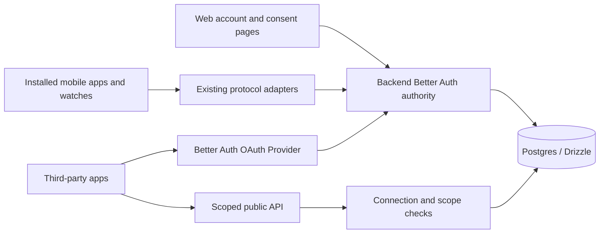

# Better Auth migration: backend-owned identity without disrupting installed clients

Status: accepted direction, implementation gated on the proofs below. This is a
design and backlog, not a deployed authentication system. Updated 2026-10-27 in
[PR #6974](https://github.com/boardsesh/boardsesh/pull/6974).

The target is self-hosted **Better Auth with its OAuth Provider plugin**, running
inside `packages/backend`, with PostgreSQL and Drizzle schemas/migrations owned by
`packages/db`. Next.js remains a presentation client for account and consent
pages. React Native, Expo web, and Garmin keep their existing user experience.

The [integration platform](./integration-platform.md) owns third-party access,
and [partner-api.md](./partner-api.md) owns its public protocol. This document
owns first-party identity, credentials, compatibility, and the migration. The
[mobile auth flow](./mobile-auth-flow.md) and [OAuth setup guide](./oauth-setup.md)
describe the current system until implementation changes them.

## Decisions and completion criteria

| Decision | Required outcome |
| --- | --- |
| Backend owns authentication | One identity and credential policy serves web, native, watch, and partner consent; Next.js does not remain an independent authority |
| Keep the installed-client protocol | Existing native and watch endpoints remain supported through a long-lived backend adapter; removing NextAuth does not require removing those endpoints |
| Email identity is case insensitive | Trimming and changing capitalization always resolves to the same account; database uniqueness prevents concurrent duplicate registration |
| Preserve ordinary sessions | No migration-induced mass logout, password reset, or forced application update; security-sensitive operations and exceptional ambiguous accounts may require verified recovery |
| Separate delivery gates | First-party migration and partner OAuth/API launch have separate acceptance and release gates; this planning PR does not implement either |

The debt being removed is split ownership: web-owned recovery, duplicate sign-in
logic, backend decryption of NextAuth cookies, and native signing coupled to
`NEXTAUTH_SECRET`. NextAuth is already self-hosted. Changing its name without
centralizing these responsibilities would leave the debt in place.

## Current contracts to inventory

| Surface | Current behavior that matters |
| --- | --- |
| Web | NextAuth v4 JWT sessions in potentially chunked cookies; shared production cookie domain; Google/Apple/Facebook links; credentials login; stale-tab sign-out guarded by user ID and `authSessionId` |
| Native | Email registration/login and Google/Apple ID-token login in `handlers/native-auth.ts`; browser fallback transfer-token exchange; `{ jwt, refreshToken, expiresAt, userId }` responses and optional account-creation receipt |
| Access credentials | Seven-day HS256 JWT, issuer `boardsesh`, audience `boardsesh-mobile`, `sub = users.id`; backend also accepts NextAuth JWE cookies |
| Refresh credentials | Opaque random token stored as a SHA-256 hash; each successful rotation issues another 90-day token; active old clients never naturally stop using this protocol |
| Watch | Garmin pairing issues the same native token pair; the watch cannot adopt browser cookies just because the phone updates |
| Recovery | Web registration, verification, forgot/reset password, and set-password routes; issued email links must remain usable for their original validity period |
| Storage | Stable `users.id` throughout product data; bcrypt in `user_credentials`; provider subject links in `accounts`; nullable verification timestamp; emails currently lack uniqueness |
| Offline | Native keeps established local identity through network/keychain failures; only confirmed credential rejection triggers logout; credential generations prevent stale work resurrecting an account |

Inventory actual callers, domains, redirect URIs, response fields, error/status
semantics, headers, cookie variants, account-deletion paths, export jobs, widgets,
and HTTP/WebSocket authentication before adding a new handler. The table is a
starting point, not permission to remove an unlisted consumer. Keep current
Google/Apple/Facebook application registrations and subject mappings.

The code supports duplicate-by-case credential lookup. That is evidence of a
compatibility requirement, not a current production count. A read-only audit
must establish the actual collision groups and affected login methods without
putting emails, password hashes, or tokens in GitHub issues or logs.

## Target ownership

Better Auth owns identity, provider links, password policy, verification,
recovery, and canonical first-party session state. A backend compatibility
module translates existing request/response protocols and validates legacy
credentials against that same state. It must not grow a second registration,
password, or revocation policy. Any retained token family/lineage tables belong
to this authority and participate in its revocation transactions.

Third-party tokens are a separate security domain. They never pass through
first-party `validateToken`, never mint mobile credentials through a generic
exchange endpoint, and never acquire full GraphQL/WebSocket access. Separate
keys, purposes, audiences, and route guards are required even when both systems
use the same library and database.

Mount the new backend auth handler at `/api/auth`. Partner OAuth endpoints use
the provider's `/api/auth/oauth2/*` paths and published discovery metadata. The
old native/watch paths remain adapters. Web callback URLs and old recovery URLs
need forwarding or compatibility handlers during transition; do not change
provider registrations until both old in-flight callbacks and new callbacks
have a tested destination. Test cookie forwarding, origins, CSRF protection,
SSR, Expo web, and the existing native deep-link/browser fallback behavior.

## Identity and case-insensitive emails

Define one shared pure normalization function: trim surrounding whitespace and
lowercase the complete address. Do not strip plus suffixes, remove dots, or infer
provider aliases. Use the same rule for registration, credentials login,
forgot/reset password, verification/resend, email changes, and any allowed email
linking. Provider subjects remain the primary key for an existing social link.

The invariant is **one normalized email identity per account address**, enforced
by PostgreSQL, not a pre-insert application check. The spike must choose either a
normalized column with a unique constraint and enforced write normalization, or
an equivalent unique expression index compatible with Better Auth's lookups.
Every writer, including OAuth account creation and old web endpoints, must obey
it. Generate checked-in migrations with `vp exec drizzle-kit generate` from
`packages/db`; do not hand-write migration SQL or apply schema changes from a
library startup hook.

Resolve existing collisions before enabling the final unique invariant:

1. Audit exact duplicates, normalized collisions, whitespace variants, missing
   provider links, and verification states. Classify product data and credentials
   attached to each existing user ID.
2. Stop creating new collisions while cleanup runs. Route all account creation
   through the authoritative backend and use a database-enforced normalized-email
   reservation/serialization strategy that covers existing collision groups.
3. Produce an explicit resolution for each group. Prove ownership of accounts
   before linking or merging; do not select the first row, choose the oldest
   account, or treat possession of an unverified email as account ownership.
4. Preserve every tick, playlist, board, social relationship, provider link, and
   offline owner boundary. Any merge, data deletion, or reassignment requires a
   separately reviewed and approved resolution; this document authorizes none.
5. Validate the normalized unique constraint and exercise concurrent registration
   and OAuth races. The migration cannot be declared complete with ambiguous
   groups still hidden behind a permanent password-search workaround.

Unaffected accounts retain their existing `users.id`. If an approved collision
resolution changes an owner, specify the ID mapping, existing-session policy,
and offline-cache reconciliation explicitly; never silently redirect an old
session into another person's account. Ambiguous groups may need targeted
support. Preserve their authenticated access while resolving them where safe,
but do not issue reset links that choose an arbitrary account in the group.

New verification and recovery records bind to a **user ID, purpose, expiry, and
single-use secret**, with the intended address recorded where needed. Legacy
email-keyed links get an explicit safe resolution path for their remaining
lifetime; an ambiguous link must not reset whichever row happens to be first.
Address normalization must not invalidate an otherwise unambiguous issued link.

## Passwords and provider links

Import bcrypt hashes using a tested custom verifier; Better Auth's default
password hashing is scrypt. Preserve password bytes exactly. Do not rehash
stored hashes, require password resets, or alter Unicode handling as an incidental
migration step. Keep bcrypt writes during the rollback window unless every
remaining reader, including the rollback version, understands the new format.

Establish **one authoritative credential writer before copying credentials**.
Registration, password reset/change/set, provider linking/unlinking, verification,
email changes, and account deletion must use it. An additive backfill needs a
recorded cutover boundary and reconciliation so an older copied hash cannot
overwrite a concurrent reset. If temporary mirrored writes are necessary, they
must commit atomically in the same Postgres transaction; a best-effort hook or
background dual-write is insufficient. Prove the adapter transaction boundaries.

Better Auth's credential account and user/session schemas differ from ours.
Keep compatibility columns/tables while old readers exist, preserve verification
timestamps, and map their meaning to the library's boolean without marking
unverified accounts verified. Adding constraints or changing column types in
place is not a safe coexistence strategy. Backfills must be idempotent and
report count/mapping discrepancies before traffic moves.

Import social links by `(provider, provider subject)` against the existing user
ID, including Apple private-relay identities. Email matching alone is not an
import strategy. Retain established links even if a provider changes its email
claim. Configure account linking deliberately; do not weaken verification rules
to imitate `allowDangerousEmailAccountLinking`.

Test Google, Apple, and Facebook on the surfaces where they are currently
supported, including cancellation, native nonce/audience checks, existing links,
and browser fallback. Better Auth's ID-token sign-in rejects a missing email
before resolving a linked account in the reviewed version. Prove a supported
persisted-email mapping for that case. Apple's own documentation says email
normally remains in later identity tokens, so this is an edge-case test rather
than a claim that all returning Apple sign-ins fail.

## Session bridge and revocation

A valid old credential proves its established identity, not that its holder just
signed in. Bridge only after full signature/decryption, issuer/audience where
applicable, expiry, user-state, and revocation checks. Never trust a client-side
JWT decode as authorization.

Record a stable legacy identity/credential lineage, canonical session, original
expiry, migration time, and authentication age when known. Preserve trustworthy
age; when it is unknown, mark the migrated session non-fresh and require actual
reauthentication for sensitive actions. Better Auth uses `createdAt` for its
normal freshness test: creating a row with the current time must not upgrade an
old cookie's assurance. The spike must prove supported implementation of this
rule; disabling freshness checks is not an acceptable workaround.

Repeated exchange must be idempotent while the session is valid and fail after
revocation. Persist revocation tombstones for the entire remaining validity of
the legacy credential and its descendants. A legacy `authSessionId` can help
identify lineage, but not every historic token has one. When stable per-session
lineage cannot be recovered, use a documented account-wide cutoff or require
reauthentication; do not claim device-specific revocation that the old token
format cannot enforce. Credential `iat` on a renewed token is not proof of
recent password/provider authentication.

| Event | Required behavior during coexistence |
| --- | --- |
| Ordinary session migration | Preserve access and normal renewal without granting fresh-login privileges |
| Sign out / revoke a session | End the canonical session and all credentials linked to it; old cookies/JWTs cannot mint it again |
| Account recovery / compromised-account revocation | Invalidate all first-party credentials and exchange paths for that user, and end active third-party connections; enforce the same cutoff in every legacy validator |
| Ordinary first-party sign-out | Does not by itself end an explicitly approved offline partner connection |
| Connected Apps disconnect | End that app's connection, applicable token families, and pending workouts; preserve unrelated app connections |

Existing signed JWTs do not become revocable merely because new Better Auth
sessions are database-backed. Every first-party request validator and bridge
must consult canonical revocation state. Bound or invalidate caches across
instances, and specify what happens to an already-authenticated WebSocket after
revocation. Fail closed for online protected operations when revocation state
cannot be read; keep the app's offline local-state policy separate.

Use separate new signing/encryption secrets and purpose-specific legacy
verification keys. Stop old issuance before considering a legacy key retired.
Never retire keys on a guessed 90-day timer while active old clients are still
renewing credentials. New compatible JWTs may preserve their public claim shape
while being issued and revoked by the new authority; prove the key transition
against every backend instance and supported client.

## Native, watch, and browser compatibility

The compatibility API is an accepted long-lived product contract. It preserves
request paths, body/response fields, JWT subject/issuer/audience, refresh
rotation, status semantics, and watch pairing. The new authority can own those
credentials without making old installations understand Better Auth cookies.
Do not promise a fixed adapter retirement date. Retirement requires an explicit
client-support decision and evidence about active installations.

Preserve existing SecureStore keys through migration or provide a tested
transactional handoff. Keep refresh-before-access-token persistence, concurrent
refresh deduplication, and generation checks after asynchronous work. Exercise
logout/account-switch races, partial keychain writes, and interrupted migration.

Network failure, rate limiting, server unavailability, and transient storage
failure must not be collapsed into invalid credentials. Preserve downloaded
boards and pending offline mutations during those failures. A confirmed expired
or revoked credential follows the current account-isolation cleanup. Offline
local identity never permits an expired token to authorize a server request.

For web and Expo web, preserve HttpOnly credential handling, cookie chunk cleanup,
shared-domain transitions, SSR authentication, and stale-tab sign-out protection.
Never move browser tokens into AsyncStorage, localStorage, or IndexedDB. Test
cross-origin requests and cookies rather than assuming the native Expo plugin
implements the browser deployment contract.

## Proof gates before rollout

Use a pinned, mutually compatible Better Auth/core/provider/Drizzle/Expo package
set. The research reviewed Better Auth v1.7.14; that is evidence, not permission
to install an unbounded latest version or a claim that a Boardsesh prototype has
passed. Record the tested versions, schema output, and results in the spike.

| Gate | Evidence required |
| --- | --- |
| Identity | Existing IDs, bcrypt credentials, verification state, provider subjects, and normalized email collisions handled; parallel account creation cannot duplicate an identity |
| Lifecycle | All credential writers use one authority; outstanding recovery links survive safely; concurrent reset/backfill/link operations cannot restore old state |
| Session security | Old web/native credentials migrate without becoming fresh; revoke/reset blocks replay through every path; cache and WebSocket behavior proven across two backend instances |
| Installed clients | Existing mobile, watch, web, and Expo web flows work; offline/partial-write/account-switch tests preserve owner isolation and pending work |
| Partner authorization | PKCE S256, exact callbacks, opaque scoped tokens, code/refresh single-use races, replay handling, and whole-connection disconnect pass independently of first-party session tests |

The provider must not require a private fork or an alternate credential authority
to meet these invariants. If a proof fails, record the missing supported hook or
semantic guarantee and revisit the design before rollout. Keeping current auth
temporarily is a possible delivery decision, not an automatic fallback silently
installed alongside Better Auth.

## Rollout, rollback, and retirement

Start with additive schema and a read-only inventory, then route lifecycle writes
through one authority. Rehearse import/backfill and compatibility in an isolated
environment before moving selected test accounts. Increase migration cohorts
only after checking login/refresh/recovery success, bridge failures, owner
mismatches, and latency against the old path. Logs contain reason codes and
internal correlation identifiers, never passwords, cookies, tokens, or raw email.

Set numerical stop thresholds from a measured baseline in the rollout issue,
including zero tolerated account-owner mismatches or accepted revoked credentials.
Have an operator-owned switch to stop new migrations without breaking already
migrated sessions or letting old writers resume independently.

Rollback means returning traffic to a compatible application version while
preserving the current authoritative credential state. It does not mean restoring
a stale database snapshot. Rehearse rollback after registration, password reset,
email change, provider linking/unlinking, session revocation, and partner disconnect.
Old passwords and revoked tokens must remain invalid; newly registered users
must still sign in. Retain additive schema and the compatibility authority until
that rollback window is deliberately closed.

Retire NextAuth issuance, callbacks, server/client APIs, adapters, and dependency
only when callers have moved and in-flight browser/recovery flows are covered.
Retire legacy verification separately, with measured issuance/usage and bounded
credential validity. Keep old native/watch endpoint adapters under the agreed
support policy. Update current-operation guides as each stage ships; do not
describe the target as current behavior prematurely.

## Implementation backlog

The linked epic and child issues below are the implementation source of truth.
This PR documents and creates that work; merging it does not complete the epic.

Epic: [#6975: Epic: migrate to one self-hosted Better Auth authority without user disruption](https://github.com/boardsesh/boardsesh/issues/6975).

| Work | Issue | Depends on |
| --- | --- | --- |
| BA-01: auth: prove Better Auth migration and OAuth Provider compatibility | [#6976](https://github.com/boardsesh/boardsesh/issues/6976) | — |
| BA-03: auth: centralize existing credential writes and recovery before migration | [#6977](https://github.com/boardsesh/boardsesh/issues/6977) | [#6976](https://github.com/boardsesh/boardsesh/issues/6976) |
| BA-02: Normalize account emails and add a case-insensitive unique index | [#4847](https://github.com/boardsesh/boardsesh/issues/4847) | [#6976](https://github.com/boardsesh/boardsesh/issues/6976), [#6977](https://github.com/boardsesh/boardsesh/issues/6977) |
| BA-04: auth: migrate identity authority and bridge legacy session lineage | [#6978](https://github.com/boardsesh/boardsesh/issues/6978) | [#6976](https://github.com/boardsesh/boardsesh/issues/6976), [#4847](https://github.com/boardsesh/boardsesh/issues/4847), [#6977](https://github.com/boardsesh/boardsesh/issues/6977) |
| BA-05: auth: migrate web and Expo web without changing account behavior | [#6979](https://github.com/boardsesh/boardsesh/issues/6979) | [#6977](https://github.com/boardsesh/boardsesh/issues/6977), [#6978](https://github.com/boardsesh/boardsesh/issues/6978) |
| BA-06: auth: preserve native and Garmin clients through the compatibility facade | [#6980](https://github.com/boardsesh/boardsesh/issues/6980) | [#6977](https://github.com/boardsesh/boardsesh/issues/6977), [#6978](https://github.com/boardsesh/boardsesh/issues/6978) |
| BA-07: auth: add isolated partner OAuth with explicit token lifecycles | [#6981](https://github.com/boardsesh/boardsesh/issues/6981) | [#6976](https://github.com/boardsesh/boardsesh/issues/6976), [#6977](https://github.com/boardsesh/boardsesh/issues/6977), [#6978](https://github.com/boardsesh/boardsesh/issues/6978) |
| BA-08: integrations: connect developer registration, consent, and Disconnect to OAuth | [#6982](https://github.com/boardsesh/boardsesh/issues/6982) | [#6979](https://github.com/boardsesh/boardsesh/issues/6979), [#6981](https://github.com/boardsesh/boardsesh/issues/6981) |
| BA-09: auth: validate and roll out the migration with mutation-safe rollback | [#6983](https://github.com/boardsesh/boardsesh/issues/6983) | [#6979](https://github.com/boardsesh/boardsesh/issues/6979), [#6980](https://github.com/boardsesh/boardsesh/issues/6980) |
| BA-10: auth: retire NextAuth while retaining supported compatibility contracts | [#6984](https://github.com/boardsesh/boardsesh/issues/6984) | [#6983](https://github.com/boardsesh/boardsesh/issues/6983) |

The first sequence is prototype → centralize current-store writers → resolve
email collisions and enforce uniqueness → import into Better Auth and bridge
sessions. Web and native/watch adoption then proceed independently. Partner
authorization has its own readiness gate. BA identifiers are stable tracking
labels; the dependency column determines execution order.

The email work reuses #4847 rather than creating a duplicate. Its original
2026-08-28 measurements remain historical context; a fresh audit is required.

## Research references

| Source | What it establishes |
| --- | --- |
| [Auth.js migration guide](https://better-auth.com/docs/guides/next-auth-migration-guide) | Schema and client/API migration; not a turnkey import of existing NextAuth sessions |
| [Drizzle adapter](https://better-auth.com/docs/adapters/drizzle) and [database model](https://better-auth.com/docs/concepts/database) | PostgreSQL/Drizzle integration and model mapping; our repository still owns migrations |
| [Password configuration](https://better-auth.com/docs/authentication/email-password#configuration) | Default scrypt, configurable hash verification, credential-account storage |
| [Session management](https://better-auth.com/docs/concepts/session-management) | Creation-time freshness and revocation/cache behavior that the bridge must respect |
| [Expo integration](https://better-auth.com/docs/integrations/expo) | Native integration support; not proof of Boardsesh offline/storage semantics |
| [Apple setup](https://better-auth.com/docs/authentication/apple) and [Apple's identity guidance](https://developer.apple.com/documentation/signinwithapple/authenticating-users-with-sign-in-with-apple) | Native audiences and the distinction between first-response profile fields and later ID-token email claims |
| [OAuth Provider](https://better-auth.com/docs/plugins/oauth-provider) | Custom scopes, PKCE, offline access, token revocation, consent deletion, and immediate secret rotation; product connection policy remains integration work |

Better Auth is selected for its Node/TypeScript/Postgres fit and ability to
consolidate first-party authentication and third-party authorization. Ory
Kratos/Hydra remains a viable service-based alternative with more operational
components; keeping current auth plus a maintained OAuth server avoids an
immediate identity migration but leaves ownership split. Neither alternative
removes the email cleanup, session compatibility, or rollback obligations above.
