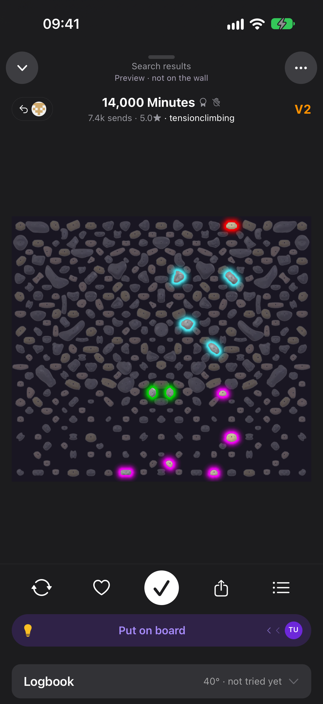
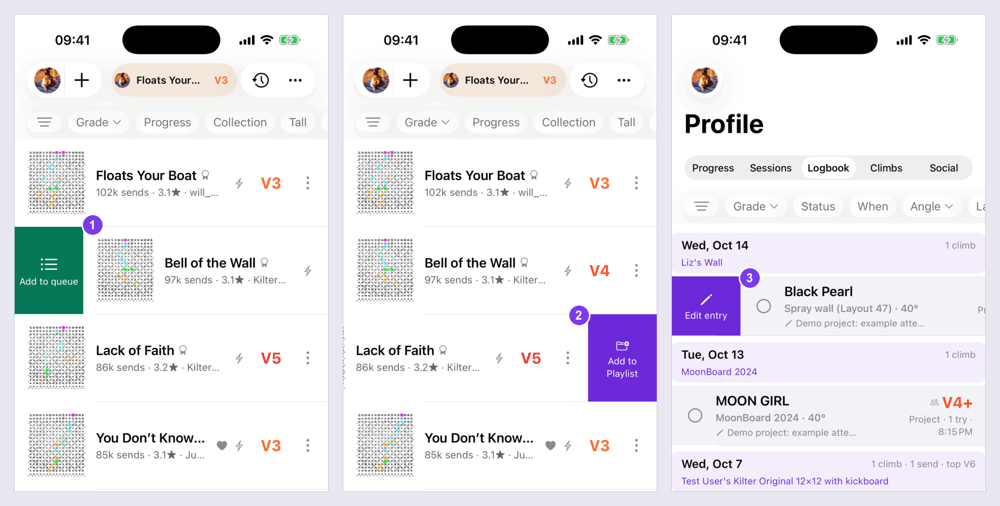
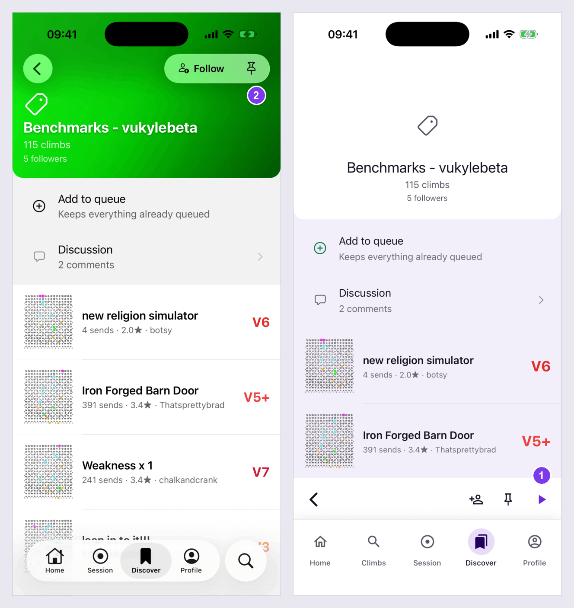
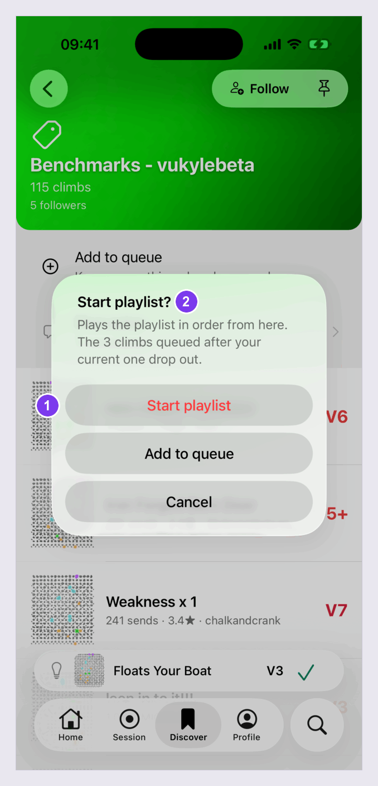
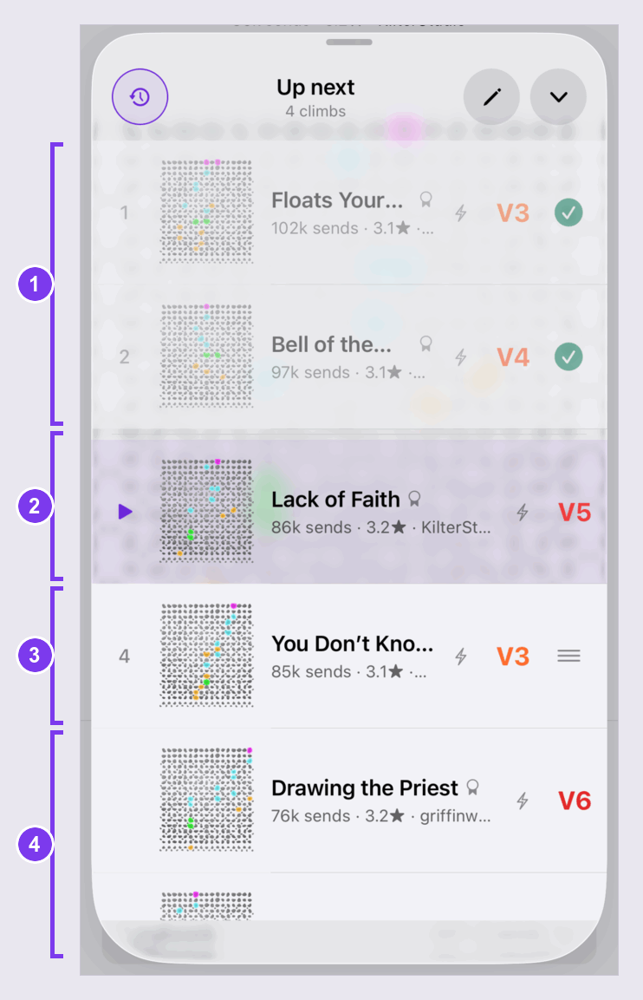
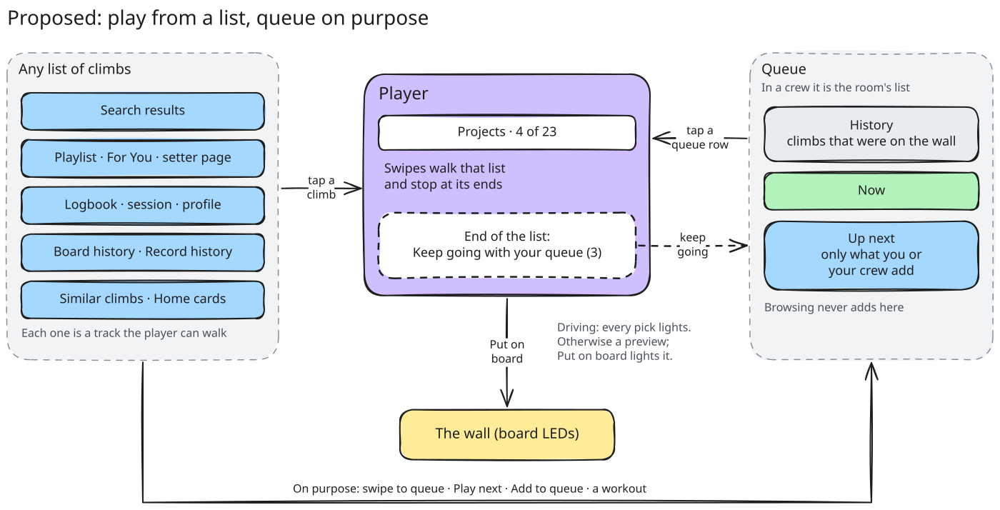

# Climb lists, the player and the queue

How every list of climbs in the mobile app behaves today, where those lists disagree with
each other, and the one model we are moving to. Issue #6230, part of the climbing-experience
epic #6238.

This page started as documentation only. The changes are the follow-ups at the bottom
(F1 to F6), filed on 2026-10-23.

The original audit's code references are to `main` at `1f9bc776a3` (2026-10-18).
The driving, player-state and MiniPlayer sections reflect `main` at `38eecfa2f0` (2026-11-02, #7188);
the then-signposts section reflects `main` at `9ddde8073a` (2026-11-02).
Mobile paths are under `packages/mobile/`, shared paths under `packages/shared/`.
Line numbers drift; the function names next to them don't.

## Why this exists

> "I still get lost all the time and the pattern of queue vs playlist vs search list etc seems
> inconsistent." (@brownbeagle, Discord)

Three in-app bug reports say the same thing in their own words:

- #3841 (app 2.2.2, 2026-07-22): "Most times I swipe left and right hoping to access the next
  climb in a playlist or in a search, but end up with whatever random climb in my queue is
  there. I think the queue should be the button like in Spotify."
- #4979 (app 2.3.1, 2026-09-01): "Is there a way to just select a climb without starting a
  playlist/adding to queue? ... whenever I connect the board automatically displays a climb
  that I did multiple sessions ago."
- #5924 (app 2.5.0, 2026-10-01): "When swiping down a climb in a playlist it returns to the
  all playlists page instead of the playlist you were on."

And after this page went up, a climber answered the Discord check below (2026-10-23):

> "The playlist is more of a conceptual misalignment for me. When I'm on a list view and I select
> a climb I always think swipe left/right is relative to that list I just came from."

That is rules 1 and 2 of the model, so the follow-ups are now filed.

Three fixes have already shipped against this, and the model below builds on them:

- #4829 (closed 2026-09-06): swipes in the player walk the list you opened the climb from,
  not the queue.
- #4281 (closed 2026-08-23): in a crew, looking at a climb opens a preview with a
  back chip and a **Put on board** button instead of taking the wall. Its
  `shared-session-browse` flag is active at 100% (verified 2026-10-31); driving
  explicitly overrides crew previews (#7113).
- #4731 (merged 2026-10-04): a playlist can be added to the queue without clearing it.

What is left is that each list still decides on its own what a tap means, and the queue
still collects climbs nobody chose to queue.

## Words we use

The current player uses the wall button and a back chip; the older pill names
remain internal state names for screen-reader announcements.

| Word                         | Meaning                                                                                                                        | In code                                              |
| ---------------------------- | ------------------------------------------------------------------------------------------------------------------------------ | ---------------------------------------------------- |
| List                         | Any screen that shows climbs in rows: search results, a playlist, your logbook, a session, the queue.                          | —                                                    |
| Track, shown in the top bar  | The list the player is walking. The player's top bar, between ⌄ and ⋯, names it: "Projects · 4 of 23" (the count only when it is known to be right). While a queued climb plays in the middle of it, the top bar says "Up next · 1 of 3" instead (#6777), with "· then Projects" while the list carries on after Up next (the then-signposts, below). A long name is cut at its end; the count never is. F1 first put it on the header's stats line, where it pushed the sends and stars off the end. | `playlistSuggestionSource`, `resolveTrackLabel`      |
| Queue                        | Your climbs in order: **History** (climbs before the current one), **Now** (the current climb), **Up next**. In a crew, the room's queue. | `queue`, `currentClimbQueueItem`                     |
| Preview                      | The player shows a climb without making it current.                                                                             | `previewQueueItem`                                   |
| Browsing (back chip)         | A preview whose swipes are guaranteed not to touch the wall.                                                                    | `WallPillState 'browsing'`                           |
| Live (internal status)      | Your next swipe changes the climb on the wall. No separate Live pill is drawn.                                                   | `WallPillState 'live'`                               |
| On the wall (internal status) | The climb on screen is the one lit on the board. No status pill is drawn. The back chip shows the wall lighter's face when back goes to the wall's climb, and its screen-reader label says "Back to the climb on the wall". | `WallPillState 'onWall'`                             |
| Put on board / Set active    | The commit button under a preview (#7113 relabelled Put on the wall). It says Set active on a board with no lights, or when nothing can be lit. | `CommitButtonLabel`, `wall-state.ts:166`             |
| Crew                         | A party session with at least one other person connected. A newly arrived peer counts after 3 s, and a peer whose phone drops stays counted while reconnecting. With `shared-session-browse` active at 100%, ordinary crew browsing previews; driving explicitly overrides it. | `shouldDefaultToBrowse`, `SHARED_SESSION_DWELL_MS`, `queue-provider.tsx` |

The lighting setting, in Settings › Board, is **Always drive the wall** (`alwaysDrive`),
default **off**. It replaced the two switches **Light the board when I tap a climb**
(`lightOnClimbTap`) and **Light the board as I swipe** (`lightOnSwipe`) in 2026-11: a climber
who had either on gets Always drive the wall on, once (`migrateLightAutomatically` in
`settings/migrations.ts`), and the old keys stay on disk for an older bundle. With it off,
selecting a climb opens a preview without committing it or lighting the wall, including
playlist **Play** and queue rows. Tap the board button (**Put on board**) to light that
climb: from 2.7 it also starts a timed drive, so every climb you pick lights until 45 s after
the last lit one (renewed by each of your own; **Stop driving after** in Settings: Right away,
30 s, 45 s, 1, 2 or 5 min, or Until I stop; in a crew only on the phone that holds the board,
with **In a session too** on, and a crewmate's put-up ends it; Put on board from any other
phone lights that one climb). Only Put on board's drive is timed: a swipe or **Light every
climb** drives until you tap the button. With **Disconnect Bluetooth when driving ends** on
(off by default; it replaced auto-disconnect in 2.7) the phone lets go of the board when you
stop driving, turn off all lights during a drive, the time runs out or a crewmate's put-up
ends a timed drive, without forgetting it, so the next Put on board reconnects. While
driving, a swipe from a preview of a queue slot puts up the slot's neighbour the peek shows.
Swipe the button, or use **Light every climb**, to drive with no end (`Driver mode` in code).
A MoonBoard follows the same Stop driving after and In a session too as every board (until
2026-11 it had its own choice, Until I stop by default, that applied in a crew too). The top bar's second line says "Preview · not on the wall" for a preview while this
phone holds the board, or while a climb lit in the last hour may still be on the wall.

**Always drive the wall** adds no lighting mode of its own: it keeps the phone driving. While it
is on and this phone's own Bluetooth link holds the board (never a relay, never a wall with no
lights), `DriveModeWatcher` keeps an open-ended drive on (`startAlwaysDrive`,
`startedBy: 'always'`), started live when the link comes up, when the switch turns on, or when
another drive ends with the link still up. It lights nothing as it starts: the wall shows
whatever connecting lit. From then on every pick lights, exactly as after a swipe on the wall
button. In a crew it drives only with **In a session too** on, on every board, MoonBoards
included (`alwaysDriveApplies` in `lib/keep-lighting.ts`), and never with the `wall-swipe-to-drive` flag off: that flag is driving's kill switch, so turned
off every pick is a preview (`docs/feature-flags.md`). A change of session or board, or a
sign-out, ends the drive and starts the next one at once with the link still up (signed out
too, as the two switches lit), so Drive Mode Ended / Started pair up per session, board and
account.
A tap on **You are driving the wall** stops it and keeps the link; it stays stopped until the
link drops, the climber's next Put on board (the wall control's `tapDrive: 'resume'`) or a flip
of the switch, and the switch never flips by itself. Disconnect Bluetooth when driving ends applies to that stop as to
any. Turning the switch off, or a crew forming with In a session too off, ends its drive keeping
the link (`always_off`). A Put on board timed drive running when the switch turns on goes
open-ended and becomes the switch's to end (`openedByAlways`): turning it off again ends that
drive too, rather than leaving one with no end. While it is on, Stop driving after and the
MoonBoard's choice don't apply: Settings › Board shows them greyed with that reason, and the
board sheet leaves its timer row out. A Lock Screen Next or Previous lights its climb and starts no drive of its own.
A playlist tap with **Tapping a playlist loads it into my queue** on depends on driving: outside
a drive, the list from the tapped climb becomes Up next, the wall keeps its climb and the tapped
climb opens as a preview; while driving (Always drive the wall's drive included), the tapped
climb lights, and solo the list replaces the queue (a crew's queue is never replaced: the
tapped climb plays from the list in the shared queue). A newcomer's first-connect confirmation and the
Climbs list's connect card read the same rule (`firstConnectAlwaysDrives`), so neither promises
that a pick lights a climb unless Always drive the wall drives there: otherwise the confirmation
names Put on board's drive length (or Until I stop) instead.
Changing the angle keeps a default preview and regrades it instead of restoring the
committed climb underneath it.

The retired switches were called "Light problems when tapping the list" and "Light problems on
swipe" until 2026-10-24. The lighting group also contains **Tapping a playlist loads it into my
queue** (`playlistTapLoadsQueue`), default off. Outside a drive it still leaves the wall alone:
a row tap or header Play makes the list from the tapped climb on the new Up next (the climbs
listed before it are left out), keeps History and the climb on the wall, and opens the tapped
climb's Up next slot as a preview. Put on board plays it with the list as its track. "Start
playlist?" asks first when Up next has climbs, and again if climbs were queued while the list
loaded. When the tapped climb is the one already up, no copy is queued: the list after it
becomes Up next and the player reopens it as it is (`loadIntoUpNextKeepingWall` in
`use-playlist-activation.ts`). In a crew the tap is still a preview and the crew's queue is not
touched.

## Today, surface by surface

Three terms keep the tables short.

| Term | Meaning | Code |
| --- | --- | --- |
| Commit | A new queue entry for the climb is inserted right after the current climb and becomes current, even if that climb is already queued further on. Only three taps reuse an existing entry: re-tapping the current climb, a queue-sheet row, and a board-history row whose climb has a queue entry. | `setCurrentClimb`, `src/providers/queue-provider.tsx:2068`; the reducer skips the insert only for the same entry uuid (`packages/shared/queue/src/reducer.ts:289`), and every list tap mints one (`src/lib/climb-to-queue-item.ts:106`) |
| Trackless preview | The player shows the climb without committing it and has no list to walk. The climb is not in the queue, so swiping and the Next and Previous buttons are disabled. | `packages/shared/play-view/src/queue-navigation.ts:269-270`, `canNext` at `:449` |
| Track end | Since F1 (#6664): at the last climb of the list it is walking, Next or one more forward swipe opens an end card, "Keep going with your queue (N)", N being Up next. Since #6777 Next plays Up next before the list goes on, so the card only comes up once Up next is played too; what N counts then is what the walk passed over, such as queued climbs this wall can't draw. From a committed climb its action goes to the next queued climb (a preview of it when swipes are view-only), and the card names that climb on its own line, "First up: Crimp Ladder" (#6238; names past 32 characters end in an ellipsis, and a climb with no name leaves the line out); from a preview it goes back to the queue's Now and names nothing, since Now is not Up next (a preview over a queue with no Now has nowhere to go back to, so it opens the queue's first climb, named). Up next is everything after Now, or with nothing current everything from the History line on (the whole queue in legacy mode), the same count as the queue sheet's header. From a preview the card reads "Back to your queue (N)" with "On the wall: modern love" under it, naming Now, or "Your climb: modern love" when the wall doesn't show it (the then-signposts; it read "Keep going with your queue", which promised a step forward the button doesn't take). With nothing Up next the card says the list is finished. Previous stops at the list's first climb. While more of the list is still loading (the next page, or the load that follows a tap) the card waits and Next stays off until it lands. Rest-timer auto-advance stops here too, with "End of the list" on its pill. Before F1, a committed climb fell into the queue here and a preview stopped dead. While a list is walked (the header names it), the player's queue button carries a badge with the same Up next count, and its label says "Queue, N climbs up next", at 0 too; at 0 there is no badge, and playing from the queue the button has no badge and keeps its plain label (#6238). | `selectNextQueueItemWithSuggestions` (`atTrackEnd`), `resolveTrackEndCard`, `countUpNext`, `resolveListWalkUpNextBadge`, `TrackEndCard.tsx` |

**The crew column has two halves.** Everything that makes a tap a private look in a crew
(#4281) sits behind the PostHog flag `shared-session-browse`
(`src/providers/feature-flags-provider.tsx`). At the original audit on 2026-10-18 it was
inactive at 0%; the off column retains that legacy fallback. It is now active at 100%
(verified 2026-10-31), so ordinary crew taps and swipes preview. The separate driving
column describes the explicit override that lights every supported climb change.

### What a row tap does

The commit behavior below applies when automatic lighting is opted in or Driver mode is
live. Untouched settings take each surface's preview path instead.

| Surface | How you get there | Tap (solo) | Next after the tap | End of the list |
| --- | --- | --- | --- | --- |
| Search results | Climbs tab | Commits, flagged `suggested`, with the results as the track (`app/(tabs)/climbs/index.tsx:1302-1329`). Since F2, outside a drive: a preview with the results as its track (`src/lib/playlists/use-playlist-activation.ts:1350`). | Walks the results | Track end. The first load holds about 250 climbs after the tapped one (rounded up to a page of 100); since F1 one more page loads as the climber nears its end, up to the first 1,000 results. |
| Setter page | For You setter card, the setter's name in the player, Home's "See all" | Since F4: commits, flagged `suggested`, with the setter's climbs as the track, named after the setter, and leaves the rest of the queue alone (`src/components/SetterPlaylistScreen.tsx`, behind both setter routes). Outside a drive: a preview with the same track. With the playlist switch on outside a drive (the default): loads Up next from the tapped climb and keeps the wall's climb (see the lighting settings under [Words we use](#words-we-use)). With the playlist switch on while driving: replaces the queue with the setter's climbs this board can draw, after "Start playlist?" if anything is queued after the current climb; there, Cancel previews the tapped climb and Play last appends the list and plays the tapped climb next, keeping everything already queued and queuing the tapped climb once. That climb plays from the queue, with no track: the list now sits behind what was queued, so a swipe walks what was queued and then the list, and never queues a second copy of a list climb. The same holds when the prompt comes up a second time, because climbs were queued while the list loaded. A replace longer than the 500-climb queue cap queues the tapped climb, the climbs after it and, near the end, the ones before it, 500 in all, and a toast says how many fit (#6673). | Walks the list, under the setter's name | Track end |
| Playlist | Discover › a playlist | As the setter page (`usePlaylistActivation` in `app/(tabs)/discover/[playlist_uuid].tsx`). The header's **Play** button (both looks since F4) does the same with the first climb, and follows the same drive rule. The **Play next** and **Play last** rows put the whole list at the top or the bottom of Up next, in list order, with or without the switch (#6772). With a sort or filter on, all of them use the sorted, filtered list on screen (see [Sorting and filtering a playlist](#sorting-and-filtering-a-playlist)). | As the setter page | As the setter page |
| For You and smart lists (Projects, Liked Climbs and the rest) | Discover › For You | As the setter page (`app/(tabs)/discover/smart/[type].tsx:119-128`) | As the setter page | As the setter page |
| Logbook | You › Logbook, someone's logbook | Since F2: commits, flagged `suggested`, with the logbook's rows as the track, named "Logbook" (`src/components/you/LogbookTab.tsx:574`, through `src/lib/playlists/use-tick-list-activation.ts`). A tick on another board model opens as a preview on its own board. The tapped tick is drawn at the size and angle it was climbed at. Outside a drive: a preview with the same track. | Walks the rows on screen, in their order (one entry per climb) | Track end. The track pages on through the logbook's own feed as the climber nears its end, from the first climb not yet in the track and at most 5 of the feed's pages per request, so a logbook of repeats is never loaded in one go (`src/lib/playlists/loaded-list-pages.ts`). |
| Session detail | Home session card, You › Sessions | As the logbook, named "Session climbs" (`src/components/session/SessionDetailScreen.tsx:91`) | Walks the session's ticks | Track end |
| Profile climbs | You › Climbs, someone's profile | As the logbook, named "Created climbs" (`src/components/you/ProfileClimbsTab.tsx:98`, `src/lib/playlists/use-board-list-activation.ts`) | Walks the list | Track end, paging on through the same feed |
| Home cards | Home tab | New-climb card: a trackless preview (`src/components/feed/NewClimbFeedCard.tsx:111`). A session card's climb (the hardest send): as the logbook, with a one-climb track named "Hardest send" (`app/(tabs)/home/index.tsx:253`; the Sessions tab's cards the same, `src/components/you/SessionsTab.tsx:106`). | New-climb card: nothing. Session card: the end card. | — |
| Board history sheet, iPad wall column | The clock button on Climbs, the wall strip, the iPad side column | Since F2: commits with the wall's history as the track (the wall's climb first, then back through what was lit), named "Wall history", reusing the queue entry when the wall's climb has one (`src/providers/drawer-host-provider.tsx:1070`; the track is built in `src/components/board-presence/NowOnTheWallPanel.tsx:539`). Outside a drive: a preview with the same track. | Walks the history the sheet had loaded | Track end. It does not page past what the sheet loaded. |
| Record in-session history | Record tab during a session | Since F2: as the session detail, through the same hook (`src/components/session-screen/in-session/InSessionView.tsx:435`). It no longer commits the climb itself with a fresh queue entry. | Walks the session's ticks, newest first | Track end |
| Queue sheet | The queue button in the player, the mini-player | Previews the exact queue slot by default, deferring the current-climb change and track clear until the board button is pressed. A Then from row's preview keeps its list as the track, re-entered at that climb; a popular row's keeps the popular rows. An automatic-lighting opt-in or live Driver mode commits immediately. A pick of the climb already up never previews, because the commit bar compares climbs and its preview would have no Put on board: a History, Up next, Then from or popular copy commits at once solo with no #4979 hold (the wall keeps its climb, or a copy in the other orientation lights it that way); the Now slot itself, a crew, or a held climb reopens the climb up instead, writing nothing and lighting nothing. A History row's Replay from here follows the same rule (`resolveQueuePickLanding`). | The queue, or the list a Then from or popular row started (the sheet's Then from rows are that walk) | Stops at the end of the queue |
| Similar climbs | The strip under the board in the player | Since F2: commits, flagged `suggested`, inserted after the current climb, with the strip as the track, named "Similar climbs" (`use-play-selection-controller.ts:373`). The strip is the climbs this wall fits, plus the one tapped. A preview with the same track outside a drive, or when the player shows a climb from another board. | Walks the strip | Track end |
| Workout preview | Record tab before a session, workout on | A trackless preview (`src/components/session-screen/pre-session/PreSessionView.tsx:245-251`). **Start** appends the workout behind the queue (`:301`). | Nothing | — |
| Wall display kiosk | Wall display on a tablet bound to a board | No rows. Older and Newer step through the wall's own history locally; **Light this** lights the board without touching the queue (`src/components/board-presence/wall-kiosk/useWallPreview.ts:345-357`). | The wall's history | Returns to live |

Since #6777, every "Walks …" in the Next column plays Up next first: the queue after the
climb on the wall, Play next climbs at the top of it, then Play last ones. The list picks up
again after the last list climb played, and its end card comes once both are done (rule 2).
Play next on a climb walked from a list, one History holds, makes it Up next like any other:
the queue entry loses the walk's `suggested` flag, which would otherwise read it as part of
the list and swipes would walk past it (#7247). The move is the usual reorder; the flag goes
in a second write for that one entry, so a crewmate's changes in the same moment stand.
A preview opened from a list walks only that list. A look off the climb on the wall, a swipe
outside a drive, plays Up next and then the list, as Next does (#7227).

### Crew, swipes and long-press

Long-press and the list/player ellipsis share grouped core actions. On the main iOS climb
list, holding a row or tapping its ellipsis opens the same lifted row and menu above the
dimmed list. Other surfaces keep their native menus. Logbook Edit entry and player controls
stay contextual; the player omits actions already shown as buttons. Menu descriptors stay
bound to the climb and exact queue slot. No menu offers Preview: a list tap already opens one.
The old enlarged-board reaction overlay is removed.

| Surface | Legacy fallback (browse flag off) | In a crew (browse flag on) | Driving the wall (#7113), crew or solo | Row swipes | Long-press |
| --- | --- | --- | --- | --- | --- |
| Search results | Commits for the whole room while driving; outside a drive, a preview with the results as the track | Preview with the loaded rows as the track, paging on past them | Commits and lights it | Right: Play next (top of Up next, #6772). Left: add to playlist. | Climb menu, plus a ⋮ button (the only list with one) |
| Setter page, playlist, For You | Commits for the whole room (F4) while driving; outside a drive, a preview. With the playlist switch on, replaces the whole room's queue | Preview with the loaded rows as the track; Next stops at the last loaded row | Commits and lights it. In a crew the playlist switch never replaces the room's queue: the tap plays from the list | As search; rows the board can't show still swipe | Climb menu |
| Logbook | Commits for the whole room | Preview with the logbook as the track (F2) | Commits and lights it; a tick on another board model stays a preview | Right: edit the tick. Left: delete it. Your own ticks only. | Climb menu, plus Edit |
| Session detail, profile climbs, Home session card | Commits for the whole room | Preview with that list as the track (F2) | Commits and lights it | None | Climb menu |
| Home new-climb card | Trackless preview | Trackless preview | Trackless preview | None | None |
| Board history sheet, iPad wall column | Commits for the whole room | Preview with the wall's history as the track (F2) | Commits and lights it | As search | Climb menu |
| Record in-session history | Commits for the whole room | Preview with the session's ticks as the track (F2) | Commits and lights it | None | Climb menu |
| Queue sheet | Preview by default; commits with automatic lighting opted in | Preview of the exact queue slot; a pick of the climb already up reopens it and never writes the crew's queue | Commits and lights it | Left only: delete | Native climb menu |
| Similar climbs | Commits for the whole room, after the current climb (F2) | Preview with the strip as the track (F2) | Commits and lights it; from a climb on another board, a preview | None | None |
| Workout preview | No session yet | No session yet | Trackless preview | None | None |
| Wall display kiosk | Lights the board; the room's current climb doesn't move | Same | Same | None | None |

### Driving the wall (#7113)

A swipe on the player's wall button (or its screen-reader action, "Light every climb")
connects the board if needed, puts the climb on screen up, lights it, and starts **driving
the wall**: from then on every change of climb lights it straight away, in a crew too.
Outside a drive every change of climb is a preview. Every entry point reads that one rule:
the player's swipes, Next and Previous (`getSwipeNavigationTarget` in
`play-drawer-navigation.ts`), the end card's Keep going, similar climbs, a fresh open (a
notification, a deep link), the MiniPlayer's ⏮ ⏭ (`useDrivingWall`), and every list tap
(`isDrivingWall`, at the tap). Always drive the wall is a drive like any other (above).

- **What stays a preview.** A climb from another board model (a wrong-board tick or
  playlist row, a similar climb from a climb on another board): the wall this phone drives
  can't light it. The trackless previews (Home's new-climb card, a deep link, the workout
  preview) stay as they are. A swipe from a preview that walks a list
  commits the next climb on that list, with the list as its track.
- **The crew's browse latch** is ignored while driving and comes back when driving ends if
  a crew is still there. The browse chrome ("Only you see this", the back chip) only shows
  for what is still a preview, and `Queue Navigation` carries `driving: true` with the
  outcome that happened.
- **A crewmate puts a climb up.** This phone's auto-sender lights it like any current climb,
  the player follows (it shows the current climb), and driving goes on. The top bar's second
  line says "Your crew put up Crimp Ladder" for 4 s, with a light buzz and one screen-reader
  announcement. It names nobody: the queue item says who added the climb, not who put it up,
  and the event doesn't say who moved the wall. A crewmate's move that the driver's own swipe
  overtakes is never said. The driver never sees the busy-wall question; crewmates still do.
- **Going live and counting.** The drive goes live at the first wall confirm on this phone's
  link (the auto-sender's write, read off the wall-confirm bus at the app root, so closing the
  player mid-connect still goes live). `climbsLit` counts each new climb confirmed while
  driving, the swipe's own first. A step along a list is placed as Next places one: a fresh
  copy at the Now slot, never a climb pulled out of History.
- **The MiniPlayer's bulb** takes the wall button's live fill while driving, so a driver on
  the Climbs tab knows a tap lights the wall (`resolveWallBulbLook` says `driving`). During
  Put on board's timed drive it is the amber bulb in an amber ring that drains to the
  drive's end instead, as on the Live Activity (`BulbDriveCue`).
- **Stopping it.** Press **You are driving the wall** to stop and keep the link, or tap any
  lightbulb (the MiniPlayer's, the player's, the toolbar's, the header pill), which stops it
  the same way (owner, 2026-11-03: "Yes, every bulb") and never hangs up while a drive runs. With the
  default settings, later taps and swipes preview. A board-button tap (Put on board) lights
  that climb and opens the keep-lighting window (`startedBy: 'tap'`: 45 s by default, renewed
  by each lit climb), on a MoonBoard too; Until I stop starts an open-ended drive instead. With Always drive the wall
  on, that tap drops the stop and its open-ended drive comes back (`tapDrive: 'resume'`). The
  settings themselves never flip.
- **A crew forms while you drive** (Marco, 2026-10-30: keep driving). A live drive, whatever
  started it (a swipe, Put on board under Until I stop, the accessible action or Always drive the wall), goes on
  into the crew in the same session, so "You are driving the wall" stays and swipes, Next, list
  taps and the MiniPlayer keep lighting. The one exception is Always drive the wall's drive with In
  a session too off (on every board, MoonBoards included): it ends keeping the link (`always_off`), and comes back
  when the crew leaves. After a stop, or with no link, nothing drives and the crew's previews
  rule. (Until 2026-11 solo driving by Light the board as I swipe alone turned into a live drive
  as the crew formed, `startedBy: 'solo_carry'`.) "Forms" is the
  roster's crew (`useIsCrewSession`) turning true after a newcomer's 3 s arrival dwell; until
  then the climber is solo. Joining a different session still ends a drive (`session_changed`).
- **Ending it.** A drive also ends when the link drops, the swipe's climb can't go up, its
  connect fails or never comes (30 s), the session or the board changes, or the climber signs
  out (`DriveModeWatcher`). A tap on the frosted button or Turn off all lights during a drive
  ends it as `stopped`. Put on board's timed drive also ends as `window_ended` when its time
  runs out, when a crewmate's put-up ends it, or when Settings › Board turns its choice to Right
  away (or In a session too off as a crew forms). Always drive the wall's drive (and a timed drive
  it opened up) ends as `always_off` when the switch goes off, it stops applying in a crew, or the
  `wall-swipe-to-drive` flag goes off. Each end fires `Drive Mode Ended {reason,
  startedBy, durationSec, climbsLit, inSession, windowRenewals, windowSec, boardType}` once;
  `startedBy` is `swipe`, `tap`, `action`, `lock_screen` or `always` (`solo_carry` before 2026-11), `windowSec` is null for an
  open-ended drive, and `durationSec` stops at `expiresAt` for a window that ran out
  (`DriveModeExitReason` in `drive-mode-store.ts` lists every reason).
- **When the board lets go mid-drive** (board plan item 8). A link that drops on its own while
  a drive is on, or a wall with no lights another climber takes, is said once: a warning buzz,
  one screen-reader line, and a caption on the player's top bar for 10 s, beside the board art.
  It waits up to 5 s for board presence to say who has the board now, then says "Sam took the
  board" (anyone not anonymous is named, crewmate or not), "Another phone has the board" (an
  anonymous holder, or no name), or "Board disconnected · Put on board reconnects" when no one
  took it. Only a holder that changed during the drive counts, and never the climber's own
  account. "Changed" means presence's `lastHolderChangeSeq` moved past where it stood at the
  drive's start (or at the drop, when the holder could be this phone): a live holder push, or a
  catch-up that read a different holder. A catch-up that reads back the same holder (the app back
  in the foreground, a reconnect) moves `lastConnectionSeq` past every stats event it repaired but
  never this, so it never names anyone. A catch-up can't tell two anonymous holders apart, so an
  anonymous take it alone reveals is said as a plain drop. Nothing is said for a hang-up, a board
  switch or switching Bluetooth off mid-drive, a stop the climber made, a drop with nobody
  driving, or when the link comes back, a connect starts, a drive starts or the board changes
  before the wait ends. A Bluetooth stack reset (iOS `.resetting` or `.unknown`) is not the
  climber's doing and comes back on its own, so a drive it ends is said like any drop. The Bluetooth provider notes how each link ended
  (`lib/ble/link-end-store.ts`); `use-board-lets-go.ts` does the rest, and that end's
  `Drive Mode Ended` carries `takenBy` (`docs/growth-metrics.md`).
- **Not on a crewmate's board**, by design. Their phone holds it and Put on board relays the climb
  to it, so the swipe refuses there and nothing changes.

### The MiniPlayer shows your last pick (owner decision A, 2026-11-02)

Every tap opens a preview since 2.7, and the player is a modal route that unmounts when it
closes, so a preview used to vanish with it and the bar went back to the queue's current
climb. Now the MiniPlayer (the iOS 26 bottom accessory, the JS queue bar on Android and older
iOS, the tablet and Duo bar) keeps the climb you most recently opened, a preview included, or
the queue's current climb when **that** changes after it, whichever happened last. No extra
marking: the bulb says whether the climb is lit. The same rule holds solo and in a crew.

On an Android phone the MiniPlayer is a card floating 8dp above the nav bar. Scrolling a tab's
list down 24dp tucks the bar away and drops the card to 8dp above the gesture inset, controls
intact; scrolling up 24dp, reaching the top or changing tab brings the bar back. Never with
TalkBack on, the keyboard open, or on a pushed page (see `docs/ai-design-guidelines.md`, Android
phones hide the bar on scroll).

- **What counts as a pick.** Every open the player applies (a list row, a search result, a
  deep link, the wall capsule's climb), and every later change of what the player shows: a
  swipe to another preview, its mirror flip, a similar climb. Back to your climb and Put on board
  end the pick. A pane that mounts later and replays another pane's target is a look, never a
  new pick.
- **What ends it.** The queue's current changing after the pick: your own Put on board, a
  crewmate's put-up, the Lock Screen's or the notification's Next and Previous, the rest
  timer's auto-advance. Also a change of board, a sign-out or another account. The bar stops
  showing a pick made under another current climb at once (`resolveBarPick`);
  `LastPickWatcher` then drops it for good, so an Undo that brings the old current back does
  not bring the pick back.
- **Tapping the bar** reopens the pick as the same preview: its list, the slot's deferred
  commit (Replay from here, a History row), its mirror flip, the board it was opened on when
  that wasn't the active board (a logbook, session or profile row's own board and angle,
  `pickBoardOverride`), and the wall as it was when you started looking, so the busy-wall
  question still compares against that wall. That snapshot is for the open it came with: a
  later open of the same slot reads the wall afresh.
- **The bulb** (`resolvePickBulb`) on a pick that isn't lit is Put on board for it: the player
  opens on the pick and presses Put on board through the wall button's own handler
  (`putOnBoard`, `usePutOnBoardIntent`), so the busy-wall question asks first in a crew, the
  timed drive starts per Stop driving after, a pick on another board at this gym moves there
  (the bulb then says "Put on MoonBoard"), and a pick presence says is still up with no link
  lights again. Its hint says the player opens first, its value keeps saying the board's
  connection, and its long press opens the board controls over a real link, as the usual
  bulb's does. The pick counts as lit only when the wall shows it through a live link (this
  phone's, a crewmate's, or a wall with no lights held here); presence alone is not enough,
  because the usual bulb would then connect, and a connect lights the queue's current climb,
  not the pick (QA #147). Lit, it is the bar's usual bulb. A pick this wall can't light, with
  no board at the gym to walk to, gets no bulb, as the player offers no board control for it.
  In the collapsed platter the pick's bulb takes the one slot only while the pick is unlit on a
  board with lights, or while this phone's timed drive runs (its ring is the time left);
  otherwise ✓ keeps it. While its ring shows this phone's drive, a tap stops driving and keeps
  the link instead of putting the pick up, and it says "Stop driving" (owner, 2026-11-03).
- **✓** logs the climb the bar shows, in the flip the bar draws: the pick's own, never its
  queue slot's. **Mirror** flips the pick's own flip, never the queue.
- **⏮ ⏭** step from the pick along its own list by the player's swipe rules for a preview
  (`getSwipeNavigationTarget`), on the board the pick was opened on: a look opens the player on
  the neighbour as a preview with the pick's list and its place in Up next (#7227); a step
  that lights puts the neighbour up as the player's swipe does (`resolvePreviewStepCommit`),
  and the queue's new current takes the bar. A crew that just left keeps a step a look for the player's dwell too
  (`useSharedBrowseLatch`, 10 s). At the end of the pick's loaded list, Next opens the pick in
  the player, which pages the list or shows its end card.
- **Not the wall's surfaces.** The Lock Screen and Live Activity keep showing the wall's
  climb, as do the Climbs header's wall capsule and the board history sheet. The capsule
  shows the wall's climb even when it is the pick or the queue's current, for an hour after it
  was lit (or while a link says it's lit), until the climber hides it (owner decision,
  2026-11-02; `climb-view-options.md`, "The Climbs header's wall capsule").
- **In memory only**, like the player's own preview: a relaunch starts from the queue's
  current.
- **The one-time tip** above the bar (`AccessoryOnboardingTip`, `mobile.onboarding.tips.accessory`)
  says so: the bar keeps the last climb you opened, until your queue moves on to another climb.
  It used to say the bar is always what's on the board. "Until another one goes up on the
  board" was close but not exact: with no board linked, Lock Screen Next or the rest timer
  moves the queue without lighting anything, and a climb lit from another phone or app moves
  the wall but not the queue.
- **Known gap.** A pick made before the queue restores at cold start (a notification or a
  deep link) ends when the restore sets the queue's current, so the bar shows the restored
  climb. The queue has no public "restored" signal to tell a restore from a real change.

### The then-signposts (owner decision, 2026-11-02)

A climb you tap is a preview, and its swipes walk only its own list. Swipes from your own
climb play Up next first and then its list (#6777), so "Projects · 7 of 20" can mean two
different walks. About 4 in 5 active climbers never queue and never see the difference; the
21% who queue ran into it in 67% of their queued 2.6 sessions. The rule a climber can say:
**"Swipes walk the list named at the top. My Up next plays from my own climb, and the player
says *then* before a swipe switches."**

Every sign reads the walk's own steps: `resolveStepTrack` and `stepCrossesIntoList` read the
`trackResume` the step selectors (`selectNextQueueItemWithSuggestions` /
`selectPreviousQueueItemWithSuggestions`) return, and "then" reads `upNextHandsBackToList`,
the same `listSuccessorOf` value `selectNextOnTrack` steps to. A queued climb this wall can't
draw (#5099) is walked past by those rules, so it never makes a sign wrong. A parity test in
`queue-navigation.test.ts` walks forward from every Up next climb and checks "then" shows
exactly when the walk reaches the list.

| Where | What the climber sees | Rule |
| --- | --- | --- |
| Top bar, line 2, your own climb | "Up next first · 4 climbs" | Your committed climb sits on the list named above and Next steps into Up next. The count is the Up next the walk plays before the list goes on (`countUpNextBeforeList`), the total "Up next · 1 of 4" then reads. The busy-wall question and a crewmate's put-up keep priority. |
| Top bar, line 1, an Up next climb | "Up next · 2 of 4 · then Projects" | Every Up next climb whose list carries on after the stretch (a list still paging its next climb counts). The list's name is cut first when the line runs out of room; "Up next", the count and "then" never are. The room is measured in the frame the bar has now (beside the rest timer, at the climber's text size): with fewer than six letters of the name left, "then Projects" takes line 2 while it is free; with line 2 taken it stays as "then …" if that fits, and otherwise is only spoken, so the line never runs under ⌄ or the timer (`resolveThenPlacement`). |
| Top bar, line 2, a list preview | "Preview · Up next: 4 waiting" in place of "Preview · not on the wall" (or a crew's "Only you see this") | The first swipe in a preview opened on a list (not a look off your own climb, which walks Up next itself) while Up next has climbs. It stays until the next step, with no timer, and shows at most once per player open and 3 times per app run (`PREVIEW_NOTE_RUN_CAP`, in memory). Only a note that reached line 2 counts: one the busy wall or a crewmate's put-up kept off costs nothing. Up next here is what the queue sheet's header counts (`countUpNext`: after Now, or from the History line with nothing current), never History. Buttons, and a step that put a climb up while driving, don't earn it. A screen reader hears it as the board's value. |
| Under the thumb | One `hapticSelection` tick | Your own swipe (the board's screen-reader adjust action included) that leaves Up next for the list: the last Up next climb's Next, or the first one's Previous back onto the list climb it left. The Next and Previous buttons stay silent; heavy haptics stay reserved for destructive actions. |
| Screen readers | The board's value "Up next, 4 of 4, then Projects", or "Preview, Up next: 4 waiting" while the note shows; its increment action "Next in Projects" (decrement "Previous in Projects") on a step that crosses; on landing, "Now in Projects, 8 of 20" | The value rides an Up next climb, or the preview the note shows on. The landing is announced (queued, never cutting VoiceOver off) once the climb it went to is on screen, for a crossing by swipe or button; a step that lands anywhere else drops it. |
| MiniPlayer ⏮ ⏭ | Spoken only: "Next in Search results", "Next in your queue", or the plain "Next climb" | Owner answer 2. The step's own track names the list; a step into Up next says "your queue"; no list, a list nobody named, or Next at a list's end keeps the plain label. No pixels change. |
| Back chip | Spoken "Back to your climb: modern love" | Was "Back to my pick". |
| End card from a preview | "Back to your queue (4)", "On the wall: modern love" | See Track end above. "On the wall" only while trusted presence shows your climb lit; with no board, nothing lit, or a crewmate's climb up it reads "Your climb: modern love". |

With Up next empty there is nothing new: no line-2 sign, no tail, no note, no tick, no board
value. Previews behave the same solo and in a crew: counts use the room's Up next, and "then"
names your own list. In a workout the stage label keeps line 1, and none of the signs show
(the player passes `enabled: false` while the climb on screen has a stage); `Queue Navigation`
still reports the walk.

`Queue Navigation` (both surfaces) carries `track` (`list`, `upNext` or `queue`: where the step
landed), `from` (`preview` or `current`), `upNextBucket` (`0`, `1-3`, `4-10`, `11+`, the buckets `Queue Sheet Opened` uses) and
`crossed`. A Previous right after a `crossed` step reads as a crossing that surprised the
climber. Read them in 3 weeks; 2.6's baselines are the 46 climbers who walked both a list and
the queue, and the 28% of active climbers whose swipes fell back to the queue.

**Lock Screen and Live Activity** (checked for this change; no Swift or Kotlin changed). Their
Next and Previous step the raw queue by index (`ClimbNavigationDirection.newIndex` in
`modules/live-activity/ios/ClimbNavigationIntent.swift`, `actionPendingIntent` in
`BoardSessionService.kt`), never the list. At the end of Up next (the queue's last entry)
`hasNext` is false: iOS draws Next disabled and a stale press is dropped as
`navigationOutOfBounds`; Android leaves the Next action out. They also step onto list-walk
entries and climbs this wall can't draw, which the in-app walk passes over. The help sentence
("Swipes walk the list named at the top. Up next plays from your own climb, then its list
carries on.") is about swipes in the player and says nothing about the Lock Screen, so it
does not contradict this; the Lock Screen keeps showing the wall's climb as before.

Code: `then-signposts.ts` (pure rules), `use-then-signposts.ts` (the note, the crossing cue),
`PlayNavigationSignposts` in `use-play-navigation-model.ts`, `PlayListContext.tsx` (the tail),
`mini-player-step-label.ts`.

## Player states today

The wall button's label says what a press does and whether subsequent climb changes light the wall.
Its model is `resolveWallControl` in `src/components/play-drawer/wall-control.ts`.
The header retains only the back chip from `resolveHeaderPillState` in `wall-state.ts`;
the old Live and On the wall status pills are no longer drawn.

The full wall button uses the frosted look only while its model confirms physical driving:
supported climb choices light the wall. Connecting, a private preview, a crew relay and a
held link without driving stay plain. A peek, drag or committed swipe awaiting confirmation
uses flat amber progress; bokeh appears only once driving is confirmed. The label says what
a tap does. When hold colours are unavailable, driving uses the existing flat amber fallback;
other states keep their tonal/outline treatment. Stopping or browsing removes frost immediately.
Put on board's timed drive is driving too: the same frost and "You are driving the wall", plus an
m:ss clock beside the label, and the frost shrinks toward the bulb as the time runs out, refilling
with each climb that lights (in 5 s steps under Reduce Motion).

| State | What you see | What happens next |
| --- | --- | --- |
| Not connected, or a dark climb | **Put on board**, with the bulb showing the connection state | A tap connects if needed and lights the displayed climb, then starts a timed drive (45 s by default, on every board). In a crew it drives too on the phone that holds the board (In a session too, on by default, MoonBoards included). From a crewmate's phone it relays that one climb. |
| Driving | The frosted full-width wall button says **You are driving the wall**; with no hold colours it uses amber | Every supported climb change lights the wall, in a crew too. A tap stops driving and keeps the link. The button becomes **Disconnect board**. |
| Connected, lit, not driving | **Disconnect board**, a filled bulb and the holder's face on a plain tonal surface | A tap disconnects. Swiping the button left where chevrons appear starts driving. |
| Browsing a list | The back chip (an arrow, plus the face of whoever lit the wall when back goes to the wall's climb), the "Preview · not on the wall" caption, and **Put on board** (or **Set active**) under the board. Screen readers hear "Back to your climb: …" or "Back to the climb on the wall: …" | Swipes walk the preview's source list. Without driving they stay previews. A live drive commits supported climb changes, including a tracked preview's next climb. |
| Standalone preview | The same preview controls, with a back chip when there is a climb to return to | A deep link, Home new-climb card or workout preview may have no list to walk; Next and swipes then do nothing. |
| A crewmate holds the board | **Put on board**, an outline bulb and their face | A tap relays the climb through their phone. There is no swipe-to-drive on that phone's connection. |
| Another board | A switch-board overlay when it is unreachable, or **Put on {board}** for another reachable board at the gym | The reachable-board action moves to that board, connects and lights the climb. A crew already on that board relays through its holder instead. |

The default wall button sits full width under the board. View options can move it,
or replace it with a lightbulb; that bulb has no swipe-to-drive gesture, and during a drive
its tap stops driving, as every bulb's does (owner, 2026-11-03). See [the board-control rules](climb-view-options.md#the-board-control-7000).

_Browsing without lighting: the back chip returns to the prior pick or the climb on the wall.
The full-width Put on board button lights the displayed climb when the climber chooses._
This capture predates #7188: it shows the old worded chip, a frosted Put on board at rest and
no "Preview · not on the wall" line. Re-capture pending (see `docs/help-screenshots.md`).

## Eleven inconsistencies

Mobile paths are under `packages/mobile/`.

### 1. A row tap does one of five things

Fixed by F2 (#6665) and F4 (#6667): the logbook, session detail, profile climbs, Home and
Sessions cards, board history, Record's history and similar climbs play from their own list
through the activation hook, as search does, and since F4 so do playlists, For You and setter
pages, which replace the queue only with the playlist switch on. Every list reads the same
drive rule (`isDrivingWall` in `src/lib/playlists/use-playlist-activation.ts`; Light on tap until
2026-11). The board history
sheet and Record's history stop taking the wall in a crew. Home's new-climb card and the
workout preview are still trackless previews. What follows is how it was.

Same gesture, five outcomes, depending on which screen the row is on.

- **Insert, with a track.** Search results put the tapped climb into the queue right after the
  current climb, flagged `suggested`, and the player walks the results:
  `app/(tabs)/climbs/index.tsx:1291-1326`, `src/lib/playlists/use-playlist-activation.ts:976-989`.
- **Replace the queue.** Playlists, For You lists and setter pages swap the whole queue for the
  list, after a "Start playlist?" prompt if anything is queued after the current climb:
  `use-playlist-activation.ts:910-948`, `src/components/SetterPlaylistScreen.tsx:65-72`. The
  replace also drops your History, which the prompt doesn't mention, and with nothing queued
  after the current climb there is no prompt at all (`use-playlist-activation.ts:926`).
- **Insert, no track.** Logbook, sessions and profile climbs insert the climb with no list to
  swipe, and without the `suggested` flag, so the cleanup in item 3 never removes it:
  `src/components/play-drawer/use-play-selection-controller.ts:151-186`.
- **Preview only.** Home's new-climb card and workout preview rows open a preview and leave the
  queue alone: `src/components/feed/NewClimbFeedCard.tsx:111`,
  `src/components/session-screen/pre-session/PreSessionView.tsx:245-251`.
- **Take the wall.** The board history sheet and Record's in-session history make the climb
  current for everyone, and would still do so with the crew flag on:
  `src/providers/drawer-host-provider.tsx:1050-1063`,
  `src/components/session-screen/in-session/InSessionView.tsx:432-446`.

Light on tap only changes the first of these. Search is the only list that reads it
(`app/(tabs)/climbs/index.tsx:351`, `:1313`); every other list commits or replaces whatever it
says.

### 2. Next goes somewhere you can't see

Fixed by F1 (#6664): the player names the list, swipes stop at both ends with an end card,
tracks page past the first load, and "Start playlist" keeps a track named after the playlist.
F1 kept the queue behind the end card. #6777 then turned that round, after the owner QA of
#6772 (climbers queued climbs from search results and the next swipe still showed the next
result): Next plays Up next first, the top bar says "Up next · 1 of 3" while it does, and the
list picks up after the last list climb played. What follows is how it was before F1.

The player doesn't say which list it is walking, and the walk ends silently.

- At the end of the list, Next falls back to whatever is queued after the current climb:
  `packages/shared/play-view/src/queue-navigation.ts:260-267` (the previous-climb mirror is at
  `:330-335`). That only holds for a committed climb. A preview with a track (wrong board, or
  a crew tap with the flag on) shows a climb that is not in the queue, so at the end of its list
  Next just stops, with no queue to fall into (`:269-270`, previous at `:338-339`).
- A track holds about 250 climbs after the one you tapped (rounded up to a page of 100; never
  past the first 1,000 results). Past that, Next drops into the queue too:
  `packages/shared/playlists-react/src/fetch-playlist-suggestion-climbs.ts:3-4`, `:11`, `:290-300`.
  (#2216 asked to page past this cap, but was closed for the retired web surface.)
- After "Start playlist" loads the whole playlist into the queue, the track is cleared:
  `use-playlist-activation.ts:773-780`. Swipes then walk the queue, which matches the playlist
  only until a tap from any other list inserts a climb into the middle of it.
- Queue-sheet, board-history and Record taps all clear the track
  (`playlistSuggestionSource: null`): `src/components/play-drawer/use-queue-sheet-handlers.ts:65`,
  `drawer-host-provider.tsx:1058`, `InSessionView.tsx:440`.

### 3. The queue fills with climbs you never added

- Every tap that commits a climb inserts a new entry after the current climb, even when that
  climb is already queued: `packages/shared/queue/src/reducer.ts:289-299`, from `setCurrentClimb`
  (`src/providers/queue-provider.tsx:2068`). The reducer only skips an entry whose uuid it
  already holds, and list taps mint a new uuid every time (`src/lib/climb-to-queue-item.ts:106`;
  callers `use-play-selection-controller.ts:185`, `use-playlist-activation.ts:987`). Only the
  current climb is checked (`use-play-selection-controller.ts:152`, `:184`;
  `use-playlist-activation.ts:323`). So with A, B (current), C queued, tapping C in the logbook
  gives A, B, C′ (current), C, and Next lands on C again. Every committed swipe off a list
  inserts an entry too (a "peek" becomes a real queue item).
- The cleanup that removes browse-origin (`suggested`) climbs needs two things: no session at
  all (`pruneSuggestedAfterCurrent: sessionIdRef.current == null`, `queue-provider.tsx:1950`),
  and a tap that carries a track (`packages/shared/queue/src/reducer.ts:309-312`). A step
  along a list skips it as Next does (`keepQueue`, #7227) when it began as a look off the climb
  on the wall, lands on a queued climb, or went through Up next. Pressing
  Start alone creates a session, so a solo climber who started one keeps every leftover. And
  taps that clear the track (the queue sheet; before F2 also the logbook, sessions, profile,
  board history, Record and similar climbs) never clean up, even solo.
- Before F2, Record's history duplicated even the current climb, because it had no
  already-current check. It now goes through the activation hook, which has one. The board history sheet reuses the wall climb's
  queue entry when there is one, and mints a new one when there isn't
  (`drawer-host-provider.tsx:1052`).
- The crew gate asks a different question: are other people connected
  (`packages/shared/play-view/src/browse-defaults.ts:54-56`)? So "alone in a session" counts as
  solo for lighting but as a session for cleanup.
- The solo queue is saved across restarts, under the AsyncStorage key
  `boardsesh_local_queue_snapshot_v1` (`src/lib/queue-snapshot-store.ts:22`). Connecting a
  board days later lights the climb that was current when you left (#4979).

### 4. Original audit: the crew gate was switched off and had holes

The gate that makes a tap a private look in a crew (#4281) is behind the PostHog flag
`shared-session-browse` (`src/providers/feature-flags-provider.tsx:581-583`, read at
`queue-provider.tsx:2558`). On 2026-10-18 the flag was inactive at 0%, as it has been since
2026-08-25. At that audit date, every crew tap committed for the whole room, and a playlist, For You
or setter tap replaces the room's queue. The /help page already promises the gate: "With
someone else in your session, swiping stops lighting the board. Tap Put on the wall when you want yours up, or tap the face at the top to go back to the climb on the wall"
(`marketing.json` `help.sessions.crowd.p1`).

**Release update, 2026-10-31:** `shared-session-browse` is active at 100%.
Ordinary crew taps and swipes preview; a live drive explicitly overrides that rule.
The release help now teaches both, using the current **Put on board** label.
The gap descriptions below record the original audit and its follow-ups.

With the flag on, search, playlists, For You, setter pages, the logbook, sessions, profile,
Home cards and similar climbs open a private preview. Three places still didn't before F2
(#6665); F2 closes the first two, so one is left:

- Record's in-session history: `InSessionView.tsx:432-446`. Its comment says "Always-live".
- The board history sheet and the iPad wall column: `drawer-host-provider.tsx:1050-1063`.
- The playlist header's Play button (Start playlist before F4) calls the row-tap path with the
  first climb (`handleActivateAll` in `src/components/playlist/PlaylistDetailView.tsx`). With
  the flag on, in a crew that path previews, so the button only shows climb 1. Since F4 that is
  a private look: Play now follows the drive rule, as a row tap does.

Two smaller gaps: list screens read the crew state at the moment of the tap, while the
logbook, sessions, profile and similar climbs read the player's browse latch. The latch arms
only when a preview was open while the crew was there (`PlayCore.tsx:750-752`), stays up for
10 s after the crew leaves, and clears as soon as a committed climb opens
(`use-play-selection-controller.ts:177`). And the right swipe, Play next and Play last write
to the room's queue with no gate at all, flag or not.

### 5. Previews you can't swipe

A preview without a track has nothing to walk, so swiping and Next do nothing
(`queue-navigation.ts:269-270`). Every preview except the crew list taps and the wrong-board
preview is like this:

- Search with Light on tap off (#5157): `app/(tabs)/climbs/index.tsx:1313-1318`. Its comment
  promises the back chip and Put on the wall button, which only appear if Light on swipe is off too. With the crew
  flag on, the same tap in a crew does get the results as a track (`:1321-1326`).
- A deep link, the Home new-climb card and workout preview rows.
- With the crew flag on: logbook, session, profile and similar-climb taps in a crew.

F2 (#6665) gives every list's preview its list as a track, search's included, so of the list above only deep links, the Home
new-climb card and workout preview rows are left trackless. Climb menus no longer have a
Preview row; a tap is the preview.

While driving, with a board connected or a climb lit, such a preview shows the **Live**
pill ("your next swipe changes the climb on the wall") while swiping and Next are disabled
(`wall-state.ts:81`; `PlayCore.tsx:783-790` leaves Browsing off and `:794-799` computes Live with
no preview).

The comment at `src/components/play-drawer/play-drawer-navigation.ts:71-86` (and its twin at
`PlayCore.tsx:776-782`) says the next swipe from such a preview commits and takes the wall. No
opener reaches that state today, because the swipe is disabled first.

### 6. Same swipe, opposite meaning

| Row                                    | Swipe right       | Swipe left                                 |
| -------------------------------------- | ----------------- | ------------------------------------------ |
| Climb rows (search, playlists, setter) | Play next         | Add to playlist                            |
| Logbook rows                           | Edit the tick     | Delete the tick (after a confirm)          |
| Queue rows                             | Nothing           | Delete from the queue (a full swipe skips the button) |

Code: `src/components/ClimbListRow.tsx:435-467`, `src/components/you/LogbookRow.tsx:55-66`,
`src/components/QueueItemRow.tsx:219-270`. A climb row the board can't show blocks tap and
long-press (`ClimbListRow.tsx:359,367`) but still swipes (`:471`).

_Left and middle: a Climbs row half-swiped right (1, Add to queue, since renamed Play next by #6772) and left (2, Add to Playlist). Right: a logbook row half-swiped right (3, Edit entry). A half swipe leaves the button showing; a full swipe runs it. A full left swipe on the logbook row deletes the tick after a confirm (`src/components/you/LogbookTab.tsx:564-568`)._

### 7. Playlists differ by platform

Fixed by F4 (#6667): the Liquid Glass header has the same Play button
(`PlaylistPlayHeaderButton`, next to the ≡ filter button and the playlist's own controls), shown
under the same conditions: the list has climbs, no switch-board banner, not editing. What
follows is how it was.

Only the Material look (Android's default) has a play-all button, in its app bar:
`PlaylistDetailView.tsx:708-716`. The Liquid Glass header (iOS) carries only the follow, pin
and owner controls (`:324-326`), and its list header has the Add to queue row (now Play next and Play last) but no play
button (`:836-843`). The /help page promises both platforms "The header's play button starts
from the top" (`marketing.json` `help.playlists.queue.p1`).

_The same playlist in the Liquid Glass look (left, the iOS default) and the Material look (right, the Android default). (1) Material's play button, which starts the playlist from the top. (2) The Liquid Glass header has Follow and Pin, and no play button. Material's app bar drawing at the bottom of the screen looks like a separate bug._

The "Start playlist?" prompt. Since F4 it only appears with the playlist switch on:

_Tapping a playlist climb with 3 climbs queued after the current one. (1) Start playlist replaces the queue, History included. (2) The prompt only counts the climbs after the current one._

### 8. Getting back

Fixed by F5 (#6668):

- Closing the player from a playlist landed on Discover's main page instead of the playlist
  (#5924). Discover reset its stack on every `blur`, and opening the player blurs the tab
  under it. #5927 made the reset wait for a real tab change (`usePopToTopOnTabBlur`), and a
  test now checks that one close pops only the player (`use-play-swipe-dismiss.test.tsx`).
- The player is a `transparentModal` over the live tab on every shell (native tabs, JS tabs,
  the iPad compact player and the browser app), so the list under it never unmounts and keeps
  its scroll position. No list in [Before and after](#before-and-after) remounts, re-keys or
  resets its query when the player opens or closes.
- A setter list in For You opened in the Climbs tab, so Back left Discover. It now opens
  Discover's own copy of the route, `app/(tabs)/discover/setter/[username].tsx`, which renders
  the same screen as the Climbs one. The setter's name in the player and Home's "See all"
  still open the Climbs copy; #6572 (the Climbs stack has no anchor) is unchanged.

### 9. Similar climbs

Fixed by F2 (#6665): a similar climb plays from the strip, inserted after the current climb.
What follows is how it was.

Solo, tapping a similar climb adds it to the **end** of the queue and then makes it current,
the loudest outcome for a look: `use-play-selection-controller.ts:310-349` (`addToQueue` at
`:338`, `setCurrentClimb` at `:347`). Every other commit inserts after the current climb.
Jumping to the end means everything that was Up next now sits before the current climb, so the
queue sheet shows it as History and Next has nowhere to go. With the crew flag on, a crew tap
previews instead (`:325`).

### 10. Words

- **"Set active" and "Put on board"** are the preview's commit action. It says Set active
  when no reachable wall can be lit; otherwise the wall button says Put on board and
  connects if needed (`wall-state.ts` and `wall-control.ts`). Put on the wall is the retired label.
- **"Projects" means three things.** The smart list: "Climbs you've worked the most without
  sending" (`playlists.json` `library.smart.projects.description`). The Progress filter: tried and not sent
  (`packages/shared/climb-filters/src/progress-filter.ts:64-65`). The chip on a climb card: a
  published climb nobody has graded yet, so nobody has sent it (`src/components/ProjectChip.tsx`).
- **"Liked"** is both a smart list ("Liked Climbs") and an option of the Collection filter
  (`climbs.json` `mobile.filter.collection.liked`).

### 11. The queue sheet

Then-signposts (owner decision, 2026-11-02) changed the sheet's sections and
`Queue Sheet Opened`. The player half of the same decision (the top bar's "then", the
preview note, the crossing cue) is described with the player.

- It shows the last 2 History rows. That is the shared model's default
  (`packages/shared/play-view/src/queue-list-model.ts`); a QA follow-up cut it from 5 on purpose.
- The sheet labels its sections History, **Now**, Up next, **Then from Projects** and
  **Popular on this board**, each only when it has rows (`QueueList.tsx`). Now sits above the
  current climb on both platforms: before, the row had only its ▶ marker and a tint, and
  nothing said what it was. One divider separates the queue from the two sections below it,
  so those stop reading as queued climbs.
- **Then from Projects** holds exactly the climbs swipes from the current climb reach after
  Up next, in the order they reach them, under the list name the player's top bar uses
  ("Projects"). A list nobody named reads "Then from the list". So does the track a popular
  row's tap starts: the top bar names nothing for it, and "Then from Popular on this board"
  over a "Popular on this board" header read as the same section twice. The rows are the walk
  itself, `resolveThenFromListItems` in `packages/shared/play-view/src/queue-sheet-walk.ts`:
  one `selectNextQueueItemWithSuggestions` step after another from the queue's current climb
  (`currentClimbQueueItem`, the object the player walks from, so a commit the server hasn't
  echoed yet walks as the swipe does), each step's resume stored on the track as a look's
  step or a commit stores it. The walk is filtered by the active board and the other walls at
  its gym (`useQueueWalkBoard`), built by the same helpers as `nextClimb`'s filter
  (`src/providers/queue/active-board-compatibility.ts`). The player's own navigation model
  still builds the same rule in place (`use-play-navigation-model.ts`, `PlayCore.tsx`).
  Climbs the sheet already lists under Now or Up next are left out. A list climb that History holds is listed where a
  swipe goes to it, and a climb queued on purpose that the list reaches again is listed again,
  because the swipe goes there twice. `queue-sheet-walk.test.ts` holds the rows to the
  player's swipe (`computeNavigationTargetsWithSuggestions` and `resolvePreviewStepSource`,
  one swipe at a time) and to Next while driving (commits through `placeOnWall`), for an empty
  Up next, a filled one, the list resumed after Up next, a list loaded into Up next, the step
  after a Previous, a workout, a crew, and a queued climb this wall can't draw. Until
  2026-11-02 the section was "Suggestions": the list from the climb it was activated on, minus
  every climb the queue held (`getPlaylistSuggestedClimbs`), topped up with the board feed. Once
  Up next or a step moved the walk, those rows were not where swipes went.
- **Popular on this board** is page 0 of the board's popular feed, minus queued climbs and the
  Then from rows. No swipe reaches these (#5403). A tap on one gets a track of these rows only;
  a tap on a Then from row re-enters its list at that climb. Neither section is worked out, and
  the feed is not fetched, while the sheet is hidden (`active`): both QueueSheets stay mounted.
- Up next still lists the raw queue after Now, which is not quite how swipes walk it. A list
  climb queued as part of the list walk plays as the list, and a climb this wall can't draw is
  walked past. With `[Now: s1, s2 (queued from the list), x1]` the swipe goes x1, s2, s3; the
  sheet shows Up next s2, x1 and Then from s2, s3, so s2 is listed twice. Then from is right;
  Up next is #7237.
- The count in the sheet header is the Up next count: the climbs after the current one
  (`QueueListBody.tsx`). It says nothing about whether the player's swipes reach them: the
  player's "Up next: 4 waiting" note says that, on the preview where it applies.
- `Queue Sheet Opened` carries `from` (`preview` when the player, or the MiniPlayer's last pick,
  showed a climb other than the queue's current; else `current`) and `upNextBucket` (`0`,
  `1-3`, `4-10`, `11+`, the buckets `Queue Navigation` sends) beside `surface` and `boardType`
  (`lib/queue-sheet-open-context.ts`). Opens with `from: 'preview'` while Up next has climbs
  are climbers looking for their queue; that share should fall.
- The header's ⋯ menu (⋮ on Android; `QueueSheetHeader.tsx`) holds Clear queue. Before it,
  Clear sat only behind the pencil, and climbers missed it (`Queue Cleared` fired 8 times on 2.6.0
  in 7 days and never on 2.7.x). Both controls run the same clear (`QueueListBody`
  `handleClearAll`): the queue and the current climb go, for the crew too, and an Undo shows for
  8 s. Neither asks first: Undo is the safety net on purpose ("Queue Undo" in
  `docs/ai-design-guidelines.md`, #6246). The ⋯ shows exactly when the pencil does, so an empty
  queue has neither and the people who can clear are the same. The pencil keeps reorder and
  remove. `Queue Cleared` carries `source: 'edit' | 'menu'`.
- With three trailing buttons (pencil, ⋯, chevron) against one leading, the title sits about
  52pt left of centre on a 375pt phone (it was about 26pt). A balancing spacer would leave the
  title about 47pt, so the offset is the accepted trade-off. The title and count keep one line
  and truncate at large text sizes, as `SheetTopBar`'s title does.
- Tapping a queue row clears the track (`use-queue-sheet-handlers.ts:65`); tapping a Then from
  or popular row sets one (`:94`).
- A workout queues as one flat run: the preview's sections (warm-up and so on) don't survive
  into the queue (`src/components/session-screen/pre-session/use-workout-preview.ts:269-273`).
  Its climbs play as Up next, and Then from picks the list up after them.

_The queue sheet. (1) History. (2) The current climb, now labelled Now. (3) Up next. (4) Below the queue: Then from the list, then Popular on this board, the board's most-sent climbs. This screenshot predates F6 and Then-signposts: it shows no section labels or divider, a single Suggestions block, and a count of 4 that includes History and the current climb._

## The model: play from a list, queue on purpose

Seven rules. Each one reuses a part that already exists in the code: the list track from
#4829, the browse preview and Put on the wall from #4281, and a list's Play last (once Add to queue) from #4731.

1. **Tap a climb in any list and the player plays from that list**, and says so in its top bar:
   "Projects · 4 of 23".
2. **Your queue plays before the list continues.** Next, the swipes and the rest timer play Up
   next first: Play next climbs at the top of it, then Play last ones, and the top bar says
   "Up next · 1 of 3". Then the list picks up at the climb after the last list climb played, and
   its name comes back: "Search results · 5 of 23". The track keeps that list climb while the
   queue plays (`PlaylistSuggestionSource.resume`), so the place survives the queue. Previous
   retraces the walk: from the first queued climb it goes back to the list climb it was played
   from. The list's start is a stop, and its end card comes only once both the list and Up next
   are done; it still offers the queue when the walk passed queued climbs over (ones this wall
   can't draw), "Keep going with your queue (1)" with "First up: Crimp Ladder" under it. The
   queue button's badge counts Up next all the way. In a crew the room's Up next plays before
   this phone's list goes on. A preview opened from a list (a crew browse, a wrong-board look, a
   tap outside a drive) walks only that list, so a look never uses up anybody's Up next;
   committing it (Put on board) starts the walk from there. Outside a drive, solo or in a crew,
   a swipe off the climb on the wall is a look that carries the list the walk is on, with its
   place in Up next (#7227, `resolvePreviewStepSource`): it plays Up next, then goes on down
   the list to its end card, as Next would, and lights nothing. Put on board puts up the climb
   on screen with that list and its place, and a list climb the look reached goes up as a fresh
   entry, as Next places one. A climb the look reached goes up leaving the queue as it is, as
   Next does, whichever way the look went, on through Up next or back up the list: the step
   off the climb on the wall marks the list the look carries (`lookOffWall`), so solo, without
   a session, nothing queued after the climb is dropped, a workout's climbs included
   (`keepQueue`). Before #7227 a look's Put on board carried no list, so it dropped nothing
   either. A step that lights from such a look, once this phone drives the wall, commits the
   same way, with the step's own place in Up next. The queue drops the mark once the list goes
   up. Put on board from a list tap's preview, or a step that lights off it, still drops the
   earlier pass's list climbs queued after it, as a list tap always has. The MiniPlayer's ⏮ ⏭
   hand the player the same list, marked the same way for a step off the climb on the wall. Until #7227
   the look walked the queue with no list of its own (owner decision, 2026-10-25, keeping the
   #5403 rule), so its swipes stopped at the end of Up next, or one climb past the wall's with
   Up next empty; once 2.7 made every pick a preview (#7188), every solo climber hit that. A
   look carries only the list its own step walked: a preview opened with no list never picks
   one up, from the climb on the wall or from an earlier look. That stale list is what #5403
   guards against. A look with no list of its own (a queue slot walked along the queue) still
   leaves the list to Put on board, which keeps this phone's list and its place for a queued
   climb ahead of the wall's, as Next would (`resolveUpNextCommitResume`), and leaves the list
   for anything else. If the list climb's own queue entry is removed while Up next plays,
   Previous goes back to that list climb instead of into History. From the list climb the
   walk picked up after Up next, Previous goes back to the last queued climb played, then to
   the list climb the walk left for the queue. The track keeps that stretch once the walk is
   back on the list (`PlaylistSuggestionSource.detour`), so Previous follows it even when older entries of list
   climbs sit between them in the queue (a swipe down the list and back leaves them there, and
   a crew keeps every one). Without it, Previous reads the stretch from the queue, and an older
   entry of the same climb ends it. A look retraces the same way: its peek of the list climb
   after Up next is in no queue, so Previous reads that stretch back from the Up next climb the
   look stepped off (the detour records it), then lands on the queue entry of the list climb it
   left rather than a peek of it, and Next from there plays Up next again (#7227). A climb a
   crewmate queued after the look came back to the list is never taken for one it played. A
   detour that names no climb, or names one since removed, reads the stretch from the queue's
   end. Owner decision, 2026-10-25 (#6777), reversing the
   list-first walk F1 shipped, where the queue waited behind the end card and the persona panel
   in discussion #6708 predicted climbers would get lost.
3. **The queue holds only what you or your crew add**: the right swipe (Play next), Play next,
   Play last, a workout. Looking at a climb never adds it to Up next. Climbs that were on the wall show
   under History, in the order they were on it. Next never pulls an old History entry forward:
   when the list's next climb is one you climbed earlier, Next puts up a fresh entry for it
   and the old one stays where History had it (owner decision, 2026-10-28). A tap on that
   climb in a list still reuses its History entry, and so does Next right after Previous,
   onto the climb just ahead (`historyCopy` in `docs/current-climb-outside-queue.md`,
   section 1).
4. **The queue is a list too.** Tap a queue row and you play from the queue. In a crew it is
   the room's list.
5. **Playing a playlist never wipes your queue.** Play next and Play last copy the playlist in. The
   "Start playlist?" prompt goes away.
6. **Ordinary browsing never takes a crewmate's wall**, from any list. The
   `shared-session-browse` flag is active at 100%. A climber driving the wall explicitly
   chooses to light every supported climb change, including in a crew. Without driving every
   change of climb is a preview, solo too. Always drive the wall keeps this phone driving
   whenever its link holds the board (in a crew only with In a session too on); stopping keeps
   changes as previews on that connection until the link drops or a press puts a climb up
   again.
7. **Closing the player puts you back on the same list, at the same scroll position.**

Only rule 3 needs a sync design choice, because the current climb lives inside the queue
today. Two ways to do it:

- **(a)** Run the existing browse-origin cleanup whenever no crewmate is connected (today it
  only runs with no session at all), and send the removals to the server when a solo session
  exists. Smaller, but it cleans up after the cause instead of removing it.
- **(b)** Let the current climb live outside the queue. This is the blocker named on #3841.
  **Chosen (2026-10-23)**, in F3 (#6666). The sync design is
  [`docs/current-climb-outside-queue.md`](current-climb-outside-queue.md).

The other direction we considered, "playing a list makes it the queue", was rejected: in a
crew it rewrites everyone's queue on every tap, and a long list runs past the 500-climb queue
cap (`MAX_SYNCED_QUEUE_ITEMS`, `packages/shared/queue/src/limits.ts:17`).

### Editing the diagram

`docs/diagrams/climb-lists-model.excalidraw` is the source. Open it at
[excalidraw.com](https://excalidraw.com), edit it, then export an SVG with the same base name,
replacing the old one.

## Before and after

What each surface does today, and what it does once F1 to F6 land. "Plays from" means the
player names that list, plays Up next first and then walks the list (#6777), and stops at its end
card once both are done. Every "walks … to the end card" under Today plays Up next first too.

| Surface                                  | Today                                                                                     | After                                                                                              |
| ---------------------------------------- | ----------------------------------------------------------------------------------------- | -------------------------------------------------------------------------------------------------- |
| Search results | Inserts the climb into the queue (a second copy if it was already queued) and walks the results, named "Search results" in the top bar, to the end card (F1). Outside a drive, solo or in a crew, a preview that walks the results (F2). | Plays from the results. Nothing is added to Up next (F1, F3). |
| Playlist                                 | Plays from the playlist: inserts the climb and walks the named playlist to the end card, queue and History untouched; a preview outside a drive, solo or in a crew. Play button in both looks. Play next and Play last copy it in, at the top or the bottom of Up next (#6772). With the playlist switch on, a tap replaces the queue with the list while driving; outside a drive it makes the list from the tapped climb Up next and previews that climb, keeping the wall's climb. Its prompt's Cancel and Play last open the tapped climb (F4). | Plays from the playlist. Nothing is added to Up next (F3). |
| For You and smart lists                  | As the playlist (F4); the track pages the board the rows on screen were read on.           | Plays from the list (F3).                                                                          |
| Setter page                              | As the playlist (F4); the track pages with the same cross-angle stats as the list.         | Plays from the setter's list (F3).                                                                 |
| Logbook | Inserts the climb and plays from the logbook, named "Logbook": Up next first, then the logbook to the end card (#6777); a preview with the same track outside a drive, which walks only the logbook (F2). | Plays from the logbook. Nothing is added to Up next (F2, F3). |
| Session detail | Inserts the climb and plays from the session's ticks (F2). | Plays from the session's ticks (F2, F3). |
| Profile climbs | Inserts the climb and plays from the profile list (F2). | Plays from the profile list (F2, F3). |
| Home cards | New-climb card: trackless preview. A session card's climb plays from a one-climb list and follows the drive rule (F2). | Same as every other list, once #6289 settles what Home shows. |
| Board history sheet, iPad wall column | Plays from the wall's history; a preview outside a drive, solo or in a crew (F2). | Plays from the wall's history; a preview in a crew (F2). Nothing is added to Up next (F3). |
| Record in-session history | Plays from the session's ticks; a preview outside a drive, solo or in a crew (F2). | Plays from the session's ticks; a preview in a crew (F2). Nothing is added to Up next (F3). |
| Queue sheet                              | Takes the wall (it is the room's queue); walks the queue.                                 | Unchanged: plays from the queue (rule 4). Sections get labels (F6).                                |
| Similar climbs | Inserts the climb after the current one and plays from the strip; a preview outside a drive, solo or in a crew (F2). | Plays from the similar list; nothing is added (F2, F3). |
| Workout preview                          | Trackless preview: swipes do nothing.                                                     | Plays from the workout preview. Start still queues the workout until #5379.                        |
| Wall display kiosk                       | Steps through the wall's own history; Light this lights the board, not the room's climb.  | Unchanged. It is a view of one wall, not a list you play from.                                     |

Closing the player returns you to the list you came from, at the same scroll position, on
every row above (F5).

## Preferences

The model keeps what exists and adds one switch, which shipped with F4.

| Setting                                     | Status                    | What it does                                                                                                                                                         |
| ------------------------------------------- | ------------------------- | -------------------------------------------------------------------------------------------------------------------------------------------------------------------- |
| Always drive the wall | Exists since 2026-11, default off | On: this phone always drives the wall while its own link holds the board (in a crew only with In a session too on, on every board), so every pick lights, as after a swipe on the wall button. Off: list taps, playlist Play, queue selection and navigation preview outside a drive. Replaced Light the board when I tap a climb and Light the board as I swipe; a climber with either on gets it on. |
| Tapping a playlist loads it into my queue | Exists since F4, default off | On: an active playlist, For You or setter selection replaces the queue with that list, after confirmation when needed. Outside a drive, a row tap or header Play loads Up next from the tapped climb instead, keeps the wall's climb and previews the tapped climb's slot. |
| End of list: stop or continue into my queue | Rejected                  | Moot since #6777: the queue plays before the list continues (rule 2), so a list only ends once Up next is played too, and the end card offers what the walk passed over. A "list first" setting would bring back the order the owner QA of #6772 rejected. |

F1, F2, F3 and F5 change behaviour for everyone without a setting; F4 changes it too, with
the playlist setting for climbers who want the old replace. Each one fixes an open bug
report (#3841, #5157, #4979, #5924), so they are bug fixes rather than tastes. F6 only adds
labels. F3 still ramps behind a release flag, a kill switch rather than a setting
([`docs/current-climb-outside-queue.md`](current-climb-outside-queue.md), section 8).

## Questions for climbers

Post this page in Discord before filing F1 to F6, and ask @brownbeagle whether it answers
"I get lost". Three things we would like climbers to answer:

1. At the end of a list, should swipes wrap back to the first climb, or stop on the end card?
2. Logbook rows swipe right to edit and left to delete, while climb rows swipe right to play
   next and left to add to a playlist. Should the logbook follow the climb rows, or is it fine
   because a logbook row is a tick, not a climb?
3. After a day away, what should the board show when you connect: nothing, the last climb you
   had up, or the top of your Up next?

## Code map

| File                                                                   | What it owns                                                                                                   |
| ---------------------------------------------------------------------- | -------------------------------------------------------------------------------------------------------------- |
| `packages/shared/play-view/src/queue-navigation.ts`                    | The walk, Up next first and then the list (#6777): `selectNextQueueItemWithSuggestions`, `selectPreviousQueueItemWithSuggestions`, `resolveTrackPosition` (on the list, or in Up next with the list climb it picks up after), `resolveUpNextProgress`. |
| `packages/shared/queue/src/playlist-suggestions.ts`                    | Tracks, peeks, the resume point kept while Up next plays (`withPlaylistTrackResume`) and the browse-origin prune (`pruneSuggestedQueueItemsAfterCurrent`). |
| `packages/shared/queue/src/reducer.ts`                                 | Insert-after-current on activation (lines 289-299).                                                            |
| `packages/shared/play-view/src/browse-defaults.ts`                     | The crew gate, `shouldDefaultToBrowse`.                                                                        |
| `packages/shared/playlists-react/src/fetch-playlist-suggestion-climbs.ts` | A track's first load, the one-page `fetchPlaylistTrackPage`, the 1,000-climb track bound and the 20-page replace drain. |
| `src/lib/playlists/track-pager.ts`, `src/components/play-drawer/use-track-paging.ts` | Paging a track past what is loaded, one page as the climber nears its end.                               |
| `packages/shared/play-view/src/track-label.ts`, `src/components/play-drawer/track-end.ts` | The top bar's "Projects · 4 of 23" and "Up next · 1 of 3 · then Projects", and the end card model. |
| `src/components/play-drawer/then-signposts.ts`, `use-then-signposts.ts`; `resolveStepTrack`, `stepCrossesIntoList`, `upNextHandsBackToList`, `countUpNextBeforeList` in `queue-navigation.ts` | The then-signposts: "Up next first", the preview note, the crossing tick and announcement, the board's spoken value, and the walk `Queue Navigation` reports. |
| `src/lib/playlists/use-playlist-activation.ts`                         | Every list tap: wrong board, preview (outside a drive), replace, insert.                            |
| `src/lib/playlists/use-board-list-activation.ts`, `use-tick-list-activation.ts`, `loaded-list-pages.ts` | Lists whose rows carry their own board (logbook, sessions, profile climbs, session cards, Record history): the tapped row's board and angle, and paging a track through the screen's own query. |
| `src/components/play-drawer/use-play-selection-controller.ts`          | Opens without a track (notifications, deep links, the climb route's hand-off) and the similar-climbs tap.    |
| `src/components/play-drawer/play-drawer-navigation.ts`                 | Whether a swipe stays a preview or commits.                                                                    |
| `src/components/play-drawer/preview-step-commit.ts`                    | How a step off a preview goes up: the player's swipe and the MiniPlayer's ⏮ ⏭ from a last pick.             |
| `src/lib/last-pick-store.ts`, `src/components/play-drawer/use-last-pick-writer.ts`, `src/components/queue-control/use-bar-climb.ts`, `LastPickWatcher.tsx` | The MiniPlayer's last pick: the store, the player that writes it, the bar that reads it, and what ends it. |
| `src/components/play-drawer/wall-state.ts`, `wall-control.ts`            | The header's back chip, preview commit state and current wall-button model.                                 |
| `src/providers/queue-provider.tsx`                                     | `setCurrentClimb`, `nextClimb` and `previousClimb` (which store the track's resume point, `storeTrackResume`), `setQueue`, `appendQueueItems`, and where the prune is switched on. |
| `src/providers/queue/use-queue-persistence.ts`, `src/lib/queue-snapshot-store.ts` | The solo queue saved across restarts.                                                                |
| `src/components/play-drawer/QueueList.tsx`, `use-queue-sheet-handlers.ts` | The queue sheet: sections (Now, Then from, Popular on this board), row taps.                                |
| `packages/shared/play-view/src/queue-sheet-walk.ts`                    | The queue sheet's Then from rows (`resolveThenFromListItems`), the swipe walk itself.                       |

## Follow-ups

Filed on 2026-10-23 under #6238: F1 #6664, F2 #6665, F3 #6666, F4 #6667, F5 #6668, F6 #6669.
A race found while filing them is #6670: swiping before a playlist finishes loading can jump back to the tapped climb.

| ID | What changes for the climber                                                                                             | Closes or rescopes             | Notes                                                                          |
| -- | ------------------------------------------------------------------------------------------------------------------------ | ------------------------------ | ------------------------------------------------------------------------------ |
| F1 | The player names the list it is walking and stops at its end with "Keep going with your queue (N)".                     | Closes #3841                   | Header wording with #6229. Removes the 250-climb track cap or pages past it. Today only a committed climb falls back into the queue at a list's end; previews (wrong board, crew) stop dead, so the end card needs its own way into the queue for them. |
| F2 | Every list opens a climb the same way. Record history and the board history sheet stop taking a crew's wall.            | Closes #5157                   | **Done** (#6665). Home taps follow F2 (#6289). The crew half only reaches climbers once `shared-session-browse` is turned on; that ramp is its own decision. The board history track stops at what the sheet had loaded; it does not page older history yet. |
| F3 | Looking at a climb stops adding it to Up next, opening a climb that is already queued stops adding a second copy, and connecting after a long gap doesn't light an old climb. | #4979                          | Risk 4/5: changes what the server's queue holds. Option (b) above.            |
| F4 | Playlists, For You and setter pages play from the list without wiping the queue. The iOS playlist header gets a play button. | Rescopes #3511              | **Done** (#6667). Adds the "Tapping a playlist loads it into my queue" switch, default off. Capping the replace at the 500-climb queue limit is #6673. |
| F5 | Closing the player returns you to the list and scroll position you came from.                                            | Closes #5924                   |                                                                                |
| F6 | The queue sheet labels Up next, History and Suggestions.                                                                 | —                              | Also fixes the stale swipe comment in `persistent-queue-bar.tsx:10`.          |

Workouts keep their "add to queue" behaviour until workout stages land (#5379, under #5399).
Web is out of scope: the climbing UI left the web app in W-16 (#4435).
