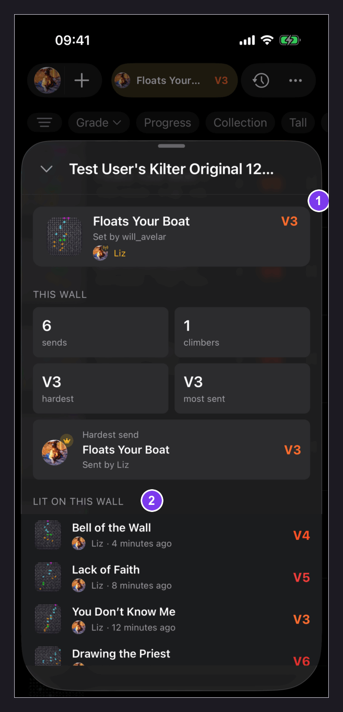
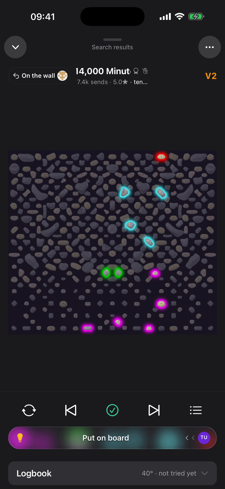
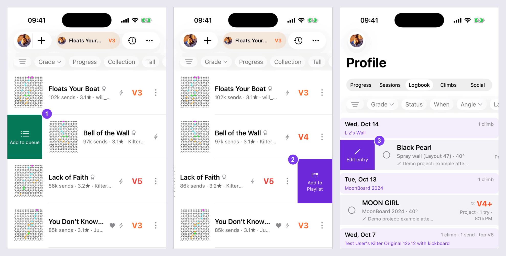
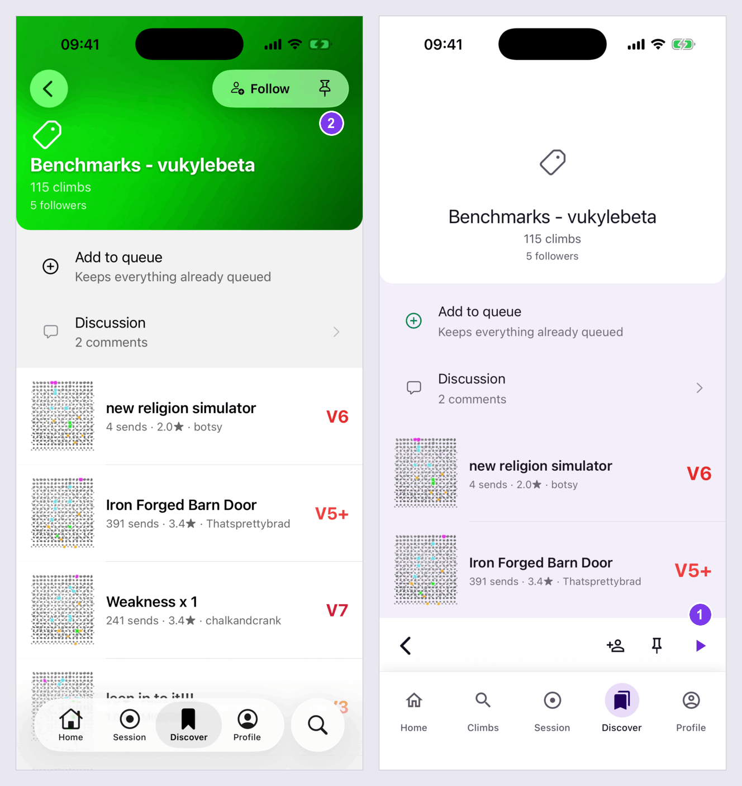
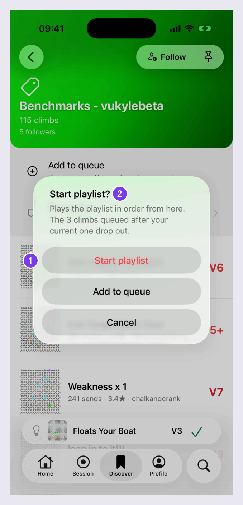
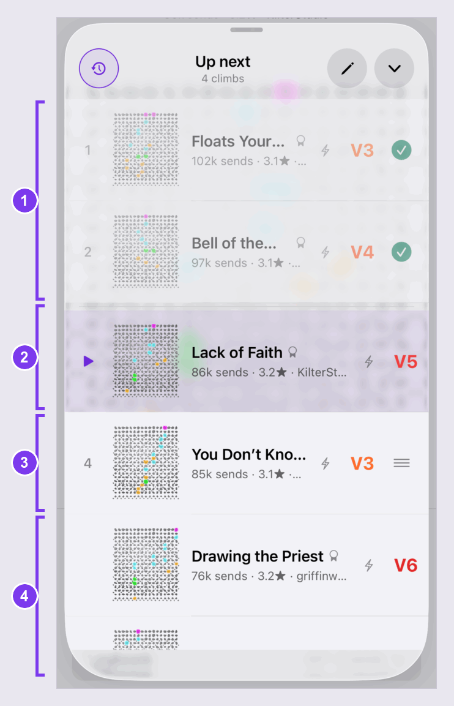
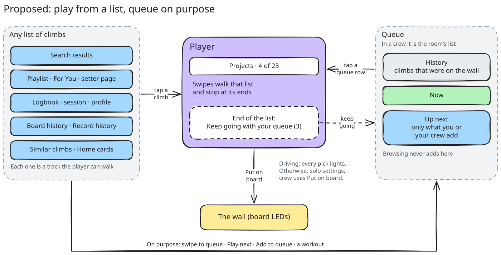

# Climb lists, the player and the queue

How every list of climbs in the mobile app behaves today, where those lists disagree with
each other, and the one model we are moving to. Issue #6230, part of the climbing-experience
epic #6238.

This page started as documentation only. The changes are the follow-ups at the bottom
(F1 to F6), filed on 2026-10-23.

Code references are to `main` at `1f9bc776a3` (2026-10-18). Mobile paths are under
`packages/mobile/`, shared paths under `packages/shared/`. Line numbers drift; the function
names next to them don't.

## Why this exists

> "I still get lost all the time and the pattern of queue vs playlist vs search list etc seems
> inconsistent." (@brownbeagle, Discord)

Three in-app bug reports say the same thing in their own words:

- #3841 (app 2.2.2, 2026-07-22): "Most times I swipe left and right hoping to access the next
  climb in a playlist or in a search, but end up with whatever random climb in my queue is
  there. I think the queue should be the button like in Spotify."
- #4979 (app 2.3.1, 2026-09-01): "Is there a way to just select a climb without starting a
  playlist/adding to queue? ... whenever I connect the board automatically displays a climb
  that I did multiple sessions ago."
- #5924 (app 2.5.0, 2026-10-01): "When swiping down a climb in a playlist it returns to the
  all playlists page instead of the playlist you were on."

And after this page went up, a climber answered the Discord check below (2026-10-23):

> "The playlist is more of a conceptual misalignment for me. When I'm on a list view and I select
> a climb I always think swipe left/right is relative to that list I just came from."

That is rules 1 and 2 of the model, so the follow-ups are now filed.

Three fixes have already shipped against this, and the model below builds on them:

- #4829 (closed 2026-09-06): swipes in the player walk the list you opened the climb from,
  not the queue.
- #4281 (closed 2026-08-23): in a crew, looking at a climb opens a preview with a
  back chip and a **Put on the wall** button instead of taking the wall. It ships
  behind a flag that is still off, so climbers don't have it yet (item 4 below).
- #4731 (merged 2026-10-04): a playlist can be added to the queue without clearing it.

What is left is that each list still decides on its own what a tap means, and the queue
still collects climbs nobody chose to queue.

## Words we use

Player wording is being agreed with #6229. Until then this page uses these words.

| Word                         | Meaning                                                                                                                        | In code                                              |
| ---------------------------- | ------------------------------------------------------------------------------------------------------------------------------ | ---------------------------------------------------- |
| List                         | Any screen that shows climbs in rows: search results, a playlist, your logbook, a session, the queue.                          | —                                                    |
| Track, shown in the top bar  | The list the player is walking. The player's top bar, between ⌄ and ⋯, names it: "Projects · 4 of 23" (the count only when it is known to be right). While a queued climb plays in the middle of it, the top bar says "Up next · 1 of 3" instead (#6777). A long name is cut at its end; the count never is. F1 first put it on the header's stats line, where it pushed the sends and stars off the end. | `playlistSuggestionSource`, `resolveTrackLabel`      |
| Queue                        | Your climbs in order: **History** (climbs before the current one), **Now** (the current climb), **Up next**. In a crew, the room's queue. | `queue`, `currentClimbQueueItem`                     |
| Preview                      | The player shows a climb without making it current.                                                                             | `previewQueueItem`                                   |
| Browsing (back chip)         | A preview whose swipes are guaranteed not to touch the wall.                                                                    | `WallPillState 'browsing'`                           |
| Live (pill)                  | Your next swipe changes the climb on the wall.                                                                                  | `WallPillState 'live'`                               |
| On the wall (pill)           | The climb on screen is the one lit on the board.                                                                                | `WallPillState 'onWall'`                             |
| Put on the wall / Set active | The commit button under a preview. It says Set active when no board is connected and nothing is lit.                            | `CommitButtonLabel`, `wall-state.ts:166`             |
| Crew                         | A party session with at least one other person connected. A newly arrived peer counts after 3 s, and a peer whose phone drops stays counted while reconnecting. The crew rules only apply with the `shared-session-browse` flag on, and it is off (see below). | `shouldDefaultToBrowse`, `SHARED_SESSION_DWELL_MS`, `queue-provider.tsx:2538-2556` |

The two lighting settings, in Settings › Board: **Light the board when I tap a climb**
(`lightOnClimbTap`) and, nested under it, **Light the board as I swipe** (`lightOnSwipe`).
Both default to on (`src/settings/defaults.ts:20-21`). They were called "Light problems
when tapping the list" and "Light problems on swipe" until the climber panel of
2026-10-24, where four of six read "problems" as errors; the storage keys did not change.
The two sit in a group of their own, swipe under tap, and the swipe switch's caption says
it only works once a climb is on the wall: a preview never lights the board as you swipe,
whatever that switch says (`swipeStaysViewOnly`). The lightbulb's long-press sheet shows
the same pair in the same order, swipe under tap. This page shortens them to Light on tap and
Light on swipe. Since F4 the same lighting group on the Board page has **Tapping a playlist loads it into my
queue** (`playlistTapLoadsQueue`), default off; this page calls it the playlist switch.

## Today, surface by surface

Three terms keep the tables short.

| Term | Meaning | Code |
| --- | --- | --- |
| Commit | A new queue entry for the climb is inserted right after the current climb and becomes current, even if that climb is already queued further on. Only three taps reuse an existing entry: re-tapping the current climb, a queue-sheet row, and a board-history row whose climb has a queue entry. | `setCurrentClimb`, `src/providers/queue-provider.tsx:2068`; the reducer skips the insert only for the same entry uuid (`packages/shared/queue/src/reducer.ts:289`), and every list tap mints one (`src/lib/climb-to-queue-item.ts:106`) |
| Trackless preview | The player shows the climb without committing it and has no list to walk. The climb is not in the queue, so swiping and the Next and Previous buttons are disabled. | `packages/shared/play-view/src/queue-navigation.ts:269-270`, `canNext` at `:449` |
| Track end | Since F1 (#6664): at the last climb of the list it is walking, Next or one more forward swipe opens an end card, "Keep going with your queue (N)", N being Up next. Since #6777 Next plays Up next before the list goes on, so the card only comes up once Up next is played too; what N counts then is what the walk passed over, such as queued climbs this wall can't draw. From a committed climb its action goes to the next queued climb (a preview of it when swipes are view-only), and the card names that climb on its own line, "First up: Crimp Ladder" (#6238; names past 32 characters end in an ellipsis, and a climb with no name leaves the line out); from a preview it goes back to the queue's Now and names nothing, since Now is not Up next (a preview over a queue with no Now has nowhere to go back to, so it opens the queue's first climb, named). Up next is everything after Now, or the whole queue without one, the same count as the queue sheet's header. With nothing Up next the card says the list is finished. Previous stops at the list's first climb. While more of the list is still loading (the next page, or the load that follows a tap) the card waits and Next stays off until it lands. Rest-timer auto-advance stops here too, with "End of the list" on its pill. Before F1, a committed climb fell into the queue here and a preview stopped dead. While a list is walked (the header names it), the player's queue button carries a badge with the same Up next count, and its label says "Queue, N climbs up next", at 0 too; at 0 there is no badge, and playing from the queue the button has no badge and keeps its plain label (#6238). | `selectNextQueueItemWithSuggestions` (`atTrackEnd`), `resolveTrackEndCard`, `countUpNext`, `resolveListWalkUpNextBadge`, `TrackEndCard.tsx` |

**The crew column has two halves.** Everything that makes a tap a private look in a crew
(#4281) sits behind the PostHog flag `shared-session-browse`
(`src/providers/feature-flags-provider.tsx:581-583`). On 2026-10-18 that flag was inactive at
0%, unchanged since it was created on 2026-08-25. So today every tap and swipe in a crew still
drives the wall, and the "flag on" behaviour below is built but nobody has it yet.

### What a row tap does

| Surface | How you get there | Tap (solo) | Next after the tap | End of the list |
| --- | --- | --- | --- | --- |
| Search results | Climbs tab | Commits, flagged `suggested`, with the results as the track (`app/(tabs)/climbs/index.tsx:1302-1329`). Since F2, with Light on tap off: a preview with the results as its track (`src/lib/playlists/use-playlist-activation.ts:1350`). | Walks the results | Track end. The first load holds about 250 climbs after the tapped one (rounded up to a page of 100); since F1 one more page loads as the climber nears its end, up to the first 1,000 results. |
| Setter page | For You setter card, the setter's name in the player, Home's "See all" | Since F4: commits, flagged `suggested`, with the setter's climbs as the track, named after the setter, and leaves the rest of the queue alone (`src/components/SetterPlaylistScreen.tsx`, behind both setter routes). With Light on tap off: a preview with the same track. With the playlist switch on: replaces the queue with the setter's climbs this board can draw, after "Start playlist?" if anything is queued after the current climb; there, Cancel previews the tapped climb and Play last appends the list and plays the tapped climb next, keeping everything already queued and queuing the tapped climb once. That climb plays from the queue, with no track: the list now sits behind what was queued, so a swipe walks what was queued and then the list, and never queues a second copy of a list climb. The same holds when the prompt comes up a second time, because climbs were queued while the list loaded. A replace longer than the 500-climb queue cap queues the tapped climb, the climbs after it and, near the end, the ones before it, 500 in all, and a toast says how many fit (#6673). | Walks the list, under the setter's name | Track end |
| Playlist | Discover › a playlist | As the setter page (`usePlaylistActivation` in `app/(tabs)/discover/[playlist_uuid].tsx`). The header's **Play** button (both looks since F4) does the same with the first climb, and ignores Light on tap. The **Play next** and **Play last** rows put the whole list at the top or the bottom of Up next, in list order, with or without the switch (#6772). With a sort or filter on, all of them use the sorted, filtered list on screen (see [Sorting and filtering a playlist](#sorting-and-filtering-a-playlist)). | As the setter page | As the setter page |
| For You and smart lists (Projects, Liked Climbs and the rest) | Discover › For You | As the setter page (`app/(tabs)/discover/smart/[type].tsx:119-128`) | As the setter page | As the setter page |
| Logbook | You › Logbook, someone's logbook | Since F2: commits, flagged `suggested`, with the logbook's rows as the track, named "Logbook" (`src/components/you/LogbookTab.tsx:574`, through `src/lib/playlists/use-tick-list-activation.ts`). A tick on another board model opens as a preview on its own board. The tapped tick is drawn at the size and angle it was climbed at. With Light on tap off: a preview with the same track. | Walks the rows on screen, in their order (one entry per climb) | Track end. The track pages on through the logbook's own feed as the climber nears its end, from the first climb not yet in the track and at most 5 of the feed's pages per request, so a logbook of repeats is never loaded in one go (`src/lib/playlists/loaded-list-pages.ts`). |
| Session detail | Home session card, You › Sessions | As the logbook, named "Session climbs" (`src/components/session/SessionDetailScreen.tsx:91`) | Walks the session's ticks | Track end |
| Profile climbs | You › Climbs, someone's profile | As the logbook, named "Created climbs" (`src/components/you/ProfileClimbsTab.tsx:98`, `src/lib/playlists/use-board-list-activation.ts`) | Walks the list | Track end, paging on through the same feed |
| Home cards | Home tab | New-climb card: a trackless preview (`src/components/feed/NewClimbFeedCard.tsx:111`). A session card's climb (the hardest send): as the logbook, with a one-climb track named "Hardest send" (`app/(tabs)/home/index.tsx:253`; the Sessions tab's cards the same, `src/components/you/SessionsTab.tsx:106`). | New-climb card: nothing. Session card: the end card. | — |
| Board history sheet, iPad wall column | The clock button on Climbs, the wall strip, the iPad side column | Since F2: commits with the wall's history as the track (the wall's climb first, then back through what was lit), named "Wall history", reusing the queue entry when the wall's climb has one (`src/providers/drawer-host-provider.tsx:1070`; the track is built in `src/components/board-presence/NowOnTheWallPanel.tsx:539`). With Light on tap off: a preview with the same track. | Walks the history the sheet had loaded | Track end. It does not page past what the sheet loaded. |
| Record in-session history | Record tab during a session | Since F2: as the session detail, through the same hook (`src/components/session-screen/in-session/InSessionView.tsx:435`). It no longer commits the climb itself with a fresh queue entry. | Walks the session's ticks, newest first | Track end |
| Queue sheet | The queue button in the player, the mini-player | Makes the row current, clears the track (`src/components/play-drawer/use-queue-sheet-handlers.ts:61-70`). A suggestion row commits with the suggestions as the track (`:90-99`). | The queue, or the suggestions | Stops at the end of the queue |
| Similar climbs | The strip under the board in the player | Since F2: commits, flagged `suggested`, inserted after the current climb, with the strip as the track, named "Similar climbs" (`use-play-selection-controller.ts:373`). The strip is the climbs this wall fits, plus the one tapped. A preview with the same track with Light on tap off, or when the player shows a climb from another board. | Walks the strip | Track end |
| Workout preview | Record tab before a session, workout on | A trackless preview (`src/components/session-screen/pre-session/PreSessionView.tsx:245-251`). **Start** appends the workout behind the queue (`:301`). | Nothing | — |
| Wall tab kiosk | Wall tab on an iPad bound to a board | No rows. Older and Newer step through the wall's own history locally; **Light this** lights the board without touching the queue (`src/components/board-presence/wall-kiosk/useWallPreview.ts:345-357`). | The wall's history | Returns to live |

Since #6777, every "Walks …" in the Next column plays Up next first: the queue after the
climb on the wall, Play next climbs at the top of it, then Play last ones. The list picks up
again after the last list climb played, and its end card comes once both are done (rule 2).
A preview walks only its list.

### Crew, swipes and long-press

| Surface | In a crew today (flag off) | In a crew, flag on | Row swipes | Long-press |
| --- | --- | --- | --- | --- |
| Search results | Commits for the whole room; with Light on tap off, a preview with the results as the track | Preview with the loaded rows as the track, paging on past them | Right: Play next (top of Up next, #6772). Left: add to playlist. | Climb menu, plus a ⋮ button (the only list with one) |
| Setter page, playlist, For You | Commits for the whole room (F4); with Light on tap off, a preview. With the playlist switch on, replaces the whole room's queue | Preview with the loaded rows as the track; Next stops at the last loaded row | As search; rows the board can't show still swipe | Climb menu |
| Logbook | Commits for the whole room | Preview with the logbook as the track (F2) | Right: edit the tick. Left: delete it. Your own ticks only. | Climb menu, plus Edit |
| Session detail, profile climbs, Home session card | Commits for the whole room | Preview with that list as the track (F2) | None | Climb menu |
| Home new-climb card | Trackless preview | Trackless preview | None | None |
| Board history sheet, iPad wall column | Commits for the whole room | Preview with the wall's history as the track (F2) | As search | Climb menu |
| Record in-session history | Commits for the whole room | Preview with the session's ticks as the track (F2) | None | Climb menu |
| Queue sheet | Commits for the whole room | Commits, on purpose: it is the room's queue | Left only: delete | Climb menu |
| Similar climbs | Commits for the whole room, after the current climb (F2) | Preview with the strip as the track (F2) | None | None |
| Workout preview | No session yet | No session yet | None | None |
| Wall tab kiosk | Lights the board; the room's current climb doesn't move | Same | None | None |

### Retrying playlist pages

Each page gets one retry for a transient connection failure and one for a short rate limit
(#4840). A connection failure does not spend the rate-limit retry, or the other way around.
Repeating either failure stops the load, so a page makes at most three requests. A rate-limit
wait longer than three seconds fails immediately, and cancelling a load stops its retry sleep.
Both budgets reset for the next page. The queue-replacement drain still stops after 20 pages;
with mixed failures that can mean 60 requests, so long smart logbooks have no guaranteed
headroom in the shared 60-per-minute limit. Only recommendations stop after six pages.

### Sorting and filtering a playlist

A playlist (#6651) has the Climbs chip row under its hero: Filters, Grade, Your progress and
Sort by default, each pinnable from the filter sheet. Once the hero scrolls away, a ≡ button in
the header opens the same sheet. With a filter on, a line under the chips reads "12 of 117
climbs · Clear filters". Clear filters keeps the sort; the sheet's Reset clears the sort too.
Smart lists and setter pages have the same chip row, sheet and ≡ button; see
[Smart lists and setter pages](#smart-lists-and-setter-pages) for what differs.

- **The request.** `usePlaylistClimbs` gets a `view` only when the sort is not the playlist's
  own order or a filter is on. With neither, the request is the one sent before views existed.
- **The rows on screen decide.** While a new sort or filter loads, the previous rows stay up.
  The screen tracks the view those rows belong to (the settled view), and the play drawer's
  track, the queue replace and Play next / Play last all use that view, so a swipe walks the order on
  screen and skips filtered-out climbs.
- **The source id carries the view.** It is `playlist:<uuid>` with no view and
  `playlist:<uuid>|<view as JSON>` with one, so a sorted track is a different source from the
  plain one and re-tapping after a change builds a fresh track.
- **Play N next / Play N last.** With a filter on, the rows read "Play 12 next" and "Play 12 last"
  and queue those climbs in the order shown, but only when the number is exact: with "Fits my board" on (the server's
  count is then all on this board), or once every row is loaded (the climbs this board can show,
  leaving out the dimmed ones the board-scoped add skips). Otherwise they stay "Play next" and
  "Play last".
- **Edit mode always shows the playlist's own order.** A reorder index is a place in that order
  (#4012). Tapping Edit sets the sort aside and clears the filters. The plain order's cached
  pages can be stale (an add or remove refetches only the view on screen), so they are marked
  stale and refetched, and the editor opens only once those rows have landed, after loading as
  many as the sorted list showed (200 at most). The chips grey out and the ≡ button goes away;
  Done backs out while it waits. If the plain order fails to load or is waiting for a
  connection, the view comes back with a message. Done brings the sort back; filters stay
  cleared. Drag-to-reorder is off whenever a sort or filter is on.
- **No active board.** Progress, your ratings, Liked, Following, beta videos, Tall / Wide and
  "Fits my board" pass only climbs on the active board (`PLAYLIST_ACTIVE_BOARD_ONLY_FILTERS` in
  `@boardsesh/climb-filters`, kept equal to the query's `PLAYLIST_FILTER_SCOPE` by a test). With
  no board picked they would match nothing, so their rows and chips are hidden and a choice
  kept from before stops filtering until a board is back.
- **The list keeps its scroll offset on new rows.** FlashList's default keeps the first visible
  row in place across data changes, which after a re-sort scrolled to wherever that row moved.
  It is off here; instead, a new sort or filter scrolls back up to the filter bar only when the
  climber was below it.

### Smart lists and setter pages

Both reuse the playlist's chip row, filter sheet and ≡ button. A plain request (no sort, no
filter) is byte-identical to before.

- **Smart lists** (Liked, Five Stars, Projects, Most repeated). Sorts: the list's own order,
  Difficulty, Quality, Ascents, Name, Random. The own order is named "Recently liked" (Liked),
  "Recently climbed" (Five Stars) or "Most tries" (Projects, Most repeated). There is no
  "Recently added". The sort is remembered per list type (`smart:<TYPE>`); filters reset on each
  visit. Liked hides the Liked collection option, Projects hides Your progress (row and chip),
  Five Stars hides My rating. The recommended lists (Crowd favorites, Hidden gems, At your level,
  Fresh) get no controls and never send a view.
- **Setter pages** (`climbs/setter/[username]`). Sorts: Newest (the default), Difficulty,
  Quality, Ascents, Name, Random. One remembered sort covers every setter page (`setter-pages`).
  The subtitle names the sort in force ("All climbs on this board · Hardest first"). Setters,
  Following, Other angles and "Fits my board" are not offered; Hold types and Board region are.
- **What you see is what you swipe and queue**, on all three surfaces. The play drawer's
  `fetchPage`, the activation `sourceId` and Play next / Play last follow the settled view (the view whose
  rows are on screen). Source ids are `playlist:<uuid>`, `smart:<TYPE>:<userId>` and
  `setter:<username>:<board JSON>`, each followed by `|<view key>` while a sort or filter is on
  (`listSourceId` in `src/lib/playlists/playlist-view.ts`).

The climb menu is the same everywhere (`src/components/climb-actions/use-climb-actions.ts`):
Preview, Play next, Play last, Open queue, Add to playlist, Favorite and the rest. In a
crew, swiping right, Play next and Play last all write to the room's queue, with or without
the flag.

### Play next and Play last (#6772)

The two placements are named the way a music app names them, so a climber knows where a climb
lands. Before, "Add to queue" put it at the bottom of Up next, behind everything already queued,
and with a long queue the climber never reached it.

- **Play next** puts the climb at the top of Up next, right behind the climb on the wall
  (`playNext` in `src/providers/queue-provider.tsx`). A climb already queued moves there instead
  of being copied. The menu hides it on the climb that is on the wall.
- **Play last** puts it at the bottom of Up next (`addToQueue`), what "Add to queue" did.
- **The row swipe right is Play next**, on every climb list that shares `ClimbListRow`: search,
  playlists, For You and the smart lists, setter pages and the board sheet. Logbook rows keep
  their own swipes. Swiping the climb that is on the wall queues it again, right behind itself:
  a row names the climb, not its queue slot, so "next" can only mean a repeat.
- **While a list is playing, the list comes first.** A Play next lands at the top of Up next, and
  the player reaches it after the list's end card, as rule 2 below says.
- **In a crew, a single Play next waits for a list still being sent.** A list's climbs go to the
  server one at a time, and a positional add sent among them would land in the wrong slot, so it
  queues behind them on the same serial lane. An append still goes at once.
- **A playlist offers both for the whole list.** Play next inserts the list at the top of Up next
  in list order, Play last appends it (`appendQueueItems` with `placement`). Both share the
  500-climb cap and the queue-full toast. Unlike a single Play next, a list never moves climbs
  that are already queued. A list Play next while you are walking that same list leaves the climb
  on the wall out (no second copy right behind it) and drops the list's track, so swipes walk the
  copies in Up next instead of peeking the list past them. The "Start playlist?" prompt keeps its
  three answers; its middle one is now called Play last.
- **The snackbar names where it went**: "Playing next" or "Playing last", with a count for a list.

### Where it's saved

| What | Where | Code |
| --- | --- | --- |
| The queue with no session | AsyncStorage key `boardsesh_local_queue_snapshot_v1`: the queue, the current climb and the track. It survives restarts. | `src/lib/queue-snapshot-store.ts:22-31` |
| The queue in a session | The server. The track is never sent, so it lives on one phone only. | `queue-provider.tsx:1930-1932` |
| Previews | Nowhere. | — |
| Recently opened playlists | AsyncStorage key `boardsesh:recent-playlists`. | `src/lib/playlists/recents-store.ts:13` |
| The sort picked inside each playlist | MMKV settings key `playlistSortsV1`, newest first, 100 playlists at most. A playlist on its own order has no entry, and Random is kept without its seed. Filters are never kept. Smart lists key theirs `smart:<TYPE>` and setter pages share `setter-pages`. | `src/lib/playlists/playlist-sort-memory.ts` |
| Which chips a playlist shows | AsyncStorage key `pinnedPlaylistChips`, one set for every playlist on the phone. | `src/lib/playlist-pinned-chips-store.ts` |
| Ticks, wall history, playlists | The server. The lists above only read them. | — |

Pinned playlists and their recently opened fallback are scoped to the current account, board,
layout and adapters in the shared `usePinnedPlaylists` hook (#6875). Switching that context hides
the previous rows while its replacement loads. Only the latest request for each stream can update
rows or loading; a late response, failed old request, or retained old refresh callback cannot restore
a previous context. A current recents-storage failure settles loading and keeps any fetched pins.

_The board history sheet (dark theme, screenshot mode's demo wall activity). (1) The climb lit on the wall now. (2) "Lit on this wall", the wall's history. Tapping any row puts that climb on the wall for everyone in the session._

## Player states today

The player's header pill and the row under the board say what a swipe will do. They come from
`src/components/play-drawer/wall-state.ts` (`resolveWallPillState`, `resolveCommitBarModel`).

| State                     | What you see                                                                                                            | How you get there                                                                                                                                                                    |
| ------------------------- | ----------------------------------------------------------------------------------------------------------------------- | ------------------------------------------------------------------------------------------------------------------------------------------------------------------------------------ |
| No pill                   | The plain player.                                                                                                       | Solo, no board connected and nothing lit (`wall-state.ts:82`); or a committed climb with Light on swipe off, where swipes don't commit. |
| Live                      | A Live pill. Your next swipe changes the climb on the wall.                                                             | A committed climb while a board is connected or a climb is lit, and swipes commit (`wall-state.ts:81`).                                                                              |
| On the wall               | The driver's avatar in the pill.                                                                                        | The climb on screen is the lit one (`wall-state.ts:79`). It outranks Browsing.                                                                                                       |
| Browsing                  | A back chip (back glyph plus the face of whoever lit the wall) that returns to the climb on the wall, and **Put on the wall** (or **Set active**) in the middle of the action row. Swipes never touch the wall. The top bar's second line carries a caption: "Preview, not lit" solo while a board is connected or a climb is lit, "Only you see this · the wall is on Crimp Ladder" in a crew (`resolveBrowseCaption`). | Any preview or swipe while Light on swipe is off (`play-drawer-navigation.ts:67`); with the crew flag on, a list tap in a crew.                                                       |
| Preview without Browsing  | The Put on the wall / Set active button, and the back chip whenever there's a committed climb to go back to (it stands in for the **Live** chip during a preview; `resolveHeaderPillState` in `wall-state.ts`), with the same "Preview, not lit" caption when a board is connected or a climb is lit. Swiping and Next do nothing: there is no list to walk. | A search tap with Light on tap off, the long-press **Preview** action, a deep link, the Home new-climb card or a workout preview row, while Light on swipe is on (`src/components/play-drawer/PlayCore.tsx:783-790`). |
| Wrong-board preview       | A Switch board overlay over the action row. Swipes walk the playlist without touching the queue, and stop at its end.    | A playlist climb from a board you are not on (`use-playlist-activation.ts:846-878`).                                                                                                 |

_The player after the long-press Preview action with Light on swipe off. (1) The back chip with the face of whoever lit the wall; tapping it returns to the climb on the wall. (2) Put on the wall, between the heart and share. The face shows as a "?" here because the simulator's wall has no named driver._

## Eleven inconsistencies

Mobile paths are under `packages/mobile/`.

### 1. A row tap does one of five things

Fixed by F2 (#6665) and F4 (#6667): the logbook, session detail, profile climbs, Home and
Sessions cards, board history, Record's history and similar climbs play from their own list
through the activation hook, as search does, and since F4 so do playlists, For You and setter
pages, which replace the queue only with the playlist switch on. Every list reads Light on tap
(`src/lib/playlists/use-playlist-activation.ts:1350`). The board history
sheet and Record's history stop taking the wall in a crew. Home's new-climb card and the
workout preview are still trackless previews. What follows is how it was.

Same gesture, five outcomes, depending on which screen the row is on.

- **Insert, with a track.** Search results put the tapped climb into the queue right after the
  current climb, flagged `suggested`, and the player walks the results:
  `app/(tabs)/climbs/index.tsx:1291-1326`, `src/lib/playlists/use-playlist-activation.ts:976-989`.
- **Replace the queue.** Playlists, For You lists and setter pages swap the whole queue for the
  list, after a "Start playlist?" prompt if anything is queued after the current climb:
  `use-playlist-activation.ts:910-948`, `src/components/SetterPlaylistScreen.tsx:65-72`. The
  replace also drops your History, which the prompt doesn't mention, and with nothing queued
  after the current climb there is no prompt at all (`use-playlist-activation.ts:926`).
- **Insert, no track.** Logbook, sessions and profile climbs insert the climb with no list to
  swipe, and without the `suggested` flag, so the cleanup in item 3 never removes it:
  `src/components/play-drawer/use-play-selection-controller.ts:151-186`.
- **Preview only.** Home's new-climb card and workout preview rows open a preview and leave the
  queue alone: `src/components/feed/NewClimbFeedCard.tsx:111`,
  `src/components/session-screen/pre-session/PreSessionView.tsx:245-251`.
- **Take the wall.** The board history sheet and Record's in-session history make the climb
  current for everyone, and would still do so with the crew flag on:
  `src/providers/drawer-host-provider.tsx:1050-1063`,
  `src/components/session-screen/in-session/InSessionView.tsx:432-446`.

Light on tap only changes the first of these. Search is the only list that reads it
(`app/(tabs)/climbs/index.tsx:351`, `:1313`); every other list commits or replaces whatever it
says.

### 2. Next goes somewhere you can't see

Fixed by F1 (#6664): the player names the list, swipes stop at both ends with an end card,
tracks page past the first load, and "Start playlist" keeps a track named after the playlist.
F1 kept the queue behind the end card. #6777 then turned that round, after the owner QA of
#6772 (climbers queued climbs from search results and the next swipe still showed the next
result): Next plays Up next first, the top bar says "Up next · 1 of 3" while it does, and the
list picks up after the last list climb played. What follows is how it was before F1.

The player doesn't say which list it is walking, and the walk ends silently.

- At the end of the list, Next falls back to whatever is queued after the current climb:
  `packages/shared/play-view/src/queue-navigation.ts:260-267` (the previous-climb mirror is at
  `:330-335`). That only holds for a committed climb. A preview with a track (wrong board, or
  a crew tap with the flag on) shows a climb that is not in the queue, so at the end of its list
  Next just stops, with no queue to fall into (`:269-270`, previous at `:338-339`).
- A track holds about 250 climbs after the one you tapped (rounded up to a page of 100; never
  past the first 1,000 results). Past that, Next drops into the queue too:
  `packages/shared/playlists-react/src/fetch-playlist-suggestion-climbs.ts:3-4`, `:11`, `:290-300`.
  (#2216 asked to page past this cap, but was closed for the retired web surface.)
- After "Start playlist" loads the whole playlist into the queue, the track is cleared:
  `use-playlist-activation.ts:773-780`. Swipes then walk the queue, which matches the playlist
  only until a tap from any other list inserts a climb into the middle of it.
- Queue-sheet, board-history and Record taps all clear the track
  (`playlistSuggestionSource: null`): `src/components/play-drawer/use-queue-sheet-handlers.ts:65`,
  `drawer-host-provider.tsx:1058`, `InSessionView.tsx:440`.

### 3. The queue fills with climbs you never added

- Every tap that commits a climb inserts a new entry after the current climb, even when that
  climb is already queued: `packages/shared/queue/src/reducer.ts:289-299`, from `setCurrentClimb`
  (`src/providers/queue-provider.tsx:2068`). The reducer only skips an entry whose uuid it
  already holds, and list taps mint a new uuid every time (`src/lib/climb-to-queue-item.ts:106`;
  callers `use-play-selection-controller.ts:185`, `use-playlist-activation.ts:987`). Only the
  current climb is checked (`use-play-selection-controller.ts:152`, `:184`;
  `use-playlist-activation.ts:323`). So with A, B (current), C queued, tapping C in the logbook
  gives A, B, C′ (current), C, and Next lands on C again. Every committed swipe off a list
  inserts an entry too (a "peek" becomes a real queue item).
- The cleanup that removes browse-origin (`suggested`) climbs needs two things: no session at
  all (`pruneSuggestedAfterCurrent: sessionIdRef.current == null`, `queue-provider.tsx:1950`),
  and a tap that carries a track (`packages/shared/queue/src/reducer.ts:309-312`). Pressing
  Start alone creates a session, so a solo climber who started one keeps every leftover. And
  taps that clear the track (the queue sheet; before F2 also the logbook, sessions, profile,
  board history, Record and similar climbs) never clean up, even solo.
- Before F2, Record's history duplicated even the current climb, because it had no
  already-current check. It now goes through the activation hook, which has one. The board history sheet reuses the wall climb's
  queue entry when there is one, and mints a new one when there isn't
  (`drawer-host-provider.tsx:1052`).
- The crew gate asks a different question: are other people connected
  (`packages/shared/play-view/src/browse-defaults.ts:54-56`)? So "alone in a session" counts as
  solo for lighting but as a session for cleanup.
- The solo queue is saved across restarts, under the AsyncStorage key
  `boardsesh_local_queue_snapshot_v1` (`src/lib/queue-snapshot-store.ts:22`). Connecting a
  board days later lights the climb that was current when you left (#4979).

### 4. The crew gate is switched off, and has holes

The gate that makes a tap a private look in a crew (#4281) is behind the PostHog flag
`shared-session-browse` (`src/providers/feature-flags-provider.tsx:581-583`, read at
`queue-provider.tsx:2558`). On 2026-10-18 the flag was inactive at 0%, as it has been since
2026-08-25. So in a crew today every tap commits for the whole room, and a playlist, For You
or setter tap replaces the room's queue. The /help page already promises the gate: "With
someone else in your session, swiping stops lighting the board. Tap Put on the wall when you want yours up, or tap the face at the top to go back to the climb on the wall"
(`marketing.json` `help.sessions.crowd.p1`).

With the flag on, search, playlists, For You, setter pages, the logbook, sessions, profile,
Home cards and similar climbs open a private preview. Three places still didn't before F2
(#6665); F2 closes the first two, so one is left:

- Record's in-session history: `InSessionView.tsx:432-446`. Its comment says "Always-live".
- The board history sheet and the iPad wall column: `drawer-host-provider.tsx:1050-1063`.
- The playlist header's Play button (Start playlist before F4) calls the row-tap path with the
  first climb (`handleActivateAll` in `src/components/playlist/PlaylistDetailView.tsx`). With
  the flag on, in a crew that path previews, so the button only shows climb 1. Since F4 that is
  deliberate: Play skips Light on tap, never the crew rule.

Two smaller gaps: list screens read the crew state at the moment of the tap, while the
logbook, sessions, profile and similar climbs read the player's browse latch. The latch arms
only when a preview was open while the crew was there (`PlayCore.tsx:750-752`), stays up for
10 s after the crew leaves, and clears as soon as a committed climb opens
(`use-play-selection-controller.ts:177`). And the right swipe, Play next and Play last write
to the room's queue with no gate at all, flag or not.

### 5. Previews you can't swipe

A preview without a track has nothing to walk, so swiping and Next do nothing
(`queue-navigation.ts:269-270`). Every preview except the crew list taps and the wrong-board
preview is like this:

- Search with Light on tap off (#5157): `app/(tabs)/climbs/index.tsx:1313-1318`. Its comment
  promises the back chip and Put on the wall button, which only appear if Light on swipe is off too. With the crew
  flag on, the same tap in a crew does get the results as a track (`:1321-1326`).
- The long-press **Preview** action, a deep link, the Home new-climb card and workout preview
  rows.
- With the crew flag on: logbook, session, profile and similar-climb taps in a crew.

F2 (#6665) gives every list's preview its list as a track, search with Light on tap off
included, so of the list above only the long-press Preview action, deep links, the Home
new-climb card and workout preview rows are left trackless.

With a board connected or a climb lit and Light on swipe on, such a preview shows the **Live**
pill ("your next swipe changes the climb on the wall") while swiping and Next are disabled
(`wall-state.ts:81`; `PlayCore.tsx:783-790` leaves Browsing off and `:794-799` computes Live with
no preview).

The comment at `src/components/play-drawer/play-drawer-navigation.ts:71-86` (and its twin at
`PlayCore.tsx:776-782`) says the next swipe from such a preview commits and takes the wall. No
opener reaches that state today, because the swipe is disabled first.

### 6. Same swipe, opposite meaning

| Row                                    | Swipe right       | Swipe left                                 |
| -------------------------------------- | ----------------- | ------------------------------------------ |
| Climb rows (search, playlists, setter) | Play next         | Add to playlist                            |
| Logbook rows                           | Edit the tick     | Delete the tick (after a confirm)          |
| Queue rows                             | Nothing           | Delete from the queue (a full swipe skips the button) |

Code: `src/components/ClimbListRow.tsx:435-467`, `src/components/you/LogbookRow.tsx:55-66`,
`src/components/QueueItemRow.tsx:219-270`. A climb row the board can't show blocks tap and
long-press (`ClimbListRow.tsx:359,367`) but still swipes (`:471`).

_Left and middle: a Climbs row half-swiped right (1, Add to queue, since renamed Play next by #6772) and left (2, Add to Playlist). Right: a logbook row half-swiped right (3, Edit entry). A half swipe leaves the button showing; a full swipe runs it. A full left swipe on the logbook row deletes the tick after a confirm (`src/components/you/LogbookTab.tsx:564-568`)._

### 7. Playlists differ by platform

Fixed by F4 (#6667): the Liquid Glass header has the same Play button
(`PlaylistPlayHeaderButton`, next to the ≡ filter button and the playlist's own controls), shown
under the same conditions: the list has climbs, no switch-board banner, not editing. What
follows is how it was.

Only the Material look (Android's default) has a play-all button, in its app bar:
`PlaylistDetailView.tsx:708-716`. The Liquid Glass header (iOS) carries only the follow, pin
and owner controls (`:324-326`), and its list header has the Add to queue row (now Play next and Play last) but no play
button (`:836-843`). The /help page promises both platforms "The header's play button starts
from the top" (`marketing.json` `help.playlists.queue.p1`).

_The same playlist in the Liquid Glass look (left, the iOS default) and the Material look (right, the Android default). (1) Material's play button, which starts the playlist from the top. (2) The Liquid Glass header has Follow and Pin, and no play button. Material's app bar drawing at the bottom of the screen looks like a separate bug._

The "Start playlist?" prompt. Since F4 it only appears with the playlist switch on:

_Tapping a playlist climb with 3 climbs queued after the current one. (1) Start playlist replaces the queue, History included. (2) The prompt only counts the climbs after the current one._

### 8. Getting back

Fixed by F5 (#6668):

- Closing the player from a playlist landed on Discover's main page instead of the playlist
  (#5924). Discover reset its stack on every `blur`, and opening the player blurs the tab
  under it. #5927 made the reset wait for a real tab change (`usePopToTopOnTabBlur`), and a
  test now checks that one close pops only the player (`use-play-swipe-dismiss.test.tsx`).
- The player is a `transparentModal` over the live tab on every shell (native tabs, JS tabs,
  the iPad compact player and the browser app), so the list under it never unmounts and keeps
  its scroll position. No list in [Before and after](#before-and-after) remounts, re-keys or
  resets its query when the player opens or closes.
- A setter list in For You opened in the Climbs tab, so Back left Discover. It now opens
  Discover's own copy of the route, `app/(tabs)/discover/setter/[username].tsx`, which renders
  the same screen as the Climbs one. The setter's name in the player and Home's "See all"
  still open the Climbs copy; #6572 (the Climbs stack has no anchor) is unchanged.

### 9. Similar climbs

Fixed by F2 (#6665): a similar climb plays from the strip, inserted after the current climb.
What follows is how it was.

Solo, tapping a similar climb adds it to the **end** of the queue and then makes it current,
the loudest outcome for a look: `use-play-selection-controller.ts:310-349` (`addToQueue` at
`:338`, `setCurrentClimb` at `:347`). Every other commit inserts after the current climb.
Jumping to the end means everything that was Up next now sits before the current climb, so the
queue sheet shows it as History and Next has nowhere to go. With the crew flag on, a crew tap
previews instead (`:325`).

### 10. Words

- **"Set active" and "Put on the wall"** are the same button. It says Set active when no board
  is connected and nothing is lit (`wall-state.ts:166`; strings in `session.json` `playView.setActive`
  and `playView.wallState.putOnWall`).
- **"Projects" means three things.** The smart list: "Climbs you've worked the most without
  sending" (`playlists.json` `library.smart.projects.description`). The Progress filter: tried and not sent
  (`packages/shared/climb-filters/src/progress-filter.ts:64-65`). The chip on a climb card: a
  published climb nobody has graded yet, so nobody has sent it (`src/components/ProjectChip.tsx`).
- **"Liked"** is both a smart list ("Liked Climbs") and an option of the Collection filter
  (`climbs.json` `mobile.filter.collection.liked`).

### 11. The queue sheet

- It shows the last 2 History rows. That is the shared model's default
  (`packages/shared/play-view/src/queue-list-model.ts`); a QA follow-up cut it from 5 on purpose.
- The sheet labels its sections History, Up next and Suggestions, each only when it has rows,
  with a divider before Suggestions (`QueueList.tsx`), so suggestions no longer read as queued
  climbs.
- The count in the sheet header is the Up next count: the climbs after the current one
  (`QueueSheet.tsx`).
- Tapping a queue row clears the track (`use-queue-sheet-handlers.ts:65`); tapping a suggestion
  sets one (`:94`).
- A workout queues as one flat run: the preview's sections (warm-up and so on) don't survive
  into the queue (`src/components/session-screen/pre-session/use-workout-preview.ts:269-273`).

_The queue sheet. (1) History. (2) The current climb. (3) Up next. (4) Suggestions; with no playlist playing they are the board's most-sent climbs. This screenshot predates F6: it shows no section labels or divider, and a count of 4 that includes History and the current climb._

## The model: play from a list, queue on purpose

Seven rules. Each one reuses a part that already exists in the code: the list track from
#4829, the browse preview and Put on the wall from #4281, and a list's Play last (once Add to queue) from #4731.

1. **Tap a climb in any list and the player plays from that list**, and says so in its top bar:
   "Projects · 4 of 23".
2. **Your queue plays before the list continues.** Next, the swipes and the rest timer play Up
   next first: Play next climbs at the top of it, then Play last ones, and the top bar says
   "Up next · 1 of 3". Then the list picks up at the climb after the last list climb played, and
   its name comes back: "Search results · 5 of 23". The track keeps that list climb while the
   queue plays (`PlaylistSuggestionSource.resume`), so the place survives the queue. Previous
   retraces the walk: from the first queued climb it goes back to the list climb it was played
   from. The list's start is a stop, and its end card comes only once both the list and Up next
   are done; it still offers the queue when the walk passed queued climbs over (ones this wall
   can't draw), "Keep going with your queue (1)" with "First up: Crimp Ladder" under it. The
   queue button's badge counts Up next all the way. In a crew the room's Up next plays before
   this phone's list goes on. A preview (a crew browse, a wrong-board look, Light on tap off)
   walks only its list, so a look never uses up anybody's Up next; committing it (Put on the
   wall) starts the walk from there. With Light on swipe off, or in a crew, a swipe off the
   climb on the wall is a look that walks the queue with no list of its own (#5403); Put on
   the wall on a queued climb ahead of it keeps this phone's list and its place, as Next
   would (`resolveUpNextCommitResume`), and leaves the list for anything else. The look itself
   never borrows or captures this phone's list, even when it starts from a list climb: only Put
   on the wall keeps the list (owner decision, 2026-10-25, keeping the #5403 rule). If the list
   climb's own queue entry is removed while Up next plays, Previous goes back to that list
   climb instead of into History. From the list climb the walk picked up after Up next,
   Previous goes back to the last queued climb played, then to the list climb the walk left
   for the queue. The track keeps that stretch once the walk is back on the list
   (`PlaylistSuggestionSource.detour`), so Previous follows it even when older entries of list
   climbs sit between them in the queue (a swipe down the list and back leaves them there, and
   a crew keeps every one). Without it, Previous reads the stretch from the queue, and an older
   entry of the same climb ends it. Owner decision, 2026-10-25 (#6777), reversing the
   list-first walk F1 shipped, where the queue waited behind the end card and the persona panel
   in discussion #6708 predicted climbers would get lost.
3. **The queue holds only what you or your crew add**: the right swipe (Play next), Play next,
   Play last, a workout. Looking at a climb never adds it to Up next. Climbs that were on the wall show
   under History, in the order they were on it. Next never pulls an old History entry forward:
   when the list's next climb is one you climbed earlier, Next puts up a fresh entry for it
   and the old one stays where History had it (owner decision, 2026-10-28). A tap on that
   climb in a list still reuses its History entry, and so does Next right after Previous,
   onto the climb just ahead (`historyCopy` in `docs/current-climb-outside-queue.md`,
   section 1).
4. **The queue is a list too.** Tap a queue row and you play from the queue. In a crew it is
   the room's list.
5. **Playing a playlist never wipes your queue.** Play next and Play last copy the playlist in. The
   "Start playlist?" prompt goes away.
6. **Looking never takes a crewmate's wall**, from any list. Solo, Light on tap and Light on
   swipe decide whether looking also lights the board, as they do today. This needs the
   `shared-session-browse` flag turned on, plus the three holes in item 4 closed.
7. **Closing the player puts you back on the same list, at the same scroll position.**

Only rule 3 needs a sync design choice, because the current climb lives inside the queue
today. Two ways to do it:

- **(a)** Run the existing browse-origin cleanup whenever no crewmate is connected (today it
  only runs with no session at all), and send the removals to the server when a solo session
  exists. Smaller, but it cleans up after the cause instead of removing it.
- **(b)** Let the current climb live outside the queue. This is the blocker named on #3841.
  **Chosen (2026-10-23)**, in F3 (#6666). The sync design is
  [`docs/current-climb-outside-queue.md`](current-climb-outside-queue.md).

The other direction we considered, "playing a list makes it the queue", was rejected: in a
crew it rewrites everyone's queue on every tap, and a long list runs past the 500-climb queue
cap (`MAX_SYNCED_QUEUE_ITEMS`, `packages/shared/queue/src/limits.ts:17`).

### Editing the diagram

`docs/diagrams/climb-lists-model.excalidraw` is the source. Open it at
[excalidraw.com](https://excalidraw.com), edit it, then export an SVG with the same base name,
replacing the old one.

## Before and after

What each surface does today, and what it does once F1 to F6 land. "Plays from" means the
player names that list, plays Up next first and then walks the list (#6777), and stops at its end
card once both are done. Every "walks … to the end card" under Today plays Up next first too.

| Surface                                  | Today                                                                                     | After                                                                                              |
| ---------------------------------------- | ----------------------------------------------------------------------------------------- | -------------------------------------------------------------------------------------------------- |
| Search results | Inserts the climb into the queue (a second copy if it was already queued) and walks the results, named "Search results" in the top bar, to the end card (F1). With Light on tap off or in a crew, a preview that walks the results (F2). | Plays from the results. Nothing is added to Up next (F1, F3). |
| Playlist                                 | Plays from the playlist: inserts the climb and walks the named playlist to the end card, queue and History untouched; a preview with Light on tap off or in a crew. Play button in both looks. Play next and Play last copy it in, at the top or the bottom of Up next (#6772). The playlist switch keeps the old replace, and its prompt's Cancel and Play last now open the tapped climb (F4). | Plays from the playlist. Nothing is added to Up next (F3). |
| For You and smart lists                  | As the playlist (F4); the track pages the board the rows on screen were read on.           | Plays from the list (F3).                                                                          |
| Setter page                              | As the playlist (F4); the track pages with the same cross-angle stats as the list.         | Plays from the setter's list (F3).                                                                 |
| Logbook | Inserts the climb and plays from the logbook, named "Logbook": Up next first, then the logbook to the end card (#6777); a preview with the same track with Light on tap off or in a crew, which walks only the logbook (F2). | Plays from the logbook. Nothing is added to Up next (F2, F3). |
| Session detail | Inserts the climb and plays from the session's ticks (F2). | Plays from the session's ticks (F2, F3). |
| Profile climbs | Inserts the climb and plays from the profile list (F2). | Plays from the profile list (F2, F3). |
| Home cards | New-climb card: trackless preview. A session card's climb plays from a one-climb list and follows Light on tap and the crew rule (F2). | Same as every other list, once #6289 settles what Home shows. |
| Board history sheet, iPad wall column | Plays from the wall's history; a preview in a crew or with Light on tap off (F2). | Plays from the wall's history; a preview in a crew (F2). Nothing is added to Up next (F3). |
| Record in-session history | Plays from the session's ticks; a preview in a crew or with Light on tap off (F2). | Plays from the session's ticks; a preview in a crew (F2). Nothing is added to Up next (F3). |
| Queue sheet                              | Takes the wall (it is the room's queue); walks the queue.                                 | Unchanged: plays from the queue (rule 4). Sections get labels (F6).                                |
| Similar climbs | Inserts the climb after the current one and plays from the strip; a preview in a crew or with Light on tap off (F2). | Plays from the similar list; nothing is added (F2, F3). |
| Workout preview                          | Trackless preview: swipes do nothing.                                                     | Plays from the workout preview. Start still queues the workout until #5379.                        |
| Wall tab kiosk                           | Steps through the wall's own history; Light this lights the board, not the room's climb.  | Unchanged. It is a view of one wall, not a list you play from.                                     |

Closing the player returns you to the list you came from, at the same scroll position, on
every row above (F5).

## Preferences

The model keeps what exists and adds one switch, which shipped with F4.

| Setting                                     | Status                    | What it does                                                                                                                                                         |
| ------------------------------------------- | ------------------------- | -------------------------------------------------------------------------------------------------------------------------------------------------------------------- |
| Light the board when I tap a climb          | Exists, default on        | Off: a tap opens a preview instead of lighting the board, and the preview still walks the list it came from. Since F2 every list reads it, at the tap (`src/lib/playlists/use-playlist-activation.ts:1350`); before, only search results did. Since F4 playlists, For You and setter pages read it too, with the playlist switch on as well. The header Play button skips it, so with Light on tap off it is how a climber plays or loads the list. |
| Light the board as I swipe                  | Exists, default on        | Off: swipes in the player stay Browsing (`play-drawer-navigation.ts:67`). On, it only applies once a climb is on the wall: a preview stays a preview as you swipe, and the setting's caption says so. Nested under Light on tap in Settings › Board. |
| Tapping a playlist loads it into my queue   | Exists since F4, default off | On: a playlist, For You or setter tap (and their Play button) replaces the queue with that list, the behaviour before F4, after "Start playlist?" when anything is queued after the current climb. Off: the tap plays from the list (rule 5). With Light on tap off a row tap is still a preview, and the Play button loads the list. In Settings › Board, in the lighting group under Light on tap (`playlistTapLoadsQueue`, read at the tap). |
| End of list: stop or continue into my queue | Rejected                  | Moot since #6777: the queue plays before the list continues (rule 2), so a list only ends once Up next is played too, and the end card offers what the walk passed over. A "list first" setting would bring back the order the owner QA of #6772 rejected. |

F1, F2, F3 and F5 change behaviour for everyone without a setting; F4 changes it too, with
the playlist setting for climbers who want the old replace. Each one fixes an open bug
report (#3841, #5157, #4979, #5924), so they are bug fixes rather than tastes. F6 only adds
labels. F3 still ramps behind a release flag, a kill switch rather than a setting
([`docs/current-climb-outside-queue.md`](current-climb-outside-queue.md), section 8).

## Questions for climbers

Post this page in Discord before filing F1 to F6, and ask @brownbeagle whether it answers
"I get lost". Three things we would like climbers to answer:

1. At the end of a list, should swipes wrap back to the first climb, or stop on the end card?
2. Logbook rows swipe right to edit and left to delete, while climb rows swipe right to play
   next and left to add to a playlist. Should the logbook follow the climb rows, or is it fine
   because a logbook row is a tick, not a climb?
3. After a day away, what should the board show when you connect: nothing, the last climb you
   had up, or the top of your Up next?

## Code map

| File                                                                   | What it owns                                                                                                   |
| ---------------------------------------------------------------------- | -------------------------------------------------------------------------------------------------------------- |
| `packages/shared/play-view/src/queue-navigation.ts`                    | The walk, Up next first and then the list (#6777): `selectNextQueueItemWithSuggestions`, `selectPreviousQueueItemWithSuggestions`, `resolveTrackPosition` (on the list, or in Up next with the list climb it picks up after), `resolveUpNextProgress`. |
| `packages/shared/queue/src/playlist-suggestions.ts`                    | Tracks, peeks, the resume point kept while Up next plays (`withPlaylistTrackResume`) and the browse-origin prune (`pruneSuggestedQueueItemsAfterCurrent`). |
| `packages/shared/queue/src/reducer.ts`                                 | Insert-after-current on activation (lines 289-299).                                                            |
| `packages/shared/play-view/src/browse-defaults.ts`                     | The crew gate, `shouldDefaultToBrowse`.                                                                        |
| `packages/shared/playlists-react/src/fetch-playlist-suggestion-climbs.ts` | A track's first load, the one-page `fetchPlaylistTrackPage`, the 1,000-climb track bound and the 20-page replace drain. |
| `src/lib/playlists/track-pager.ts`, `src/components/play-drawer/use-track-paging.ts` | Paging a track past what is loaded, one page as the climber nears its end.                               |
| `packages/shared/play-view/src/track-label.ts`, `src/components/play-drawer/track-end.ts` | The top bar's "Projects · 4 of 23" and "Up next · 1 of 3", and the end card model.               |
| `src/lib/playlists/use-playlist-activation.ts`                         | Every list tap: wrong board, preview (crew or Light on tap off), replace, insert.                            |
| `src/lib/playlists/use-board-list-activation.ts`, `use-tick-list-activation.ts`, `loaded-list-pages.ts` | Lists whose rows carry their own board (logbook, sessions, profile climbs, session cards, Record history): the tapped row's board and angle, and paging a track through the screen's own query. |
| `src/components/play-drawer/use-play-selection-controller.ts`          | Opens without a track (notifications, deep links, the climb route's hand-off) and the similar-climbs tap.    |
| `src/components/play-drawer/play-drawer-navigation.ts`                 | Whether a swipe stays a preview or commits.                                                                    |
| `src/components/play-drawer/wall-state.ts`                             | The header pill and the Put on the wall / Set active button.                                                 |
| `src/providers/queue-provider.tsx`                                     | `setCurrentClimb`, `nextClimb` and `previousClimb` (which store the track's resume point, `storeTrackResume`), `setQueue`, `appendQueueItems`, and where the prune is switched on. |
| `src/providers/queue/use-queue-persistence.ts`, `src/lib/queue-snapshot-store.ts` | The solo queue saved across restarts.                                                                |
| `src/components/play-drawer/QueueList.tsx`, `use-queue-sheet-handlers.ts` | The queue sheet: sections, suggestions, row taps.                                                          |

## Follow-ups

Filed on 2026-10-23 under #6238: F1 #6664, F2 #6665, F3 #6666, F4 #6667, F5 #6668, F6 #6669.
A race found while filing them is #6670: swiping before a playlist finishes loading can jump back to the tapped climb.

| ID | What changes for the climber                                                                                             | Closes or rescopes             | Notes                                                                          |
| -- | ------------------------------------------------------------------------------------------------------------------------ | ------------------------------ | ------------------------------------------------------------------------------ |
| F1 | The player names the list it is walking and stops at its end with "Keep going with your queue (N)".                     | Closes #3841                   | Header wording with #6229. Removes the 250-climb track cap or pages past it. Today only a committed climb falls back into the queue at a list's end; previews (wrong board, crew) stop dead, so the end card needs its own way into the queue for them. |
| F2 | Every list opens a climb the same way. Record history and the board history sheet stop taking a crew's wall.            | Closes #5157                   | **Done** (#6665). Home taps follow F2 (#6289). The crew half only reaches climbers once `shared-session-browse` is turned on; that ramp is its own decision. The board history track stops at what the sheet had loaded; it does not page older history yet. |
| F3 | Looking at a climb stops adding it to Up next, opening a climb that is already queued stops adding a second copy, and connecting after a long gap doesn't light an old climb. | #4979                          | Risk 4/5: changes what the server's queue holds. Option (b) above.            |
| F4 | Playlists, For You and setter pages play from the list without wiping the queue. The iOS playlist header gets a play button. | Rescopes #3511              | **Done** (#6667). Adds the "Tapping a playlist loads it into my queue" switch, default off. Capping the replace at the 500-climb queue limit is #6673. |
| F5 | Closing the player returns you to the list and scroll position you came from.                                            | Closes #5924                   |                                                                                |
| F6 | The queue sheet labels Up next, History and Suggestions.                                                                 | —                              | Also fixes the stale swipe comment in `persistent-queue-bar.tsx:10`.          |

Workouts keep their "add to queue" behaviour until workout stages land (#5379, under #5399).
Web is out of scope: the climbing UI left the web app in W-16 (#4435).
