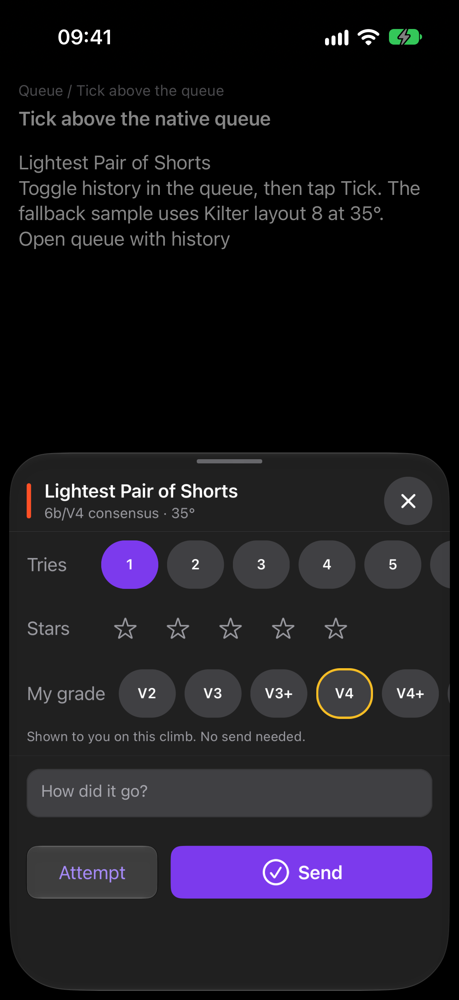
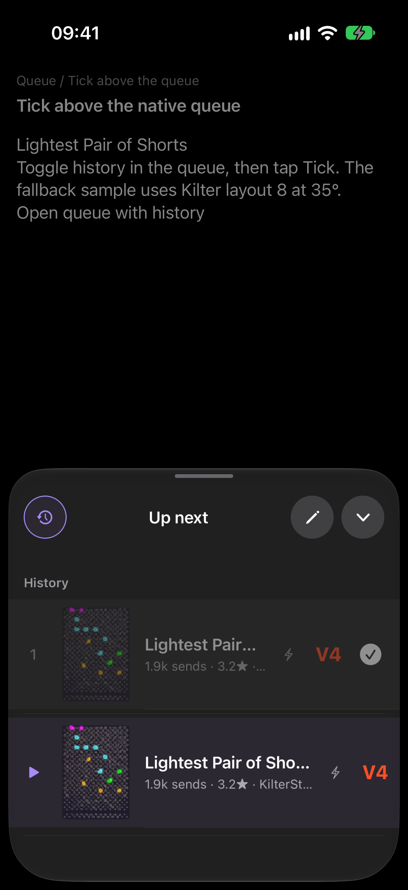
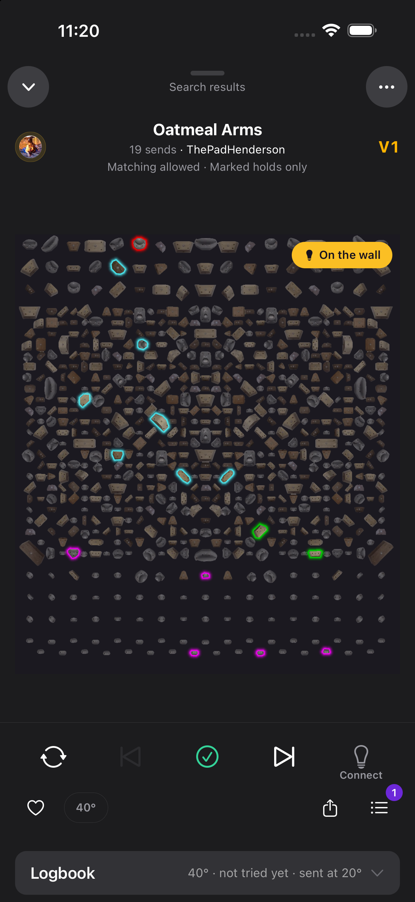
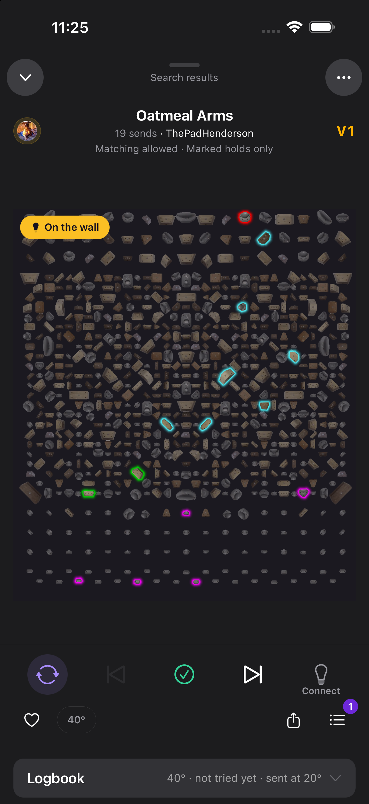
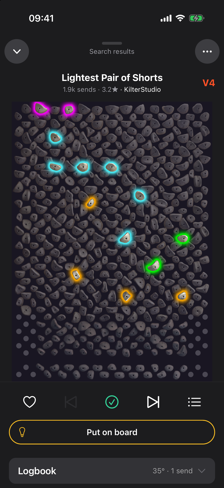
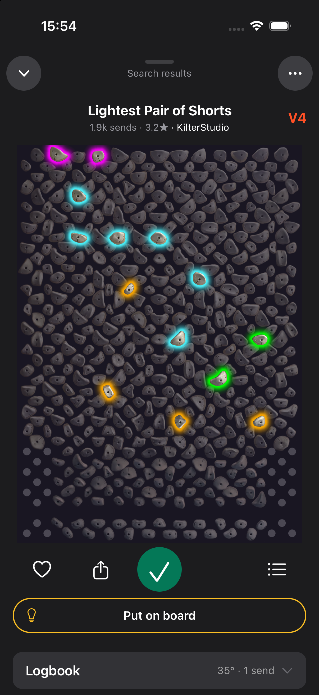

# Climb view options

What a climber can change about the player (the climb view): the sections below the climb, and the player buttons
around Log (#6229), plus the buttons on the MiniPlayer bar above the tabs (#6940). All three live in the player's
⋯ → **View options** sheet, on three tabs, **Below the climb**, **Buttons** and **Mini player**. Settings → Climbs & grades → **Climb view** has the same switches on the native form; the order only
changes in View options (#6477, #6480). The sections half is described in
[mobile-sheets-vs-routes.md › Play drawer section controls](mobile-sheets-vs-routes.md#play-drawer-section-controls);
this page covers the buttons, the MiniPlayer and what they share.

## What the climber gets

- **Buttons**: a switch and ↑/↓ arrows each for Mirror, Favorite, Queue, Share and Angle; one switch for
  **Previous and next**; a **Board control**, Wall button (the default) or Lightbulb; and a **Position**, Below the
  board (the default) or Above the board. A pinned preview draws the bar for the board on screen as the climber
  changes it. Settings › Climb view has the same Board control picker.
- **Defaults**: Mirror, Angle, Favorite, Share, Queue in that order, all on, with Previous and next off. The first
  candidate and last three fill the four positions around Log: `⇄ ♡ ✓ Share ☰` on a board that mirrors,
  `Angle ♡ ✓ Share ☰` on an adjustable board that doesn't. Angle waits in ⋯ while Mirror takes its place.
- **Restore defaults** on the Buttons tab brings back that bar, with the wall button below the board and Previous
  and next off. The Below the climb tab has its own Restore defaults for the sections.
- Existing customized button choices, position and board control survive the upgrade. An untouched layout adopts
  the new defaults. Explicitly stored Previous and next choices stay as they were.

Log uses a 56 pt filled circled-check symbol in the same neutral colour as the other actions (white in dark mode).
The native symbol centres the check within its circle. Its ordinary row keeps its existing 60 pt height:
4 pt top padding plus the 56 pt control replaces 12 pt plus 48 pt. Neighbouring controls keep their sizes, and
the rendered board keeps its allocation. The count badge, tap and hold behavior are unchanged.

Queue history keeps its smaller 26 pt Tick, using the same neutral action colour rather than green.
Tapping it opens the logging form above the Queue, retaining the Queue's detent and scroll position.
Close or save dismisses Tick alone. A pending opening is cancelled if its Queue closes or credentials
change; an old dismissal cannot close a later Tick. On iPad, a layout-only Queue fold waits for an
open Tick to finish, so rotation does not discard its note.

The `queue-sheet--history-tick` development story mounts the real QueueSheet with recorded climb data
and two local queue occurrences. It exercises native child presentation without changing the saved queue.
These iOS 27 simulator captures show the logging form and the retained Queue after closing it:

| Tick above Queue | Queue after closing Tick |
| --- | --- |
|  |  |

Fixed, and why:

| Control                                  | Why it doesn't move                                                         |
| ---------------------------------------- | --------------------------------------------------------------------------- |
| Log                                      | The core loop. Always the centre of the big row.                            |
| The board control                        | The one control that says whether the climb is lit, and how to get it lit. The climber picks its look (wall button or bulb), not whether it is there. |
| Put on the wall, busy-wall question, Fell / Sent | Session states, not preferences. Put on the wall is a wall button state; the busy-wall question takes the wall button's row as a pair; Fell / Sent takes the second row while it needs it. |
| Playback slider                          | Belongs to the board, so it always sits next to it.                         |
| Top row ⌄ · list · rest timer · ⋯        | ⋯ is how a hidden button comes back. Where you are (the list, "Projects · 4 of 23", or the workout stage, "4x4 · Rep 3 of 4 · Set 2 of 4") sits between ⌄ and the timer and costs the board nothing. A second, smaller line there is for what the wall is doing. |

## The board control (#7000)

The board control is the whole answer to "is this climb on the wall, how do I get it there, and whose board is it".
It took the place of the header's On the wall and Live chips, the "Lit on the wall" text and the separate Put on the
wall button.

Climbs open in preview by default, including playlist Play and queue selections. Both
lighting switches default off and preserve stored opt-ins. Tap the board control to light
the climb and open the keep-lighting window (45 s by default); on a MoonBoard the tap starts
Driver mode by default, in a crew too (below). Swipe the wall button, or choose **Light every
climb**, for open-ended Driver mode.

### One model, several views

Every view of it draws one model and runs one handler:

- **The model** is `resolveWallControl` (`play-drawer/wall-control.ts`): the state, the holder and their face, the
  tap action, the swipe action, whether a hold opens the sheet, and ids for the label, the screen-reader value, the
  hint and the bulb's value. `wall-control-text.ts` turns the ids into words, with every key spelled out once.
- **The handler** is `useWallControl` (`play-drawer/use-wall-control.ts`): it runs the tap action, opens the board
  sheet on a hold, buzzes, announces a disconnect, and fires `Wall Control Tapped`, `Board Controls Opened` and
  `Wall Control Shown` once each, with the view that was used.
- **The views** draw the model and read nothing else (no presence, no profile, no Bluetooth state):
  `WallControlButton` (full width in the second row, or `compact` in a workout's top row), `WallControlBulb` (the
  first row's bulb), and `PaneWallControlBulb` (the MiniPlayer's bulb standing in for a tablet or open-Duo player's, through
  `pane-wall-control-store.ts`).
- **A face needs a live link.** `holder` is `self` while this phone holds the link (or a wall with no lights), `crew`
  while a crewmate's link is authoritative and presence doesn't name this climber's own account, and `null`
  otherwise. Before the refactor the bulb's pip read board presence by itself and kept the face after a
  tap-disconnect; that pip (`LightbulbHolderBadge`) is gone.

The wall button is the default; View options › Buttons › **Board control** picks **Wall button** or **Lightbulb**
(see [Board control setting](#board-control-setting)). Both use the same model. The wall button's
"You are driving the wall" tap stops driving while keeping the link; the bulb's tap disconnects instead.
Holding either opens the board sheet while this phone holds the link.

**The label says what a press does** (#7113, Marco). The bulb's fill, outline or spinner already shows the
connection, and the face whose board it is, so the label doesn't restate either. Every press that puts the climb on a
board, connecting first when needed, says "Put on board"; screen readers hear where things stand after it ("Put on
board, Sam has the board").

The full wall button's frosted surface marks confirmed physical driving: `model.driving`
is true and supported navigation changes the wall. Connect, re-light, previews, crew relays
and a held link without driving stay plain. A peek, drag or committed swipe awaiting
confirmation uses flat amber progress. Without hold geometry, driving uses its existing
flat amber fallback; the label still says what the next press does.

| State (`resolveWallControlState`) | The button | A tap |
| --- | --- | --- |
| No board linked (`connect`) | tonal "💡 Put on board" | connects, and the connect lights it |
| No link, but presence says the climb on screen is the wall's, lit under an hour ago (`on_wall_unlinked`, QA #147) | "💡 Put on board", amber outline, the sheet's label colour, no frost or face; screen readers hear "On the wall" | connects and lights it again: the climber's own climb re-asserted (through the #4979 hold), a preview put up; never left to the auto-send |
| Preview or crew browse (`put_on_wall`) | tonal "💡 Put on board" (on a crewmate's board too, their face at the edge); tonal "Set active" where no wall is reachable, since the press only makes it the current climb | puts it up, connecting first if needed |
| Linked, this climb dark (`dark`) | tonal "💡 Put on board" | re-lights it (clears a Turn off all lights and the #4979 hold) |
| This phone holds the board, climb lit, not driving (`lit`) | tonal "💡 Disconnect board", filled bulb and face | disconnects this phone (the board sheet's Disconnect) |
| This phone holds the board, climb lit, driving (`lit`, `driving`) | "💡 You are driving the wall": the frost (or filled amber); screen readers hear "every climb you pick lights up" and "Tap to stop driving" | stops driving and keeps the link (`stop_driving`, #7113) |
| A crewmate holds the board (`crew`) | tonal "💡 Put on board", outline bulb and their face; no swipe-to-drive | relays the climb to their phone |
| This account holds it on another device (`crew`, `holderIsSelfAccount`) | tonal "💡 Put on board", no face; screen readers hear "On your other phone" | relays it to that phone |
| A crewmate's board, nothing to relay | tonal "💡 On Sam's board" / "On your other phone" / "On your crew's board": the only labels left that say where things stand | nothing |
| A wall with no lights | Take the wall / Release the wall | as the bulb always did |
| Nothing to offer (`null`) | an empty slot of the same height | nothing |

- **One icon, one face.** The bulb sits at the leading edge in every state. Whoever holds the board sits at the
  trailing edge at the same inset, as a 24 pt face (`model.holder`): this phone's climber when this phone holds
  it, the crewmate when theirs does, nobody with no live link. The label stays centred either way. Screen readers hear
  the label, then where things stand ("Put on board, You have the board"); the face itself is hidden. Disconnect
  board reads "Disconnect board, You have the board, lit on the wall", with the hint "Tap to disconnect. Hold for
  board controls."
- **Only Disconnect board disconnects on a tap.** Marco tried it on the phones: once the climb is lit and the
  board is yours, the next thing you want is to let go of it. The tap buzzes as a warning and a screen reader hears
  "Board disconnected". Every other state keeps its tap (connect, put on the wall, re-light, relay).
- **A press on You are driving the wall stops driving and keeps the link** (#7113). One rule, solo included: the
  press stops driving (a light buzz, "Stopped driving the wall" for screen readers), the label changes to
  "Disconnect board", and swipes go back to previews; the next press disconnects. The frost disappears
  immediately, even if swipe progress has not settled. Disconnecting a crew's board has no Undo and breaks every crewmate's
  relay, so a press on You are driving the wall never disconnects. Solo with
  Light the board as I swipe on, the stop holds until the link drops, or until the climber presses to put a climb
  up again (below); it never flips the setting. A second tap inside 600 ms of a stop or a disconnect is dropped.
- **A tap opens a keep-lighting window (2.7).** Connect, Put on board and re-light put the
  climb up with the existing one-climb runner. Put on board then lights every climb you pick
  until the window ends: 45 s after the last lit climb by default, renewed by each climb this
  phone's own picks light (Settings › Board: Off, 30 s, 45 s, 1 min or Until I stop). A
  crewmate's put-up ends the window (`window_ended`, `use-drive-follow.ts`): their relay
  never renews it, so the holder's next pick is a preview again and Put on board asks the
  busy-wall question. Open-ended driving follows a crewmate's put-up instead. While a connect
  is in flight (the device picker open) the 30 s arming timeout waits. The window starts on the wall's
  lit confirm, not on the press, and its shown end is clamped to the auto-disconnect deadline.
  Every pick reads the window's end off the wall clock (`drivingAtPick` in `drive-mode-store.ts`),
  never a timer alone: Android pauses JS timers with the activity (#7038), so a pick past the end
  stays a preview even before `DriveModeWatcher` has ended the window and tidied the button.
  A rest or a long look drops back to previews. **Turn off all lights** in the board sheet ends a window or an
  open-ended drive as a stop does (`stopDrivingForLink`, said aloud), so the dark wall's Put on board means one
  climb and the next pick is a preview. In a crew the window needs **In a session too**
  (on by default). A swipe or the accessible **Light every climb** command starts open-ended
  Driver mode instead, which also ends a window's clock. Solo with **Light the board as I
  swipe** explicitly enabled, `tapDrive: 'resume'` clears a stop on this link so that saved
  opt-in applies again.
- **The three looks of the wall button.** Plain tonal: a preview, or a single lit climb.
  Plain with a violet drain bar and an m:ss clock ("Each pick lights · 0:38"): the window.
  A tap on it stops the window and keeps the link. Frost: open-ended driving only, "You are
  driving the wall". A window never frosts. The top bar's second line says "Preview · not on
  the wall" for a preview while this phone holds the board, or while a climb lit in the last hour may still be
  on the wall (`wallCouldLight` in `wall-state.ts`).
- **A MoonBoard press drives by default (2.7: `moonboardPutOnBoardKeepsLighting`, default Until I stop), in a crew
  too.** Most
  MoonBoard controllers don't like phones switching, so a MoonBoard has its own keep-lighting choice, and it applies
  in a crew session too, whatever **In a session too** says (`resolveKeepLightingPlan` in `lib/keep-lighting.ts`).
  At the default the model's `tapDrive` is `drive`: once the climb is up, the press starts an open-ended drive (the
  frost). A timed MoonBoard choice gives `window` like any other board. Where no drive can start here (no swipe
  offered, the `wall-swipe-to-drive` flag off, a drive already on) the press lights one climb. Never on Set active.
  `Drive Mode Started` and `Drive Mode Ended` say `startedBy: 'tap'` and carry `boardType` for these drives. This
  still needs a field test on real MoonBoard controllers.
- **Driving the wall** (#7113) lives in `drive-mode-store.ts`, in memory only: `arming` while a swipe's connect or
  first light is in flight, `live` once every change of climb lights the wall, in a crew too. `DriveModeWatcher`
  (mounted once in the root layout) ends it when this phone's link or hold drops, the swipe's connect fails (or
  arming passes 30 s), the session or the board changes, or the climber signs out; going to the background ends
  nothing. A press's "stopped" lasts until that link drops, a solo press resumes an explicit Light on swipe opt-in, or Put on board opens a keep-lighting window or drive (`tapDrive`). The model's `swipeAction` is `drive` on Put on board
  (this phone's board) and on Disconnect board while not driving; never on Sam's board (his phone holds it), a relay, Set active, a wall with
  no lights or another board's climb (`offWall`; nor does Put on board's keep-lighting there), or while the busy-wall question is up or a connect is in flight. `climbChangeStaysViewOnly`
  (`play-drawer-navigation.ts`) is the one rule for whether a change of climb lights: driving always does, otherwise
  the setting decides solo and a crew previews. A drive starts from the swipe below, its "Light every climb"
  screen-reader action, or the board sheet's row. Holding any
  view, in any state, or ⋯ › Board controls opens the board sheet (Re-light, Turn off all lights, Disconnect, plus
  the MoonBoard "Light the hold above") while this phone holds the link; screen readers get the hold as a named
  action, "Board options". Every view runs the same tap. The player's sheet leaves out auto-disconnect and the two lighting switches, which live in Settings ›
  Board; the app-wide sheet (the top bar's bulb, the Climbs header pill) keeps them. Both sheets lead with **Keep
  lighting after Put on board** (the MoonBoard's own choice on a connected MoonBoard), so the window's length is two
  taps away at the wall. A change there applies to the window that is running (`DriveModeWatcher`): a new length
  counts from the change, Until I stop makes it open-ended, and Off ends it. The player's sheet carries a status
  line for the climb on screen. Auto-disconnect still frees the
  board. Its countdown starts over on every write that lands, every change of preview in the player and every
  wall-button press (tap, hold, swipe, the named action), so browsing previews with nothing lit never drops the
  board; an open-ended drive with nothing picked still counts down, so a phone left in a bag lets go. When it
  lets go it says so in a toast: "Disconnected after 30 seconds with no new climb lit or previewed. Put on board to reconnect."
  (the configured time).
- **One press through the #4979 hold.** A press that connects asked for the climb, so it lights a climb held dark
  for 4 h in that one press: Put on board re-asserts when its connect's first write meets the hold (any hold while
  the connect is on its way, or within a minute of it linking), and Light again and the swipe's drive re-assert as
  their connect resolves, which the provider carries to the link that comes up within 5 s. A bulb's connect never
  re-asserts: it keeps the hold by design.
- **No control for a climb this wall can't light**: the switch-board overlay, another board's climb, or a board with
  no lights linked (`offWall`). A tap there could only re-send the queue head.
- **A tap while the busy-wall question is up does nothing**: Put mine up is the one answer
  (`resolveWallControlAction`'s `confirmArmed`).
  When the preview belongs to another board at the gym, **Put mine up** commits the preview and follows
  **Put on {board}** to move there, connect and light it. A board already used by the crew still relays to
  its holder instead of moving this phone; **Keep theirs** leaves both boards alone.
- **Lit only with a live link.** `resolveWallLit` (`play-drawer/wall-lit.ts`) decides it: this phone's link or a
  crewmate's. The server's board presence never clears and can name a climb lit 8 hours ago, so with no link the
  button offers a connect (Put on board). A preview of another climb, the #4979 hold and "Turn off all lights" read as dark.
- **Look.** `wallControlUsesFrost` (`wall-control-frost.ts`) requires confirmed driving and excludes virtual
  Take/Release wall controls and Set active. PlayCore checks whether the board has LEDs, using the destination
  board's LED metadata for a cross-board action. A lit physical board driven by this phone gets the climb's
  hold-colour frost; a connected non-driving holder, preview, crew relay or connect remains plain. The label
  says what the press does, and "You are driving the wall" says supported climb changes light the wall.
  The glow uses the displayed climb's holds (look F1b, `wall-glow.ts`, `WallGlow.tsx`, described in
  `ai-design-guidelines.md`). Without hold geometry the old fallbacks remain: `live` amber while driving,
  tonal violet for other actions, or the amber outline for unlinked wall presence. The tonal fill is 20% of the
  brand violet (`WALL_CONTROL_TONAL_ALPHA`), with at least 4.6:1 label contrast on every Liquid Glass and Material
  sheet (`wall-control-button-contrast.test.ts`). Lightbulb mode keeps its own fill rule (`resolveWallBulbLook`).
  PlayCore supplies `useParseFrames` geometry from the playback frame and colours from `use-hold-state-colors.ts`,
  memoised on climb, frame, mirror and colours. 44 pt tall on iOS, 48 dp on Android; the second row's fixed height is built from it, so nothing moves
  between states. The row's padding matches the Logbook card's edges below it. A long label (German, a long name)
  shrinks to 80% before it truncates. While a climb is written to the LEDs it shows the bulb's spinner, and in
  auto-disconnect's last ten seconds the bulb's amber ring.

While the #4979 hold keeps the current climb dark, the wall button reads Put on board and nothing else
changes in the controls. The "Last on the wall …" note that used to sit under it (#7000) was removed: climbers
didn't find the date useful.

The header has one wall chip left, the back chip during a preview: a back glyph, words that say where back goes
(QA #147, Marco: "My pick" for the climber's own current climb, "On the wall" for the wall's), and the face of whoever
lit the wall when back lands on their climb (`resolveHeaderPillState`). Screen readers hear "Back to my pick: The
Eyes" or "Back to the climb on the wall: The Eyes". It shows only when going back lands somewhere, and DrawerHeader
floors both flanks; the words cap at 96 pt, so they can't squeeze the climb name.

**Trusting board presence without a link (QA #147).** Aurora and MoonBoard boxes keep their LEDs after a phone
disconnects, so with no live link (this phone's or a crewmate's) presence's wall climb is trusted for an hour after it
was lit (`presence-freshness.ts`: `isPresenceFresh`, `usePresenceFresh`, which re-renders once when the hour runs
out). Inside the hour the wall's climb is `on_wall_unlinked` (screen readers hear On the wall), `resolveWallLit` reads
it lit, and the back chip can go back to it; past the hour the button's press connects (`connect`), never a
preview's put-up, and the Climbs
header's wall capsule hides (#7095, `trustedWallCapsuleClimb`). With a live link the link decides and freshness
doesn't matter.

### Swipe to drive (#7113)

Swipe the wall button left to drive the wall: connect if needed, light the climb on screen, and light every climb
picked after it, in a crew too. Behind the positive flag `wall-swipe-to-drive` (`useWallSwipeToDriveEnabled`); with it
off the button has no chevrons, no peek and no gesture, and the screen-reader action and the sheet row hide too.

- **Where.** Wherever the model's `swipeAction` is `drive` and the host hands `onSwipe`: the full-width button and the
  workout's compact one. Not on the bulb view (there the sheet row is the way in).
- **The gesture** (`use-wall-swipe.ts`, numbers in `wall-swipe.ts`). A pan that claims a leftward drag past 10 pt and
  gives way to a vertical one past 14 pt. Flat `live` amber progress (`WallSwipeWipe`) moves in from the trailing
  edge on the UI thread, with no React render per frame. It stays flat during a peek, drag and committed swipe
  awaiting confirmation, even when hold geometry is available. Letting go commits past 55%
  of the width (189 pt of 343 pt, like the climb rows' full swipe), or on a fling faster than −800 pt/s once past
  25%. Crossing the commit point buzzes medium once and the label becomes "Let go to light every climb". Short of it
  the gesture springs back (damping 20, stiffness 300). Past it the flat progress fills the remaining width in
  150 ms and holds until the drive goes live (a live drive whose climb doesn't read lit yet gets 1.5 s, and never
  an error). Once the model confirms driving, the button shows its driving frost or amber fallback and says You are driving the wall;
  the lit confirm buzzes success. A refusal, or a drive that ends while still arming (a failed connect), cancels
  the gesture with an error buzz and springs back the progress. A pan swallows the tap and the hold it ended in, and a drag after a hold that already fired
  does nothing (the sheet is opening). A system gesture that takes the touch cancels the pan, which springs back like
  any cancel. **Android's edge Back** was the one that mattered: measured on a Pixel 8 Pro with gesture navigation,
  drags starting 35 dp or more from the screen edge drive and drags starting 28 dp or less go Back and close the
  player. The full-width button ended 16 dp from the edge, so its trailing ~12 dp sat in the zone, and neither RN nor
  RNGH can exclude it without native code. So on Android the button takes 16 dp more margin on both sides wherever it
  is the one thing drawn in a phone's second row (counted by what draws, so an angle pill with no angle or a Share
  with nothing to share doesn't count), 32 dp from each edge, the same on the left and the right so it stays centred
  (`ANDROID_EDGE_BACK_EXTRA_INSET`, `WallControlButton.tsx`; `spansRow` from `PlayDrawerActionBar`). The height doesn't
  change, so the second row's fixed height holds. iOS, the workout's compact button between ⏮ and ⏭, the button
  between the bulb row's buttons, and the first-row button beside a MiniPlayer (a tablet's pane, away from the edge)
  are unchanged. On Expo web the detector has `touchAction="pan-y"`.
- **No swipe on a crewmate's board**, by design: his phone holds it, and Put on board relays the climb to that
  phone. That relay stays tonal and has no chevrons, no peek and no gesture. A drive the runner still can't
  start (presence says another account holds the board) answers `held_by_crew`, cancels with an error buzz and
  springs back the progress.
- **The hint.** Resting ‹‹ chevrons (10 pt, at 70% and 40% of brand violet) sit before the face slot wherever the
  swipe is offered; the flat progress uses its readable amber label colour over them. A 28 pt trailing-edge peek and
  spring-back (about 700 ms; a fade in place under Reduce Motion) plays where the swipe is news (2.7, spec B3): the
  first keep-lighting window in an app session, and one replay that session on the third Put on board within 5
  minutes. The peek uses the same flat amber progress, with no bokeh before driving. At most 3 sessions on the v2
  count `wallSwipePeekSessionsV2`, so a climber who used up 2.6's three sees it again for the new meaning; never again
  once a swipe has driven the wall (`wallSwipeUsed`, kept from 2.6), never in screenshot mode, never with VoiceOver or
  TalkBack on (`lib/wall-swipe-hint.ts`, built like `reset-zoom-hint.ts`). A session counts towards the three once a
  peek runs, however many play in it.
- **Driving frost and flat swipe progress.** PlayCore prepares hold geometry only for confirmed physical driving,
  when the button renders `WallGlow`. Non-driving drags and peeks use the temporary flat `live` amber `WallSwipeWipe`,
  which unmounts when the gesture settles or driving is confirmed. Stopping or browsing removes driving frost
  immediately, including in the compact workout button, even if swipe progress remains.
- **Without the swipe.** Screen readers get the named action "Light every climb" beside "Board options" (the rotor,
  or TalkBack's actions menu). The spoken hint stays the tap's: under VoiceOver and TalkBack a swipe moves focus. The board sheet's first row is **Light every climb** wherever the
  swipe is offered: the visible way in for the bulb view and for Put on board with no link, where a hold opens no
  sheet. ⋯ › Board controls opens the sheet then even with no link, showing only that row.

### What we measure

- `Wall Control Shown {state, climbUuid}`: `connect` once per player open, `put_on_wall` once per climb per open, only
  while drawn (`use-wall-control-shown.ts`, `isWallControlDrawn`). The iPad pane counts an open as the stretch it
  shows a climb.
- `Wall Control Tapped {state, action, control}`: every tap on any view, `control` saying which: `button` (the wall
  button, full width or in a workout's top row), `bulb`, or `mini_bar` (the MiniPlayer's bulb standing in for a
  tablet or open-Duo player's). A tap on Disconnect board logs `{state: 'lit', action: 'disconnect'}`; a tap on
  You are driving the wall logs `{state: 'lit', action: 'stop_driving'}`.
- `Wall Control Swiped {state, outcome, control}` (#7113): once per swipe that got going (a drag past 10 pt), with
  the state it began in. `outcome`: `drive` (let go past the commit point and a drive started), `cancelled` (let go
  short of it), `refused` (past it, but nothing could start: presence says another account holds the board). Whether the
  drive then went live is `Drive Mode Ended`'s `reason`. The screen-reader action and the sheet row don't fire it.
- `Board Controls Opened {surface: 'play_drawer', source}`: a hold on `button`, `bulb` or `mini_bar`, or
  `player_menu`. A tap never opens it. Pre-release QA builds sent `wall_control`, `bulb_long_press` and
  `open_sheet`; no store build did.
- Beside a MiniPlayer with the bulb chosen (tablets, the open Duo), the player counts `Wall Control Shown` for
  `connect` on the bar's bulb, which stands in for it.

## Layout rules

Mirror is saved on each committed queue occurrence, in solo climbing and in a crew.
The player, mini player, wall and Log ascent use that occurrence's orientation.
History keeps the saved flip for logging and replay; a fresh occurrence starts with
its own supplied orientation. Mirroring a preview stays local and its temporary
flip is cleared when the preview is committed.

After mirroring the same solo climb, advancing and returning to it:

Captured on an iOS simulator with recorded data; physical BLE was not exercised.

| Before: flip forgotten | After: saved flip restored |
| --- | --- |
|  |  |

`resolveActionBarLayout` (`packages/mobile/src/components/play-drawer/action-bar-layout.ts`) is the one rule. The
bar, the player's ⋯ menu and the preview all read it, so they can't disagree.

```
Wall button (the default)
Adjustable, no mirror     [40°] [♡]  [✓] [Share] [☰]   /  [ 💡        Put on board             ]
Tension, Decoy, Woods      [⇄]  [♡]  [✓] [Share] [☰]   /  [ 💡      Disconnect board       (me) ]
Busy wall                 [40°] [♡]  [✓] [Share] [☰]   /  [ (S) Keep Sam's ] [ 💡 Put mine up ]
Fell / Sent                [ ] [ 💡   Disconnect board   (me) ] [ ]  /  [ Fell              Sent ]
Previous and next on       [⇄] [⏮]  [✓]  [⏭]   [☰]   /  [ 💡        Put on board             ]

Lightbulb
Tension, Decoy, Woods      [⇄]  [♡]  [✓] [Share] [💡]   /  [40°] ······················ [☰]
A preview                  [⇄]  [♡]  [✓] [Share] [💡]   /  [40°] [ 💡 Put on the wall ] [☰]
Fell / Sent                [⇄]  [♡]  [✓] [Share] [💡]   /  [ Fell              Sent ]
Busy wall                  [⇄]  [♡]  [✓] [Share] [💡]   /  [ (S) Keep Sam's ] [ 💡 Put mine up ]

Anonymous                  [ ]  [⏮]  [✓]  [⏭]  [ ]    /  [40°] ················ [⬆]   (mirror boards keep [⇄])
```

- **Four positions around Log.** With Previous and next off, up to four enabled, applicable buttons take the row.
  If more than four apply, the first and last three in the climber's order get the positions, in that order.
  With Previous and next on, the pair takes the two inner positions and the first and last candidates get the
  ends. A single candidate takes the leading end; with fewer than four, the first and last stay at the ends and
  intermediate candidates fill the inner positions from left to right. Mirror only applies on a board that
  mirrors (`boardSupportsMirroring`), Angle only where the angle changes. A draft keeps Share's empty position,
  so other controls don't jump between climbs. Every applicable action not drawn remains in ⋯.
- **Second row**: with the wall button chosen, the wall button alone, full width, in every wall state. With the bulb
  chosen, the bulb takes the trailing slot and the second row stays on every board with lights, as the bar before
  #7000 did, so the board never jumps mid-swipe: the climber's other enabled buttons not in the first row, small,
  the first half left and the rest right, and Put on board in the gap for a preview, which pushes
  nothing into ⋯. With no Bluetooth, on a spray wall or on a board with
  no lights there is no wall to light, so the row collapses (and there is no bulb). A preview keeps the row there
  for its Set active button.
- **Previous and next off** fills the two inner positions with actions while Log stays centred. Swiping the board
  still moves, and the board’s screen-reader increment/decrement actions still navigate.
- **The busy-wall question** (#7017, `commitButton: 'confirm'`): someone else put a climb up while this climber
  looked around. Nothing draws over the first row or the climb. The question is the header caption, "Sam just put
  up Crimp Ladder" (`playView.wallState.busyWall.captionNamed`, the climb's name last and cut first), in place of
  "Only you see this", and VoiceOver hears it once. The answers are the wall button's row as two segments in the
  wall button's family (`BusyWallQuestionGroup`): 44 pt, pill radius, the same type, two equal halves with an 8 pt
  gap. Put mine up keeps its tonal fill, bulb (filled amber while this phone holds the board) and lavender label.
  It confirms the tap the climber just made and keeps its tonal confirmation surface. Keep
  Sam's is the neutral tonal fill with a hairline and Sam's face, and reads "Keep theirs" where the name won't fit.
  Where a label won't fit half the row (large Dynamic Type, German) the two stack full width, Put mine up on top.
  The first row stays as it was in both Board control modes; Put mine up carries the bulb, so the wall button's bulb
  doesn't come back. Taps on either segment in the question's first 500 ms are dropped (`useBusyWallQuestion`), so
  a thumb already on its way to the wall button doesn't answer a question it never read. Browsing on still
  cancels it. The rule (`resolveBusyWallQuestion`, `resolveBusyWallFit`) decides the labels and the disabled
  state; the view only draws.
- **Fell / Sent** (`workoutOutcome: true`) keeps the climber's chosen look; it never switches icon language mid-block.
  With the wall button, the top row becomes `⏮ [wall button] ⏭` (`primaryCenter: 'wallControl'`): the same button,
  `compact`, about 239 pt wide on a 375 pt phone, same height, radius and colours, its label shrinking to 85% for
  German. ⇄ / ♡, ✓ and ☰ wait in ⋯ (`hidden.tick` adds a Log row there); Fell / Sent log each go. The ⏮ ⏭ slots
  keep their 48 pt even with Previous and next off, so the row and the board keep their size. Each first row is
  keyed, so the swap back to the five slots mounts fresh views; reused ones kept the `⏮ [wall button] ⏭` row's
  styles and left the slots uneven (#7017). The busy-wall question in a block takes the second row as the pair,
  with the five-slot first row. With the bulb, the block keeps today's row, `⇄ ⏮ ✓ ⏭ 💡` over Fell | Sent.
- **Tablets and the open Duo: the wall button moves up a row (Marco's tablet rule).** There the MiniPlayer always
  shows beside the player (the open Duo's pane, the iPad's player route) and has the same controls as the player's
  first row: ⏮ ⏭, the climber's buttons, ⋯ and ✓. So the player drops its first row of icons and puts the
  full-width wall button there instead (`primaryCenter: 'wallControlFull'`), with the same driving-only frost, bulb and face rules, or the
  busy-wall question's pair in its place (`primaryCenter: 'confirm'`); the second row is only Fell / Sent (or the
  pair, with the bulb chosen), and otherwise folds so the board gets the height back.
  The MiniPlayer then has no bulb of its own. With the bulb chosen the player has no first row at all, and the
  MiniPlayer's bulb is the player's board control (`PaneWallControlBulb`, `control: 'mini_bar'`, the same model and
  handler), with a preview's Put on the wall in the player's second row. The signal is one rule in two halves:
  `playerMirroredByMiniPlayer` for the player (the native accessory is the climb's home, and the player is the
  Duo's pane or a tablet's route) and `miniPlayerPaneMode` returning `mirror` for the bar (the Duo's pane isn't
  taken by a screen, or a tablet's player route is up). The JS tablet shell's pane has no MiniPlayer beside it, and
  phones are unchanged. Nothing in the player sits under the bar: in the Duo's pane `insets.bottom` already
  includes the accessory, and with the second row folded or taken by Fell / Sent the board no longer fits to the
  height past it.
- **What may hang below the fold (#6956).** The landscape iPad player fits the board to the screen's height only
  when its second row is plain: every item a player button or the gap (`secondaryRowCanFold`,
  `shouldFitBoardToHeight` in `play-drawer-layout.ts`). The wall button never folds (Marco's call), so with the bulb
  chosen a preview's Put on the wall stays on screen, and so do the busy-wall question and Fell / Sent. The
  allow-list ends in a `never` switch, so a new kind of item stays on screen until someone decides otherwise. The
  Duo's pane always fits, since its inset already clears the MiniPlayer.
- **After a tap-disconnect.** Taps are dropped for 600 ms (`DISCONNECT_TAP_GUARD_MS`): the provider marks the link
  down before the adapter lets go, so a double tap's second tap would otherwise start a connect. "Board
  disconnected" is announced when the link actually drops. A dropped link, or the wall coming back to the cleared
  climb, forgets a Turn off all lights.
- **The bulb fills whenever this phone holds the board.** In the wall button and in Lightbulb mode, the 💡 glyph is
  filled amber while `model.holder === 'self'`, in any state: Put on board on a preview with the link up,
  Disconnect board, a dark climb. Otherwise it is an outline. The full wall button's frost requires confirmed
  driving; previews, crew relays and held links without driving remain plain. Its label says what a tap does
  and whether subsequent climb changes light the board.
- The bulb reads the same model as the wall button: grey outline with no board, filled amber while this phone holds
  the board or a crewmate's climb is lit, amber outline when the board is on the wall but not this phone's. The
  holder's face sits on its corner (only from `model.holder`). Screen readers hear "Board lights", the state, and
  what a tap does.
- **A preview in a block.** Fell / Sent only ever shows for the climb on the wall and on screen
  (`shouldShowWorkoutOutcome`), so a preview of another climb gets Put on board in the second row in both modes,
  and its Fell / Sent comes back with the climb on the wall. Showing Fell / Sent there would log a climb the
  climber isn't looking at. See [One-tap Fell / Sent](#one-tap-fell--sent).
- **The anonymous web reader** gets a read-only bar whatever the device stored: no heart, queue, bulb or wall button,
  and Angle and Share stay in the row, since they have no ⋯ to bring a button back.
- Every button the bar is not showing is flagged in `hidden`, and ⋯ carries a row for each.

### ⋯ stand-ins

`PlayDrawerHiddenButtons` has a flag per button: `tick` (only in a block with the wall button), `favorite`, `share`,
`queue`, `mirror`, `angle`. The player's ⋯
offers a row only while its flag is up (`play-drawer-menu-rows.ts`), so an action never shows twice. Mirror,
Change angle and **Board controls** (while this phone holds the link) form their own group after the queue rows. The
Favorite row runs the bar heart's own toggle and reports its own `source` on Favorite Toggle. Both are disabled on another board's climb, like every row
that writes or touches the wall. The Mirror row runs the same `handleMirror` as the button (shared-session
orientation included); Change angle opens the player's own angle sheet, so it presents above `/play`.

<a id="board-control-setting"></a>
### Board control setting

View options › Buttons › **Board control** (and Settings › Climb view) picks how the board control looks:
**Wall button** (the default, the full-width second row) or **Lightbulb** (the first row's trailing slot). The
choice rides the buttons' record as `boardControl` (see [Storage](#storage)). Both modes draw the same model and run
the same handler, so a tap and a hold do the same thing in either; only where the control sits changes
(`resolveActionBarLayout`'s `boardControl`).

### One-tap Fell / Sent

In a timed workout block (#6231, #5380) every go gets logged, so the small row becomes two 44 pt buttons. Both save
through `useTickSaver`, the same path as the Log ascent sheet, so the rest timer and the workout's tick log get the
tick's status and queue item exactly as from the sheet (`docs/workout-stages.md` › Pacing).

- **Fell** logs one try at once (`attempt`, 1 try). Nothing waits for the end of the climb, so an early End, a killed
  app or a dead signal loses no falls.
- **Sent** logs a flash when the climber has no tick on the climb at this angle and no fall on this queue item
  earlier in the block, else a send (`deriveAscentType`). While the logbook is still loading it says send, as the
  sheet does.
- **A spray climb nobody has sent** needs a grade, which only the sheet asks for, so Sent opens Log ascent instead.
  Fell still logs at once: a try sets no grade. The queue's copy of the climb never hears of a send, so once the
  climber's own send is in this block's tick log (this queue item) or their logbook (this angle), later Sents log in
  one tap again.
- **One tap at a time.** A second tap within 700 ms (`ONE_TAP_GUARD_MS`), on either button, is dropped, and so is a
  tap while a save for that queue item is still in flight. A fumbled double tap logs one go, never a fall and a send.
  The guard, the in-flight saves and the saved line are shared by every Fell / Sent on screen
  (`workout-one-tap-store.ts`): the player's row and both MiniPlayer placements, so a tap on one and a tap on another
  within the guard also log one go.
- **A 4x4 set is one climb, every rep.** Each Fell or Sent is one rep on the climb on the wall, and the climb stays up
  (with the row) until the set's last rep is logged, then the set rest runs and the wall moves on. A Sent after the
  set's first rep logs a send, never a flash: the first rep is already in the block's tick log for this queue item.
- **Just after the wall moves on.** An on-the-minute beat advances whether the climber logged or not, so a tap within
  2 s (`WALL_MOVED_GRACE_MS`) of the climb on the wall changing logs for the climb it left, against that queue item
  (`TickSaveFields.queueItem`), with that climb's own flash rule. Every one-tap names its queue item this way, and
  the saver still holds it to `attributeTickToQueueItem`'s angle rule: a tap at another angle than the item is up at
  (the board moved, the queue has not regraded yet) saves the tick but counts it for no queue item. Nobody gets a go on a climb that fast after it
  lights up. A first ascent there can't open the sheet (it would open on the new climb), so the row says to swipe
  back to it. A new copy of the same queue item is not a move.
- **The row stays through the grace when the wall leaves the block** (`useWorkoutOutcomeHold`). When the beat moves
  the wall onto a climb outside the timed block, the gate turns false at once, and the normal row would put the heart
  and the angle button where Fell was, under a finger already on its way (simulator QA: a Fell tap just after the
  last beat opened Choose Angle). So the player keeps Fell / Sent for the climb it left for the same 2 s, then swaps.
  Taps in that window log there, exactly as above; one past it is dropped, never sent to the new climb. The hints
  name that climb ("Logs one try on Crimp line, the previous climb") and the saved line is the full sentence, since
  the board already shows the next one. The hold starts only when the committed climb changed with the player still
  on it; a swipe to browse, the gate coming back, the switch-board gate or a sign-out ends it at once. PlayCore reads
  the held row for the bar layout, ⋯ and the opening layout key, so the row and the board change once, at the swap.
- **The wall at the tap.** The row leaves `useTickSaver`'s `active` out, so each save takes the board as it is right
  then: a board bound from the bulb mid-block is on the next tick. The sheet snapshots it when it opens instead.
- **When it shows** (`shouldShowWorkoutOutcome`): the climb on screen is the committed current one (not a climb the
  climber swiped to or a preview), its run stage has `pacing` (keyed on the pacing, not the stage kinds, so any
  future timed block gets it too), the climber is signed in, it is not another board's climb and not a draft. A
  crew phone without the run never shows it.
- **The row says what a tap did, not a toast.** The player is a native modal on iOS, and the root toast overlay draws
  behind it (a toast fired from the player is never seen there). So after a save the tapped button reads "Try logged"
  (Fell) or "Flash logged" / "Send logged" (Sent) with a check for 2 s (`SAVED_NOTICE_MS`), and both buttons stay
  live. When the go was for the climb the wall just left, the line names it ("Flash logged · Crimp line"). The
  buttons keep their Fell / Sent accessibility labels; the full sentence is announced. A failure, or where to log a
  first ascent, needs reading, so it takes the whole row for 5 s (`MESSAGE_NOTICE_MS`) or until tapped, then the
  buttons come back. The success haptic plays with the line; a failure's comes from `useTickSaver`. Tick Logged and
  Quick Tick Failed report `surface: 'mobile_workout_runner'`, with no Quick Tick Opened before them.
- **A save outlives the row.** Swiping to a preview, the end of the hold after the wall left the timed block or
  closing the player unmounts the row while a save can still be in flight. `useTickSaver` runs the side effects (rest timer, the workout's tick
  log, Tick Logged, the confirmation) off the `mutateAsync` promise, which settles either way, never off a per-call
  `mutate` callback, which React Query drops once the caller is gone. With no row left to say it, that late save
  falls back to the toast, which shows once the player is closed.
- The pair holds the row's fixed height, so the board never moves. The opening-layout cache keys on it
  (`controlsFingerprint`).

### Above the board

`PlayCore` renders the controls region (playback slider, bar, and the switch-board scrim over both) either after
the board or between the header and the lost-holds banner. The block moves whole, so the scrim and its card still
cover every control. Above the board the bar comes first and the slider follows, so the slider stays next to the
board, and the bar's hairline moves to its bottom edge (`edge="bottom"`), the side that faces the board.

The switch-board card (another board's climb) is taller than the controls, more so with the small row off. A card
that spilled out of the region would sit under the next sibling (the board above the fold, the first section below
it), and that view would take the taps meant for Switch board. So while the card is up the region's `minHeight` is
the card's measured height plus 8 pt above and below (a typical 184 pt card until the first measurement), in both
positions. Above the board the region also has `zIndex: 1` over the lost-holds banner and the board. The region
is measured while it sits above, and the wall-state callout hangs below it instead of below the header, so the
notice never covers Log. The opening-layout cache keys on the resolved small row and the position, since both move
the board. The tablet-shell and phone-split panes render the same `PlayCore`, so all of this applies there too.

## Storage

All device-local, in the synchronous settings store (MMKV), so the player's first frame already has the climber's
bar: no jump from today's bar to theirs.

| Key                     | Type                          | Default   | Notes                                                                                         |
| ----------------------- | ----------------------------- | --------- | --------------------------------------------------------------------------------------------- |
| `playerButtonsV3`       | `SectionLayoutRecord & { boardControl? } \| null` | `null`    | Order and switches for Mirror, Angle, Favorite, Share and Queue, plus `boardControl: 'lightbulb'` when chosen. Read and written only by `playerButtonsStore` and `setPlayerBoardControl`. Unknown ids and boolean switches survive writes. A non-v1 or malformed record uses the new defaults. |
| `playerButtonsV2`       | Legacy layout record          | `null`    | Imported once when V3 is physically absent, then left untouched for rollback. |
| `playerPreviousNext`    | `boolean`                     | `false`   | Stored booleans survive; missing or malformed values use the new default. |
| `playerButtonsPosition` | `'below' \| 'above'`          | `'below'` | Anything else reads as `'below'`. |

- `null` means the defaults, so a later release's default order reaches a climber who never changed it. Restore
  defaults writes V3's default state; an explicit V3 `null` blocks re-importing V2, including after a relaunch.
- **V2 migration** runs before the first snapshot. A valid customized V2 record keeps its full old order,
  switches and board-control choice, with missing switches filled from frozen V2 defaults (Share and Angle off).
  An unchanged V2 layout gets the new defaults. A record saved only to choose Lightbulb gets the new buttons
  and keeps Lightbulb. Unknown ids and boolean switches are retained rather than collapsed into a default record.
- **Rollback**: a V2 bundle still reads its untouched V2 layout. V3 writes do not overwrite it. Both generations
  share the Previous and next switch and position, so explicit choices there remain available to either bundle.
- **Why V3.** The old first/last-only row and the four-action row give order different placement semantics. The
  new key makes that change explicit while preserving customized V2 choices through a one-time migration.
- `resetAllSettings` clears current and legacy keys. A fresh launch then uses the new defaults.

The sections below the climb keep their own AsyncStorage record (`playDrawerSections`); see
[mobile-sheets-vs-routes.md](mobile-sheets-vs-routes.md#play-drawer-section-controls).

## Code map

| Piece                                   | File                                                                            |
| --------------------------------------- | ------------------------------------------------------------------------------- |
| Ids, defaults, position type            | `packages/mobile/src/lib/player-buttons.ts`                                     |
| Store, hooks, Restore defaults          | `packages/mobile/src/lib/player-buttons-preference.ts`                          |
| Layout rule                             | `packages/mobile/src/components/play-drawer/action-bar-layout.ts`               |
| Board control model (`resolveWallControl`) | `packages/mobile/src/components/play-drawer/wall-control.ts`                 |
| Board control words                     | `packages/mobile/src/components/play-drawer/wall-control-text.ts`               |
| Board control handler and events        | `packages/mobile/src/components/play-drawer/use-wall-control.ts`                |
| The wall button / the bulb              | `play-drawer/WallControlButton.tsx`, `play-drawer/WallControlBulb.tsx`          |
| The MiniPlayer bulb beside a player     | `queue-control/PaneWallControlBulb.tsx`, `play-drawer/pane-wall-control-store.ts` |
| Tablet rule (who mirrors whom)          | `queue-control/mini-player-controls.ts` (`miniPlayerPaneMode`, `playerMirroredByMiniPlayer`), `play-drawer/use-mini-player-mirrors.ts` |
| Bar                                     | `packages/mobile/src/components/play-drawer/PlayDrawerActionBar.tsx`            |
| Fell / Sent row and its taps            | `packages/mobile/src/components/play-drawer/WorkoutOutcomeRow.tsx`, `use-workout-one-tap.ts` |
| Fell / Sent hold after the wall leaves  | `packages/mobile/src/components/play-drawer/use-workout-outcome-hold.ts`        |
| Placement, taps, ⋯ wiring               | `packages/mobile/src/components/play-drawer/PlayCore.tsx`                       |
| View options sheet (both tabs)          | `packages/mobile/src/components/play-drawer/PlayDrawerSectionsSheet.tsx`        |
| Shared labels and actions               | `packages/mobile/src/components/settings/use-player-button-controls.ts`         |
| Preview                                 | `packages/mobile/src/components/player-buttons/PlayerButtonsPreview.tsx`        |
| Settings › Climb view                   | `packages/mobile/src/components/settings/climb-view/`, `app/settings/climb-view.tsx` |
| Reorder rows (shared with sections)     | `packages/mobile/src/components/section-layout/SectionLayoutList.tsx`           |

## Mini player

The MiniPlayer is the bar above the tabs: the current climb, then buttons. Tap it to open the climb.

The tab and the Settings section show only where that bar is the native bottom accessory (`useTabChrome().nativeAccessory`:
iOS 26 with the Liquid Glass tab bar). On Android, the Material shell and earlier iOS the current climb rides the
floating bar, which has no such buttons, so the tab and section are left out (a selected tab falls back to Below the
climb).

### What the climber gets

- A **Mini player** tab in View options: a switch and ↑/↓ arrows for Next climb, Previous climb, Mirror, Favorite,
  Wall display (tablets only), Queue, Share and Angle, a pinned preview, and **Restore defaults**. Settings → Climbs & grades → **Climb view** has
  a Mini player section with the switches only; the order changes in View options, the same rule as the player's
  buttons.
- Defaults: Next, Previous, Mirror, Favorite and Wall display on; Queue, Share and Angle off. On iPhone the one extra slot goes to Next, so Mirror and Favorite only show on iPad and the open Duo by default. Each switch drives a real button:
  - **Next / Previous**: step the list. Driving lights each supported climb change, including in a crew.
    Otherwise solo lighting follows Light on swipe; in a crew, with Light on swipe off, or after stopping
    driving, they open the player on a preview. Next at the end of a list opens the player.
  - **Mirror**: boards that mirror (Tension, Decoy, Woods). In a crew it sets the shared orientation; solo it
    flips what the wall lights.
  - **Favorite** and **Queue**: signed in only.
  - **Share**: not on drafts.
  - **Angle**: boards with an adjustable angle. It opens the player's angle sheet and is hidden while the player is
    open.
  - **Wall display**: tablets only (`useDeviceLayout().isTablet`, the gate `WallDisplayEntry` uses), so an iPhone
    and the open Duo list no switch for it; there a move steps over it (`miniPlayerMoveSteps`). Hidden while the
    player is open. See Wall display below.
- The preview draws two bars from `resolveMiniPlayerControls`, `miniPlayerSlotCount` and the bar's own
  `isMiniPlayerButtonAvailable`, so it can't disagree with the real one: the open bar at the width the real bar last
  measured on this device (`mini-player-measured-bar-store.ts`, published by `NativeAccessoryClimbRow`; an iPhone
  Duo's closed display, ~290 pt, previews one slot) and the collapsed one, for the board on screen and the
  signed-in state. Before the bar has ever drawn it falls back to 995 pt for an iPad or open Duo and 343 pt for an
  iPhone. On an iPad or open Duo the open bar is drawn in the wide layout below (⏮ ⏭ first, ⋯, the filled ✓).
  Static glyphs; no Bluetooth component is mounted.
- Board light and Log are fixed, like the player's: a note on the tab says so. They have no switch or arrows. The
  tab's footer differs by device: on iPhone it says the bar has room for one button beside them; on a wide screen
  it says the bar fits as many as it has room for.

### Layout rules

- Drawing order, left to right, on an iPhone and on every collapsed bar: the climb, the climber's others, then ⏮ ⏭,
  then 💡 ✓. On a wide bar (below): ⏮ ⏭, the others, the climb, then ⋯ 💡 ✓.
- Slot count (`miniPlayerSlotCount`), Board light and Log included:
  - inline (tab bar minimized): 1;
  - iPhone: `min(3, floor((w − 68 − 140) / 44))`, at least 1, where `w` is the platter width and 68 pt is the
    insets, artwork and label padding. 343 pt and up gives 3; Duo closed (~290 pt) and a 320 pt Display Zoom
    iPhone give 1. With one slot the bar keeps the bulb while the board is free, otherwise Log;
  - iPad and the open Duo: `floor((w − b − 160) / 44)`, which fits every button. `b` is 68 pt on a 48 pt platter and
    74 pt on iPad's ~62 pt one (below);
  - before the first layout: 3 on an iPhone, everything when wide, so the common bar doesn't redraw.
- Every slot sits at one even 44 pt pitch, on every bar, as on Music's (#7048).
- Platter height (`accessoryPlatterGeometry`): the row fills the platter UIKit gives it, so the controls centre in it.
  From 56 pt up (iPad's open bar, ~62 pt) the artwork is 40 pt at a 12 pt inset, the trailing inset is 10 pt so ✓
  centres in the rounded end, and ✓ is 22 pt like its neighbours. Below that, an iPhone's 16 / 8 pt insets, 32 pt
  artwork and 24 pt ✓. The measured height only grows, so a squeezed hidden row never swaps the geometry back.
- Buttons claim slots in the climber's order; what doesn't fit drops from the end of that list. On a wide bar the
  bar's own ⋯ has it; on an iPhone the player's ⋯ does.
- The open Duo's split: the bar is a centred capsule (UIKit's accessory glass, capped at 689 pt by the
  react-native-screens patch), about 47 pt tall, spanning both halves left of the rail. It never covers the player
  pane: the pane docks its controls above it (`PhoneSplitPane` gives its subtree a bottom inset of the bottom-chrome
  metrics' `fixedFooterBottom`, the accessory's height plus its gap), and fits the board to the height that leaves
  (`computeFitToHeightFirstScreenHeight`), so the big row and the ♡ / share row both stay in view. The first screen
  pads that inset too, so the band under the capsule is empty at rest and the first section (Logbook) starts below
  the fold instead of peeking out under the capsule. The list on the
  right pads for the bar through `scrollBottomPadding`, as every tab list does.
- Beside a player (`miniPlayerPaneMode` returns `mirror`: the open Duo's pane, a tablet's player route) the bar is
  that player's first row (#7000): its full layout, with no bulb when the wall button is chosen (the player's first
  row is the wall button), and with the bulb chosen the player's own board control as its bulb
  (`pane-wall-control-store.ts`). In a timed block the bar leaves Fell / Sent to the player, whose larger pair sits
  by the climb.

### Wide bar (iPad, open Duo)

The open bar on an iPad or the open Duo (`miniPlayerUsesWideLayout`: `isTablet || phoneSplit`, regular placement)
copies Apple Music's iPad MiniPlayer:

```
iPad      [⏮][⏭] [⇄][♡] | [art 40] Name (17 pt) / V5 · 1.6k sends | [⋯] [⛶] [💡] [✓]
Duo open  [⏮][⏭] [⇄][♡] | [art 40] Name (17 pt) / V5 · 1.6k sends | [⋯] [💡] [✓]
```

- ⏮ ⏭ lead the row, filled (`skip.previous.fill` / `skip.next.fill`) at 24 pt. The climber's other buttons follow at
  19 pt in the secondary label colour; a favourite stays red and a mirrored climb's ⇄ stays brand purple. The angle
  pill is unchanged. 💡 stays 22 pt.
- ✓ is the one large control: `checkmark.circle.fill`, 32 pt, brand purple (`LogAscentToolbarButton`'s
  `appearance="hero"`, which logs and pops exactly as the plain one does).
- The name is set in body (17 pt) instead of subheadline. The artwork stays 40 pt.
- Claim order does not change, so saved layouts need no migration: 💡 ✓ first, then ⋯ (`MiniPlayerControls.more`),
  then the climber's buttons in their order. A drawn order of ⏮ ⏭ first does not change which buttons win a short
  bar.
- ⋯ sits in a third fixed frame before 💡 ✓ inside the trailing pair (`trailingSlotFrame`), so it moves with them
  when UIKit squeezes the hidden regular row. With no board bound the bulb draws nothing, so the wide bar drops the
  bulb's frame and ⋯ sits right beside ✓ (whether a board is bound is the same in both placements, so no frame moves
  as the bar expands).
- A wide bar counts its slots from the widest row width it measured under one window shape (`wideRowCapacityWidth`,
  keyed on the window width and the tab content's side insets by `rowLayoutKey`). UIKit squeezes the hidden regular
  row to the inline width while the bar is minimized; counting from that would drop the buttons before the climb and
  bring them back mid-expand, sliding the art sideways and remounting ⋯. A rotation, a window resize or the sidebar
  shown or hidden starts the record over. The iPad's top tab bar and the Duo's rail never minimize, so today this
  matters only in a narrow iPad window, where the tab bar moves to the bottom. No ⋯ while the `/play` route is up (`moreAvailable`; the menu also
  draws nothing there as a backstop), on an iPhone, or on any collapsed bar.
- The open Duo draws this bar, whatever the pane shows. Its buttons act on the climb the bar names, as on an iPad.
  Beside the pane it stands in for the pane's first row (#7000): no 💡 with the wall button chosen, and no Fell /
  Sent in a timed block, which the pane keeps. ⋯ claims after 💡 ✓.
- iPhone and every inline bar are unchanged.

**Wall display (tablets).** ⛶ opens the full-screen Wall display (`router.push(WALL_DISPLAY_HREF)`, the board
sheet's push), with the existing `mobile.boardPresence.wallDisplay.open` label.

- Where: right after ⋯, where Music's iPad bar puts lyrics: `[⋯][⛶][💡][✓]`. `expand` glyph at 22 pt, the bulb's
  size and colour. It is a fourth fixed frame in the trailing pair (`MiniPlayerWallDisplayButton`).
- Claim: in the climber's order like the leading buttons (straight after Favorite by default), but drawn in the
  trailing cluster, so it is `MiniPlayerControls.wallDisplay`, never in `leading`. In a timed block it stays after ⋯
  when there is room: it moves neither the wall nor the queue.
- The frame exists only while ⛶ shows. That follows the switch, the widest width under the window shape, the
  `/play` route and what claims ahead of it for this climb (Mirror, Favorite, a timed block), none of which changes
  while UIKit squeezes the hidden regular row, so no frame moves mid-expand. On a full bar a new climb can bring ⛶
  or drop it, which moves ⋯ one slot.
- Not offered (`isMiniPlayerButtonAvailable`): on a phone, the open Duo included; while the `/play` route is up.
- Switched off, or squeezed out, it is a row in the bar's ⋯, in the queue's group after Open queue
  (`withWallDisplayRow`).
- The Climbs ⋯ lists Wall display only on a tablet with no native MiniPlayer (Material, Android, iPadOS before 26),
  since those have no ⛶ to open it from. The board sheet's `WallDisplayEntry` button stays everywhere, so Wall display
  is reachable with an empty queue, when there is no bar.

**The ⋯ menu** (`MiniPlayerActionsMenu`) is the player's ⋯ over the same `useClimbActions` and
`buildPlayDrawerMenuRows`, in Music's order (`MINI_PLAYER_MENU_GROUPS`):

1. Favourite, Add to playlist, Share
2. Open queue, Wall display (tablets, when ⛶ is not on the bar)
3. Mirror, Change angle
4. Add beta video, Edit, Fork
5. Climb view (settings), Open in Kilter / Tension app
6. Report, Delete

- Favourite, Share, Open queue, Mirror and Change angle appear only while the bar is not showing that button and
  could (`miniPlayerMenuHiddenButtons` over `isMiniPlayerButtonAvailable`): switched off, or no room. So signed out
  there is no Favourite or Open queue, a draft has no Share, Kilter has no Mirror.
- Play next, Play last and Log are never offered: the climb is on the wall and ✓ is beside ⋯. Edit, Delete and
  Report keep `useClimbActions`' owner gating.
- Favourite, Mirror and Open queue run the bar's own hooks (`useMiniPlayerFavorite`, `useMiniPlayerMirrorToggle`,
  `useOpenMiniPlayerQueue`), so a row and a button never disagree. The other sheets open through the root openers
  on `useDrawerHost()`, which present over the tab content; Change angle opens the host's angle sheet.
- Climb view pushes Settings → Climb view in the tab the bar sits over (`climbViewSettingsHref`), which has the
  Mini player switches, and is labelled with that screen's title. The player's View options sheet with its Mini
  player tab only exists inside `/play`.
- Open in Kilter / Tension app sits in the same group as on the player's ⋯, on Aurora boards only.
- Analytics: rows tag `mini_player_menu` (`ClimbActionsAnalyticsSource`, `FavoriteToggle`'s `source`, and
  `Queue Sheet Opened`'s `surface`).

### Session states

- **A timed workout block** (#6940) turns the bar into one-tap Fell / Sent for the climb on the wall, the same taps
  as the player's small row (One-tap Fell / Sent above: `useWorkoutOneTap` and `useTickSaver`, the 700 ms guard,
  the flash rule, a spray first ascent opening Log ascent, one climb every rep of a 4x4 set).
  - When: `useMiniPlayerWorkoutOutcome` asks the player's `shouldShowWorkoutOutcome` about the committed head: in a
    session, its stage has `pacing`, signed in, not a draft, not another board's climb (a board at this gym counts
    as here), and the bar names the head (not a climb retained through a presence blip). Not while the `/play` route
    is up: the player has its own pair, and a toast from the bar would draw behind it. The climb is drawn and logged
    on the board `resolveClimbRenderBoard` picks, at its angle, with the session's orientation (the queue item's
    `mirrored`, as the player reads it in a session).
  - What (`resolveMiniPlayerControls`, `workoutOutcome`): the climber's buttons, ⏮ ⏭ included, step aside, so a
    mis-tap mid-4x4 never flips the wall or skips a rep. Fell and Sent claim slots first, then the bulb, then the
    tick. With no board bound the bulb draws nothing, so the tick takes its place (an iPhone shows Fell · Sent · ✓):

    | Bar                                 | Holds                  |
    | ----------------------------------- | ---------------------- |
    | iPad                                | Fell · Sent · ⋯ ⛶ 💡 ✓ |
    | Open Duo, no player beside it       | Fell · Sent · ⋯ 💡 ✓   |
    | iPhone (3 slots)                    | Fell · Sent · 💡       |
    | Two slots                           | Fell · Sent            |
    | Minimized / inline (1 slot)         | Sent                   |
    | Beside a player (iPad route, Duo)   | none: the player has its own pair |

    The iPhone's ✓ comes back when the block ends.
  - The 2 s hold: when the wall leaves the block, the bar keeps Fell / Sent for the climb it left through
    `useWorkoutOutcomeHold` (`WALL_MOVED_GRACE_MS`), so a finger on its way to Fell never lands on Next, and a tap
    there logs for that climb, as in the player. Its hints name it.
  - Feedback: the root toast is in view over the tabs, so a failure, or where to log a first ascent, is a toast
    (`useWorkoutOneTap`'s `messages: 'toast'`). A saved go plays the success haptic, swaps the tapped button's glyph
    for a filled check for 2 s (`SAVED_NOTICE_MS`) and announces the full sentence; the buttons keep their Fell / Sent
    labels. Glyphs: Fell ⊗ (`ascent.attempt`), Sent a circled check in the brand colour (`tick`). The check goes
    only on the climb the go was logged on: the bar's buttons have no room to name another climb, so a go on a climb
    the bar no longer shows (a tap in the grace after the wall moved, or a player save that lands after the player
    was swiped down and the set ended) is a toast with the full sentence ("Send logged · Crimp line"). So is any save
    whose tapped surface is gone.
  - Two bars at once: react-native-screens renders the accessory's regular and inline placements together, and
    they share no state, so there are two `MiniPlayerWorkoutButtons`. Everything a tap depends on is in the shared
    store above, so a Sent on the open bar and one on the minimized bar within 700 ms log once, and both bars show the
    same check. Slots are keyed `fell` / `sent`, so a change of buttons swaps slots and neither row remounts.
  - The open Duo: the pane's own Fell / Sent row stays in view above the capsule, so VoiceOver finds both pairs,
    each on its own surface. The inline bar never shows there: the open Duo's tab bar is the vertical rail, which
    never minimizes (`tabBarMinimizeBehavior` in `packages/mobile/app/(tabs)/_layout.tsx`).
  - Where the climber can't log the block (signed out, a draft, another board), the bar keeps its usual buttons
    but still drops ⏮ ⏭ (`isMiniPlayerButtonAvailable`'s `inTimedBlock`): the stage moves the wall on its own beat.
  - The Settings preview draws no workout: it shows the bar the climber set up.
- Without driving, a crew, Light on swipe off or a stop on this link makes Next and Previous open the player
  on a preview. Driving lights each supported climb change instead.
- Signed out: no Favorite or Queue. A draft has no Share. A fixed-angle board has no Angle; a board that can't
  mirror has no Mirror.

### What we measure

The defaults above were picked without data. Two events (#6940) let them be revisited; their contract is
`packages/shared/analytics/src/queue-navigation-events.ts`.

- `Queue Navigation`, once per Next or Previous the climber takes: `direction` (`next`, `previous`), `method`
  (`button`, `swipe`; the board's screen-reader adjust action counts as a swipe), `surface` (`player`,
  `mini_player`), `outcome` (`moved`, or `preview` when a crew or Light on swipe off kept the wall still),
  `sessionMode` (`party`, `solo`), `lightOnSwipe`, `boardType` and `layoutId` (null on a spray wall). The rest
  timer's auto-advance and the workout runner don't fire it, and neither does Next opening the player at the end
  of a list. www fired the same name before W-16 with other `method` values and no `surface`, so filter on
  `surface`.
- `Queue Sheet Opened`: `surface` (`player`, `player_menu`, `mini_player`, `mini_player_menu`, `snackbar`) and
  `boardType`. The
  side-by-side iPad player's queue button shows Up next in its panel instead of a sheet, and still counts as
  `player`.

Button against swipe, and how much the MiniPlayer carries:

```sql
SELECT properties.surface AS surface, properties.method AS method,
       properties.direction AS direction, properties.outcome AS outcome,
       count() AS steps, uniq(person_id) AS climbers
FROM events
WHERE event = 'Queue Navigation'
  AND properties.surface IS NOT NULL
  AND timestamp >= now() - INTERVAL 28 DAY
GROUP BY surface, method, direction, outcome
ORDER BY steps DESC
```

Where the queue is opened from: the same query on `Queue Sheet Opened`, grouped by `surface`.

### Storage

`miniPlayerButtonsV1` in the synchronous settings store (MMKV), a `SectionLayoutRecord | null` written only by
`miniPlayerButtonsStore`. `null` means the defaults, written again when a change lands back on them and on Restore
defaults; ids this build doesn't know survive its writes. **Rollback**: an older bundle ignores the key and draws
today's bar (Board light and Log). `resetAllSettings` clears it.

### Code map

| Piece                                  | File                                                                                  |
| -------------------------------------- | ------------------------------------------------------------------------------------- |
| Ids and defaults                       | `packages/mobile/src/lib/mini-player-buttons.ts`                                      |
| Store, `useMiniPlayerButtonsEditor`    | `packages/mobile/src/lib/mini-player-buttons-preference.ts`                           |
| Slot count and what the bar holds      | `packages/mobile/src/components/queue-control/mini-player-controls.ts`                |
| The bar                                | `packages/mobile/src/components/queue-control/NativeAccessoryClimbRow.tsx`            |
| The wide bar's ⋯                       | `packages/mobile/src/components/queue-control/MiniPlayerActionsMenu.tsx`              |
| Workout gate and hold, Fell / Sent     | `use-mini-player-workout-outcome.ts`, `MiniPlayerWorkoutButtons.tsx` (same folder)    |
| Shared one-tap state                   | `play-drawer/workout-one-tap-store.ts` |
| Preview                                | `packages/mobile/src/components/queue-control/MiniPlayerButtonsPreview.tsx`           |
| Shared labels and actions              | `packages/mobile/src/components/settings/use-mini-player-button-controls.ts`          |
| View options tab, Settings › Climb view | `PlayDrawerSectionsSheet.tsx`, `settings/climb-view/`                                |

## Measuring the drawer's buttons

The same recorded climb on the same iPhone 16 Pro simulator, before and after the action-row change.
The board and its surrounding full-width band (pixels 400–2063 of the 1206 × 2622 captures) are pixel-identical.
This fixed-angle capture has no Angle action; its three optional actions keep the first/last positions.

| Before | After |
| --- | --- |
|  |  |

`Play Drawer Actions Shown` records the actual action rows that fit completely inside the drawer's viewport.
It waits for native layout measurements, excludes loading placeholders, board-mismatch scrims, open sheets and
MiniPlayer-delegated rows, and captures through the existing analytics-consent gate. Ordinary renders and scroll
frames do not emit events. A visible climb/layout transition or foreground resume can emit a new exposure.

The exposure and drawer-origin action events carry `player_layout_version: 3`, `player_previous_next`,
`player_board_control`, `player_tick_size`, and ordered `player_primary_slots` / `player_secondary_actions`.
These lists are comma-separated strings because the analytics wrapper accepts primitive properties only; `-`
marks an empty primary position. `player_visible_actions` includes only actions in fully visible rows, with
`player_tick_visible` and `player_share_visible` as direct filters. Draft Share placeholders never count.

Compare unique sessions using Share or Tick with unique sessions shown that action in the same layout cohort,
and report the exposed sample size. Use the drawer-specific source/surface filters so menu and MiniPlayer use
does not inflate button usage. Share still records opening the share flow, not a completed share or a referral.
The old `Board Connect Tapped` series remains historical connect intent; new wall-button taps carry the layout
context on `Wall Control Tapped`. Never add those two event counts together.

## Adding a button

1. Add the id to `PLAYER_BUTTON_IDS` in `player-buttons.ts`, at the place its default should be. A stored order
   without it slots it in after the id it follows in the defaults.
2. Decide in `resolveActionBarLayout` whether it takes a place for this board and viewer, and whether it can draw
   right now. Add a flag to `PlayDrawerHiddenButtons`, a ⋯ row in `use-climb-actions.ts` and `MENU_GROUPS`, and a
   case in the bar and the preview.
3. Add its label (and a subtitle if it only shows on some boards) to `use-player-button-controls.ts`, in every
   locale.
4. Extend the "the climber's buttons" table in `resolve-action-bar-layout.test.ts`. If the change would move an
   existing climber's buttons, start a new key (next: `playerButtonsV4`) rather than reading the old record differently.

## Adding a section

Every section sits below the fold and takes part in the order: add its id to `BELOW_FOLD_SECTION_IDS` in
`play-drawer-sections-preference.ts`, a default visibility, a label, and a `case` in `DeferredSections`. See
[mobile-sheets-vs-routes.md](mobile-sheets-vs-routes.md#play-drawer-section-controls) for the record and the fold.
