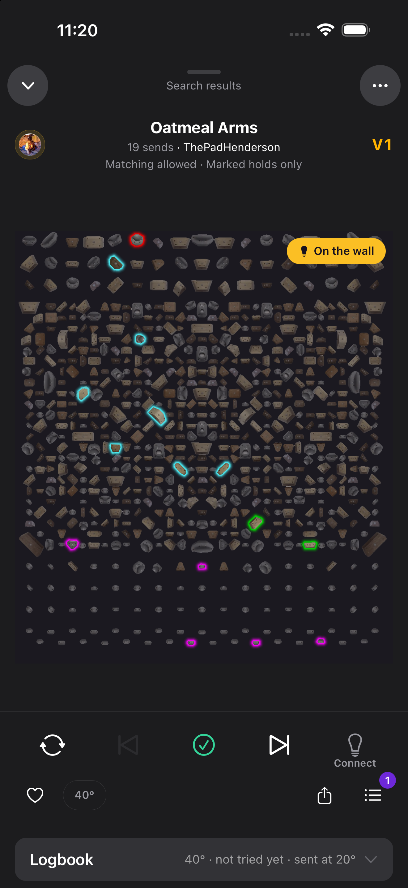
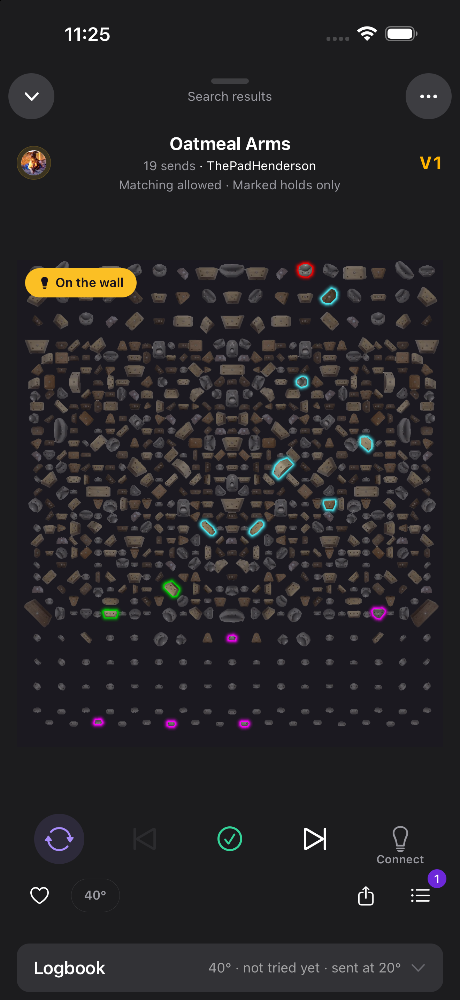

# Climb view options

What a climber can change about the player (the climb view): the sections below the climb, and the player buttons
around Log (#6229), plus the buttons on the MiniPlayer bar above the tabs (#6940). All three live in the player's
⋯ → **View options** sheet, on three tabs, **Below the climb**, **Buttons** and **Mini player**. Settings → Climbs & grades → **Climb view** has the same switches on the native form; the order only
changes in View options (#6477, #6480). The sections half is described in
[mobile-sheets-vs-routes.md › Play drawer section controls](mobile-sheets-vs-routes.md#play-drawer-section-controls);
this page covers the buttons, the MiniPlayer and what they share.

## What the climber gets

- **Buttons**: a switch and ↑/↓ arrows for Mirror, Favorite, Angle, Share and Queue; one switch for **Previous and
  next**; one for **Wall status on the board** (the badge that says whether the climb is lit); and a **Position**, Below the board (the default) or Above the board. A pinned preview draws the bar for
  the board on screen as the climber changes it.
- **Restore defaults** on the Buttons tab brings back today's bar, below the board, with Previous and next and the wall badge. The
  Below the climb tab has its own Restore defaults for the sections.
- Nothing changes until the climber changes it.

Fixed, and why:

| Control                                  | Why it doesn't move                                                         |
| ---------------------------------------- | --------------------------------------------------------------------------- |
| Log                                      | The core loop. Always the centre of the big row.                            |
| Board light                              | Wall control must not move under a climber's thumb. Always the right slot, with a word under it for the board: Connect, On, or Light while a crewmate holds the wall. |
| Put on the wall, busy-wall question, connect pill, Fell / Sent | Session states, not preferences. They show up in the small row when they need it. |
| Playback slider                          | Belongs to the board, so it always sits next to it.                         |
| Top row ⌄ · list · rest timer · ⋯        | ⋯ is how a hidden button comes back. Where you are (the list, "Projects · 4 of 23", or the workout stage, "4x4 · Rep 3 of 4 · Set 2 of 4") sits between ⌄ and the timer and costs the board nothing. A second, smaller line there is for what the wall is doing. |

## Wall badge

A capsule on the board art says whether the climb on screen is lit (#6939): **On the wall** (the `live` amber),
**Preview, not lit**, **Only you see this** in a crew, or **Not on the wall** when nothing lights it. It takes the top
corner the climb's holds leave clear (`resolveWallBadgeSide`, left on a tie) and is off for the signed-out reader, a
wall with no lights and a climb on another board. Its states are `resolveWallBadge` in `play-drawer/wall-badge.ts`.
While it shows, the solo "Preview, not lit" leaves the top bar's second line to the list again.

## Layout rules

Mirror is saved on each committed queue occurrence, in solo climbing and in a crew.
The player, mini player, wall and Log ascent use that occurrence's orientation.
History keeps the saved flip for logging and replay; a fresh occurrence starts with
its own supplied orientation. Mirroring a preview stays local and its temporary
flip is cleared when the preview is committed.

After mirroring the same solo climb, advancing and returning to it:

Captured on an iOS simulator with recorded data; physical BLE was not exercised.

| Before: flip forgotten | After: saved flip restored |
| --- | --- |
|  |  |

`resolveActionBarLayout` (`packages/mobile/src/components/play-drawer/action-bar-layout.ts`) is the one rule. The
bar, the player's ⋯ menu and the preview all read it, so they can't disagree.

```
Big row     [lead] [⏮] [Log] [⏭] [Board light]
Small row   [first half of the rest] ········ [last half]
```

- **Lead slot**: the first of Mirror and Queue, in the climber's order, that is on and can show here. Mirror shows
  only on a board that mirrors (`boardSupportsMirroring`); Queue only for a member. With both off the slot is
  empty and the row keeps its five-slot spacing.
- **Small row**: every other button that is on, in order. The last ⌊n/2⌋ form the right-hand group; the odd one out
  goes left. Mirror counts only on a board that mirrors, Favorite and Queue only for a member. Angle and Share
  count even where this board or climb can't draw them (a fixed-angle board, a draft): they leave their place
  empty instead, so nothing jumps sides between climbs and today's bars come out exactly as they were.
- **Previous and next off** leaves both slots empty, so Log stays centred. Swiping the board still moves.
- **The connect pill** replaces the right-hand group. **Put on the wall** (`commitButton: 'putOnWall'`) sits in the
  gap in the middle of the small row. With no board connected it shows on the climber's own current climb too
  (#6939), wherever a tap on the bulb would connect: its tap connects (sets a preview first), and the connect pill
  stands down while it shows. The first button of the start group and the last of the end group keep their
  places; the rest step into ⋯ while it shows, because the label needs ~140 pt and a mirror board's full row leaves
  ~120 pt on a 375 pt phone. Only the busy-wall question (`commitButton: 'confirm'`, "Keep Sam's" / "Put mine up")
  replaces the whole row. Whatever the pill, the button and the question push out, and every button the climber
  switched off, is flagged in `hidden`, and ⋯ carries a row for each.
- **Fell / Sent** (`workoutOutcome: true`, `secondaryRow: 'workoutOutcome'`) takes the whole small row while the climb
  on the wall is in a timed workout block: its stage paces the rest timer (a 4x4, limit bouldering, on the minute).
  See [One-tap Fell / Sent](#one-tap-fell--sent). The order of the session states is busy-wall question > Put on the
  wall > Fell / Sent > connect pill > the climber's buttons. The lead slot keeps its button, the bulb stays in its
  slot (the pill gives way), and every small-row button steps into ⋯ while the pair shows.
- **Nothing left to draw**, no pill and no commit button: there is no small row (`secondaryRow: []`). The board gets
  52 pt back (the 8 pt gap and the 44 pt row; the 12 pt bottom padding moves to the big row). Put on the wall, the
  busy-wall question, Fell / Sent and the connect pill bring the row back while they need it, so a row with every
  button switched off still appears with Put on the wall alone in it. Share switched on keeps the row even on a draft, where it
  can't draw (`['spacer']`, held at the row's usual 64 pt): it is the one button that comes and goes climb to
  climb, and the board must not jump mid-swipe. The angle depends on the board, not the climb, so an angle-only
  row on a fixed-angle board does collapse.
- **The anonymous web reader** gets today's bar under the board whatever the device stored: they have no ⋯ to bring
  a hidden button back, and no View options to undo a choice left in a shared browser.

Today's bars, which the defaults reproduce (pinned in `resolve-action-bar-layout.test.ts`):

```
Kilter, MoonBoard     [☰]  [⏮]  [✓]  [⏭]  [💡]   /  [♡] [40°] ············ [⬆]
Tension, Decoy, Woods [⇄]  [⏮]  [✓]  [⏭]  [💡]   /  [♡] [40°] ········ [⬆] [☰]
Anonymous             [ ]  [⏮]  [✓]  [⏭]  [ ]    /  [40°] ················ [⬆]   (mirror boards keep [⇄])
```

### ⋯ stand-ins

`PlayDrawerHiddenButtons` has a flag per button: `favorite`, `share`, `queue`, `mirror`, `angle`. The player's ⋯
offers a row only while its flag is up (`play-drawer-menu-rows.ts`), so an action never shows twice. Mirror and
Change angle form their own group after the queue rows. Both are disabled on another board's climb, like every row
that writes or touches the wall. The Mirror row runs the same `handleMirror` as the button (shared-session
orientation included); Change angle opens the player's own angle sheet, so it presents above `/play`.

### One-tap Fell / Sent

In a timed workout block (#6231, #5380) every go gets logged, so the small row becomes two 44 pt buttons. Both save
through `useTickSaver`, the same path as the Log ascent sheet, so the rest timer and the workout's tick log get the
tick's status and queue item exactly as from the sheet (`docs/workout-stages.md` › Pacing).

- **Fell** logs one try at once (`attempt`, 1 try). Nothing waits for the end of the climb, so an early End, a killed
  app or a dead signal loses no falls.
- **Sent** logs a flash when the climber has no tick on the climb at this angle and no fall on this queue item
  earlier in the block, else a send (`deriveAscentType`). While the logbook is still loading it says send, as the
  sheet does.
- **A spray climb nobody has sent** needs a grade, which only the sheet asks for, so Sent opens Log ascent instead.
  Fell still logs at once: a try sets no grade. The queue's copy of the climb never hears of a send, so once the
  climber's own send is in this block's tick log (this queue item) or their logbook (this angle), later Sents log in
  one tap again.
- **One tap at a time.** A second tap within 700 ms (`ONE_TAP_GUARD_MS`), on either button, is dropped, and so is a
  tap while a save for that queue item is still in flight. A fumbled double tap logs one go, never a fall and a send.
  The guard, the in-flight saves and the saved line are shared by every Fell / Sent on screen
  (`workout-one-tap-store.ts`): the player's row and both MiniPlayer placements, so a tap on one and a tap on another
  within the guard also log one go.
- **A 4x4 set is one climb, every rep.** Each Fell or Sent is one rep on the climb on the wall, and the climb stays up
  (with the row) until the set's last rep is logged, then the set rest runs and the wall moves on. A Sent after the
  set's first rep logs a send, never a flash: the first rep is already in the block's tick log for this queue item.
- **Just after the wall moves on.** An on-the-minute beat advances whether the climber logged or not, so a tap within
  2 s (`WALL_MOVED_GRACE_MS`) of the climb on the wall changing logs for the climb it left, against that queue item
  (`TickSaveFields.queueItem`), with that climb's own flash rule. Every one-tap names its queue item this way, and
  the saver still holds it to `attributeTickToQueueItem`'s angle rule: a tap at another angle than the item is up at
  (the board moved, the queue has not regraded yet) saves the tick but counts it for no queue item. Nobody gets a go on a climb that fast after it
  lights up. A first ascent there can't open the sheet (it would open on the new climb), so the row says to swipe
  back to it. A new copy of the same queue item is not a move.
- **The row stays through the grace when the wall leaves the block** (`useWorkoutOutcomeHold`). When the beat moves
  the wall onto a climb outside the timed block, the gate turns false at once, and the normal row would put the heart
  and the angle button where Fell was, under a finger already on its way (simulator QA: a Fell tap just after the
  last beat opened Choose Angle). So the player keeps Fell / Sent for the climb it left for the same 2 s, then swaps.
  Taps in that window log there, exactly as above; one past it is dropped, never sent to the new climb. The hints
  name that climb ("Logs one try on Crimp line, the previous climb") and the saved line is the full sentence, since
  the board already shows the next one. The hold starts only when the committed climb changed with the player still
  on it; a swipe to browse, the gate coming back, the switch-board gate or a sign-out ends it at once. PlayCore reads
  the held row for the bar layout, ⋯, the connect pill and the opening layout key, so the row and the board change
  once, at the swap.
- **The wall at the tap.** The row leaves `useTickSaver`'s `active` out, so each save takes the board as it is right
  then: a board bound from the bulb mid-block is on the next tick. The sheet snapshots it when it opens instead.
- **When it shows** (`shouldShowWorkoutOutcome`): the climb on screen is the committed current one (not a climb the
  climber swiped to or a preview), its run stage has `pacing` (keyed on the pacing, not the stage kinds, so any
  future timed block gets it too), the climber is signed in, it is not another board's climb and not a draft. A
  crew phone without the run never shows it. While it shows, the connect pill can't, so the pill's day budget is not
  spent (`deriveFirstConnectPillWouldConnect`'s `workoutOutcome`).
- **The row says what a tap did, not a toast.** The player is a native modal on iOS, and the root toast overlay draws
  behind it (a toast fired from the player is never seen there). So after a save the tapped button reads "Try logged"
  (Fell) or "Flash logged" / "Send logged" (Sent) with a check for 2 s (`SAVED_NOTICE_MS`), and both buttons stay
  live. When the go was for the climb the wall just left, the line names it ("Flash logged · Crimp line"). The
  buttons keep their Fell / Sent accessibility labels; the full sentence is announced. A failure, or where to log a
  first ascent, needs reading, so it takes the whole row for 5 s (`MESSAGE_NOTICE_MS`) or until tapped, then the
  buttons come back. The success haptic plays with the line; a failure's comes from `useTickSaver`. Tick Logged and
  Quick Tick Failed report `surface: 'mobile_workout_runner'`, with no Quick Tick Opened before them.
- **A save outlives the row.** Swiping to a preview, the end of the hold after the wall left the timed block or
  closing the player unmounts the row while a save can still be in flight. `useTickSaver` runs the side effects (rest timer, the workout's tick
  log, Tick Logged, the confirmation) off the `mutateAsync` promise, which settles either way, never off a per-call
  `mutate` callback, which React Query drops once the caller is gone. With no row left to say it, that late save
  falls back to the toast, which shows once the player is closed.
- The pair holds the row's usual 64 pt, so the board moves only for a climber who switched every small button off.
  The opening-layout cache keys on it (`controlsFingerprint`).

### Above the board

`PlayCore` renders the controls region (playback slider, bar, and the switch-board scrim over both) either after
the board or between the header and the lost-holds banner. The block moves whole, so the scrim and its card still
cover every control. Above the board the bar comes first and the slider follows, so the slider stays next to the
board, and the bar's hairline moves to its bottom edge (`edge="bottom"`), the side that faces the board.

The switch-board card (another board's climb) is taller than the controls, more so with the small row off. A card
that spilled out of the region would sit under the next sibling (the board above the fold, the first section below
it), and that view would take the taps meant for Switch board. So while the card is up the region's `minHeight` is
the card's measured height plus 8 pt above and below (a typical 184 pt card until the first measurement), in both
positions. Above the board the region also has `zIndex: 1` over the lost-holds banner and the board. The region
is measured while it sits above, and the wall-state callout hangs below it instead of below the header, so the
notice never covers Log. The opening-layout cache keys on the resolved small row and the position, since both move
the board. The tablet-shell and phone-split panes render the same `PlayCore`, so all of this applies there too.

## Storage

All device-local, in the synchronous settings store (MMKV), so the player's first frame already has the climber's
bar: no jump from today's bar to theirs.

| Key                     | Type                          | Default   | Notes                                                                                         |
| ----------------------- | ----------------------------- | --------- | --------------------------------------------------------------------------------------------- |
| `playerButtonsV1`       | `SectionLayoutRecord \| null` | `null`    | Order and switches. Read and written only by `playerButtonsStore` (`createSectionLayoutStore`). |
| `playerPreviousNext`    | `boolean`                     | `true`    | Only an explicit `false` hides the pair.                                                      |
| `playerWallBadge`       | `boolean`                     | `true`    | Only an explicit `false` hides the wall badge on the board art.                               |
| `playerButtonsPosition` | `'below' \| 'above'`          | `'below'` | Anything else reads as `'below'`.                                                             |

- `null` means the defaults, so a later release's default order still reaches a climber who never changed it. The
  store writes `null` again when a change lands back on the defaults, and on Restore defaults.
- Ids this build doesn't know survive its writes, after the id they followed (`createSectionLayoutStore`), so a
  newer bundle's buttons survive an OTA rollback and one edit.
- **Rollback**: an older bundle ignores all four keys and draws today's bar below the board. Nothing is lost; the
  choices come back with the newer bundle.
- `resetAllSettings` clears all four.

The sections below the climb keep their own AsyncStorage record (`playDrawerSections`); see
[mobile-sheets-vs-routes.md](mobile-sheets-vs-routes.md#play-drawer-section-controls).

## Code map

| Piece                                   | File                                                                            |
| --------------------------------------- | ------------------------------------------------------------------------------- |
| Ids, defaults, position type            | `packages/mobile/src/lib/player-buttons.ts`                                     |
| Store, hooks, Restore defaults          | `packages/mobile/src/lib/player-buttons-preference.ts`                          |
| Layout rule                             | `packages/mobile/src/components/play-drawer/action-bar-layout.ts`               |
| Bar                                     | `packages/mobile/src/components/play-drawer/PlayDrawerActionBar.tsx`            |
| Fell / Sent row and its taps            | `packages/mobile/src/components/play-drawer/WorkoutOutcomeRow.tsx`, `use-workout-one-tap.ts` |
| Fell / Sent hold after the wall leaves  | `packages/mobile/src/components/play-drawer/use-workout-outcome-hold.ts`        |
| Placement, callout offset, ⋯ wiring     | `packages/mobile/src/components/play-drawer/PlayCore.tsx`                       |
| View options sheet (both tabs)          | `packages/mobile/src/components/play-drawer/PlayDrawerSectionsSheet.tsx`        |
| Shared labels and actions               | `packages/mobile/src/components/settings/use-player-button-controls.ts`         |
| Preview                                 | `packages/mobile/src/components/player-buttons/PlayerButtonsPreview.tsx`        |
| Settings › Climb view                   | `packages/mobile/src/components/settings/climb-view/`, `app/settings/climb-view.tsx` |
| Reorder rows (shared with sections)     | `packages/mobile/src/components/section-layout/SectionLayoutList.tsx`           |

## Mini player

The MiniPlayer is the bar above the tabs: the current climb, then buttons. Tap it to open the climb.

The tab and the Settings section show only where that bar is the native bottom accessory (`useTabChrome().nativeAccessory`:
iOS 26 with the Liquid Glass tab bar). On Android, the Material shell and earlier iOS the current climb rides the
floating bar, which has no such buttons, so the tab and section are left out (a selected tab falls back to Below the
climb).

### What the climber gets

- A **Mini player** tab in View options: a switch and ↑/↓ arrows for Next climb, Previous climb, Mirror, Favorite,
  Queue, Share and Angle, a pinned preview, and **Restore defaults**. Settings → Climbs & grades → **Climb view** has
  a Mini player section with the switches only; the order changes in View options, the same rule as the player's
  buttons.
- Defaults: Next, Previous, Mirror and Favorite on; Queue, Share and Angle off. On iPhone the one extra slot goes to Next, so Mirror and Favorite only show on iPad and the open Duo by default. Each switch drives a real button:
  - **Next / Previous**: step the list. Solo with Light on swipe on they move the climb; in a crew, or with Light on
    swipe off, they open the player on a preview, so one tap never moves the room's climb. Next at the end of a
    list opens the player.
  - **Mirror**: boards that mirror (Tension, Decoy, Woods). In a crew it sets the shared orientation; solo it
    flips what the wall lights.
  - **Favorite** and **Queue**: signed in only.
  - **Share**: not on drafts.
  - **Angle**: boards with an adjustable angle. It opens the player's angle sheet and is hidden while the player is
    open.
- The preview draws two bars from `resolveMiniPlayerControls`, `miniPlayerSlotCount` and the bar's own
  `isMiniPlayerButtonAvailable`, so it can't disagree with the real one: the open bar at the width the real bar last
  measured on this device (`mini-player-measured-bar-store.ts`, published by `NativeAccessoryClimbRow`; an iPhone
  Duo's closed display, ~290 pt, previews one slot) and the collapsed one, for the board on screen and the
  signed-in state. Before the bar has ever drawn it falls back to 995 pt for an iPad or open Duo and 343 pt for an
  iPhone. On an iPad or open Duo the open bar is drawn in the wide layout below (⏮ ⏭ first, ⋯, the filled ✓).
  Static glyphs; no Bluetooth component is mounted.
- Board light and Log are fixed, like the player's: a note on the tab says so. They have no switch or arrows. The
  tab's footer differs by device: on iPhone it says the bar has room for one button beside them; on a wide screen
  it says the bar fits as many as it has room for.

### Layout rules

- Drawing order, left to right, on an iPhone and on every collapsed bar: the climb, the climber's others, then ⏮ ⏭,
  then 💡 ✓. On a wide bar (below): ⏮ ⏭, the others, the climb, then ⋯ 💡 ✓.
- Slot count (`miniPlayerSlotCount`), Board light and Log included:
  - inline (tab bar minimized): 1;
  - iPhone: `min(3, floor((w − 68 − 140) / 44))`, at least 1, where `w` is the platter width and 68 pt is the
    insets, artwork and label padding. 343 pt and up gives 3; Duo closed (~290 pt) and a 320 pt Display Zoom
    iPhone give 1. With one slot the bar keeps the bulb while the board is free, otherwise Log;
  - iPad and the open Duo: `floor((w − b − 160) / 44)`, which fits every button. `b` is 68 pt on a 48 pt platter and
    74 pt on iPad's ~62 pt one (below);
  - before the first layout: 3 on an iPhone, everything when wide, so the common bar doesn't redraw.
- Every slot sits at one even 44 pt pitch, on every bar, as on Music's (#7048).
- Platter height (`accessoryPlatterGeometry`): the row fills the platter UIKit gives it, so the controls centre in it.
  From 56 pt up (iPad's open bar, ~62 pt) the artwork is 40 pt at a 12 pt inset, the trailing inset is 10 pt so ✓
  centres in the rounded end, and ✓ is 22 pt like its neighbours. Below that, an iPhone's 16 / 8 pt insets, 32 pt
  artwork and 24 pt ✓. The measured height only grows, so a squeezed hidden row never swaps the geometry back.
- Buttons claim slots in the climber's order; what doesn't fit drops from the end of that list. On a wide bar the
  bar's own ⋯ has it; on an iPhone the player's ⋯ does.
- The open Duo's split (`miniPlayerPaneMode`): while the pane shows the committed climb with its controls below the
  board, the bar sits on the player's small row and carries those covered buttons (`miniPlayerPaneCoveredButtons`),
  dropping what the pane's big row already shows (⏮ ⏭ 💡 ✓). While the pane shows a preview, or its controls are
  above the board, the bar keeps Board light and Log only.

### Wide bar (iPad, open Duo)

The open bar on an iPad or the open Duo (`miniPlayerUsesWideLayout`: `isTablet || phoneSplit`, regular placement)
copies Apple Music's iPad MiniPlayer:

```
[⏮][⏭] [⇄][♡] | [art 40] Name (17 pt) / V5 · 1.6k sends | [⋯] [💡] [✓]
```

- ⏮ ⏭ lead the row, filled (`skip.previous.fill` / `skip.next.fill`) at 24 pt. The climber's other buttons follow at
  19 pt in the secondary label colour; a favourite stays red and a mirrored climb's ⇄ stays brand purple. The angle
  pill is unchanged. 💡 stays 22 pt.
- ✓ is the one large control: `checkmark.circle.fill`, 32 pt, brand purple (`LogAscentToolbarButton`'s
  `appearance="hero"`, which logs and pops exactly as the plain one does).
- The name is set in body (17 pt) instead of subheadline. The artwork stays 40 pt.
- Claim order does not change, so saved layouts need no migration: 💡 ✓ first, then ⋯ (`MiniPlayerControls.more`),
  then the climber's buttons in their order. A drawn order of ⏮ ⏭ first does not change which buttons win a short
  bar.
- ⋯ sits in a third fixed frame before 💡 ✓ inside the trailing pair (`trailingSlotFrame`), so it moves with them
  when UIKit squeezes the hidden regular row. With no board bound the bulb draws nothing, so the wide bar drops the
  bulb's frame and ⋯ sits right beside ✓ (whether a board is bound is the same in both placements, so no frame moves
  as the bar expands).
- A wide bar counts its slots from the widest row width it measured under one window shape (`wideRowCapacityWidth`,
  keyed on the window width and the tab content's side insets by `rowLayoutKey`). UIKit squeezes the hidden regular
  row to the inline width while the bar is minimized; counting from that would drop the buttons before the climb and
  bring them back mid-expand, sliding the art sideways and remounting ⋯. A rotation, a window resize or the sidebar
  shown or hidden starts the record over. The iPad's top tab bar and the Duo's rail never minimize, so today this
  matters only in a narrow iPad window, where the tab bar moves to the bottom. No ⋯ while the `/play` route is up (`moreAvailable`; the menu also
  draws nothing there as a backstop), on an iPhone, or on any collapsed bar.
- The open Duo keeps what it had, plus ⋯: in `carry` the covered small row then ⋯; in `stepAside` ⋯ 💡 ✓. In a
  timed block Fell / Sent take the leading cluster before the climb, and ⋯ claims after 💡 ✓.
- iPhone and every inline bar are unchanged.

**The ⋯ menu** (`MiniPlayerActionsMenu`) is the player's ⋯ over the same `useClimbActions` and
`buildPlayDrawerMenuRows`, in Music's order (`MINI_PLAYER_MENU_GROUPS`):

1. Favourite, Add to playlist, Share
2. Open queue
3. Mirror, Change angle
4. Add beta video, Edit, Fork
5. Climb view (settings), Open in Kilter / Tension app
6. Report, Delete

- Favourite, Share, Open queue, Mirror and Change angle appear only while the bar is not showing that button and
  could (`miniPlayerMenuHiddenButtons` over `isMiniPlayerButtonAvailable`): switched off, or no room. So signed out
  there is no Favourite or Open queue, a draft has no Share, Kilter has no Mirror.
- Play next, Play last and Log are never offered: the climb is on the wall and ✓ is beside ⋯. Edit, Delete and
  Report keep `useClimbActions`' owner gating.
- Favourite, Mirror and Open queue run the bar's own hooks (`useMiniPlayerFavorite`, `useMiniPlayerMirrorToggle`,
  `useOpenMiniPlayerQueue`), so a row and a button never disagree. The other sheets open through the root openers
  on `useDrawerHost()`, which present over the tab content; Change angle opens the host's angle sheet.
- Climb view pushes Settings → Climb view in the tab the bar sits over (`climbViewSettingsHref`), which has the
  Mini player switches, and is labelled with that screen's title. The player's View options sheet with its Mini
  player tab only exists inside `/play`.
- Open in Kilter / Tension app sits in the same group as on the player's ⋯, on Aurora boards only.
- Analytics: rows tag `mini_player_menu` (`ClimbActionsAnalyticsSource`, `FavoriteToggle`'s `source`, and
  `Queue Sheet Opened`'s `surface`).

### Session states

- **A timed workout block** (#6940) turns the bar into one-tap Fell / Sent for the climb on the wall, the same taps
  as the player's small row (One-tap Fell / Sent above: `useWorkoutOneTap` and `useTickSaver`, the 700 ms guard,
  the flash rule, a spray first ascent opening Log ascent, one climb every rep of a 4x4 set).
  - When: `useMiniPlayerWorkoutOutcome` asks the player's `shouldShowWorkoutOutcome` about the committed head: in a
    session, its stage has `pacing`, signed in, not a draft, not another board's climb (a board at this gym counts
    as here), and the bar names the head (not a climb retained through a presence blip). Not while the `/play` route
    is up: the player has its own pair, and a toast from the bar would draw behind it. The climb is drawn and logged
    on the board `resolveClimbRenderBoard` picks, at its angle, with the session's orientation (the queue item's
    `mirrored`, as the player reads it in a session).
  - What (`resolveMiniPlayerControls`, `workoutOutcome`): the climber's buttons, ⏮ ⏭ included, step aside, so a
    mis-tap mid-4x4 never flips the wall or skips a rep. Fell and Sent claim slots first, then the bulb, then the
    tick. With no board bound the bulb draws nothing, so the tick takes its place (an iPhone shows Fell · Sent · ✓):

    | Bar                                  | Holds                  |
    | ------------------------------------ | ---------------------- |
    | iPad, open Duo (pane doesn't cover)  | Fell · Sent · ⋯ 💡 ✓   |
    | iPhone (3 slots)                     | Fell · Sent · 💡       |
    | Two slots                            | Fell · Sent            |
    | Minimized / inline (1 slot)          | Sent                   |
    | Open Duo, `carry`                    | Fell · Sent · ⋯        |
    | Open Duo, `stepAside` (pane preview) | ⋯ 💡 ✓, as outside a block |

    In `carry` the bar sits on the pane's small row, which shows Fell / Sent itself, and the pane's big row has 💡 ✓,
    so the bar carries the pair only. The iPhone's ✓ comes back when the block ends.
  - The 2 s hold: when the wall leaves the block, the bar keeps Fell / Sent for the climb it left through
    `useWorkoutOutcomeHold` (`WALL_MOVED_GRACE_MS`), so a finger on its way to Fell never lands on Next, and a tap
    there logs for that climb, as in the player. Its hints name it.
  - Feedback: the root toast is in view over the tabs, so a failure, or where to log a first ascent, is a toast
    (`useWorkoutOneTap`'s `messages: 'toast'`). A saved go plays the success haptic, swaps the tapped button's glyph
    for a filled check for 2 s (`SAVED_NOTICE_MS`) and announces the full sentence; the buttons keep their Fell / Sent
    labels. Glyphs: Fell ⊗ (`ascent.attempt`), Sent a circled check in the brand colour (`tick`). The check goes
    only on the climb the go was logged on: the bar's buttons have no room to name another climb, so a go on a climb
    the bar no longer shows (a tap in the grace after the wall moved, or a player save that lands after the player
    was swiped down and the set ended) is a toast with the full sentence ("Send logged · Crimp line"). So is any save
    whose tapped surface is gone.
  - Two bars at once: react-native-screens renders the accessory's regular and inline placements together, and
    they share no state, so there are two `MiniPlayerWorkoutButtons`. Everything a tap depends on is in the shared
    store above, so a Sent on the open bar and one on the minimized bar within 700 ms log once, and both bars show the
    same check. Slots are keyed `fell` / `sent`, so a change of buttons swaps slots and neither row remounts.
  - VoiceOver on the open Duo: in `carry` the bar covers the pane's own Fell / Sent, so the pane's row leaves the
    accessibility tree while the open placement reports it carries it (`pane-workout-row-cover-store.ts`). The
    inline bar never shows there: the open Duo's tab bar is the vertical rail, which never minimizes
    (`tabBarMinimizeBehavior` in `packages/mobile/app/(tabs)/_layout.tsx`).
  - Where the climber can't log the block (signed out, a draft, another board), the bar keeps its usual buttons
    but still drops ⏮ ⏭ (`isMiniPlayerButtonAvailable`'s `inTimedBlock`): the stage moves the wall on its own beat.
  - The Settings preview draws no workout: it shows the bar the climber set up.
- A crew, or Light on swipe off: Next and Previous open the player on a preview.
- Signed out: no Favorite or Queue. A draft has no Share. A fixed-angle board has no Angle; a board that can't
  mirror has no Mirror.

### What we measure

The defaults above were picked without data. Two events (#6940) let them be revisited; their contract is
`packages/shared/analytics/src/queue-navigation-events.ts`.

- `Queue Navigation`, once per Next or Previous the climber takes: `direction` (`next`, `previous`), `method`
  (`button`, `swipe`; the board's screen-reader adjust action counts as a swipe), `surface` (`player`,
  `mini_player`), `outcome` (`moved`, or `preview` when a crew or Light on swipe off kept the wall still),
  `sessionMode` (`party`, `solo`), `lightOnSwipe`, `boardType` and `layoutId` (null on a spray wall). The rest
  timer's auto-advance and the workout runner don't fire it, and neither does Next opening the player at the end
  of a list. www fired the same name before W-16 with other `method` values and no `surface`, so filter on
  `surface`.
- `Queue Sheet Opened`: `surface` (`player`, `player_menu`, `mini_player`, `mini_player_menu`, `snackbar`) and
  `boardType`. The
  side-by-side iPad player's queue button shows Up next in its panel instead of a sheet, and still counts as
  `player`.

Button against swipe, and how much the MiniPlayer carries:

```sql
SELECT properties.surface AS surface, properties.method AS method,
       properties.direction AS direction, properties.outcome AS outcome,
       count() AS steps, uniq(person_id) AS climbers
FROM events
WHERE event = 'Queue Navigation'
  AND properties.surface IS NOT NULL
  AND timestamp >= now() - INTERVAL 28 DAY
GROUP BY surface, method, direction, outcome
ORDER BY steps DESC
```

Where the queue is opened from: the same query on `Queue Sheet Opened`, grouped by `surface`.

### Storage

`miniPlayerButtonsV1` in the synchronous settings store (MMKV), a `SectionLayoutRecord | null` written only by
`miniPlayerButtonsStore`. `null` means the defaults, written again when a change lands back on them and on Restore
defaults; ids this build doesn't know survive its writes. **Rollback**: an older bundle ignores the key and draws
today's bar (Board light and Log). `resetAllSettings` clears it.

### Code map

| Piece                                  | File                                                                                  |
| -------------------------------------- | ------------------------------------------------------------------------------------- |
| Ids and defaults                       | `packages/mobile/src/lib/mini-player-buttons.ts`                                      |
| Store, `useMiniPlayerButtonsEditor`    | `packages/mobile/src/lib/mini-player-buttons-preference.ts`                           |
| Slot count and what the bar holds      | `packages/mobile/src/components/queue-control/mini-player-controls.ts`                |
| The bar                                | `packages/mobile/src/components/queue-control/NativeAccessoryClimbRow.tsx`            |
| The wide bar's ⋯                       | `packages/mobile/src/components/queue-control/MiniPlayerActionsMenu.tsx`              |
| Workout gate and hold, Fell / Sent     | `use-mini-player-workout-outcome.ts`, `MiniPlayerWorkoutButtons.tsx` (same folder)    |
| Shared one-tap state, Duo pane cover   | `play-drawer/workout-one-tap-store.ts`, `play-drawer/pane-workout-row-cover-store.ts` |
| Preview                                | `packages/mobile/src/components/queue-control/MiniPlayerButtonsPreview.tsx`           |
| Shared labels and actions              | `packages/mobile/src/components/settings/use-mini-player-button-controls.ts`          |
| View options tab, Settings › Climb view | `PlayDrawerSectionsSheet.tsx`, `settings/climb-view/`                                |

## Adding a button

1. Add the id to `PLAYER_BUTTON_IDS` in `player-buttons.ts`, at the place its default should be. A stored order
   without it slots it in after the id it follows in the defaults.
2. Decide in `resolveActionBarLayout` whether it takes a place for this board and viewer, and whether it can draw
   right now. Add a flag to `PlayDrawerHiddenButtons`, a ⋯ row in `use-climb-actions.ts` and `MENU_GROUPS`, and a
   case in the bar and the preview.
3. Add its label (and a subtitle if it only shows on some boards) to `use-player-button-controls.ts`, in every
   locale.
4. Extend the layout table in `resolve-action-bar-layout.test.ts`, starting with "today's bars unchanged".

## Adding a section

Every section sits below the fold and takes part in the order: add its id to `BELOW_FOLD_SECTION_IDS` in
`play-drawer-sections-preference.ts`, a default visibility, a label, and a `case` in `DeferredSections`. See
[mobile-sheets-vs-routes.md](mobile-sheets-vs-routes.md#play-drawer-section-controls) for the record and the fold.
