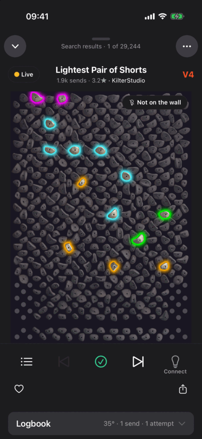
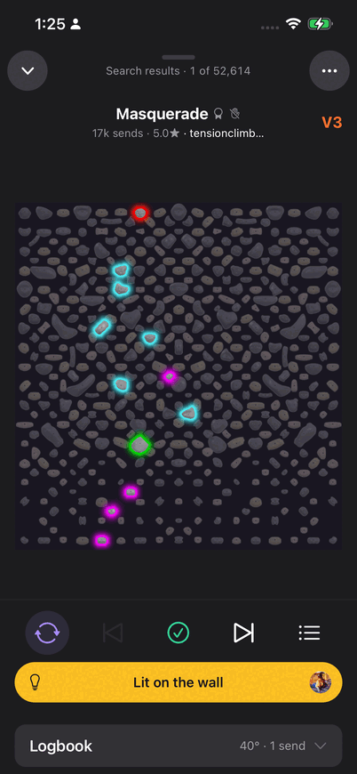
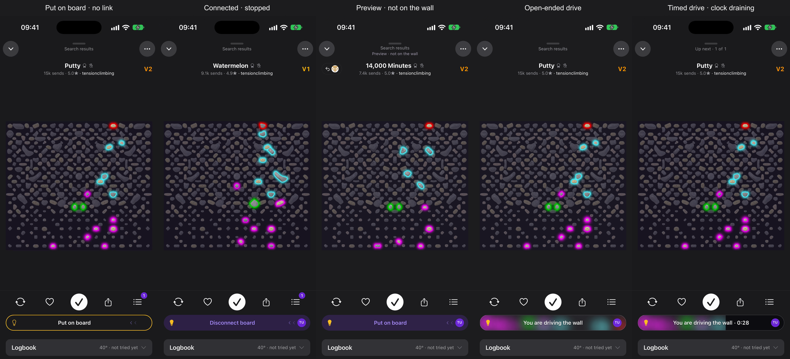

# Mobile chrome and layout metrics

Screen-level specs for the Boardsesh mobile app's chrome: the glass size ladder, tab and header bars, the controls under the bar, filter capsules, facet rows and the top-bar buttons. They moved here from [ai-design-guidelines.md](ai-design-guidelines.md), which keeps the system itself (colour, type, spacing, components, accessibility) and the product rules "Nothing over the climb" and "Content hierarchy and brand accents". Large screens have their own doc: [mobile-large-screen-layout.md](mobile-large-screen-layout.md).

## Layout & chrome metrics

Source: `packages/mobile/src/theme/layout.ts`, plus sheet/material metrics in `tokens.ts`.

**Glass size ladder** — one height ladder for every floating FAB / capsule / pill so the chrome reads
as one deliberately-sized system. Every interactive tier we draw ourselves is at or above the 44pt touch
floor; `bar` is a slot inside UIKit's navigation bar, which owns that bar's hit testing:

| Tier            | px  | Use                                                          |
| --------------- | --- | ------------------------------------------------------------ |
| `hero`          | 56  | One defining action per surface (create)                     |
| `standard`      | 48  | Default floating FAB; the log-ascent Attempt / Flash bar     |
| `capsule`       | 44  | Standalone floating capsule (4pt under sibling FABs)         |
| `inlinePrimary` | 48  | Primary action inside a sheet                                |
| `inline`        | 44  | Standard inline control                                      |
| `bar`           | 38  | UIKit grouped bar-item slot in the native navigation bar; UIKit's own grouped minimum is 36 |
| `mini`          | 32  | Label-only pill (angle); carries 44pt hit-slop when tappable |

**Play drawer Log.** The drawer's primary Log action uses a 56pt filled circled-check symbol in the same neutral
colour as its neighbours (white in dark mode). The native symbol centres its check without a separate glyph's
baseline correction. Its row keeps the same 60pt height by using 4pt top padding instead of 12pt; the board does not shrink.
Other inline buttons keep their existing sizes. The default row is Mirror (Angle on adjustable boards without
mirroring), Favorite, Log, Share, Queue. Previous and next remain available in View options.

**Tab bar.** `TAB_BAR_HEIGHT` = 49 (Liquid Glass / native iOS). `MATERIAL_TAB_BAR_HEIGHT` = 64 (M3
Expressive short navigation bar: a 56×32 active-indicator pill, icon above a label capped at 1.2× font scale).
On an Android phone's tab root it overlays the content and hides on scroll; elsewhere it sits in flow.

**Floating toolbar.** `TOOLBAR_FAB_SIZE` 48 · `TOOLBAR_CAPSULE_HEIGHT` 44 · `TOOLBAR_CAPSULE_MAX_WIDTH`
260 · `TOOLBAR_SIDE_MARGIN` 16 · `TOOLBAR_GAP` 8 · `TOOLBAR_GAP_ABOVE_TABBAR` 10 · `TOOLBAR_RESERVE`
66 (bottom padding screens reserve so the last row clears the toolbar). Material floats the MiniPlayer
card instead (`FloatingMiniPlayerCard`): the iPhone accessory's row (art, name, the climber's buttons,
Board light, Log) on an opaque `surfaceContainer` card with a 12dp corner and level-2 elevation,
`MATERIAL_MINI_PLAYER_CARD_INSET` 8 from each edge, `MATERIAL_MINI_PLAYER_CARD_GAP` 0 so it sits
straight on the measured tab bar (and on the gesture inset while the bar hides), `MATERIAL_MINI_PLAYER_CARD_HEIGHT` 48 (the platter's height, so it holds the same controls).

On the browser's regular-width sidebar shell, this same card also accompanies the
selected-climb pane. It clears the navigation rail and docks to the bottom window inset;
both the pane and scrolling lists reserve the card's height. Its menu keeps queue access
available from every tab root, including Profile. See [large-screen layout](./mobile-large-screen-layout.md).

**Sheet chrome** resolves per variant via `theme.sheet` (`sheetChromeByVariant`), so `Sheet`,
`ModalSheet` and `PlayDrawer` never drift:

|               | Liquid Glass            | Material         |
| ------------- | ----------------------- | ---------------- |
| Scrim opacity | 0.4                     | 0.32             |
| Handle        | 36 × 5, radius 3        | 32 × 4, radius 2 |
| Top corners   | soft (glass background) | 28dp             |

**Sheet backgrounds.** On iOS with the Apple variant, let the native sheet presentation
draw its background. iOS 26 uses
the system glass material; earlier iOS versions use the system sheet appearance.
Material 3 on iOS uses the opaque `theme.sheetSurface` tonal colour, and Reduce
Transparency uses that opaque surface regardless of variant. Android and web always
paint an opaque colour, `theme.sheetSurface` unless a sheet picks another theme
surface (`LogbookEntryChooserSheet` uses `systemColors.background`), so a sheet never
picks up the phone wallpaper's Material You colours. A form or list may still paint a semantic content
surface inside the sheet for legibility; do not use that content surface to replace
the presentation background. The same split applies to `modal` page routes: keep
the system presentation and paint only content that needs an opaque ground.
See Apple's [Sheets](https://developer.apple.com/design/human-interface-guidelines/sheets)
and [Adopting Liquid Glass](https://developer.apple.com/documentation/TechnologyOverviews/adopting-liquid-glass)
guidance.

**Where actions go.** Sheet and screen actions sit in a top bar: leading Cancel / close / back, a
centred title, a trailing confirm. Sheets pass `SheetTopBar` through their `header` prop, and pushed or
modal screens call `useHeaderActions` to fill the native header. Nothing pinned at the bottom of a sheet
or form, because a bottom bar moves with the keyboard and the inset. The exceptions are `LogAscentSheet`
(Attempt / Save stay in thumb reach), composers such as `CommentSheet`, and tool palettes and FABs. Full
rules: `docs/mobile/mobile-sheets-vs-routes.md`, "Where actions go".

**Session screen.** Show one contextual title: "Start a session" before starting,
then the session name. On iOS Liquid Glass the native large title owns that text;
omit the in-body title and expose rename through a separate pencil action. The
Session toolbar contains session actions only (invite, rename, Stop/Leave), with
board switching in the setup card and board/light controls on Climbs. Stop is
plain red semibold text; Leave is neutral text. Both keep the exit confirmation.
The summary's Add a recap action is a full-width inset row. Apple Health saving
and saved states are readable, noninteractive statuses; Save/Retry are action
rows. These labels wrap rather than truncate at larger text sizes.

### Root header actions are native bar items

On an iPhone or iPad running iOS 26 Liquid Glass, the root tabs' header buttons can be native UIKit
bar items (`root-bar-items.ts`, gated by `useNativeRootBarItems`). iPhone Duo moves native items onto
its side rail; a custom view never moves there, and neither does an item with a title but no icon. So
every root action that can be a native item carries an SF Symbol and a title. UIKit shows the symbol
in the bar and on the rail, and the title in the overflow menu and to VoiceOver. On iPad, UIKit lays
the items out beside its own sidebar button and the portrait top tab bar, which glass capsules
collided with.

**The iPhone bar mirrors its sides (#7281).** Off the rail, Climbs and Discover draw two glass
islands of the same 38pt slots (a 4pt hit slop takes each to 46pt, past the 44pt floor):

```
Climbs    (@ 40°)   [ Mid Range Game  ]   ((h) ...)
                    [ V6 · 683 sends  ]
Discover  (@ 40° +)                       ((board) (*))
```

- The leading island is the avatar, then the glass "40°", then + where it stays. The angle sits in the
  same place on both tabs.
- On Climbs in a compact-width bar, + is the first row of ⋯ ("Create a climb"), so the capsule gets
  the slot. A regular-width iPad keeps + in the island. Discover keeps +: it
  has no capsule and no ⋯.
- The trailing island is history and ⋯ on Climbs (`ClimbListBoardActions` with `showAngle` off), the
  board and the bulb on Discover. Equal islands centre the capsule: 151pt at 375pt, 178pt at 402pt,
  216pt at 440pt (`nativeItemsTitleMaxWidth`).
- Why not native items for the angle: a title-only item ("40°") got a capsule of its own, even with
  `sharesBackground` (#7281 QA, iOS 27), and an icon would hide the number. Why not native items on
  the trailing side: UIKit's 44pt items do not match the 38pt island slots.

**Where native items stay:**

- On the Duo rail every action is a native item: account (`person.crop.circle.badge.ellipsis`, not
  the Profile tab's `person.crop.circle`) and + leading; the angle as a title item (it stays in the
  bar), history and ⋯ or the board switcher, and the bulb, trailing. On Climbs + is the first row of
  ⋯ on the rail too: UIKit does not keep the rail's bar items clear of the tab bar, and account, +,
  history and ⋯ ran into it on the closed Duo. A bar item's image is not
  clipped (a photo shows square), react-native-screens loads any image source after it makes the
  item, and a bar item cannot draw initials, so the horizontal bar keeps the glass avatar.
- On an iPad the trailing group stays native items (history and ⋯, or the board switcher) with the
  glass bulb after them as a custom view: react-native-screens has no item with both a tap and a
  long-press menu, and the long press opens Board controls. A compact-width iPad also moves + into
  ⋯ on Climbs. The iPad's native history is where the showcase recorder's `board-history-button`
  anchor points (`NativeTrailingItemShowcaseAnchor`); the iPhone island anchors its own glass history.
- + (create) and the notifications bell keep `visibilityPriority: 'high'`, so they stay on screen
  longest. Board history is `'standard'`; the rest take the default.

**The angle's picker** is a sheet on iPhone and a popover on a regular-width iPad
(`useAnglePickerPopover`), which needs a React view to point at: the glass "40°" is one. Moving between
the bar and the rail swaps it for the native title item, so that move waits while the picker is open.

**Material angle control.** Climbs and Discover place the angle beside the avatar
in a standard `Appbar.Action`. Its numeric `title3` label is 22dp on Material,
matching the visual size of the neighboring 24dp toolbar icons. Quick filters
start with Filters; the angle stays in the toolbar when quick filters are hidden.

**The Climbs capsule** (`WallStatusCapsule`, `BoardHeldCapsule`) is the climb's name over the grade
and one fact:

| State | Line 2 | Face |
| --- | --- | --- |
| Someone else lit it (with a name) | `V6 · Sam` | theirs, from a 130pt capsule (every iPhone but Display Zoom) |
| Your own climb, or no named sender | `V6 · 683 sends` | none |
| You hold the board | `V6 · 683 sends` | none (it would be yours) |
| Lit with no live link | `V6 · 20m ago` | as above |

The grade never cuts; the fact after it ends in "…" when room runs out, except the age, which a cut
would make wrong (it may cut only in a 320pt Display Zoom bar). A climb with no name shows its grade
as the name, and line 2 drops the grade. While a signed-in climber's id is still loading, the capsule
shows the grade alone, so your own climb never flashes your face. The capsules carry no ×:
a left swipe hides them, and VoiceOver gets a Hide action. The capsule's room and the showcase
anchor measure the navigation stack's frame (`useFrameSize`), not the window, so the iPad sidebar is
left out. The capsule and the controls under the bar are always custom views.

iOS 18 and the Material variant keep the glass capsules.

### Controls pinned under the bar

Some root tabs pin a block of controls under the UIKit navigation bar: Climbs has its filter chips,
the grade row and the removable filter tokens; Profile has its segmented control. `NativeRootHeader`
draws that block (`HeaderControls`), and the list reserves the full measured height, including an
expanded Grade row. At the top, opening Grade moves results below the controls so compact rows
remain readable. Away from the top, the Climbs list compensates for the height change after its
layout commits, preserving the visible rows without resetting the search or scrolling to the top.

**On iOS 26 the block floats without a continuous blur.** Individual filter capsules keep their
native glass surfaces. List content remains sharp between and beneath them, matching the GitHub
app's floating filter row. Profile's translucent segmented track has a local opaque
`systemColors.background` backing so list text cannot cross its tab labels; child filter capsules
remain outside that backing. UIKit owns the navigation bar's
scroll-edge material, status area and action lenses above the supplementary controls.

The control block stays below the native bar as its title collapses. Closing Grade releases its
reserved space; no empty rail slot remains. The block owns
touches through the gaps between controls, so taps do not open climbs underneath.
Disclosed grade rails opt into individual regular native glass chips on the same capability
and accessibility gate as floating header controls. Their rail has no continuous backing;
neutral labels use the secondary theme label, selected/range labels the primary label.
Selected endpoints retain the grade hue with a 35% tint and a selection ring; interior grades
keep their 18% tint and grade-colour ring. Each native lens has its own rounded edge, with
rings drawn separately. At normal text size the 28pt lens matches the native small filter
capsules inside a full 44pt touch target. Eight-point vertical insets and matching content
padding let the lens grow with taller text. The static carrier preserves tap/hold behavior.
Other grade pickers keep their existing flat chips. Older iOS, Material, Reduce Transparency
and Increase Contrast keep the local opaque backing. Angle rails also retain their local
`systemColors.background` backing; the filter capsule row stays transparent.

Older iOS versions, Reduce Transparency, Increase Contrast and an explicit `opaqueControls`
request retain the painted band in `systemColors.background`. The native glass path adds no
custom backdrop, fade or wash. Existing scroll-edge wiring is accepted for caller compatibility
without attaching a backdrop to the store. The Climbs list tracks native offsets in a ref for
clearance changes; scrolling never updates React state for this tracking.

Filter capsules' SwiftUI Host follows the app's resolved light/dark scheme. Resting native glass
capsules use SwiftUI's secondary foreground style for muted grey labels, symbols and chevrons.
Active capsules retain the brand fill and `onPrimary` label; older opaque capsules keep their
existing neutral styling. The wall-status
capsule carries one regular native `GlassSurface` with a 14% amber tint and a native rounded
edge; its opaque amber-bordered fallback remains on older devices and with Reduce Transparency.
Native glass does not enter through an opacity fade.
Its custom native title is bounded by the navigation stack's measured local frame, horizontal
safe-area insets, and the actual leading/trailing action widths plus capsule padding and gaps.
Only the climb name shrinks; the avatar and grade retain their width. This keeps long names
inside the title slot on narrow phones, after rotation, and in a tablet pane.


### Quick filter capsules

The small filter row under a list's title is one component, `CapsuleRow`
(`src/components/filter-capsules/`). A surface describes each capsule as a plain object and the row
draws it natively: SwiftUI glass buttons and menus with `controlSize('small')` on iOS, 32dp M3
`FilterChip`s on Android, Paper chips on the web. The row holds no filter state and no copy; the
surface passes final, localised labels and bound handlers. Five kinds (`CapsuleRow.types.ts`):

| Kind         | What a tap does                                          | Example              |
| ------------ | -------------------------------------------------------- | -------------------- |
| `sheet`      | Opens a sheet or picker the screen presents              | Filters · 2, Setter  |
| `rail`       | Shows or hides an inline rail under the row              | Grade                |
| `menu`       | Single-select menu; extra commands after a divider       | Popularity, Recent   |
| `toggle`     | Flips an on/off filter                                   | Beta videos          |
| `toggleMenu` | Flips a filter; iOS long-press opens extra commands      | Tall / Wide (lock)   |

- **One active style.** An active capsule is filled with `primaryFill` and labelled in `onPrimary`
  on every platform, the web included (Paper's selected chip would draw `secondaryContainer`).
  Never the text brand colour: in dark mode it is a light lavender that white text can't sit on
  (see "Brand colours" in [ai-design-guidelines.md](ai-design-guidelines.md#brand-colours)).
- **Compact Filters control.** Climbs and Logbook opt their Filters sheet capsule into
  `presentation: 'iconBadge'`: only the filter glyph is visible when no filters are active;
  an inline count badge appears above zero and grows for multiple digits (99+ ceiling).
  The full localized Filters/count label remains available to assistive technology.
  Active capsules retain the brand fill, with an inverse badge for contrast. Other sheet
  capsules keep their labels; the badge adds no separate tap target or glass surface.
- **Glass only where it is real.** Below iOS 26 `@expo/ui` turns the glass styles into plain text
  buttons, so the row draws `bordered` (resting, neutral) and `borderedProminent` (active) there,
  picked by `useGlassCapability()` as `Button` does.
- **The rail chevron is iOS-only.** It points up while the rail is shown. On regular-width iPad a
  `rail` can carry a `popover` instead of the inline row.
- **Android and the web are tap-only.** A Compose `FilterChip` eats the long-press (#3319, #3322),
  so a `toggleMenu` draws a plain toggle there and its commands are unreachable. Keep anything a
  climber needs on those platforms in the sheet.
- **Order is the climber's.** Filters (and Material's Angle) lead and never move. The pinned
  capsules follow in the order their store saved, which Settings › Climbs & grades › Quick filters
  edits with a switch and ↑/↓ arrows per filter, as Settings › Home does. A newly pinned capsule
  goes last. The Logbook row still draws in its catalog order.

**Pins.** Which capsules show is the climber's choice, saved per surface by a store from
`createPinnedChipsStore({ storageKey, catalog, defaults, normalize?, fromStored?, toStored? })`
(`src/lib/pinned-chips-store.ts`). Each store has its own key, state and listeners, and its hook
returns `{ pinned, loaded, isPinned, togglePin }`; the store also has `set`, `toggle` and
`move(kind, -1 | 1)`. `pinned` is in the saved order, and the default `normalize`
(`keepStoredPinOrder`) keeps it, dropping unknown kinds and repeats. The catalog is the order a
fresh install's defaults draw in and the order unpinned filters list in on Quick filters. Climbs
uses the key `pinnedFilterChips` and its catalog in `src/lib/pinnable-chips.ts`; `normalize` is
where a retired kind migrates (a stored `shape` pin becomes Tall + Wide where it stood, unless the
list names them). `fromStored` runs on load only, for a migration that must not run when a pin
changes. An older bundle reads a reordered list in its own catalog order: it loses the order, never
a pin. An active filter whose capsule isn't pinned still shows as a removable token under the row,
so a filtered list always says why.

**Quick filters** (`src/components/settings/quick-filters/`, route `settings/quick-filters`, also
re-exported on the Climbs and Discover stacks so a filter sheet can push it) edits two stores:
Climbs, and Playlists (every playlist, smart playlist and setter page). Pinned filters come first
in the saved order with a switch and arrows, the rest follow in catalog order with a switch only,
and each row is named as the Filters sheet names its control (`src/lib/filter-chip-labels.ts`). The
page is built like Settings › Home (`section-layout-form-rows.ts`, `useMovableFormRows`): hosted
`SectionLayoutFormList` rows on iOS and the browser, native switches with native move buttons on
Android. The iOS Filters form has no pin switches; the React Native sheet keeps its pin icons for
now.

Climbs' Recent menu (saved searches) is a pinnable kind too, first in the catalog and pinned by
default, with its pin under Climb name in Filters. That Filters row also lists the saved searches as
a horizontal strip of grade-rail chips (`RecentSearchRail`), or a one-line hint while there are
none. A chip and the toolbar menu apply a search through the same helpers
(`src/lib/recent-filter-selection.ts`) and the screen's one apply handler. The toolbar chip still
shows only while there are saved searches, and unpinning it never deletes them. Every list saved before Recent was pinnable lacks
it, so the climbs `fromStored` adds `recent`, first, to a list that holds neither `recent` nor the
`!recent` marker, which is what `toStored` writes when Recent is unpinned. An empty list still loads
the full defaults, and older bundles drop both values. The Filters capsule itself is never
pinnable: it is the way back to every pin.

**The Logbook is the second surface.** Its catalog is `src/lib/logbook-pinnable-chips.ts` (Grade,
Status, Stars, When, Board, Angle, Setter, Benchmarks, Sort; Grade, Status, When, Angle and Sort
pinned on a fresh install), its store `logbookPinnedChipsStore` on the key `pinnedLogbookChips`, and
its builder `src/components/you/logbook-capsules.ts` (`buildLogbookCapsules`, plus
`buildLogbookFilterTokens` for the token row), locked by `logbook-capsules.test.ts`. Grade and Angle
are `rail`s; Status, Stars, When, Board and Sort are `menu`s (When's "Custom…" command opens the
sheet on the Custom window, scrolled to When; Board shows only with two or more logged boards); Setter is a `sheet`
capsule that pushes the setter picker; Benchmarks is a `toggle`. The Sort menu switches the key, and
each option names what it gives ("Latest", "Name A–Z", "Most tries"); the order itself is in the
sheet. The Logbook's own climb-name search is never a capsule, only a token.

**A new surface adds three things:** a catalog (the pinnable kinds, their order and the default
pins), a store on its own storage key, and a pure builder that turns its filter state into
`Capsule[]` (the climbs one is `src/components/search/climb-capsules.ts`, locked by
`climb-capsules.test.ts`). It renders `<CapsuleRow capsules={…} />` with the builder's output in a
`useMemo`, and never imports `@expo/ui` itself.

### Inline facet rows

A filter control that lives in place is a plain row. The reference is the grade picker,
`GradeRangeRail` (`src/components/grade/GradeRail.tsx`). On Climbs the Grade chip opens it as a row
of the chrome under the filter chips. The Logbook's Grade capsule opens the same row under its
capsule row (and its Angle capsule an `AngleRangeRail`, one at a time). Both filter sheets and the iPad
popover use the same picker.

**No frame, no grab handle.** The row belongs to the surface that holds it; it is not a sheet. [HIG
Sheets](https://developer.apple.com/design/human-interface-guidelines/sheets) keeps the grabber for
resizable sheets, and a glass capsule under a row of glass chips is glass on glass (see "Glass
material" in [Aesthetic vs. capability](#aesthetic-vs-capability)). The row is the strip of chips and nothing else: no pinned control beside it.

**Hidden until tapped, then it stays.** On Climbs the row is hidden by default and the Grade chip
opens it over the list, including at the list's resting top. The persistent chip and token rows
stay above it. On iOS 26 the backdrop covers the expanded controls while the grade row is open,
even at rest; opaque layouts extend their existing background instead. Open is a persisted setting
(`gradeRowShown`): the row stays across
opening a climb, search focus, Filters and app launches, until the chip hides it. Nothing else
closes it. On iOS the chip's chevron points up while the row is shown. The row is drawn only while
the Grade chip is pinned: the chip is its one way out, so unpinning the chip takes the row with it,
and pinning it again brings the row back as it was left. The regular-width iPad popover is the
exception to all of this: it stays transient.

**It follows the selection, never the finger.** The row centres on the selection when it opens.
Once the climber has scrolled or tapped it, it stays put for their own picks, so a tapped chip does
not slide away. It centres again when the selection changes somewhere else (Filters, a recent
filter, a token) and when the screen comes back into focus (`recenterKey`). It never scrolls itself
while a finger is on it.

**Insets come from the container.** With no frame, the row lines up with what is above it: the
first chip rests under the first chip of the chip row (or under the section's label in a sheet).
Both insets are props (`contentInsetLeft` / `contentInsetRight`, 16pt by default). On Climbs, in
both filter sheets and in the popover the strip scrolls out to the container's edge. Under a chip
row that is itself inset (the Material chrome) it clips on that row's line. No
gradient fade: the background differs per call site.

**One chip per label.** Grades that read the same in the climber's format are one chip, a "stop"
(`buildGradeRailStops`). Under V grades 4a, 4b and 4c are all "V0", so the row has one "V0" that
filters all three; under Font nothing merges. Anything that names the selection compares labels,
not ids: a pick of that "V0" is two different ids and still reads "V0", never "V0–V0". Logging
keeps one chip per grade (`GradeSingleSelectRail`), because a tick needs the exact one.

**A label never claims more than the filter.** A saved bound can cover only part of a stop: 4a
alone, set under Font grades or before chips were grouped, sits inside "V0". Nothing rewrites it on
load. Its chip may draw as selected, but every label names that end precisely, "V0 / 4A"
(`gradeBoundLabels`); the plain "V0" is for a bound that covers the stop edge to edge. A tap or a
hold on a partly covered stop first completes it. Only a stop the bound covers exactly clears on a
tap, and an end the gesture does not touch keeps its exact grade.

**The label is the whole chip.** No dot and no checkmark in front of it; labels are centred. A
resting chip is a `systemColors.fill` capsule with a transparent border. A selected stop, or either
end of a range, is the solid grade colour with `readableTextColor` text and a 1pt ring in the label
colour at 45%, which keeps a dark grade visible on a dark background. A chip inside a range is a
wash of its own grade colour (18%) with a ring of that colour (75%). "Any" is neutral; with no
filter set it takes the ring and nothing else, never a brand fill.

**State is never hue alone.** Resting, in range and selected differ in fill strength and in border,
so they hold up without colour vision, and each chip's accessibility label and `selected` state say
the same thing. Every state keeps one 1pt border, so a chip does not resize and its label does not
move when its state changes. The chip's height is one constant, `GRADE_CHIP_HEIGHT`, shared by the
chip and the row.

**Two quick taps make a range; touch and hold makes one without the clock.** A tap picks one stop
and a tap on the selected stop clears. A tap on a second stop within 3 s of that pick
(`RANGE_EXTEND_WINDOW_MS`) makes the range covering both; after 3 s it switches to that stop. With a
range set, a tap on an end moves it one stop inward and any other tap picks that stop alone
(`computeGradeTap` in `@boardsesh/climb-filters`). Touch and hold for 400 ms does not depend on
timing: it makes the range with the selected stop, or moves the nearer end of a range to the held
stop (`extendGradeRange`). The screen-reader hint names the hold, since VoiceOver cannot count on
the gap between two taps. The 3 s run from the climber's own tap on the row: a selection that
arrives from somewhere else closes the window, so the next tap switches grade.

The timed rule is the owner's call, kept against [HIG
Accessibility](https://developer.apple.com/design/human-interface-guidelines/accessibility)'s advice
to minimise time-boxed interface elements, with the hold as the route that needs no timing. The
window stays at 3 s for a measured reason. On iOS over 30 days (October 2026), 2,417 ranges were
made by the quick second tap and 28% of them were replaced by a single grade within 5 s. The share
undone is highest for the fastest pairs (41% under 0.5 s, 30% at 0.5 to 1 s) and lowest for the slow
ones (21 to 23% between 1.5 and 3 s). A shorter window would cut the deliberate ranges and keep the
accidental ones. `Grade Filter Changed` carries `withinRangeWindow` so the misfire rate can be read
from the real tap gap from now on.

### Top-bar buttons

One spec for every button in a sheet's `SheetTopBar`, a native stack header (`useHeaderActions` /
`HeaderActionButtons`) and the hand-built sheet headers (tick, queue, logbook, session, play drawer).
Source: `src/theme/top-bar.ts` (`topBarFor(variant)`), the `label` text variant, `ChromeIconButton`
(glyph buttons) and `resolveTopBarActionLook` (text and confirm actions).

| Role | iOS (Liquid Glass) | Material | Size | Colour |
| --- | --- | --- | --- | --- |
| Close / back / minimise | `xmark`, `chevron.left`, `chevron.down`, semibold | `close`, `arrow-left`, `chevron-down` | iOS 17pt glyph, 44pt target (a `systemColors.fill` circle in our chrome; in a native header a bare 32pt `mini` frame, `nativeBarGlyphFrame`, with 6pt hit slop out to 44pt, where UIKit draws the glass); M3 24dp in 48dp | iOS label; M3 onSurface |
| More / edit / help (actions) | `ellipsis` and friends, semibold, same container as close | `more_vert` IconButton | as above | iOS label; M3 onSurfaceVariant |
| Cancel / plain text action | the word | the word | `label` 17/22/400 (iOS), 14/20/500 (M3) | label colour |
| `confirm`: saves or commits the climber's own edit (Save, Add, Create, a Done that commits an angle or a crop) | `checkmark` in a brand circle the size of the close; the word is the spoken label | brand text, no fill (an M3 full-screen dialog's Save) | iOS 44pt circle, 17pt semibold glyph; M3 `label` 14/20/500 | brand fill, onPrimary glyph; M3 brand text |
| `send`: sends or reports to someone else (Submit, Send, Report, Claim) | prominent text: brand capsule in a sheet | brand text, no fill | `label`, 600 on iOS | brand |
| `forward`: moves on, applies, or closes a confirmation (Next, Apply, "Show 12 climbs", Try again, Use look, the Done after a report went through) | text; prominent: brand capsule in a sheet | brand text if prominent | `label` | label colour; brand if prominent |
| Destructive commit (End session) | red semibold text, never a red ✓, never a red fill | red text | `label` | `brandColors.error` |

- **A Done with nothing to commit** (a filter sheet that applies live, a read-only summary) is no
  trailing action at all: the leading X closes it.
- **Feedback and report submits** (bug report, rating, QA verdict, climb report and wall report)
  use `kind: 'confirm'` for compact sheet headers: a ✓ in the brand circle on Liquid Glass,
  short localized Send text on Material. Send remains the spoken label; other send actions keep
  the `send` presentation above. Dismissal rules stay in `docs/mobile/mobile-sheets-vs-routes.md`.
- **Native headers on iOS 26** (`useHeaderActions`, gated on `useGlassCapability()`): the trailing side
  is native bar items. An idle confirm is the prominent (brand-tinted glass) item with the ✓ SF Symbol;
  a send or prominent action the prominent item with its label; a plain or destructive one plain text.
  While it saves, or beside an accessory, it is a custom item that hides UIKit's glass and draws the
  same ✓ circle or brand capsule at `glassSize.capsule`, so idle and loading look alike. Inside UIKit's
  shared glass (iOS before 26) or on Material, a header action is text and never a shape: no circle or
  capsule inside a capsule.
- **Disabled:** 40% opacity on iOS, keeping the colour. Material: onSurface at 38%.
- **Loading:** a spinner takes the label's or glyph's place, in its colour, without changing the width.
- **Dynamic Type:** bar labels hold at 1.0 on iOS (UIKit bar items don't scale) and 1.2 on Android.
- **Large Content Viewer:** glyph buttons wrap in `LargeContentViewer`. The known exception is the
  `AppMenu` ⋯ anchor (the player's and the queue sheet's): on iOS it is a SwiftUI menu with no
  viewer yet, so a long press at accessibility text sizes shows no HUD on it.
- **Kind:** callers pass `kind: 'confirm' | 'send' | 'forward'`. Unset, a `prominent` action is a
  confirm and any other a forward. A confirm may pass `icon` (the create drawer's lock) for the ✓.
- **Header tint** is the theme's label colour (`useStackScreenOptions`, and the root navigation theme's
  `primary`), so no bar glyph falls back to React Navigation's iOS blue.

### Material Climbs bar

The Android Climbs header (`ClimbTopChrome`, Material branch) follows the iOS bar: avatar, title
slot, then history and ⋮. It is about 112dp under the status bar (a 64dp app bar over a 48dp chip
row), with or without a climb on the wall. Only Climbs looks like this; the other root tabs keep
their titled bars.

- **Empty title slot.** No "Climbs", no board name. The slot holds an empty `header` view whose
  spoken label is "Climbs", so TalkBack still names the screen. Boards are switched from ⋮ → Switch board.
- **The climb on the wall** fills the title slot as a compact M3 pill (`WallStatusCapsule`'s
  Material skin) that says what the iOS capsule says, plus the climb's board art. It is 48dp
  tall, full radius, filled with the `live` amber so it reads as "lit" against the
  bar (`#B45309` light, `#FBBF24` dark: the lit-bulb hue, not the mint spark and not Material's
  `tertiary`, which is the spark). It leads with the MiniPlayer's `AccessoryClimbThumbnail` (40dp
  slot, drawn through the shared render scheduler), then the sender's 24dp face where iOS would
  show it. The name sits in titleSmall over the iOS byline, "grade · one fact" in labelMedium:
  who lit it, your own or an unnamed climb's sends, or how long ago. All text is
  `onLive` (white at 5.02:1 in light, `#16111F` at 11.09:1 in dark), so the grade never sits in its own hue on
  the amber. The grade is never cut in the byline; only the fact gives way. Width rules, from
  the pill's measured width (nothing leads before the first layout): under 130dp neither the
  thumbnail nor the face; from 130dp the thumbnail; from 180dp the face beside it (the byline
  names the sender either way). The pill stops at 280dp. Tap opens the wall preview; a left
  swipe or the screen-reader Hide hides it. There is no ×. The empty `header` view stays
  beside the pill, so TalkBack still reads "Climbs".
- **Create** is ⋮'s first row on a compact width, as on iOS. A regular-width tablet keeps + in the bar.
- **Chips stay pinned.** The chip row is `dense`: no vertical padding, so Compose's 48dp chip touch
  targets are the row's whole height (8dp visible above and below each 32dp chip). Nothing pads under
  the chips; when the sheet-only filter tokens show, their row keeps 8dp above and below its pills.
  The Logbook and playlist rows keep their 8dp padding.

**Material building blocks** (`tokens.ts` → `material`, Android branches only): nav active-indicator
pill 64 × 32 (radius 16), surface elevation 3, pressed state-layer opacity 0.12. `androidRipple(color,
borderless)` builds a Pressable `android_ripple` config at that state-layer opacity.

## UI variants and glass capability

The full variant model, moved from [ai-design-guidelines.md](ai-design-guidelines.md) (which keeps one paragraph per variant).

### The two UI variants

Source: `packages/mobile/src/theme/resolve-ui-variant.ts`, `providers/theme-provider.tsx`.

The whole app renders in one resolved `variant`:

| Variant       | When                                                  | Look                                                                                     |
| ------------- | ----------------------------------------------------- | ---------------------------------------------------------------------------------------- |
| `liquidGlass` | Every iPhone by default; opt-in on Android            | Apple Liquid Glass — floating glass capsules, soft corners, HIG type, reanimated springs |
| `material`    | Android and the Expo browser app by default; on iOS only a legacy saved choice or the dev stories harness | Material 3 — elevation, ripple, nav active-indicator pill, M3 type and corners           |

The user's stored preference is `UiVariantPreference` = `'auto' | 'liquidGlass' | 'material'`.
There is no in-app picker: it was removed on 2026-06-28 (6af5f43df1). A value saved before then
still resolves, and the dev stories harness (`dev/stories/use-story-appearance.ts`) is the only
remaining `setUiVariant` caller.
`'auto'` resolves against the **platform**, not glass capability — Liquid Glass on every iPhone
(including iOS < 26), Material on Android:

```ts
export function resolveUiVariant(preference: UiVariantPreference, autoPrefersGlass: boolean): UiVariant {
  if (preference === 'liquidGlass') return 'liquidGlass';
  if (preference === 'material') return 'material';
  return autoPrefersGlass ? 'liquidGlass' : 'material'; // 'auto'; caller passes Platform.OS === 'ios'
}
```

Change it with `theme.setUiVariant(next)`. Every option is selectable on every platform — any phone
can opt into Liquid Glass. Material is drawn opaque (M3 tonal surfaces) on **every** platform when
chosen, so a user who picks Material gets a real M3 app, not a glass app with the blur turned off.

### Aesthetic vs. capability

The `variant` chooses the _aesthetic_; a separate, synchronous **capability** check decides whether
real iOS 26 glass _chrome_ is used or a fallback stands in. Keep the two apart — Liquid Glass on an
older iPhone is the variant with the chrome degraded, not Material.

- `useGlassCapability()` → iOS 26 only (the native `GlassView` / `GlassContainer` API is present).
- `useTabChrome()` (pure core: `resolveTabChrome` in `src/hooks/tab-chrome.ts`) is the canonical
  answer for the tab chrome, and `useBottomChromeMetrics` keys tab-bar geometry on it so the layout
  math matches the bar actually on screen:
  - `nativeTabBar` (`useNativeTabBar()`): Liquid Glass on any iPhone or iPad, iOS 18 included, gets
    the system UIKit tab bar through `NativeTabs` (HIG, Tab bars); on iPad it adapts to a sidebar.
    Material, Android and the JS tablet shell keep the JS `Tabs` + `MaterialTabBar` / rail.
  - **Android phones hide the bar on scroll** (M3 hide-on-scroll, the counterpart of iOS 26's
    minimize). On a top-level tab root the bar is drawn over the content, and scrolling down 24dp
    slides it off screen while the MiniPlayer card drops onto the gesture inset with all its
    controls. Scrolling up 24dp, reaching the top, switching tabs or changing route brings it back.
    It never hides on pushed sub-routes (the bar sits in flow there), on tablets, on filter boards,
    with the keyboard open or with TalkBack or another accessibility service on. Reduce Motion
    swaps it without the slide. The card, the rest pill, the connectivity banner, the Discover
    create button, the Start button, snackbars and toasts move with it on one shared value
    (`tabBarHiddenProgress`, `TabBarHideFollower`); `bottom` never animates. The bottom-chrome
    metrics describe the shown bar, as on iOS. Kill switch: `tab-bar-hide-on-scroll-kill`.
  - **Fades in where it overlays** (Spotify's bar): on those tab roots the bar is `m3.surface` at 94% in dark
    and 85% in light behind the icons, labels and gesture inset (`material.navBar.overlaySurfaceAlpha`),
    so content is faint there
    and never legible. A 24dp fade above its top edge runs from clear to that same fill, so content dissolves into the
    bar; it takes no touches and slides away with the bar. No blur, no top hairline, no shadow. The
    in-flow bar on sub-routes stays opaque, and the MiniPlayer card is always opaque and draws over
    the fade.
  - `liquidGlassTabBar`: the iOS 26 extras on that bar, also gated on `useGlassCapability()` —
    minimize-on-scroll. Climbs stays an ordinary labelled tab, the rightmost one, like Apple
    Music's Search tab, not a separated `role="search"` tab. On an iOS 27 iPhone it is the
    prominent tab, so it stays on screen when the bar collapses.
  - `nativeAccessory`: the `BottomAccessory` platter carries the bar's climb (iOS 26 only), on
    iPhone and iPad alike: the climb you last opened, a preview included, or the queue's current
    climb when that changed later (`useBarClimb`; see
    [The MiniPlayer shows your last pick](../product/climb-lists-and-queue.md#the-miniplayer-shows-your-last-pick-owner-decision-a-2026-11-02)).
    The Lock Screen, the Climbs wall capsule and the board history sheet still show the wall's climb.
    Like Apple Music's platter, it shows a 32pt thumbnail and the climb name over a byline (grade ·
    sends, or grade · rating when nobody has sent it), and fills the frame UIKit gives it, with
    Music's insets (artwork 16pt in, last control ~30pt from the right edge). Open
    (`regular`), the lightbulb and the tick sit at the trailing edge. Collapsed (`inline`) there is
    one 44pt control slot: the pick's own bulb (Put on board for the pick) while the pick is unlit
    on a board with lights; otherwise the bulb while a board is bound and nobody holds it, otherwise
    the tick (you hold it, a teammate does, or no board is bound). The bulb is drawn solid like Music's
    controls, and outlined when off while Differentiate Without Color is on. Both placements put a
    connection mark on the thumbnail's top-trailing corner: a 14pt neutral disc (`CornerStatusDisc`,
    shared with `BoardDriverAvatar`'s badge) with a 9pt glyph. `lightbulb.fill` in amber
    (`brandColors.warning`) is an LED board you hold, `pin.fill` in the brand tone is a board with
    no lights you hold, `person.fill` in secondary label is a teammate holding it, and no mark
    (kept mounted at opacity 0, because UIKit snapshots the platter between placements) means free.
    The shape carries the state, so it survives Differentiate Without Color; amber only ever means
    lit LEDs. The collapsed platter's climb link also speaks the connection as its accessibility
    value, plus "Driving the wall" while this phone drives; the open one doesn't, because its bulb
    already does.
    Wherever it is false, including the native bar on iOS 18, the floating JS `PersistentQueueBar`
    carries the same climb, positioned above whichever bar is on screen.
- Surfaces degrade in `GlassSurface` via `useEffectiveSurfaceMode()`: `glass` (iOS 26) → `blur`
  (iOS < 26 frosted) → `material`/`solid` (Android, Reduce Transparency). `Button` uses native
  SwiftUI on iOS, native Compose on Android, and Paper on web; the iOS outlined/tonal tier explicitly
  falls back to a bordered control when native glass is unavailable.

**Glass material.** Custom toolbar islands over ordinary app content use `glassEffectStyle="regular"`.
[HIG Materials](https://developer.apple.com/design/human-interface-guidelines/materials) reserves clear
Liquid Glass for controls over visually rich backgrounds; being a floating toolbar is not enough.
Keep UIKit-owned headers and tabs native, and avoid adding glass behind content cards or layering it
inside an existing glass surface. Older-iOS blur, Material and Reduce Transparency fallbacks retain
their existing surfaces.

**Component routing rule.** Cross-variant components expose one public prop API and route internally
on `theme.variant`; call sites never change. Don't hand-write the `variant === '…'` branch — use the
shared primitives in `packages/mobile/src/theme/variants/` (full decision tree + four-axis model in
its `README.md`):

```tsx
// Whole subtree differs → createVariantComponent (renders the chosen impl as JSX,
// so each gets its own fiber/hook list and a live variant flip can't crash).
export const Card = createVariantComponent('Card', { liquidGlass: CardGlass, material: CardMaterial });

// A single value differs → selectByVariant (a typed Record<UiVariant, T>; a new
// variant is a compile error at the call site).
const iconColor = selectByVariant(variant, { liquidGlass: systemColors.label, material: brandColors.primary });
```

Three rungs, in order of preference: (1) a **token** resolved once in the provider when the value has a
designer-facing name (`theme.actionColors`, `theme.chartColors`, `theme.sectionCaption`,
`theme.radii`, `theme.textStyles`); (2) **`createVariantComponent`** for a whole-subtree swap;
(3) **`selectByVariant`** for a local one-off. A CI guard (`vp run check:mobile-variants`) blocks raw
`variant === 'material'` / `=== 'liquidGlass'` compares from regrowing in `src/components/`.

## The wall button: "is it lit"







Captured from main `3b1d9be90c` on 2026-11-02: iPhone 16 Pro Max, dark,
local seeded Tension board and the simulated Bluetooth adapter. Left to right:
Put on board without a link, connected but stopped, a solo preview, an open-ended
drive, and a timed drive with its clock and frost part-way down. These show the
app's controls, not physical Bluetooth delivery. [Capture provenance](../marketing/help-screenshots.md).

The wall button has two looks. Plain tonal means a preview or a single lit climb. Frost means
driving ("You are driving the wall": every climb you pick lights up). A drive started by Put on board
is timed, so it also shows a small m:ss clock and the frost shrinks toward the bulb as the time runs out
(width = remaining fraction), refilling to full on each lit climb. Under Reduce Motion it shrinks in 5 s
steps. A swipe drive ("Light every climb") is open-ended: full frost, no clock, no shrink. So is Light
automatically's drive (Settings › Board), which keeps the phone driving whenever its link holds the board:
it is the same frost and label, not a look of its own. There is no separate bar and no "Each pick lights"
label; the same frost and label say "driving" for every drive.
The preview cue ("Preview · not on the wall") lives in the top bar's second line, not on the art.

Round 2 still answered "is this climb lit?" in up to four places that could disagree: the header face pill, the bulb's
fill, the "Lit on the wall" text and the purple button. Now one board control says it, drawn from one model
(`resolveWallControl`, `docs/product/climb-view-options.md`, "The board control"). By default it is the full-width wall
button in the second row; View options › Buttons › Board control can make it the first row's bulb instead. Either
way it looks like this:

- **Physical driving uses the climb's frosted bokeh.** The play drawer's full-width/workout board button
  frosts only while its model confirms driving: navigation changes what the wall shows. Connect, re-light,
  relay, move, a held link without driving, and a swipe awaiting confirmation stay plain. The existing label,
  bulb, face, tap and swipe behaviour still come from the board-control model. A confirmed drive keeps frost
  while its busy-wall question is up.
  "Your climb · no lights", spray walls, Set active and virtual Take/Release wall controls keep their existing
  colours. A target gym board's own LED metadata decides moves and relays; missing LED metadata remains LED-capable.
  The glow, in the full-width and the workout button: every
  lit hold of the climb, turned a quarter clockwise so the
  climb reads start (left) to finish (right), as a soft blob of the colour the player draws its role (Aura or
  classic, with the climber's overrides). The blobs screen together on a near-black `#0E0D12` with an 8% white
  frost and a still 6% grain; the label is white with a soft shadow, over the smallest label-zone fade that keeps it
  at 4.5:1 (`wall-glow.ts` checks the brightest pixel the glow can put there). The border is a plain 1 pt hairline,
  white at 20%: Marco wanted a simple border with the busy fill. Light scheme: a pale `#F6F3FB` the blobs multiply
  into at lower strength, a dark label, black hairline at 12%. Android below 10 can't screen-blend, so the blobs
  draw normally, fainter. With `wall-frost-motion` enabled, iOS and Android 13+ native builds breathe at 15 fps and
  change climbs with the board's swap at up to 60 fps: the lights follow the drag, the release and Next as the
  board's holds do (option I; see "The wall button's frost follows the swap" in `docs/design/mobile-motion.md`).
  Binaries from before that glide between climbs over 700 ms. Both use the same 3.5-point drift and 14% swell.
  Reduce Motion keeps the still frost; Battery Saver/Low Power Mode disables breathing. Hidden or
  backgrounded views stop scheduling frames. Older Android versions, binaries without the module,
  renderer failures, samples and screenshot mode retain the still renderer. That renderer cross-fades
  new climbs or playback frames over 200 ms (at once with Reduce Motion).
  The browser uses the same still renderer, with CSS `backgroundImage` for the coloured hold blobs,
  the label's readability fade and the swipe's feather; native uses `experimental_backgroundImage`.
  On iOS, Metal library and pipeline preparation runs once on a background queue;
  property updates never wait for compilation. The latest properties draw when it is ready.
  Pipeline failures and GPU command execution failures report the existing still-renderer fallback.
  A failed view stops submitting frames, and completions from before detachment or backgrounding
  cannot fail its replacement surface.
  With no holds the button keeps its existing fallback: filled `live` amber while driving, otherwise its
  existing tonal surface. The climber's own face sits at the trailing edge either way.
  The geometry, falloff, presets and original grain texture live in `@boardsesh/frosted-bokeh`;
  the reusable native `FrostedBokeh` component draws them while `WallGlow` owns the button's label fade.
  The Climbs header's board-held capsule uses the same `WallGlow` background, hold-role
  colours and mirrored geometry for its current climb. Its label uses the glow's readable
  foreground and shadow, with a full-width readability fade because the text reaches the pill's edges.
  That capsule's frost means this phone holds the board,
  including when a crew's swipes browse;
  read the Play drawer button's "You are driving the wall" label to identify driving.
  Missing hold data keeps the plain amber treatment. With no current climb, the held LED header uses just
  the frost base and grain without inventing hold colours; its words use the frost label colour and shadow.
  The wall-with-no-lights capsule keeps its existing status surface.
  Climb-link previews reuse the dark preset behind the board/photo and details at 1200×630,
  with an OG-only preset: blur/radii scaled by `1200 / 225`, 45% blob opacity,
  5% frost and 3% grain. A 240px scrim transition protects text; supporting labels keep at least 4.5:1.
  Public spray-wall previews use photo-mapped hold colours. The native preset stays at its original strength.
- The bulb at the leading edge in every state, and whoever holds the board as a 24 pt face at the trailing edge, so
  the label stays centred.
- **The one place bokeh shows without a drive: the Android lock screen card (#7327).** Its background is always
  the climb's bokeh, fully grey (blob alpha ×0.80) unless this phone is driving. The thumbnail
  stays in full colour. Everywhere in the app, frost still means driving.
- **Swipe to drive: flat progress until driving is confirmed (#7113).** Dragging the button left wipes flat
  `live` amber in from the trailing edge, under the finger; the pill itself stays still. Its base colour fades in
  over 12 pt before the edge. The row is drawn twice: words and chevrons covered by amber use the amber's label
  colour; the rest stay violet on the tonal pill. Past 55% of the width the label becomes "Let go to light every
  climb". The frosted bokeh appears only while `model.driving` is true, when navigation changes the wall.
  A peek, drag, or committed swipe awaiting confirmation never shows bokeh. Stopping or browsing removes it
  immediately, including in the compact workout button, even if swipe progress has not settled.
- **The swipe's hint.** ‹‹ chevrons, 10 pt glyphs 2 pt apart, 4 pt before the face slot, in the brand violet at 70%
  (the leading one) and 40%: the mocks' 25% vanished on the dark tonal pill. The one-time peek wipes flat amber in
  28 pt from the trailing edge over 250 ms, holds 150 ms and springs back (damping 20, stiffness 300), about 700 ms
  in all; under Reduce Motion the same strip fades in and out where it stands (200 + 300 + 200 ms). Shimmer was
  rejected (Liquid Glass already has a specular), and so was a draggable knob (it clashes with the face).
  Current dark references in `docs/marketing/images/7113/` were captured from `3b1d9be90c`
  on 2026-11-02: `hints-dark` shows the flat amber entering, `drag-dark` the
  release prompt, `driving-dark` the open-ended frost, and `timed-dark` the
  draining clock and frost. The obsolete light and workout captures have been removed.
  See [hint](../marketing/images/7113/swipe-to-drive-hints-dark.png),
  [drag](../marketing/images/7113/swipe-to-drive-drag-dark.png),
  [driving](../marketing/images/7113/swipe-to-drive-driving-dark.png) and
  [timed drive](../marketing/images/7113/swipe-to-drive-timed-dark.png).

A tap lights the climb, on Disconnect board disconnects (a warning buzz, and "Board disconnected" for screen
readers), or on You are driving the wall stops driving and keeps the link (unless Disconnect Bluetooth when driving
ends is on); a hold opens the board sheet, a named "Board options" action for screen readers. The header keeps only
the back chip: the back arrow, plus the face of whoever lit the wall when back goes to the wall's climb. It has no
words, so the climb name keeps its room. Screen readers and the Large Content Viewer get "Back to your climb: …" /
"Back to the climb on the wall: …".

- **On the wall, not yours (QA #147).** With no live link but presence saying the climb on screen was lit on the wall
  under an hour ago, the button reads "Put on board", with "On the wall" as its screen-reader status,
  an outline bulb and no face. It keeps the amber outline and sheet label without driving frost.
  A tap still connects and lights it again.

- **A face means a live link.** The holder's face, on the button's trailing edge or the bulb's corner, comes only
  from the model, which needs this phone's link or a crewmate's authoritative one. Board presence alone never puts a
  face up, so it goes the moment the climber disconnects.
- **A timed block keeps the chosen look.** With the wall button, the top row becomes ⏮, the same button about 239 pt
  wide (on a 375 pt phone), and ⏭, over Fell | Sent: same height, radius, colours, leading bulb, centred label and
  trailing face, so the board art keeps its size. With the bulb, the block keeps ⇄ ⏮ ✓ ⏭ 💡. The two never swap
  mid-block.

## Logbook and climbs filter sheets

The Profile Logbook puts the quick filter capsule row (see "Quick filter capsules" in [mobile-chrome.md](mobile-chrome.md#quick-filter-capsules)) under the
profile tabs: Filters · N, then the climber's pinned capsules, then at most one inline Grade or Angle
rail and the removable tokens. There is no search field on the page: the climb-name search is the
first row of the filter sheet, and a typed name shows as a token ("“crimp”") so a filtered list
always says why. The Climbs list works the same way on every platform, with no title in its
header either: a second tap on the Climbs tab opens Filters, without the keyboard. In the composed profile header the selected Logbook tab already names the page, so
the row has no heading of its own. A public profile keeps its "Logbook" heading in the page's
normal flow; its scope line says "All boards" until a board is picked, then names that board.

The full-height native results list uses the UIKit title inset plus measured padding for these
supplementary controls. Automatic row anchoring is disabled in this composed native header so
FlashList does not cancel that padding when the controls are first measured or change height (an
opening rail changes it too). Its controls use the shared scroll-driven backdrop and clear it when
the list disappears. Material keeps its results viewport below the entire opaque header.

The Logbook filter sheet is built from the shared filter-sheet parts and applies live, like the
climbs sheet: X / "Filters" with the feed's own count / Reset. The count is entries, and only on
the flat feeds: the date-ordered feed's total counts the server's (climb, day) groups, which the
list regroups by local day, angle and mirror, so it would not match the rows. Its sections are Climb name (names and
notes), Difficulty (the grade rail), Your ascents (a four-segment All · Sends · Flashes · Attempts
control, a star minimum, and When presets with Custom From / To rows that can't cross each other or
today), The climb (board and layout chips when there is a choice to make, the angle rail, the
setter picker row, Only benchmark climbs) and Sort (Sort by chips and a Descending / Ascending
order). On someone else's logbook the copy says "Their", never "Your", and the filters and sort last
the visit: only your own logbook saves them. The setter row pushes a picker route and the sheet
suspends around it (`useSheetSubRoute`).

On iOS with Liquid Glass, the climbs Filters sheet (Climbs, playlists, smart lists, setter pages)
draws its body as one SwiftUI `Form`, the grouped look of iOS Settings (#6872,
`ClimbFilterForm.ios.tsx`). The X / Filters / Reset bar stays our RN `SheetTopBar`.
- **Opening height.** It opens at half height, with the name field, Recent and the grade rail on
  screen and the list still visible behind it. Drag it, or focus the name field, for the tall detent.
- **Controls.** A segmented control only for two or three options (climb type, sort order). Four or
  more become a menu row with the value on the right: grade accuracy, collection, progress, both
  star minimums, popularity, sort by. Recent searches are one "Recent" menu row with the current
  search ticked. Switches are toggle rows with a subtitle. Setters, Hold types and Board region are
  value-and-chevron rows that push their pickers.
- **Glass.** The Form's own background is hidden so the sheet's glass shows between the cards. The
  cards are opaque (`secondarySystemGroupedBackground`): a Form row's default fill is translucent
  over glass, and in light mode the list behind showed through it.
- **No pins in the sheet.** Its last row opens Settings › Quick filters, where the chips are switched
  on and ordered. After any picker round trip the Form comes back at the top: SwiftUI can't scroll a
  Form to a row.

Android and the Material variant keep the RN sheet with its pin icons.

## Native switch rows and the rest timer sheet

**Native switch rows.** iOS `SwitchRow` measures its wrapping title and subtitle
inside SwiftUI. Put minimum heights in a native `frame`, not on a React Native
`Host` with `matchContents`: the host writes its measured height back to Yoga.
Leave text unrestricted at accessibility sizes, and let React Native own the
leaf host's safe-area placement. A padded card must cancel its horizontal inset
once around the whole group of self-insetting controls so labels share one gutter.

Rest timer cadence uses content-width scrolling tabs above a font scale of 1.3,
matching the iOS segmented control's large-text fallback. Keep the selection
haptic and same-cadence guard when swapping controls so a tap cannot restart a
running rest window.

The rest timer sheet uses a bounded 90% detent and a scroll body so its final
turn-off action stays reachable on short screens and at accessibility text sizes.
Do not combine its scroll body with content-fitting: the native host proposes an
unbounded height, leaving overflow outside the scroll viewport.

## Theme consumption pattern

Source: `packages/mobile/src/providers/theme-provider.tsx`.

`useTheme()` returns the resolved theme; `useOptionalTheme()` returns `null` outside a provider (for
low-level primitives like `Text` that can render before providers mount — e.g. the root error
boundary). The theme object is the `Theme` type in `packages/mobile/src/providers/theme-provider.tsx`; read it there rather than from a copy here. Its colour, type and spacing fields resolve from the token sources below.

Read tokens at the top of the component and compose with `StyleSheet`. Brand colours, per-scheme
(`Button` glass branch):

```tsx
const { radii, brandColors: brand } = useTheme();
const fillColor = tintColor ?? brand.primaryFill; // #5B22F2 light · #7855FF dark
const accentColor = tintColor ?? brand.primary; // #5B22F2 light · #9784FF dark
const containerStyle = {
  borderRadius: radii.button, // 10 glass · 20 material
  ...(variant === 'filled' && { backgroundColor: fillColor }),
  ...(variant === 'outlined' && { borderWidth: 1, borderColor: accentColor }),
};
```

Surfaces from `systemColors` (`Card` glass branch):

```tsx
const { systemColors } = useTheme();
const backgroundStyle = { backgroundColor: systemColors.secondaryBackground };
// styles.card carries borderRadius.lg (12), padding 16, iOS shadow / Android elevation 2
```

**Touch feedback** goes through `PressableSurface` (`components/PressableSurface.tsx`): one API that
renders a native Material **ripple** on Android and a reanimated **scale/opacity spring** (`feedback`
= `'scale'` | `'opacity'` | `'none'`, `springs.snappy`) on iOS. Don't hand-roll an
`AnimatedPressable`.

**Canonical primitives** (exported from `components/index.ts`): `Text`, `Button`, `Card`, `ListRow`,
`Avatar`, `Badge`, `Separator`, `SectionHeader`, `Sheet`, `ModalSheet`, `GlassSurface`,
`GlassSheetBackground`, `Icon`, `SegmentedControl`, `StarRating`, `Toast`, `CollapsibleSection`,
`RadioGroup`, `SwitchRow`, `ActivityIndicator`, plus board/climb/queue components. Prefer these over
raw RN host components.
