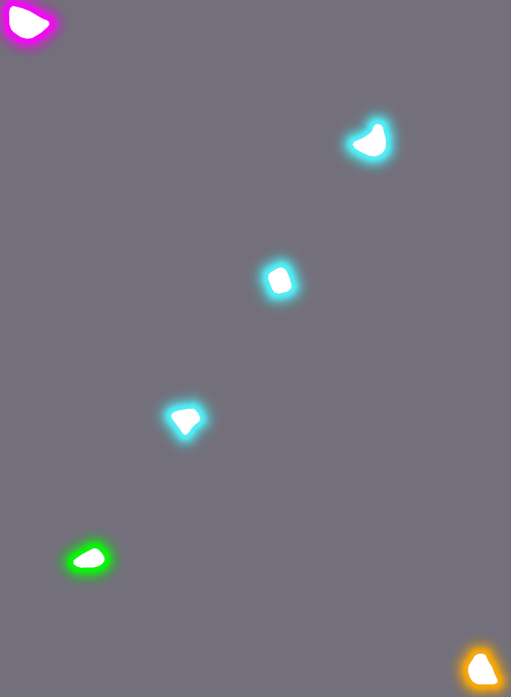
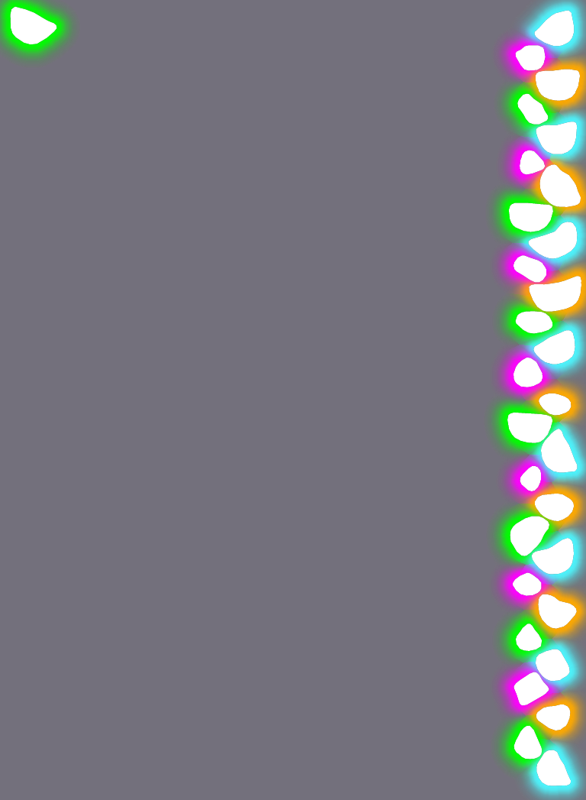
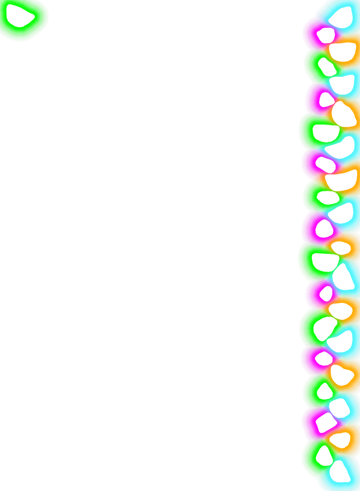
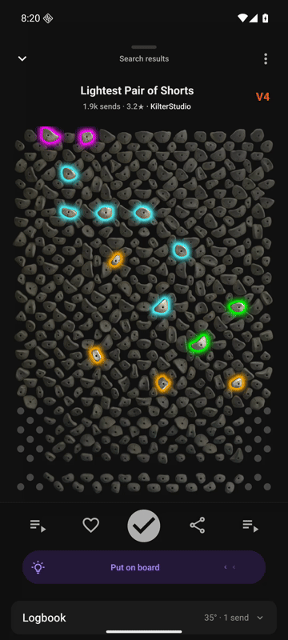
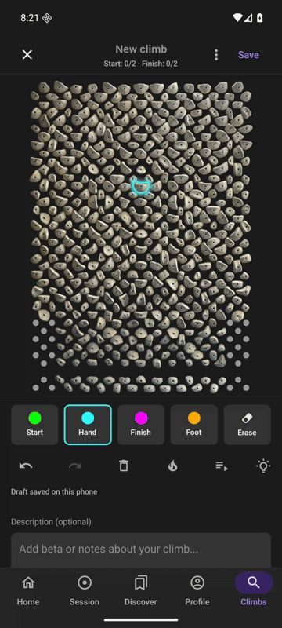

# GPU climb overlay experiment (#7431)

The current shipping path supports Kilter Homewall. Catalogue expansion is held behind the `aura-gpu-enabled` emergency switch and an explicit per-family payload allowlist; an unresolved flag keeps existing Homewall behavior. New catalogue layouts require the forthcoming API 5 native binary. Classic, custom spray walls and filled appearances retain PNG rendering. Full field resolution and the current one-channel-byte parity rule are unchanged; fill remains on PNG for this release. No new product indicator is introduced.

API 5 replaces eager full-layout preparation with lazy lit-hold chunks, bounded GPU residency and ordered tile culling. Descriptor and uniform encoding move into Rust while the Metal and GLES kernels retain their existing pixel math. These native changes require fresh final-build handset verification. Historical full-atlas measurements and rejection/optimization evidence remain source-scoped in [device verification](aura-device-verification.md).

The CDN cache PR is parked and excluded from the shipping stack. There is no asset prefetch or publication in this rollout. Reconsider it only after cold-preparation/fallback telemetry demonstrates a need. [Feature flags](feature-flags.md) and [render diagnostics](board-render-analytics.md) define the JS safety controls and the one-family rollout policy.

A matching full-size PNG stays above an incoming GPU surface until the native drawable and board photographs are ready. Row thumbnails cannot bridge this transition: their filled-hold appearance can differ from the full board. A missing module, unsupported configuration, rendering error or ten-second readiness timeout restores normal PNG rendering. Empty player selections remove the live overlay immediately. The v3 editor retains a transparent empty scene so the very first hold receives the same feedback as later edits. GPU readiness is never written into the PNG cache or snapshot contract. Native rendering pauses while inactive or detached.

## Swipe and edit feedback

Native API v3 supports the stationary play-drawer wall. The photograph stays in one zoomable surface while the existing pager slides the title continuously with the finger and supplies an absolute page position directly from its UI-thread shared values. Current, previous and next hold lists share one atlas. Moving the finger only changes a numeric native property; it does not parse the layout, upload geometry or update React state per frame.

A soft directional reveal changes each hold’s lighting as it crosses the stationary wall. Its 22%-wide band uses the hold’s display position, including mirroring. One weighted field combines outgoing and incoming holds without duplicating the veil or same-role holds. Shared holds with the same role remain steady. A hold whose role changes fades its old mark through clear before its new role appears, preserving the meaning of role colours and glyphs. Exact endpoints use the still renderer. Cancelling restores the original endpoint; a committed swipe settles on the next climb. Unsupported scenes retain the existing image carousel.

In Create Climb, the new role and glyph appear immediately. Added or changed holds expand their glow to 135% reach over 100 ms, then contract to the original edge by 350 ms; removals disappear immediately. The hold geometry, role colour and glyph do not move or change brightness. The pulse starts after the first normal-size drawable is presented, so preparation does not consume its visible duration. Undo and Redo use the same frame-difference treatment. A new edit replaces the previous effect instead of queuing it. Opening an existing climb or changing the layout does not animate; an empty editor records its baseline before preparation finishes, so a fast first tap still gets feedback. Reduce Motion shows the exact committed state directly; Low Power Mode suppresses the optional edit feedback. The native display link stops when the effect ends or the view becomes inactive.

The player passes its actual drawer surface colour into the board backing and veil, including Material tint and Reduce Transparency. GPU/PNG cache identities and opening snapshots include that colour; editor, thumbnail, share and pane defaults remain unchanged.

Both the player and editor preserve their unzoomed board size while allowing zoom to fill the available width. Pan limits use the full viewport. Editor taps and role-menu anchors account for the centred board offset, including mirrored boards.

For repeatable capture, the story URL accepts `gpu=1`, `sample=0` through `4`, `resolution=512|768|1024`, `mode=compare|rust|metal`, and `verify=1`. Invalid inputs use the normal defaults; the unparameterized story keeps GPU drawing off. `verify=1` runs one pixel comparison after that request is ready and logs its metrics and PNG paths with the `[gpu-climb-parity]` prefix. The story harness's `theme=light|dark` parameter sets appearance.

## What the screen compares

Both sides receive identical Rust render configuration for Kilter Homewall layout 8, size 17, sets 26 and 27: real catalogue placements and traced silhouettes, the current shared Aura defaults, and the current light/dark veil. The test climbs are synthetic selections of real holds; they are never saved to the account. Five samples cover six spread holds, 30 spread holds, adjacent same-colour holds, adjacent different-colour holds, and an empty climb.

The story's own switch starts off and enables its optional native view independently of production rendering. A missing native module or rendering error shows the matching Rust image. There is no animation loop, breathing or glide. The story disables drawing on route blur; the native view also handles application/window inactivity.

The initial output width is 768 pixels. The resolution button cycles through 512, 768, and 1024 pixels; both renderers receive the same resolution. A native memory-budget failure is reported and falls back to Rust. This experiment does not establish sharpness under pinch zoom or production rendering speed.

## Read the measurements correctly

Use **Mode: rust** or **Mode: metal** to run one renderer at a time. **Mode: compare** draws both and is for appearance; its timings include competing work. The screen retains the latest 100 sample records, with a **Share measurements** button for the JSON and **Reset readings** for a new sitting.

After the requested render completes, **Validate pixels** makes an offscreen Rust/GPU comparison at the same atlas resolution. The native view pauses while this runs. It reports maximum RGBA channel error, RMSE, and how many pixels differ by more than one byte, and saves both PNGs for inspection. The exported measurements include the snapshot paths and comparison result. These CPU/GPU compute timings exclude the normal PNG display path.

- **Rust API / PNG ready** includes the native API round trip, cache lookup, and any needed render/PNG encode/write. **Fresh Rust PNG** uses a new experiment-owned cache key. **Repeat cached key** reuses the key; the first such request may still miss.
- **Rust image onLoad** is the image-load callback measured from the same request start. It is not a compositor presentation timestamp.
- **GPU callback** is the native ready event round trip (drawable presentation on physical iOS with API v2–v4; command completion on the v1 prototype). The iOS simulator SDK omits the drawable-presentation callback, so simulator builds advertise API v1: the parity story and offscreen comparison work, while the player and editor use their PNG fallback. Simulator checks do not verify live GPU motion or presentation readiness. **Atlas prepare**, **upload**, and **GPU** describe native stages; the atlas hit flag and resident byte count distinguish preparation from reuse. Relaunch the app for a cold in-process atlas. The offscreen comparison still parses its full configuration; its preparation time does not measure the v2 frame-only update path.
- These story readings do not measure the production render scheduler, the player's gestures, or the create editor's tap-to-paint latency. Use the probes in `mobile-visible-performance.md` for those.

Record device, OS/build, output resolution, thermal state, power mode, whether the phone is charging, and sample counts alongside exported results. Compare alternating isolated Rust and Metal runs in the same sitting. iPhone 17 Pro evidence is preliminary; the issue's iPhone 13 Pro comparison remains a separate device run. Simulator images prove appearance only.

## Decision gate

Keep screenshots and exported measurements with the PR evidence. Compare silhouette edges, same-colour merging, different-colour seams, antialias coverage, and veil in both schemes. Report errors and unverified checks explicitly. Check first opening, rapid swipes, editor hold changes and clearing, plus background/resume. Do not infer a production speedup from the existence of the shader.

Initial iPhone 17 Pro evidence at 768 × 1047 pixels: the sparse dark sample differed from Rust by at most one channel byte, with zero pixels differing by more than one and RMSE 0.01375. Offscreen GPU execution was 0.61 ms versus 3.64 ms Rust computation; the original full-config warm preparation was 10.77 ms. These are individual diagnostic samples, not player latency measurements. The original full size-25 layout at 1080 × 1504 used an 84,805,136-byte atlas for 499 holds. Reserving distance-field padding for the 35% editor expansion increases that payload to 120,143,120 bytes (114.58 MiB), 41.67% larger and still below the 128 MiB limit. These payload counts exclude other process allocations and do not establish peak process memory.

The v2 live integration on the same iPhone reported fourteen consecutive cached requests with 0.063–0.157 ms preparation, zero upload time and 2.82–4.44 ms GPU execution. Their active atlas payload was 61,516,448 bytes. These readings confirm reuse across frame updates; they do not include gesture handling, JS scheduling or total time to visible presentation. Cold-start latency and peak process memory remain separate measurements.

## Android implementation and verification

### API 5: selected holds and ordered tiles

Opening a layout creates a bounded Rust session without rasterizing its holds. Each visible current/previous/next selection requests only its missing distance fields, canonical role stamps and required covers. Native code retains their stable GPU offsets in a per-chunk LRU. Reusing resident holds changes descriptors and controls without rasterizing or uploading their pixels. A first edit that introduces a missing hold or role can prepare and upload that chunk; it is measured separately from repeating an edit with resident geometry.

Rust encodes the 224-byte descriptors, 144-byte uniforms and 32-pixel tile lists. Each list retains ascending original contribution order; both shaders keep the existing compositing arithmetic, full-resolution fields, still endpoints and pulse padding. Shared constants come from the versioned packet contract. The Metal and GLES kernels remain separate sources.

The GPU cache has a 32 MiB soft retention target, bounded metadata and the unchanged 128 MiB aggregate application-owned admission ceiling. The ceiling includes mounted scenes, pending commands, descriptors, resources, uniform buffers and old/new arenas during growth. Selected and in-flight chunks stay pinned. These are allocation ceilings rather than reserved storage; driver internals and OS drawables remain outside the accounting. A native-private compressed chunk cache writes after readiness; one invalid chunk regenerates locally. The parked CDN cache does not participate.

At most two distinct, already-loaded adjacent climbs can prepare while the pager is idle. Lookahead does not change request identity or emit readiness, and stops when a gesture, request, inactivity or layout change supersedes it. Resource counters include this work and cancelled jobs. `getClimbOverlayGPUResourceStats` is absent on older binaries, which must report unavailable statistics rather than zero work. API 5 snapshots report cumulative raster attempts, materialization, pixel uploads, arena copies and pending work; a stable drained snapshot is required before claiming a warm operation did no geometry work.

Detachment and cancellation are silent. Finished reusable chunks can outlive a cancelled presentation. Android recreates its EGL surface before retrying the latest scene after context loss; invalid frame data does not evict an otherwise usable layout. JS persists only static configuration failures per installed binary, while frame/context failures leave later climb windows eligible.

The [selected-hold census](aura-lazy-packet-census.md) records host byte/encoder checks for all 51 configurations. Actual Metal/GLES image checks and final alternating iPhone 13 Pro/Pixel 8 Pro runs remain separate gates. No additional family is enabled by these host results.

### Historical full-atlas format v2 census

Native API v4 packs exact squared distance into 24 bits and coverage into eight bits. The all-ones distance sentinel is distinct from every possible distance at the supported 1536 × 2304 bounds. The 135% editing padding and native resolution are preserved. Transparent covers and stamps occupy no pixel storage; nonempty stamps are cropped after rasterization in board coordinates. Outline and glyph stamps preserve CPU drawing order and integer source-over rounding. Equivalent role aliases share a visual identity, so a code alias alone cannot trigger a role-change fade or editing pulse.

Filled appearances (`fill` and `glow-fill`) use PNG. Three rounds of stamp fixes removed coordinate and pass-order defects, but the final raw parity matrix still found two-channel-byte differences on a handful of dense filled pixels. The assumption that cached 8-bit fill passes exactly reproduce every clipped tiny-skia blend remains unproven. Glow, outlines, glyphs and auxiliary annotations keep the GPU path; the fallback preserves filled appearance at native resolution.

Rust hands manifest and pixel allocations to native separately, removing the explicit full-payload concatenation from the production transfer. Both platforms serialize preparation and count atlas, LUT and scene buffers through their retained GPU lifetime, including mounted views and submitted work, against the existing 128 MiB budget. Driver internals and OS drawable pools are not a process-memory bound. Rejected allocations keep the PNG path.

The reference 499-hold atlas falls from 120,143,120 to 56,822,920 pixel bytes (114.58 to 54.19 MiB). All 51 full-resolution configurations pass the requested-buffer size census; the largest is 59.25 MiB before its small LUT and scene descriptors. See [the catalogue census](aura-atlas-census.md) for per-configuration measurements and evidence limits. These host measurements do not establish physical-device peak memory or visible-ready latency.

The Android renderer uses a transparent `TextureView` and an OpenGL ES 3.1 compositor. It keeps the shared player/editor API, directional reveal and 135% edit-glow reach. The outer React Native view owns zoom, clipping and mirroring. The shared feature flag now controls both live boards and the stationary carousel.

The native bridge transfers ownership of the Rust atlas through a direct buffer, avoiding a Java byte-array copy of the large payload. Cold preparations are serialized and GPU atlas residency is bounded, including entries retained by mounted views. The Rust packing step can still hold both its working storage and its final payload temporarily. Neither the GPU residency limit nor the atlas byte count establishes a peak process-memory bound. Low-memory admission checks and unsupported GPU limits must fall back to PNG rather than retry indefinitely.

Android readiness requires both GPU completion and a matching buffer update consumed by `TextureView`, correlated using a monotonic presentation timestamp and request/surface generations. TextureView can notify before HWUI consumes its buffer, so bounded deferred reads wait for the exact timestamp; an unverifiable frame falls back after two seconds. This proves consumption by the view, **not physical display scanout**. The edit pulse starts after the initial normal-reach frame meets that boundary. A destroyed surface, context loss or superseded request must not release the PNG bridge for a newer request. Battery Saver and disabled system animations suppress the optional pulse, alongside the shared reduced-motion setting.

Only genuine, non-disjoint GPU timer results may populate GPU timing. Devices without that facility report unavailable timing; CPU command-submission time must not be labelled GPU execution. Offscreen framebuffer comparisons remain separate from visible presentation measurements.

Android validation must include native lifecycle/ownership tests, shader pixel comparisons in both themes, mirrored and dense hold patterns, rapid edits and cancelled swipes, background/resume and memory pressure. Emulator checks can establish functional behavior but cannot establish physical-device performance or scanout timing. Record actual build, device, parity and memory results with the stacked PR; iPhone measurements above are not Android evidence.

## Initial device parity images

These are the original 768 × 1047 offscreen outputs captured on the iPhone 17 Pro, not screenshots of the later swipe animation. They document still-image parity only.

| Rust reference | Metal output |
| --- | --- |
|  |  |

## Android emulator parity evidence

On 2026-11-15, an owned Android API 36 ARM64 emulator with 4 GiB RAM and ANGLE/SwiftShader GLES 3.1 completed 14 offscreen comparisons: all five fixtures in both themes at 768 pixels, plus the 30-hold fixture in both themes at 512 and 1024 pixels. Every comparison had a maximum channel error of at most one byte and zero pixels differing by more than one byte. RMSE ranged from 0 to 0.04015. GPU duration was reported as unavailable. These are functional and image-comparison results, not physical-device performance measurements.

The first TextureView notification reported timestamp zero. A deferred read subsequently matched the submitted buffer exactly and emitted one ready event. After pausing for comparison, the old timestamp was rejected and the newly submitted buffer was matched on resume. A separate 2 GiB emulator run correctly fell back because available memory was below preparation admission.

The [Android comparison screen](images/gpu-climb-overlay/android-comparison-screen.png) shows the existing PNG renderer beside GPU rendering over the same photographs. The images below are actual 768 × 1047 offscreen overlays. Transparent cutouts reveal the unchanged board photographs when composed in the app.

| Appearance | Rust reference | Android GPU |
| --- | --- | --- |
| Dark |  |  |
| Light |  |  |

The final APK without diagnostic tracing also reported API v3 readiness in the normal player and editor (screenshot mode off, recorded local backend). Player swipes reused the atlas with zero upload time. The first editor hold, later additions, role changes, Undo and Redo reported 350 ms edit feedback; recorded frames show expansion and contraction. Disabled system animations reported reduced motion and zero edit duration. Battery Saver was confirmed on through Android power state and reported zero edit duration with low-power mode active; both system settings were restored afterward. These emulator observations do not establish a hardware frame rate.

| Player swipes | Editor hold feedback |
| --- | --- |
|  |  |

## Catalogue expansion evidence

The [host parity census](aura-gpu-parity.json) records 251 raw Rust/Metal comparisons within one channel byte: all 51 default and mirrored-glyph configurations, 49 outline/glyph configurations, 51 glyph-only configurations, 24 pulse samples, seven MoonBoard auxiliary-only cases and 18 dense glow cases. Two outline/glyph configurations correctly use PNG at the unchanged 128 MiB limit. Filled treatments stay on PNG after the documented dense-fill residual. Selected-set and outline-cap field reconstruction also matches exactly across all 51 configurations.

These are Apple M5 Max host results. [Physical verification](aura-device-verification.md) now records the selected USB iPhone 13 Pro and Pixel 8 Pro baselines, the rejected initial candidate and the replacement's complete primary restart pairs. Native frame, full hardware catalogue/cache checks and final visual sign-off remain separate pending gates. No host timing is presented as a phone speedup.
