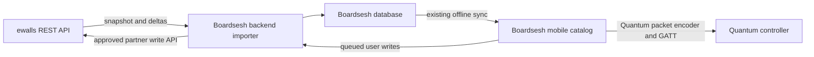

# Quantum Board / ewalls API integration notes

**Inspected:** ewalls Android 2.6.5, version code 552, on 2026-11-19.
**Status:** notes read from the shipped client, not a contract. The agreed contract replaces it section by section; the open questions are in [quantum-ewalls.md](quantum-ewalls.md) and the sync design is in [board-manufacturer-sync.md](board-manufacturer-sync.md).
**Bluetooth:** [Quantum Board Bluetooth protocol](../boards/QUANTUM_BLUETOOTH_PROTOCOL_SPEC.md).

Walltopia identifies **ewalls** (`com.walltopia.ewalls2`) as the companion app
for Quantum Board on its [official website](https://e-walls.eu/) and
[Google Play listing](https://play.google.com/store/apps/details?id=com.walltopia.ewalls2).
This document records what the downloaded client constructs and consumes. It
does not establish current server behavior, partner access, rate limits, or
compatibility with every controller. No account was used, no API requests were
sent to the service, and no board was connected during this investigation.

## Reading the evidence

**Observed** means present in the APK, configuration, or a traced bytecode
function. **Proposed** means a Boardsesh integration choice. **Unknown** means
the client does not establish the answer. HTTP examples use invented values;
they are request reconstructions, not captured successful exchanges.

References such as `F32341 +0x20a` identify a function and instruction offset in
the pinned `assets/index.android.bundle`. Function numbers only apply to the
bundle hash below. They are more durable than line numbers in a particular
disassembler's output.

## App stack

| Component | APK evidence |
| --- | --- |
| React Native 0.86.3 | Version embedded in packaged dependency resource paths; `libreactnative.so` in the ARM64 split |
| Expo SDK 57; package 57.0.30 | `assets/app.config` declares `sdkVersion: "57.0.0"`; dependency resource paths identify the package patch version |
| Hermes bytecode v98 | Bundle header and `libhermesvm.so` |
| Expo SQLite and Expo Updates | Native libraries and app configuration; SQLite catalog behavior is covered below |
| Reanimated, Gesture Handler, Screens, SVG, Sentry | Packaged native libraries and Expo plugins |

The Android configuration declares minimum SDK 29 and target SDK 36. The
server's implementation language, framework, and database are **unknown**;
client libraries and URL shapes do not establish them.

## Hosts and HTTP conventions

| Purpose | Address |
| --- | --- |
| Production REST base | `https://e-walls.eu/api/v1/` |
| Unversioned base constant | `https://e-walls.eu/api/` |
| Socket.IO origin and path | `https://e-walls.eu`, path `/api/socket.io/` |
| Test REST constant | `https://test.e-walls.eu/api/v1/` |
| Test Socket.IO origin | `https://test.e-walls.eu` |

Source: `F714 +0x113`. Test-host constants do not establish that Boardsesh has a
usable test tenant. Confirm the partner environment with Walltopia.

The HTTP client uses Axios. Its request interceptor sets
`Authorization: Bearer <token>` when a token exists and removes the header when
one does not. It also sends `x-ewalls-version` from the native app version
(`2.6.5` here) and `x-ewalls-platform: android` (`F32341 +0x1df–0x28f`). These
are observed first-party headers; ask Walltopia which identification headers
Boardsesh should send.

## Authentication

The first-party email flow sends:

```http
POST /api/v1/auth/email/login
Host: e-walls.eu
Content-Type: application/json
x-ewalls-version: 2.6.5
x-ewalls-platform: android

{"email":"climber@example.invalid","password":"<user-supplied password>"}
```

The login handler reads `response.data.token` and `response.data.user`, then
passes both into its login state. The token becomes the bearer credential for
later requests. Source: `F32981 +0x3dc–0x3f9` and `+0x7e–0xa4`;
`F6738` configures the Axios client with the versioned base URL. A leading `/`
in these Axios route strings still combines with `/api/v1/`.

**Unknown:** partner OAuth, token lifetime, refresh, logout/revocation semantics,
and whether an integration may use this first-party login endpoint. The
presence of generic authentication-library symbols does not prove a refresh
flow. Ask Walltopia for the approved connection flow before choosing how
Boardsesh stores or renews credentials.

## Downloading and refreshing the catalog

The important discovery is an existing **snapshot plus delta** read path. A
separate request per climb is not necessary for the observed app bootstrap.

### Request shape

```http
GET /api/v1/board/routes-delta?board=<encoded-board-name>&forcedType=<encoded-board-type>&page=1&limit=500
Authorization: Bearer <token>
```

For subsequent refreshes:

```http
GET /api/v1/board/routes-delta?board=<encoded-board-name>&forcedType=<encoded-board-type>&lastFetch=<encoded-server-timestamp>
Authorization: Bearer <token>
```

| Parameter | Observed use |
| --- | --- |
| `board` | Board name; the connection initialization reads the peripheral's advertised `localName` |
| `forcedType` | Selected board type; the client has a `BOARD_TYPE_BIG` fallback |
| `page` | Bootstrap page, starting at `1` |
| `limit` | Bootstrap page size `500` |
| `lastFetch` | Previously saved server `timestamp`; omitted during bootstrap |

Construct these with URL encoding. The observed incremental branch does not
add `page` or `limit`. Source: `F33712 +0xd98–0xf20` and `F33839 +0x211–0x26d`.
Do not guess the board name or type from screen dimensions: the Bluetooth
guide describes the controller identity and configuration path. Catalog sync
does not inherently require a live Bluetooth connection: `F33712
+0x1325–0x13bc` falls back from the selected peripheral's name to the first
remembered board's name, then to an empty `board` string with `forcedType`.

### Bootstrap completion

The client consumes `routes`, `diodes`, `favorites`, `projects`, `ascents`,
`hasMore`, `totalCount`, and `timestamp` from the JSON response. Its initial
cache writer checks `initialSync` and rejects an unexpected delta-shaped
response (`F28504`).

The observed fetch flow, with a stricter proposed Boardsesh completion check:

1. Start at page 1 with limit 500, without `lastFetch`.
2. Store the first response's catalog and associated collections.
3. Append subsequent route pages while `hasMore` is true.
4. For Boardsesh, require the expected `totalCount` before declaring completion.
5. Persist the server checkpoint only with successfully committed data.

The app has a 50-page safety cap. That is client behavior, **not** a proven
server maximum. Its completion guard is weaker than exact completeness:
`F28506` rejects a positive `totalCount` only when cached count is less than
**half** that count. Do not copy that threshold as proof of a complete import.
The stricter count check in step 4 is a **proposed Boardsesh safeguard**.
Sources: `F33712`, `F28504`, `F28506`. Treat an exceeded page cap as incomplete.
The APK does not prove stable ordering or a snapshot immune to concurrent
edits; confirm those guarantees or reconcile/restart an inconsistent fetch.

### Applying changes and deletions

The delta cache path normalizes `routes` and `ascents` through a `changed`
collection, and `favorites` and `projects` through an `added` collection.
The normalized result has `upsert` and `deleted` lists (`F28509`). The consumer
supports this shape (invented IDs and an opaque checkpoint placeholder):

```json
{
  "timestamp": "<server-issued checkpoint>",
  "routes": { "changed": [], "deleted": [{ "id": "example-route-id" }] },
  "ascents": { "changed": [], "deleted": [{ "id": "example-ascent-id" }] },
  "favorites": { "added": [], "deleted": [{ "routeId": "example-route-id" }] },
  "projects": { "added": [], "deleted": [{ "routeId": "example-route-id" }] },
  "diodes": []
}
```

`F7517` also accepts a flat array as upserts with no deletions, and a missing
collection as empty. Tombstones are **objects**, not bare ID strings: the
deletion helpers access `tombstone.id` or `tombstone.routeId` (`F28501`,
`F28502`). These are supported consumer shapes, not a guarantee that the
server currently emits every variant or permits every field to be absent.

| Collection | Upsert identity | Deletion identity / observed action |
| --- | --- | --- |
| Routes | Route `id` | Delete by `id` |
| Ascents | Ascent `id` | Delete by `id` |
| Favorites | `routeId` within account/catalog scope | Delete by `routeId` |
| Projects | `routeId` within account/catalog scope | Delete by `routeId` |
| Diodes | Board's diode collection | Replace when a nonempty diode array arrives; absence or an empty array does not clear it |

The SQLite transaction applies the changes and saves the response `timestamp`
together (`F34646`, especially `+0x136–0x1b4`, `+0x28a–0x390`,
`+0x5a8–0x5c2`, `+0x733–0x749`). Preserve this property in Boardsesh: a failed
page, failed upsert, or failed deletion must not advance the checkpoint.

**Account isolation matters:** the route enrichment code groups ascents by
both `routeId` and `userId` to calculate community and current-user counts
(`F7558`). The `ascents` collection is not established as an export of only the
signed-in climber's logbook. Only map rows whose `userId` matches the connected
ewalls user into that climber's Boardsesh ticks.

## Configuration, route details, and data fields

All paths below are relative to `/api/v1/`. Each method is traced to an actual
HTTP client call; response descriptions cover only fields the client uses.

| Read | Path | Observed result and source |
| --- | --- | --- |
| Board configuration | `GET board/config?boardID=<encoded-advertised-name>` | Configuration including `id` and `type`; `F28816 +0x31a–0x334` |
| Configuration by type | `GET board/config?type=<encoded-type>` | Alternative to the named-board lookup; `F31805 +0x112–0x149` |
| Diode catalog | `GET board/routes-all-lights?forcedType=<encoded-type>` | `response.data.diodes`; `F34428 +0x200–0x21b` |
| Route details | `GET board/<route.id>` | `response.data`; `F33653 +0x56d–0x58a` |
| Route ascents | `GET board/log-ascent/by-route/<route.id>` | Array; not established as a user-only logbook; `F33653 +0x489–0x4ab` |
| Ascents by angle | `GET board/ascents-by-angle/<route.id>` | Array; `F33653 +0x43c–0x45e` |
| Current profile | `GET users/current-user` | Profile response; `F27014 +0x24–0x32` |
| User board lists | `GET users/board-lists` | List response; `F27014 +0x76–0x84` |

### Route records

`F7492` stores the full route JSON and explicitly indexes these fields:

| Group | Consumed fields / behavior |
| --- | --- |
| Identity and geometry | `id`, `name`, `grade`, `angle`, `type`, `minVariant`; angle is converted to a number when needed |
| Metadata | `tips`, `tags`, `disabled`, `createdAt`, `updatedAt` |
| Climbing rules | `edge`, `kickplate`, `standard`, `matching`, `campusing`, `noEdge`, `noKickplate`, `noMatching`; boolean/0/1 normalization is client behavior |
| Setter | `routeSetter.id`, `firstName`, `lastName`, `photo.path` or `photo.url` |
| Activity and holds | `activatedBy`, `plays`, `ascents`, `rating`, `logged`, `lights`; the lights structure is preserved as JSON |

This is not an exhaustive required schema. Grades and tags can be strings or
structured values in the cache path. Preserve the source representation until
the grade mapping is known. Fields such as `isFavourite`, `isProject`, and
`userAscents` can be calculated locally; do not mistake enriched UI objects
for untouched server responses.

### Diode and ascent records

The diode cache mapper (`F32418`) uses `id`, `module`, `type`, `universe`,
`x`, `y`, `z`, `xOriginal`, `yOriginal`, `zOriginal`, `idLedNode`, and `autocadId`,
and preserves the complete source JSON. It checks numeric conversions for
coordinates and universe. Coordinate units and physical addressing do not
follow from those field names; use the Bluetooth mapping described in the
sibling guide.

The ascent cache mapper (`F32419`) indexes `id`, `userId`, and `routeId`, while
retaining full JSON. Display/optimistic objects also use `rating`, `logText`,
`attempts`, `grade`, `createdAt`, `standard`, and nested `user` details. Their
presence in UI code does not prove each field is mandatory in sync responses.
Keep missing fields distinguishable from zero/false.

## Writing user data

These are observed first-party mutation paths. They were not called during
research. The partner contract still needs to establish supported writes,
authorization, retry safety, and conflict behavior.

| Action | Observed request | Evidence |
| --- | --- | --- |
| Log an ascent | `POST board/log-ascent`, queued payload passed through | `F31138 +0x76–0x88` |
| Favorite / unfavorite | `GET board/route/favorite/<routeId>` / `GET board/route/unfavorite/<routeId>` | `F31130` |
| Project / unproject | `GET board/route/project/<routeId>` / `GET board/route/unproject/<routeId>` | `F31131` |
| Create a route | `POST board/route-setter/route` | `F31157 +0x435–0x440` |
| Edit a route | `PATCH board/<routeId>` | `F31158 +0x383–0x3a1` |

Paths are relative to `/api/v1/`. The favorite and project GETs **change user
state**; do not use them as read-only probes or crawl them.

The ascent submission creates a `clientId` shaped as
`ascent_<Date.now()>_<random-base36-suffix>` and queues that with the form
payload (`F33512 +0x315–0x345`, also `F33563`). This demonstrates an offline
mutation queue. It does **not** prove server-side deduplication or that a timed
out request is safe to repeat. Persist a stable operation identity locally and
confirm the server's idempotency rules before enabling automatic uploads.

### Ascent request body

`F33210 +0xeb–0x163` constructs the form body, `F33512` adds `clientId`, and
`F31138` posts it unchanged. This is a synthetic example with placeholders,
not a tested request:

```json
{
  "clientId": "ascent_<timestamp>_<random-suffix>",
  "logText": "Synthetic integration test ascent",
  "rating": 3,
  "ascentStandard": false,
  "attempts": 1,
  "standard": false,
  "grade": "[19]",
  "routeId": "<route.id>"
}
```

`attempts` is the selected numeric option; the UI defaults a flash to 1 and
another ascent type to 2 (`F25447`). `grade` is an internal option's `Value`.
For example, the packaged V5 and Font 6C+ options both use the **string**
`"[19]"`, not the label or the number `19` (`F717 +0xdd`, `+0x265`, checked
against the official literal buffers). Use the actual grade table for other
values. `ascentStandard` and `standard` carry the same vote boolean;
privilege-dependent UI behavior means an integration should not assume it
may set them true. Server rating bounds and grade validation remain unknown.

**Backdated ascent uploads are unresolved:** this form does not construct a date
field. Its optimistic local record uses the current time, but that is not a
submitted `createdAt`. Do not upload old Boardsesh ticks through this request
and assume their original dates survive.

### Route creation and editing

The board route editor constructs the same body for creation and editing
(`F33643 +0x16bf–0x1932`). This is a reconstruction of its serializer, not
a complete server validation schema:

```js
{
  campusing,
  noKickplate,
  noMatching,
  noEdge,
  name: routeName,
  angle: routeParams.angle,
  tips: routeTips,
  tags: routeParams.tags ?? '',
  grade: selectedGradePayloadValue,
  draft: submitArgument,
  diodes: selectedDiodes.map(({ id, step }) => ({ id, step })),
  type: selectedBoardType,
}
```

The four climbing-rule flags start as booleans in the editor (`F19200`).
The grade is the option's payload value, as in ascent submissions. `draft`
comes from the submit action. `type` uses the selected board type, with the
client's big-board fallback. The diode mapper strips entries to **API diode
`id` and `step`** (`F34502`): do not substitute `autocadId` or `idLedNode`,
which serve different Bluetooth mappings. Step semantics still need the
partner's schema.

This base serializer does not add a board advertised name, `boardConfigId`,
timestamp, external ID, or `clientId`. Local queue metadata is not necessarily
part of the HTTP request. Confirm route ownership, publication permissions,
draft visibility, and the acknowledged route ID before exporting Boardsesh
climbs. Route creation and lighting the physical board are separate operations.
A board route DELETE call was not established in the inspected paths.

### Playlists and membership

Playlists use `users/board-lists`, separately from catalog deltas:

| Action | Request and body | Evidence |
| --- | --- | --- |
| Read lists / members | `GET users/board-lists` / `GET users/board-lists/<listId>` | `F33504`, `F30761`, `F35009` |
| Create list | `POST users/board-lists`, `{name, iconName}` | `F2893`, `F19337`, `F33672 +0x20b–0x236` |
| Edit list | `PATCH users/board-lists/<listId>`, `{name, iconName}` | `F33672 +0x257–0x29b` |
| Delete list | `DELETE users/board-lists/<listId>` | `F34547 +0xf1–0x10d` |
| Add route | `POST users/board-lists/<listId>`, `{route: routeId}` | `F31136 +0x93–0xc4` |
| Remove member | `DELETE users/board-lists/item/<itemId>` | `F31137 +0x7e–0x96` |
| Reorder lists | `PATCH users/board-lists/reorder`, `{ids: [listId, ...]}` | `F33508`, `F34345` |

Create/edit trim the list name and send both `name` and `iconName`; an empty
trimmed name is rejected by the UI. The default icon is
`format-list-bulleted`. These are observed client choices, not proof of server
validation limits. The detail reader expects an array and tolerates a route
reference in `row.route.id`, `row.routeId`, or a string `row.route`
(`F17743`, `F25502`). Preserve the member's item ID as well as its route ID:
**removing membership takes the item ID**, not the route ID.

Before a queued add, the app checks `listAlreadyHolds` with a GET; a read
failure is treated as not found (`F31136`, `F30761`). That check cannot prove
atomic uniqueness under concurrent adds or safe retry after a timeout.
The reorder endpoint orders the user's **lists**, not climbs within a list.
Neither a route-ordering API nor playlist deltas/tombstones was established;
do not assume `board/routes-delta` includes playlists. Complete list and
membership reads would need separate reconciliation and visibility guarantees.

### What remains incomplete for two-way sync

| Entity | Observed pull | Observed push | Unresolved contract |
| --- | --- | --- | --- |
| Personal ascents | Catalog delta includes ascent records; filter by connected user | Create with `POST board/log-ascent` | Full user history, edit/delete, original climb date, permanent-ID acknowledgement, deduplication |
| Favorites / projects | Added/deleted collections in catalog delta | Separate add/remove state-changing GETs | Concurrent edits, retry behavior, account visibility |
| Routes | Snapshot/delta, detail, and tombstone consumers | Create and PATCH edit | DELETE API, ownership/publication, revision conflicts, creation deduplication |
| Playlists / members | Separate list and member GETs | List create/edit/delete, member add/remove, list reorder | Complete pagination/visibility, change feed, revisions, member ordering, duplicate-safe creation/add |

The APK also contains `PATCH comments/<commentId>` with `{routeId, text}`
and `DELETE comments/<commentId>` (`F33212`, `F33213`). Their traced caller
belongs to the general route-details flow, which reads
`log-ascent/by-route/<id>` without the `board/` prefix (`F33195`). They are
**not verified Quantum ascent edit/delete endpoints**. Using a board ascent
ID there would be a guess. Pull-side ascent tombstones establish a consumer
for deletions, not permission or an endpoint to perform them.

### Mutation acknowledgements and identity

The traced ascent handler awaits the HTTP POST (`F31138`). The queue calls
`handler.sync(payload, httpClient)` and, on success, removes the queue entry
by its local queue ID (`F34666 +0x44e–0x47c`, `+0xeb–0x126`, `F34952`).
These paths do not establish a response schema containing a permanent ascent
ID or a guaranteed `clientId` echo in subsequent deltas. A successful local
queue drain is therefore insufficient evidence for duplicate-free two-way
sync. Confirm both the mutation acknowledgement and how it matches the
eventual imported record. Never identify a repeated ascent solely by user,
route, and date: multiple legitimate ascents can share those fields.

## Realtime board state

The app connects to the Socket.IO namespace `https://e-walls.eu/board`, using
transport path `/api/socket.io/`, `auth: {token: jwt}`, and
`transports: ['websocket']`. The token has no `Bearer ` prefix in this object.
The normal connection disables Socket.IO's automatic reconnection and sets a
20-second connection timeout (`F26742`). This is a Socket.IO connection, not
a plain WebSocket endpoint accepting arbitrary JSON frames.

| Event | Direction and observed meaning |
| --- | --- |
| `subscribe_board` | Client sends `{boardId}`; waits up to 15 seconds for matching `board_config` (`F35010`, `F34444`) |
| `get_board_config` | Client sends `{boardId}`; receives board configuration (`F33592`) |
| `unsubscribe_board` | Client sends the current `{boardId}`; no server acknowledgement callback is passed (`F33591`) |
| `route_activity` | Server sends lighting activity; consumed fields include `activity`, `routeId`, `timestamp`, `boardId`, `userId`, `color` (`F26751`, `F19044`) |
| `board_config`, `board_config_updated` | Configuration and `activePlayers` state; not a route catalog snapshot (`F26727`) |

**`route_activity` is not an ascent or catalog change feed.** The traced
consumer handles `activated` and `deactivated` by changing active-player
lighting state (`F19044`, `F26726`). Deactivation does not mean deletion of a
climb. The duplicate cache uses an in-memory key built from activity, route
ID, and timestamp; it is not a persistent sync cursor (`F26751`, `F18765`).
No route-created/updated/deleted or ascent-changed listener was found in this
service's listener registration (`F18764`). This does not rule out partner
events elsewhere on the server.

Use REST deltas for the observed durable data path. On socket reconnect,
resubscribe and refresh board configuration; no replay contract was found in
these client paths. Board-control events may improve live presence in
Boardsesh, but cannot replace logbook reconciliation.

## Mapping pitfalls for two-way sync

Preserve each grade's original representation and system alongside any
Boardsesh-normalized grade. Grade options have distinct `ID`, `Label`, and
`Value` fields; the submission helper selects `Value`, not `ID` (`F19207`,
`F19209`). For example, shipped V0 has option ID `3` and the string Value
`"[9,10]"`, representing multiple internal indices. Flattening this to a
single number loses information. Boulder preference keys include `hueco`
and `ebleau` (exact spelling); rope systems include `UIAA`, `French`, `US`,
and `EWBANKS` (`F719`, `F720`).

The angle helpers treat missing/invalid angles separately from actual
angles and serialize the missing sentinel as `-1` (`F19068`, `F19069`). Do
not import it as zero degrees. The shipped selection options are 25–60 in
5-degree steps for `big`, 10–30 for `belay`, and 15–60 for other types
(`F2837`, `F19066`). These are UI options; physical limits, degree orientation,
and server validation still require partner confirmation.

## Proposed Boardsesh implementation

This section is a design recommendation, not behavior observed in ewalls. The
current design is [board-manufacturer-sync.md](board-manufacturer-sync.md); where
the two differ, that document wins.



1. Put credential handling and upstream sync in `packages/backend`. Keep
   separate public catalog and per-account collections; partition checkpoints
   by the actual upstream board/type and connected account scope.
2. Preserve upstream IDs as strings and keep their provenance. Map routes,
   diodes/geometry, grades, and user ascents explicitly into Boardsesh's board
   tables; never equate an API hold ID, coordinate, and physical LED address.
3. Bootstrap into a staging generation, validate completeness, then publish
   that generation. Apply deltas, tombstones, and checkpoints transactionally.
   On account changes, invalidate account-scoped cache and pending operations.
4. Reuse Boardsesh's downstream offline-sync path. Add a pure Quantum encoder
   in `packages/shared/ble-protocol` and a dedicated mobile transport strategy;
   Android and iOS/background BLE must both support the same packet semantics.
5. Enable outbound changes only after partner validation. Retain upstream
   ascent IDs and operation IDs to prevent import/export loops. Do not infer
   a send, attempt count, grade, angle, or timezone that the upstream row does
   not establish.

### Bidirectional reconciliation contract

Before enabling uploads, define these rules for each supported entity:

| Concern | Proposed Boardsesh behavior |
| --- | --- |
| Stable identity | Store the connected account, board scope, entity kind, Boardsesh ID, remote ID, and originating operation ID. Playlist membership IDs are separate from route IDs. |
| Durable outbound work | Commit the local edit and outbox operation together. Persist one operation ID and request payload across retries; never generate a new `clientId` for each attempt. |
| Acknowledgement and echo | Record the remote identity from a documented acknowledgement or reconciliation lookup. Apply imported changes without automatically re-enqueuing them. Wait for an unambiguous mapping before marking an uncertain upload complete. |
| Concurrent edits | Keep the last synchronized representation, compare local and remote edits against it, and merge only independent field changes. Surface conflicting changes until partner revision/precondition semantics are known. Do not choose a winner using device clocks. |
| Deletions and visibility | Propagate deletion only for an explicitly supported operation and an owned, linked record. A missing item on one page, private item, or incomplete fetch is not a deletion. Keep tombstones and pending-operation state until reconciled. |

An HTTP timeout can occur after a successful server commit. Until the partner
provides idempotency or a reliable operation lookup, hold that upload in an
uncertain state and reconcile it instead of automatically creating another
ascent. Handle rate limits with the partner's retry contract; do not copy the
first-party queue's retry behavior as a guarantee of safe replay.

Start with approved new-ascent uploads and inbound reconciliation. Historical
backfill must wait for preserved climb dates/timezones and duplicate handling.
Enable ascent edits/deletes and playlist/route writes separately, as their
authorization, identity, and conflict contracts are confirmed. Connection
revocation must stop both imports and pending exports for that account.

The existing [board account integration guide](integrations.md) and
[sync table manifest](../data/sync-table-manifest.md) describe the Boardsesh side.
No Quantum implementation or database migration is included in this research.

## Questions for Walltopia and validation gates

| Area | What remains to establish |
| --- | --- |
| Partner access | Authentication/scopes, credential renewal, test tenant, approved client headers, and allowed catalog visibility |
| Sync correctness | Stable snapshot pagination, timestamp semantics and retention, deletion completeness, rate limits, and reset/rebootstrap rules |
| Personal data | Complete per-user logbook export, ascent edit/delete semantics, backdated climb timestamps/timezones, and grade/angle definitions |
| Writes | Idempotency and `clientId` echo/lookup, permanent IDs in acknowledgements, revision preconditions, playlist membership identity, allowed route publication, and duplicate resolution |
| Controller | Supported firmware/protocol versions, GATT permissions, notification framing, diode mapping, multi-climber conflict behavior, and real-device packet acceptance |

The first partner test should use a dedicated account and board: compare a
complete bootstrap with ewalls, create/edit/remove one approved test item,
verify its delta and retry behavior, then exercise the Bluetooth sequence in
the sibling guide. Static decoding provides an implementation starting point;
those tests establish compatibility with the deployed service and hardware.

## Artifact identity and reproduction

The APK came from an [APKPure mirror download](https://apkpure.net/e-walls/com.walltopia.ewalls2/download),
using `https://d.apkpure.net/b/XAPK/com.walltopia.ewalls2?versionCode=552&nc=arm64-v8a&sv=29`.
The XAPK contains a base APK plus architecture, density, and language splits.
The Android manifest and Expo configuration independently agree on the package
and version. This is the inspected release, not a claim that it is the latest.

| Artifact | Bytes | SHA-256 |
| --- | ---: | --- |
| Downloaded XAPK | 106267684 | `2ac4964f9967b469db85072d2e6897a797bfe1bd6fb321438d22b82c4826a75b` |
| `com.walltopia.ewalls2.apk` | 72293921 | `20c4e15e81491499e4487fe0b786c74734ca120bd9960defd10e81bc1537827f` |
| `config.arm64_v8a.apk` | 31853219 | `61db2222458411547d06d65d6fc501476f08962334032159bd117739201e3591` |
| `assets/index.android.bundle` | 8556480 | `531d2a0a86c56b37ca153241d9872acf9fc04a39ecef243666c6f497bbba947f` |

Android SDK build-tools 36.0.0 `apksigner verify --verbose --print-certs`
verified APK Signature Scheme v3/v3.1 and the source stamp. The Android 33+
signing certificate SHA-256 is
`d3e1dd051e9710c62f70d28ebbac3694785f5a8e7b057c35ab5af62c19cda89f`;
the Android 24–32 certificate is
`147f8ee9cb166ffc0d62e143a9635604535de5e19761752c9f6360a716cac18d`.
No independent publisher-provided or Google Play APK was available for signer
comparison. A valid signature establishes integrity under those keys, not
independent publisher attribution.

The investigation used the **reverse-engineer-anything** skill and REA 6.7.0's
CLI fallback. REA's MCP tools were not connected in this chat and its optional
JADX MCP provider was unavailable. REA's archive inspection produced:

```text
inspection: ev_fae1bb6e659d7363d5eb42f9fbab2bf0874928241f0a603e66e567fc465ce078
inventory:  ev_75e1e97dacdf46dbff2f2f5be1c979accad6355520c9661faef6812817e788b3
```

That evidence covers ZIP member inventory only. It does not establish Android
execution, API semantics, or signing-block contents. Signature checks used
`apksigner`; resource decoding used installed JADX 1.5.5; protocol claims come
from the separately identified Hermes bytecode analysis.

The authoritative instruction dump was produced with the official npm package
`hermes-compiler@250829098.0.2`, whose compiler reports HBC version 98:

```sh
hermesc -b -dump-bytecode index.android.bundle > hermes-official.txt
vp dlx -- rea-agents@6.7.0 inspect-artifact com.walltopia.ewalls2.apk --format json
```

The first command decodes bytecode; it does not run the application. The npm
tarball's published SHA-512 integrity was verified. Its SHA-256 is
`885820c08620145ddaaa668c63d32d635f3c4b64eee67d5ca9e4c9fa1853aa6d`;
the Linux compiler binary's SHA-256 is
`9ce175dcabd877c52b92018bf86c1952a7dc1c11d05d28d208793dbafd05f905`.
The resulting dump has 35,098 functions, 51,095 strings, and SHA-256
`d22f99b027e5b143c1659b4733ac9ab92056ce6421fdf12a619a926fcc9ecc04`.

An initial `hermes_dec` 0.1.3 attempt was incomplete and misidentified some
builtin names and undefined literals for v98. Its decompiled JavaScript is
**not** a source of truth. Its instruction-offset view is useful for locating
functions, but semantic conclusions must agree with the official dump. Count
all `Function`, `NCFunction`, and `Constructor` declarations when mapping
official output to function IDs; the auxiliary Python listing also has
`Async function` headers.

Raw downloads and analysis outputs are retained locally under the ignored
`.boardsesh/quantum-api-research/` directory. They are not redistributed in Git.
The main files are `acquisition/provenance.json`,
`acquisition/apksigner-verification.txt`, `acquisition/app.config`,
`evidence/apk-inventory.json`, `evidence/hermes-official.txt`, and
`tooling/hermes-v98-provenance.json`. Reacquire the
same APK and verify its hashes before applying the function references to a
different analysis environment.
