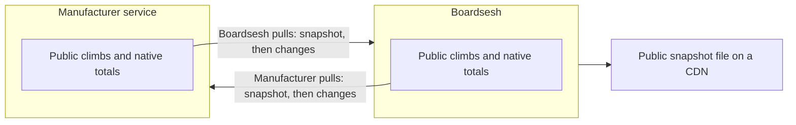

# Two-way sync with a board manufacturer: proposal

Status: **proposal**. Nothing in this document is built or agreed unless a
section says so. It describes how Boardsesh would like to exchange climbs,
stats and logbooks with the service a board manufacturer runs for its own app.
The first partner is Walltopia's Quantum Board; the Quantum specifics and the
questions for Walltopia are in [quantum-ewalls.md](quantum-ewalls.md).

In short: public climbs and their totals appear in both apps for everyone; a
climber who links their two accounts gets one logbook in both. The first step
needs only a test environment and a read-only credential for the public
catalogue.

It is written for the engineers on the manufacturer's side. Where it changes a
decision recorded elsewhere in these docs, the section
[What this changes on the Boardsesh side](#what-this-changes-on-the-boardsesh-side)
says which one.

## Contents

1. [Terms](#terms)
2. [What "share everything" means](#what-share-everything-means)
3. [Principles](#principles)
4. [The three tiers](#the-three-tiers)
5. [Catalogue sync](#catalogue-sync)
6. [Climb identity and ownership](#climb-identity-and-ownership)
7. [Combining stats from two services](#combining-stats-from-two-services)
8. [Linking an account](#linking-an-account)
9. [Logbook sync for linked climbers](#logbook-sync-for-linked-climbers)
10. [The public snapshot](#the-public-snapshot)
11. [Sharing one wall](#sharing-one-wall)
12. [Privacy and data roles](#privacy-and-data-roles)
13. [Phases and who builds what](#phases-and-who-builds-what)
14. [What this changes on the Boardsesh side](#what-this-changes-on-the-boardsesh-side)
15. [Open questions](#open-questions)

## Terms

| Term | Meaning here |
| --- | --- |
| Ascent | One logged climb in a logbook. A **send** is an ascent that was completed |
| Totals | The numbers shown on a climb: how many people sent it, its star rating, its grade votes |
| Origin | The service where a climb or an ascent was first created |
| Native | Logged in that service's own app, as opposed to received from the other service |
| Tier | A level of sharing: 0 is public data for everyone, 1 is a linked account |
| System credential | A key issued to a company, not to a climber |
| Cursor | A bookmark string that only the server that issued it understands |
| Tombstone | A record in a feed that says a climb is no longer shown publicly, for example after moderation. The climb itself is not deleted |
| Diode | One LED on the board |

## What "share everything" means

The goal both sides stated is that the two apps share climbs, logbooks and
lists: set a climb in one app and it shows up in the other.

Boardsesh proposes to get there in two layers, because not every Boardsesh
climber has, or wants, an account with the manufacturer:

- **For everyone, with no account link:** every public climb and its stats
  appear in both apps. A climb set in Boardsesh shows in the manufacturer's
  app with the setter's public Boardsesh name, and the other way round.
- **For a climber who links their two accounts:** their whole logbook, and
  later their favourites, projects and lists, stay the same in both apps.

What does not cross is the individual logbook of a climber who has not linked.
Their sends still count in the totals each climb shows. Their name, dates and
comments stay in the app they logged them in.

Linking is the way to full sharing, so Boardsesh will make it one tap from the
place it matters: when a climber connects to the manufacturer's board. That
prompt offers "link your account" and "create an account" side by side. It is
an offer, not a gate. A climber can skip it and still climb, set and log.

## Principles

1. **The catalogue comes with the board.** A climber or gym that buys a board
   expects the climbs set on it to stay available. Boardsesh treats the public
   catalogue as open data and publishes it as a file anyone can download (see
   [The public snapshot](#the-public-snapshot)), so it outlives any one app,
   ours included.
2. **Open means public climbs and totals only.** No logbooks, no accounts, no
   drafts, no private walls.
3. **A logbook belongs to the climber.** It moves between services when that
   climber says so, and only then.
4. **No required third account.** Using a board through Boardsesh never
   requires an account with the manufacturer. Linking adds things; not linking
   takes nothing away.
5. **Each record has one home.** Every climb and every ascent originates in
   one service. That service owns it; the other holds a copy. This one rule is
   what stops duplicates, double counting and edit conflicts.

## The three tiers

| Tier | Who | What crosses | Direction |
| --- | --- | --- | --- |
| 0. Catalogue | Everyone. No account link, no consent screen | Public climbs with the setter's display name; totals per climb | Both ways |
| 1. Linked | A climber who connected their two accounts | That climber's ascents and attempts; later favourites, projects, lists; climbs they set appear under their own identity in both apps | Both ways |
| Not shared | Nobody | Logbook rows of climbers who have not linked, in any form, including anonymised; drafts; private walls; account details | Neither |

We considered sending unlinked climbers' logbooks with the names removed, and
rejected it. A row with a timestamp, a climb and a board at a known gym points
at a person even without a name, so it is still personal data, and it needs
the same consent and deletion handling as a named row. The totals in tier 0
give both apps what they need from those climbers: how often a climb is sent,
how it is graded and how it is rated.

We also considered requiring an account with the manufacturer before a climber
can use the board in Boardsesh. That contradicts principle 4.

## Catalogue sync

Both directions use the same shape: a complete first read, then a feed of
changes since a cursor, with withdrawn climbs sent as explicit tombstones.



### Manufacturer to Boardsesh

Boardsesh pulls. We need:

- **A system credential**, not a climber's login. It reads the public
  catalogue and nothing else.
- **A stated public view.** The manufacturer says which climbs that
  credential may see and Boardsesh may show and republish. Climbs outside it
  (drafts, gym-only climbs, private walls, if those exist) are not returned.
- **A complete first read**, paginated, with a total so we can tell it is
  complete before we publish anything from it.
- **A change feed** from an opaque cursor the server issues, carrying changed
  climbs and tombstones for removed ones.
- **A stated retention** for the feed, and a clear signal when a cursor is too
  old and we must start over.

Boardsesh refreshes on a schedule (every six hours in the prototype) and
stages a full read before replacing anything, so a half-finished download
never reaches climbers.

### Boardsesh to manufacturer

We suggest the manufacturer pulls, from two endpoints Boardsesh would build on
`api.boardsesh.com`. If pushing suits the manufacturer better, that works too
(see the end of this section). The endpoints follow the cursor rules of the logbook feed that is
already built ([partner-api.md](partner-api.md), "Syncing").

| Endpoint | Returns |
| --- | --- |
| `GET /v1/catalog/changes?cursor=&limit=` | Public climbs set in Boardsesh on this manufacturer's boards, and tombstones |
| `GET /v1/catalog/stats/changes?cursor=&limit=` | Boardsesh-native totals per climb and angle, for every public climb on those boards |

- No cursor means "start from the beginning": the response walks the whole
  set and runs into the live feed. The caller is caught up when it sees
  `hasMore: false`.
- Cursors are opaque strings. An expired one returns `410 cursor_expired` and
  the caller starts again.
- Authentication is a system credential issued to the manufacturer, limited to
  its own board types.

A climb in the feed:

```json
{
  "type": "climb",
  "climb": {
    "id": "5A0C1F2B9D7E4C3A8B6F0E1D2C3B4A59",
    "origin": "boardsesh",
    "externalId": null,
    "revision": 3,
    "board": { "type": "quantum", "layout": 9101, "compatibleSizes": [9201, 9202] },
    "name": "Left Hand Path",
    "description": "No matching on the finish.",
    "angle": 40,
    "grade": { "system": "font", "value": "6C+" },
    "rules": ["no-matching"],
    "holds": [
      { "diodeId": "0c1d…", "role": "start" },
      { "diodeId": "77ab…", "role": "middle" },
      { "diodeId": "91fe…", "role": "finish" }
    ],
    "setter": { "displayName": "sam_climbs" },
    "publishedAt": "2026-11-20T18:04:11Z",
    "updatedAt": "2026-11-22T09:15:40Z"
  }
}
```

A tombstone is `{ "type": "climb.withdrawn", "id": "…" }`. Boardsesh sends it
when moderation hides a climb. Boardsesh never deletes a published climb: a
climb is a fact about a board, so it stays in the catalogue.

Holds are identified with the manufacturer's own diode ids, so no geometry
has to be translated on their side. The setter is the name shown on
the climb in Boardsesh and nothing else: no Boardsesh account id, no email, no
profile link. A setter who has linked an account with the manufacturer also
carries `partnerAccountId`, the id the manufacturer gave that account.

**Fallback if pulling does not suit the manufacturer:** Boardsesh pushes the
same payloads to two endpoints the manufacturer provides (create or update a
climb by its Boardsesh id; replace the totals for a climb). The payloads and
the rules in the next two sections stay the same. Pull is our first choice
because it can be replayed from any point and neither side writes into the
other's database.

## Climb identity and ownership

Without these rules, a climb Boardsesh sends to the manufacturer would return
in the manufacturer's feed as a new climb, and the catalogue would fill with
copies.

1. **Every climb has an origin and keeps its origin id.** The service that
   receives a copy stores the origin id next to its own and returns it
   whenever it mentions that climb. In the payload above, `origin` and `id`
   are the origin pair; `externalId` is the id the other service gives its copy.
   It is null until we know it.
2. **Each feed carries only climbs that originated there.** Boardsesh's feed
   never contains climbs it imported from the manufacturer, and we ask the
   same of the manufacturer's feed, or at least a field that lets us skip
   them.
3. **The origin service owns edits.** A setter edits a climb in the app they
   set it in; the change reaches the other side through the feed with a higher
   `revision`. The other app shows the climb as read-only for editing.
4. **Either service may remove any climb from its own app.** A manufacturer
   has to be able to moderate its own product. A removal there is a tombstone
   to Boardsesh in the manufacturer's feed when the climb originated there.
   A service that removes its copy of the other's climb sends nothing back;
   the origin keeps the climb. Each side tells the other about such removals
   only if both want that.
5. **A published climb stays published.** In Boardsesh a climb has no
   audience setting: once published and listed it is public to everyone,
   whoever set it ([privacy.md](../product/privacy.md)). A setter cannot
   withdraw it from the shared catalogue later. If the setter deletes their
   Boardsesh account, the climb stays and loses its link to the account. Its
   If the climber chooses to remove their name when deleting, the setter
   becomes "Unknown", and the feed sends an ordinary update with that name.
   The climb is never removed for this reason.
6. **Setter credit follows the account when one is linked.** If a Boardsesh
   setter later links an account with the manufacturer, the feed sends an
   update with `setter.partnerAccountId`, so the manufacturer can attach the
   climb to that account. The climb id does not change.
7. **Geometry changes are not edits.** A climb's holds refer to physical
   diodes. If the manufacturer changes what a diode id means, that is a new
   board layout, announced ahead of time, never a silent change under existing
   climbs.

What this needs on the manufacturer's side: a place to store an external id
and an origin on a climb, both returned in their feed; and a setter name field
that accepts plain text for climbs whose setter has no account with them.

## Combining stats from two services

Every climb shows totals: how many people sent it, how they graded it, how
they rated it. With two apps logging on the same board, the totals have to add
up without counting anyone's send twice.

### The rule

**An ascent counts once, in the service where it was first logged.**

Each service publishes totals of its *native* ascents only: the ones logged in
its own app. Ascents it received from the other service, through a linked
account, are left out. Each app then shows the sum of the two.

### What is published

Per climb and angle, once a day:

| Field | Meaning |
| --- | --- |
| `senders` | Distinct climbers with at least one native send |
| `qualitySum`, `qualityCount` | Sum and number of native star ratings, on a stated scale ("quality" is Boardsesh's name for the star rating). One rating per climber, their latest |
| `gradeVotes` | Number of native grade votes per grade; omitted below a minimum number of votes |

Sums and counts are used instead of averages because they add exactly:
`(sumA + sumB) / (countA + countB)` is the true combined average, and an
average of two averages is not.

### Worked example

| | Manufacturer app | Boardsesh | Shown in both apps |
| --- | ---: | ---: | ---: |
| Native senders | 40 | 12 | 52 |
| Star rating sum / count | 152 / 38 | 50 / 11 | 202 / 49 = 4.1 stars |
| Votes for 6C+ | 21 | 7 | 28 |

An example climber, Ana, has linked her accounts and logged her send in
Boardsesh. Her ascent is copied to the manufacturer's app so her logbook
matches. It is native to Boardsesh, so she is one of the 12 and not one of the 40. She counts once.

### What this needs on the manufacturer's side

An origin stored on each ascent ("logged here" or "received from Boardsesh"),
and totals that can be filtered by it.

**If that is not possible at first:** Boardsesh takes the manufacturer's
totals as they are and removes the overlap on its own side. Boardsesh already
does this for the boards it syncs one way: a Boardsesh climber who also has a
received ascent on that climb is not added again. This is less exact. It also
means Boardsesh must not send linked climbers' ascents to the manufacturer
until the manufacturer can tell them apart, or they are counted twice. So the
origin field is needed before phase 3, not before phase 2.

### Details and limits

- **People, not ascents.** Boardsesh counts distinct senders, so repeats by
  one climber do not inflate a climb. We propose the same unit for the shared
  number and need to know what the manufacturer's count means today.
- **One person in both apps, unlinked, is counted twice.** Neither side can
  know they are the same person. Linking fixes it for that climber.
- **Angle.** Boardsesh keeps totals per angle. We need to know whether the
  manufacturer's totals are per angle or per climb, and what angle an ascent
  is recorded at.
- **Displayed grade.** The origin service decides the grade a climb displays.
  The other service contributes its votes and shows the same result.
- **Grade scale.** Each side sends grades in a named system with the value it
  uses, and Boardsesh keeps the original next to its own scale. Where one
  label covers a range of internal values we need the mapping, not a guess.
- **Small numbers.** A daily total that moves from 0 to 1 describes one
  person's day. So the stats feed is daily, not live, carries no first-ascent
  name or time, and leaves out the grade-vote breakdown until a climb has a
  minimum number of votes (we propose 5).

## Linking an account

Linking is what turns tier 0 into tier 1 for one climber.

### Preferred: the manufacturer runs a standard OAuth 2.0 sign-in

- Authorization code flow with PKCE. Boardsesh opens the manufacturer's
  sign-in page in the system browser; the climber never types their
  manufacturer password into Boardsesh.
- **The same page offers "create an account".** That is the sign-up wizard
  inside Boardsesh: we open the page, the climber signs up with the
  manufacturer, and returns linked. The manufacturer keeps full control of its
  own sign-up, terms and consent.
- Scopes that name what Boardsesh may do: read the logbook, write the
  logbook, read and write favourites and lists, set climbs.
- A refresh token so sync continues while the app is closed, and a way to
  revoke it from either side.

With this in place Boardsesh does the work in both directions using the
climber's token: it reads their ascents from the manufacturer and writes their
Boardsesh ascents to the manufacturer. The manufacturer builds no sync client
for personal data.

### If an OAuth server is too much to start with

Either of these gets a first version working sooner.

- **The manufacturer's existing login.** The climber enters their manufacturer
  email and password in Boardsesh once; Boardsesh exchanges them for a token
  and stores the credential encrypted on its backend. This is how Boardsesh
  links other board accounts today. It needs the manufacturer's permission to
  use that login, a token lifetime and a way to renew it. It cannot offer
  sign-up.
- **The other direction.** Boardsesh already runs an OAuth server for partner
  apps ([partner-api.md](partner-api.md)). The manufacturer registers its app,
  the climber approves it, and the manufacturer pulls that climber's Boardsesh
  logbook from the feed that exists today. This gives Boardsesh-to-manufacturer
  logbook sync with small changes on our side: each ascent carries the
  manufacturer's own climb id, the manufacturer may register under its brand
  name, and the early-access limit of 25 connected climbers is raised. The
  return direction still needs one of the options above.

### What the climber is told when linking

One screen, before anything moves:

- Their ascents, attempts, grades, ratings and comments will be copied in both
  directions, including ascents they marked "Only me" in Boardsesh.
- Past ascents are included or not (see phase 4).
- After copying, each service keeps its copy under its own privacy policy.
- They can unlink at any time from either app.

### Unlinking

Sync stops both ways at once and pending uploads are dropped. Copies already
made stay where they are, as the link screen said they would. A climber who
wants a copy gone deletes it in that app, or deletes that account.

## Logbook sync for linked climbers

What a write to the manufacturer needs, so that a retry never creates a second
ascent:

| Need | Why |
| --- | --- |
| An idempotency key on every write, kept by the server | A request can time out after it succeeded. Repeating it with the same key must return the first result, not a new ascent |
| The permanent id of the created ascent in the response | Boardsesh stores it and recognises the ascent when it comes back in a read |
| An origin field on the ascent | The manufacturer can leave it out of its native totals; Boardsesh can skip it when reading |
| The original date and time of the climb, with timezone | A send logged offline on Tuesday and uploaded on Thursday is a Tuesday send |
| The angle | Totals are per angle |
| Edit and delete for an ascent | A climber fixes a mistake in one app and expects it fixed in the other |
| A rate limit and a retry rule | Boardsesh follows the stated rule instead of guessing |

Rules Boardsesh follows:

- An ascent is matched by ids only. Two ascents by the same climber on the
  same climb on the same day are both real, so user, climb and date are never
  used to decide that two records are the same.
- **Sends logged in both apps before linking.** When a climber links, both
  services already hold some of the same climbing, logged twice by hand.
  Boardsesh shows the climber the likely pairs once and lets them confirm.
  A confirmed pair is marked as one ascent, with the earlier record as its
  origin. Nothing is merged automatically.
- **Until edit and delete exist on the manufacturer's side**, a change made in
  the non-origin app is kept there as a local correction and the totals follow
  the origin record.
- Attempts that did not end in a send cross only if the manufacturer's logbook
  has a place for them.

## The public snapshot

Boardsesh publishes each board's public catalogue as a SQLite file on a CDN,
rebuilt nightly, free to download with no account
([board-snapshots-dataset.md](../data/board-snapshots-dataset.md)). It holds
climbs, their holds, grades and totals, the setter's name and the name and
date of the first ascent where the source catalogue has one. It holds no
accounts and no logbooks. Today it covers imported catalogues only; climbs set
in Boardsesh are due to join it.

This is how principle 1 is kept in practice. If Boardsesh shuts down, or a
manufacturer retires an app, the climbs people set on a board they bought are
still there for whatever comes next.

**The ask.** We would like the public catalogue of the manufacturer's board,
climbs from both apps included, to be part of that snapshot. This is a
decision for the manufacturer and we are asking for it explicitly, because a
published file cannot be recalled once someone has downloaded it.

The options, in the order we prefer them:

1. The full public catalogue for the board, with climbs from both services.
2. Climbs set in Boardsesh only. The manufacturer's climbs reach Boardsesh
   apps through the sync and are not republished.
3. Not now. The board is left out of the snapshot and we revisit it later.

Phases 1 to 3 below work the same under all three.

**Terms.** Boardsesh's position ([LEGAL.md](../../LEGAL.md)) is that climbs
and grades are facts and that no manufacturer owns the community's climb
data. That position is argued under U.S. law, and we know EU database law may
read differently. We therefore do not propose a copyright
licence. The snapshot asks two things of anyone who uses it: credit setters
where a climb is shown, and do not present the data as an official
manufacturer source. If the manufacturer wants more than that written down, a
short agreement between the two companies is the place for it.

## Sharing one wall

Two apps can be connected to the same board at the same time, and some boards
let several climbers light their climbs at once in different colours.

Boardsesh follows four rules so that it does not disturb other players:

- It reads who is on the wall before it lights anything.
- It only changes or clears the layer it lit itself.
- It never clears the wall to make room.
- A phone that reconnects does not assume it still owns its old layer.

What has to be agreed per board is in the manufacturer's annex: how a climber
is identified on the controller, what a climber with no manufacturer account
presents, how many layers there are, and whether each app should show what
the other app's climbers have lit.

## Privacy and data roles

- **Two independent services.** Each company decides for itself why and how it
  processes the data it holds. Neither processes data on the other's behalf.
  For linked climbers, each receives a copy at the climber's request.
- **Tier 0 carries one piece of personal data:** a setter's public display
  name on a climb they chose to publish. In Boardsesh that name is already
  public on the climb.
- **Tier 0 totals are counts**, published daily, with the limits listed under
  [Details and limits](#details-and-limits).
- **A private Boardsesh account** hides that climber's activity. It does not
  hide climbs they published, and their sends still count in totals. Tier 0
  sends nothing else about them.
- **Deleting a Boardsesh account** removes the account's link to its climbs,
  and sets the setter name to "Unknown" if the climber chooses that. The
  climbs stay. The feed says so. Ascents already copied to a linked account stay with the
  other service until the climber removes them there.
- **Tokens** for linked accounts are stored encrypted on the Boardsesh
  backend and never reach a phone.
- **Age.** Each service applies its own minimum age to its own accounts.
  Whether linking needs a further rule is an open question.

## Phases and who builds what

Each phase is useful on its own and none commits either side to the next.

| Phase | Climbers get | Manufacturer builds | Boardsesh builds |
| --- | --- | --- | --- |
| 1. Catalogue in | The manufacturer's public climbs and totals in Boardsesh | A test environment; a system credential with a stated public view; confirmation of the snapshot-and-changes read | The importer and board support |
| 2. Catalogue out | Climbs set in Boardsesh, and Boardsesh totals, in the manufacturer's app | External id, origin and a plain-text setter name on climbs; a job that reads two Boardsesh feeds; adding Boardsesh totals to its own | The two feed endpoints and the system credential |
| 3. Linked logbooks | One logbook in both apps for new ascents | Sign-in for linking (OAuth, or permission to use the existing login); idempotency key, permanent id, origin, date and angle on ascent writes; totals filtered by origin | Link and sign-up flow; two-way logbook sync; the duplicate review at link time |
| 4. The rest | Past ascents, corrections, favourites, projects, lists | Edit and delete for ascents; change feeds for lists | The same on our side |

Phase 1 needs only a credential and a test environment. Everything after it can be scheduled around the manufacturer's
own roadmap.

## What this changes on the Boardsesh side

These are recorded decisions that this proposal would change. None has
changed yet.

| Today | Under this proposal |
| --- | --- |
| Every app gets the same API, scopes and limits ([partner-api.md](partner-api.md)), through one self-service registration path ([integration-platform.md](integration-platform.md), D7) | A manufacturer gets catalogue endpoints for its own boards, by agreement with that manufacturer. This is not a standing offer to every app |
| No tokens without a climber: client-credentials grants are disabled | A system credential for the manufacturer, catalogue scopes only |
| Catalogues and community stats are not in the API, by design | They are, for the board's own manufacturer |
| No API query whose cost grows with the catalogue | The catalogue feed needs its own change log and cost budget before it ships |
| Boardsesh is the OAuth server and partners do not run one (D1) | For linking, the manufacturer is the server, as Kilter's sign-in service is for Kilter accounts |
| The snapshot holds imported climbs only, never one a Boardsesh account set ([board-snapshots-dataset.md](../data/board-snapshots-dataset.md)) | Decided 2026-11-25: published climbs set in Boardsesh go into the snapshot, and stay. Not built yet |
| Boardsesh ascents are not sent upstream today, so native and imported totals simply add | Ascents of linked climbers are sent, so each ascent needs an origin on both sides |
| A climb set in Boardsesh takes its totals from Boardsesh ascents alone | A synced climb also takes the partner's native totals |

## Open questions

For Boardsesh:

1. The minimum vote count before grade votes are published. Proposed: 5.
2. Whether attempts without a send cross for linked climbers.
3. Whether linking needs a minimum age beyond each service's own.
4. Wording in LEGAL.md: it offers to remove a climb at its creator's request,
   and rule 5 above says a published climb stays published. One of the two
   needs rewording.

For each manufacturer, the list is in its annex. For Quantum:
[quantum-ewalls.md](quantum-ewalls.md).
