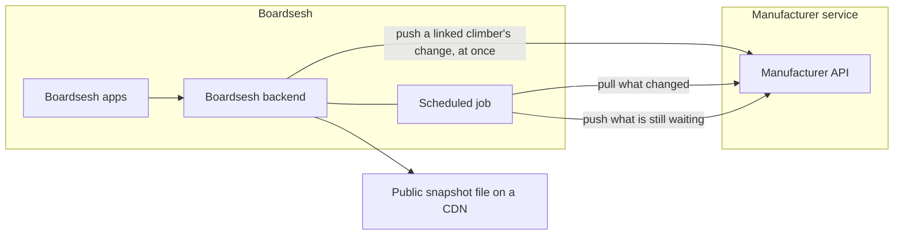

# Two-way sync with a board manufacturer: proposal

Status: **proposal**. Nothing in this document is built or agreed unless a
section says so. It describes how Boardsesh would like to exchange climbs,
totals and logbooks with the service a board manufacturer runs for its own
app. The first manufacturer is Walltopia, for the Quantum Board; the details
and our questions for Walltopia are in [quantum-ewalls.md](quantum-ewalls.md).

Boardsesh does the syncing. It reads the manufacturer's API on a
schedule to learn what changed there, and it sends its own changes to the
manufacturer's API. Public climbs and their totals appear in both apps for
everyone. A climber who links their two accounts gets one logbook, one set of
favourites and one set of playlists in both apps, and can edit in either. The
manufacturer builds no sync client.

## Contents

1. [Terms](#terms)
2. [What "share everything" means](#what-share-everything-means)
3. [Principles](#principles)
4. [The two tiers](#the-two-tiers)
5. [How data moves](#how-data-moves)
6. [Climbs](#climbs)
7. [Linking an account](#linking-an-account)
8. [Linked climbers: logbook, favourites, playlists](#linked-climbers-logbook-favourites-playlists)
9. [Edits from both apps](#edits-from-both-apps)
10. [Climbers who have not linked](#climbers-who-have-not-linked)
11. [Totals](#totals)
12. [The public snapshot](#the-public-snapshot)
13. [Sharing one wall](#sharing-one-wall)
14. [Operations](#operations)
15. [Names and trademarks](#names-and-trademarks)
16. [Privacy and data roles](#privacy-and-data-roles)
17. [Phases and who builds what](#phases-and-who-builds-what)
18. [If a manufacturer prefers to pull](#if-a-manufacturer-prefers-to-pull)
19. [What this changes on the Boardsesh side](#what-this-changes-on-the-boardsesh-side)
20. [Open questions](#open-questions)

## Terms

| Term | Meaning here |
| --- | --- |
| Ascent | One logged climb in a logbook. A **send** is an ascent that was completed |
| Totals | The numbers shown on a climb: how many people sent it, its star rating, its grade votes |
| Linked climber | A climber who linked their Boardsesh account to their account with the manufacturer |
| Pull | Boardsesh reads data from the manufacturer's API: everything that changed since the last read |
| Push | Boardsesh writes data to the manufacturer's API: it creates or changes a record |
| Catalogue | All public climbs of a board |
| Setter | The person who created a climb. Their **public name** is the name shown on the climb |
| Playlist | A climber's own named list of climbs |
| Cursor | A bookmark the manufacturer's API returns, so the next pull continues where the last one stopped |
| External id | The id the manufacturer gave a record. Boardsesh stores it next to its own id |
| Partner credential | A key issued to Boardsesh as a company, not to a climber |

## What "share everything" means

Both sides want the two apps to share climbs, logbooks and playlists: set a
climb in one app and it shows up in the other.

Not every Boardsesh climber has an account with the manufacturer, so the
proposal has two layers:

- **For everyone, with no account link:** every public climb and its totals
  appear in both apps. A climb set in Boardsesh shows in the manufacturer's
  app with the setter's public Boardsesh name, and the other way round.
- **For a linked climber:** their logbook, favourites, projects and playlists
  are the same in both apps.

The individual logbook of a climber who has not linked does not cross. Their
sends still count in the totals each climb shows. Their name, dates and
comments stay in Boardsesh.

Boardsesh wants climbers to link. When a climber first uses the
manufacturer's board in Boardsesh, Boardsesh asks them to link their account or create
one. Two-way sync is one of the features our users ask for most, so we expect
most of them to link. Linking stays optional: the prompt can be dismissed and returns only
occasionally, and a climber who never links keeps every feature.

## Principles

1. **The catalogue is factual data that gives the board its value.** The
   climbs set on a board are a large part of what its owner paid for, so they
   should stay available to that owner. Boardsesh publishes the public
   catalogue as a file anyone can download (see
   [The public snapshot](#the-public-snapshot)). The Boardsesh app uses the
   same file to work offline, and serving a file from a CDN costs far less
   than syncing a database to every phone.
2. **Only public climbs and totals are open.** Logbooks, accounts, drafts and
   private walls are not.
3. **A logbook belongs to the climber.** The climber decides whether it moves
   between services. Boardsesh also lets every climber export their own data.
4. **No required third account.** Using a board through Boardsesh never
   requires an account with the manufacturer. Boardsesh encourages linking and
   does not enforce it.
5. **Both apps can edit.** A climber should not have to remember which app an
   ascent or a playlist was first made in.
6. **Climbs are not deleted.** A published climb is a fact about a board.
   Moderation can hide it and its setter's name can be removed, and the climb
   itself remains.

## The two tiers

| Tier | Who | What crosses | Direction |
| --- | --- | --- | --- |
| 0. Catalogue | Everyone. No account link | Public climbs with the setter's public name; totals per climb and angle | Both ways |
| 1. Linked | A linked climber | That climber's ascents and attempts, favourites, projects and playlists; climbs they set appear under their own identity in both apps | Both ways |

Not shared, for anyone: logbook rows of climbers who have not linked, in any
form, including anonymised; drafts; private walls; account details.

We considered sending unlinked climbers' logbooks with the names removed, and
rejected it. A row with a timestamp, a climb and a board at a known gym can
identify a person even without a name. It is still personal data and needs the same
consent and deletion handling as a named row. The totals in tier 0 give both
apps what they need from those climbers.

We also considered requiring an account with the manufacturer before a climber
can use the board in Boardsesh. That contradicts principle 4.

## How data moves

| Direction | Whose data | How | When |
| --- | --- | --- | --- |
| Manufacturer to Boardsesh | Public catalogue | Boardsesh pulls with the partner credential (a test account at first) | On a schedule (we suggest every six hours) |
| Manufacturer to Boardsesh | A linked climber's logbook, favourites, playlists | Boardsesh pulls with that climber's token | When the climber opens Boardsesh, and on the schedule |
| Boardsesh to manufacturer | A linked climber's changes | Boardsesh pushes with that climber's token | At once |
| Boardsesh to manufacturer | Public climbs and totals of climbers who have not linked | Boardsesh pushes with the partner credential | On the schedule |

### Pushing

1. A record made in Boardsesh is saved with no external id.
2. Boardsesh pushes it. On success the manufacturer returns its own id, and
   Boardsesh stores it as the external id.
3. If the manufacturer could not be reached, the record stays saved and the
   scheduled job pushes it later.
4. Before the job repeats a push, it pulls first and looks for the record. A
   push can succeed and its answer be lost on the way back; pulling first
   means that record is recognised and not created a second time.
5. If the manufacturer rejects the record as invalid, Boardsesh shows the
   climber the reason and asks them to fix it. See
   [Publishing a climb](#publishing-a-climb).

The manufacturer stores no Boardsesh ids. Boardsesh keeps the only table that
pairs a Boardsesh id with the manufacturer's id.

### Pulling

Boardsesh reads what changed since its last cursor. A record whose external
id Boardsesh already holds is an update to something it knows. Anything else
is new and is matched as described under [Climbs](#climbs) and
[Linked climbers](#linked-climbers-logbook-favourites-playlists).

An edit made in the manufacturer's app reaches Boardsesh at the next pull.
Pulling when a climber opens Boardsesh covers the case they would notice.

### Does the manufacturer need to push to Boardsesh?

No. The scheduled pull is enough. If the manufacturer would like its changes
to arrive in Boardsesh sooner, Boardsesh is happy to accept pushes, or a short
"something changed for this climber" message that makes Boardsesh pull at
once. Neither is needed to start.

### Why Boardsesh pushes, and the manufacturer does not pull from us

- A push gets an answer straight away, so a problem with a climb reaches the
  climber while they are still looking at it.
- Only one side keeps the table of paired ids.
- A push can check what the other side holds before changing it, which makes
  edits from both apps safe.
- The manufacturer builds no sync client and runs no scheduled job.

This model needs write access to the manufacturer's API. A manufacturer that
would rather read from Boardsesh can do that:
see [If a manufacturer prefers to pull](#if-a-manufacturer-prefers-to-pull).

## Climbs

### What makes two climbs the same climb

Two published climbs on the same board layout are the same climb when they
use the same holds, each in the same role (start, hand, foot, finish), under
the same rules (for example "no matching"). The angle is not part of it: these boards
are adjustable and one climb is climbed at several angles. The name is not
part of it either.

Boardsesh already applies this rule to its own catalogue: it refuses a new
climb that matches a published one on the same layout, at any angle.

When a pull delivers a climb that is the same as one Boardsesh already has,
Boardsesh merges them:

- **The climb that was published first keeps its name, setter and grade.**
  This applies whichever app it came from.
- The later one becomes an alias of it. Boardsesh remembers both external ids.
- Ascents and totals logged against either are shown on the one climb.
- A linked climber's ascent is pushed to the manufacturer's climb at the
  angle they climbed, or to the earliest one when no angle matches.
- Boardsesh's totals for an angle go to the same manufacturer climb that
  ascents at that angle go to.
- If either climb's holds are edited later so that they differ, Boardsesh
  separates them again.

One Boardsesh climb can therefore match several of the manufacturer's climbs:
the same holds set once at 25 degrees and once at 40, or set twice by two
people. The manufacturer does not have to merge anything on its side.

### Publishing a climb

Publishing a climb cannot be undone, so Boardsesh checks first:

1. Publishing needs a connection. A climb made offline is kept as a draft
   until the phone is online.
2. Boardsesh checks the manufacturer's rules itself before saving (hold
   count, start and finish holds, name length, allowed angles), so most
   problems are caught on the screen.
3. Boardsesh saves the climb and pushes it.
4. If the manufacturer still rejects it, Boardsesh shows the climber the
   reason and asks them to fix it. Until they do, the climb is marked "not
   synced" in Boardsesh.

### Other rules

1. **A published climb stays published.** In Boardsesh a climb has no
   audience setting: once published and listed it is public to everyone,
   whoever set it ([privacy.md](../product/privacy.md)).
2. **Deleting a Boardsesh account does not delete climbs.** If the climber
   chooses to remove their name, the setter becomes "Unknown", and Boardsesh
   pushes that change.
3. **If the manufacturer removes a climb,** Boardsesh stops listing it and
   keeps the ascents already logged on it. Boardsesh does not create it
   again.
4. **Hold ids never change meaning.** A climb's holds refer to physical LEDs.
   A change to what an id means is a new board layout, announced ahead of
   time.

## Linking an account

Climbers sign in on the manufacturer's own page. Boardsesh stores the
resulting token and makes every call, so the manufacturer does not need to
call Boardsesh.

### Preferred: a standard OAuth 2.0 sign-in

- Authorization code flow with PKCE. Boardsesh opens the manufacturer's
  sign-in page in the system browser. The climber never types their
  manufacturer password into Boardsesh.
- **The same page offers "create an account".** That is how a climber creates
  a manufacturer account from inside Boardsesh: we open the page, they sign
  up with the manufacturer and return linked. The manufacturer controls its
  own sign-up page.
- Scopes that name what Boardsesh may do: read and write the logbook, read
  and write favourites and playlists, set and edit climbs.
- A refresh token, so sync continues while the app is closed, and a way to
  revoke it from either side.

### To start sooner: the manufacturer's existing login

The climber enters their manufacturer email and password in Boardsesh once.
Boardsesh exchanges them for a token and stores the credential encrypted on
its backend. Boardsesh links Tension accounts this way today. It needs the
manufacturer's permission, a known token lifetime and a way to renew the
token. We see this as a temporary step, because it means Boardsesh holds the
climber's password.

### What the climber is told when linking

One screen, before anything moves:

- Their ascents, attempts, grades, ratings, comments, favourites, projects
  and playlists will be copied in both directions, including past ones.
- Ascents they marked "Only me" in Boardsesh are copied too, and the screen
  says who can see an ascent in the manufacturer's app.
- Boardsesh will keep reading their manufacturer account in the background.
- After copying, each service keeps its copy under its own privacy policy.
- They can unlink at any time.

### Unlinking

Boardsesh revokes and deletes the token. Pulls and pushes stop. Copies already
made stay where they are, as the link screen said. A climber who wants a copy
gone deletes it in that app.

If a token expires and cannot be renewed, sync pauses and Boardsesh asks the
climber to link again.

## Linked climbers: logbook, favourites, playlists

All of this is one piece of work on the Boardsesh side and ships together.

| Record | Boardsesh pushes | Boardsesh pulls |
| --- | --- | --- |
| Ascents and attempts | Create, edit, delete | The climber's ascents, with deletions |
| Favourites and projects | Add, remove | Added and removed |
| Playlists | Create, rename, delete, add and remove climbs, reorder | The same |
| Climbs they set | Create, edit | Their climbs, like any public climb |

### Matching ascents

- An ascent Boardsesh pushed is known by the id the manufacturer returned.
- An ascent that arrives in a pull with no known id is matched by its data:
  the climber, the climb, the angle and the time it was climbed. This is
  mainly for the first sync after linking, when both apps hold some of the
  same climbing, logged twice by hand.
- That only works if an ascent keeps the time it was climbed and its angle.
  An ascent pushed days later must still carry the day it happened.
- Ascents of other climbers that arrive in a linked climber's pull are
  discarded.
- A pulled ascent gets the default audience of the climber's Boardsesh
  account: Public on a public account, Followers on a private one.

### Deletions

When a climber deletes an ascent or a playlist in Boardsesh, Boardsesh pushes
the deletion. It also remembers it, so that if the manufacturer cannot delete
the record, the next pull does not bring it back.

### What the manufacturer's API needs for this

| Need | Why |
| --- | --- |
| The permanent id of a created record in the response | Boardsesh stores it as the external id |
| The time of the climb, with timezone, accepted on an ascent and returned unchanged | History, and sends logged offline |
| The angle on an ascent | Totals are per angle |
| A read of one climber's whole logbook | The first sync after linking |
| An "updated at" time on each record | To tell which edit is newer |
| Delete for an ascent | A climber removes a mistake in one app and expects it gone in the other |
| A rate limit and a retry rule | Boardsesh follows the stated rule |

## Edits from both apps

A climber can edit an ascent or a playlist in either app.

**Preferred.** When Boardsesh pushes an edit, it states what it believes the
manufacturer holds (a version number, or the "updated at" it last saw). If the
record changed in the meantime, the manufacturer refuses the push. Boardsesh
then pulls the current record and keeps the newer of the two edits.

**If the API cannot refuse a push that way,** the latest edit wins. Boardsesh
compares the manufacturer's "updated at" with the time the climber made the
edit in Boardsesh, not the time the edit reached a server, so an edit made
offline on Monday does not beat one made on Wednesday.

**Favourites, projects and the climbs in a playlist are sets.** They are
merged one add or remove at a time. A favourite added in one app and a
different one added in the other both survive.

## Climbers who have not linked

Their public climbs and their share of the totals still cross. This part
needs new features in the manufacturer's API.

- Boardsesh pushes each of their published climbs with its partner
  credential. The setter shown is the climber's public Boardsesh name, sent
  as text. No manufacturer account is created for them, and nothing else
  about them is sent.
- The scheduled job does this, so a rejected climb is reported to the setter
  after the job's next run, not at the moment they publish.
- When that climber links later, their climbs move to their manufacturer
  account and they can edit them in both apps.
- Before their first publish on a synced board, Boardsesh tells the climber
  that the climb and their name will also appear in the manufacturer's app.

What this needs on the manufacturer's side:

1. A partner credential that may create and edit climbs.
2. A setter name stored as text on a climb, for a setter with no account.
3. A way to move a climb to its setter's account when they link.
4. Somewhere to receive Boardsesh's totals (next section).

## Totals

Every climb shows totals: how many people sent it, how they graded it, how
they rated it. Both apps should show the same numbers, and nobody's send
should be counted twice.

Totals are kept per climb **and angle**. A new climb has no totals at any
angle. Once it is sent at 40 degrees it has totals for 40 degrees and still
none for 45.

### The rule

**Boardsesh counts an ascent until it sees that ascent in a pull from the
manufacturer. From then on the manufacturer counts it.**

- A linked climber's ascent is pushed. Boardsesh keeps counting it until a
  later pull returns it, which is also when the manufacturer's totals in that
  pull include it. So there is no moment when it is missing from both, or
  counted in both.
- An unlinked climber's ascents are never pushed, so Boardsesh counts them.
- An ascent whose push is still waiting is counted by Boardsesh.
- After a climber unlinks, ascents already pushed stay counted by the
  manufacturer only.

Each app shows the manufacturer's totals plus Boardsesh's totals.

### What Boardsesh pushes

Per climb and angle, once a day, as the full current values. Each push
replaces the previous values, so a missed day corrects itself:

| Field | Meaning |
| --- | --- |
| `senders` | Distinct Boardsesh climbers with at least one counted send |
| `ratingSum`, `ratingCount` | Sum and number of star ratings on counted ascents, on a stated scale. Each climber counts once, with their latest rating |
| `gradeVotes` | Number of their grade votes per grade; left out below a minimum number of votes |

Sums and counts are sent because they can be added exactly:
`(sumA + sumB) / (countA + countB)` is the true combined average.

### Worked example

One climb at 40 degrees:

| | Manufacturer | Boardsesh | Shown in both apps |
| --- | ---: | ---: | ---: |
| Senders | 41 | 11 | 52 |
| Rating sum / count | 156 / 39 | 46 / 10 | 202 / 49 = 4.1 stars |
| Votes for 6C+ | 22 | 6 | 28 |

An example climber, Ana, has linked her accounts and logged her send in
Boardsesh. Her ascent was pushed to the manufacturer, so she is one of the 41
and not one of the 11.

### What this needs on the manufacturer's side

- An endpoint that accepts Boardsesh's totals for a climb and angle.
- **Boardsesh's totals kept apart from the manufacturer's own.** The
  manufacturer's API keeps returning its own totals unchanged, and its app
  shows the two added together. If the two were stored as one number,
  Boardsesh would read back its own contribution at the next pull and add it
  again.

### Limits

- People or ascents. Boardsesh counts distinct people, so repeats by one
  climber do not inflate a climb. If the manufacturer counts logged ascents,
  the two numbers are different things and should not be added until one side
  changes. We propose counting people.
- One person in both apps, unlinked, is counted twice. Neither side can
  know they are the same person. Linking fixes it for that climber.
- A day's delay. After a climber links, their sends move from one total
  to the other at the next daily push.
- Displayed grade. We propose both apps show the grade from the combined
  votes, and the setter's grade until there are enough votes.
- Small numbers. A total that goes from 0 to 1 shows what one person did
  that day. So totals are pushed daily, carry no first-ascent name or time, and
  leave out the grade-vote breakdown until a climb has a minimum number of
  votes (we propose 5).

## The public snapshot

Boardsesh publishes each board's public catalogue as a SQLite file on a CDN,
rebuilt nightly, free to download with no account
([board-snapshots-dataset.md](../data/board-snapshots-dataset.md)). It holds
climbs, their holds, grades and totals, the setter's name, and the name and
date of the first ascent where the catalogue has one. It holds no accounts and
no logbooks. Today it covers the published climbs of imported catalogues;
climbs set in Boardsesh are due to join it.

The Boardsesh app loads the same file to work offline. It is also what makes
principle 1 true in practice: if Boardsesh shuts down, or a manufacturer
retires an app, the climbs on a board someone bought are still available.

**Our request.** We would like the public catalogue of the manufacturer's board,
with climbs from both apps and with setter and first-ascent names, to be part
of that snapshot. This is the manufacturer's decision, because a published
file cannot be recalled once someone has downloaded it.

The options, in the order we prefer them:

1. The full public catalogue for the board, with climbs from both services.
2. Climbs set in Boardsesh only. The manufacturer's climbs reach Boardsesh
   apps through the sync and are not republished.
3. Not now. The board is left out of the snapshot and we revisit it later.

The sync works the same under all three. Under 2 and 3 the Boardsesh app
needs another way to hold the board's catalogue offline.

**Terms.** Boardsesh's position ([LEGAL.md](../../LEGAL.md)) is that climbs
and grades are facts and that no manufacturer owns the community's climb
data. That position is argued under U.S. law, and EU database law may read
differently. We therefore do not propose a copyright licence. The snapshot
asks two things of anyone who uses it: credit setters where a climb is shown,
and do not present the data as an official manufacturer source. If the
manufacturer wants more than that written down, a short agreement between the
two companies would be the right document.

## Sharing one wall

Two apps can be connected to the same board at the same time, and some boards
let several climbers light their climbs at once in different colours.

Boardsesh follows four rules so that it does not disturb other players:

- It reads who is on the wall before it lights anything.
- It only changes or clears the layer it lit itself.
- It never clears the wall to make room.
- A phone that reconnects does not assume it still owns its old layer.

A Boardsesh session, where a group shares a queue and takes turns, is one
player on the wall. The session lights one climb at a time, whoever in the
group is climbing.

Boardsesh has a board presence feature that shows who is on a board and what
is lit. For a manufacturer with a live feed of board activity, the Boardsesh
backend can subscribe to that feed and show the manufacturer's climbers in the
same place.

What has to be agreed per board is in the manufacturer's annex.

## Operations

- Moderation. Each company moderates its own app. The manufacturer may
  hide or remove any climb Boardsesh wrote, and Boardsesh will not write it
  again. Boardsesh removes abuse on its side and answers the manufacturer's
  reports about climbs that came from Boardsesh.
- Limits. Boardsesh keeps to the rate limits the manufacturer states, and
  limits how many climbs one setter can publish in a day.
- Access. The manufacturer can revoke the partner credential or a
  climber's token at any time. Boardsesh then stops and keeps what it has.
- Outages. When the manufacturer's API is down, Boardsesh keeps working
  and holds its pushes until it is back. When Boardsesh is down, the
  manufacturer's app is not affected.

## Names and trademarks

These are proposed terms, for the manufacturer to confirm in writing. Until
then Boardsesh describes the board as it describes every other: a board it
works with, with no claim of a relationship.

- Boardsesh may name the manufacturer and its board in the app and on the
  website to describe the integration, for example "Works with Quantum
  Board" and "Syncs with eWalls", and may show the manufacturer's logo next to that
  statement if the manufacturer supplies one.
- The manufacturer may do the same with the Boardsesh name and logo.
- Boardsesh stays an independent app and does not present itself as the
  manufacturer's app.
- **The permission covers the Boardsesh apps and website that Boardsesh
  publishes. It does not pass to forks.** Boardsesh's code is open source and
  anyone may run their own copy. A copy gets neither the manufacturer's names
  nor the partner credential.

## Privacy and data roles

- **Two independent services.** Each company decides for itself why and how
  it processes the data it holds. Neither processes data on the other's
  behalf. For linked climbers, each receives a copy at the climber's request.
- **Tier 0 carries one piece of personal data:** a setter's public name on a
  climb they chose to publish. In Boardsesh that name is already public on
  the climb. The manufacturer's app is a new place for it to appear, so
  Boardsesh tells the setter before their first publish and says so in its
  privacy policy.
- **Tier 0 totals are counts,** with the limits under [Limits](#limits).
- **A private Boardsesh account** hides that climber's activity. It does not
  hide climbs they published, and their sends still count in totals.
- **Deleting a Boardsesh account** removes the account's link to its climbs
  and sets the setter name to "Unknown" if the climber chooses that. The
  climbs stay. Snapshot files downloaded earlier keep the old name.
- **Deleting an account with the manufacturer.** Boardsesh needs to learn of
  it, to stop syncing and to apply the same rule to that climber's climbs.
- **Tokens** are stored encrypted on the Boardsesh backend and never reach a
  phone.
- **Age.** Each service applies its own minimum age to its own accounts.

## Phases and who builds what

| Phase | Climbers get | Manufacturer provides | Boardsesh builds |
| --- | --- | --- | --- |
| 1. Read | The manufacturer's public climbs and totals in Boardsesh | Test user accounts; permission to read the catalogue | The importer and board support |
| 2. Linked accounts | One logbook, favourites, projects and playlists in both apps, with edits from both; climbs a linked climber sets appear in both | Sign-in for linking; the API needs listed under [Linked climbers](#what-the-manufacturers-api-needs-for-this) | Link and sign-up prompt; pull and push; matching; the review of likely duplicates at first sync |
| 3. Everyone else | Climbs set by unlinked climbers, and their share of the totals, in the manufacturer's app | The four items under [Climbers who have not linked](#climbers-who-have-not-linked) | The scheduled push of climbs and totals |

Phase 1 needs only test accounts and permission to read the catalogue. Phase
2 builds on what the manufacturer's own app already calls and may need a few
new fields or endpoints. Phase 3 is the only one that needs a credential that
acts for no climber, which is why it comes last.

## If a manufacturer prefers to pull

Some manufacturers will not want another company writing to their API.
Boardsesh expects to support that as well. It would offer two read-only feeds
on `api.boardsesh.com`, with the cursor rules of the logbook feed that already
exists ([partner-api.md](partner-api.md), "Syncing"): public climbs set in
Boardsesh on that manufacturer's boards, and Boardsesh's totals. The
manufacturer runs the job that reads them and stores Boardsesh's id on each
climb it copies. Linked logbooks would use the Boardsesh OAuth API for partner
apps, which reads a logbook today and would need write, favourites and
playlist scopes added.

Pulling costs the manufacturer more work and makes edits from both apps
harder, which is why this proposal leads with push.

## What this changes on the Boardsesh side

These are recorded decisions and behaviours this proposal would change. None
has changed yet.

| Today | Under this proposal |
| --- | --- |
| Boardsesh ascents are not sent to a manufacturer, so its own totals and the manufacturer's add up. An ascent pulled from a manufacturer counts only in that manufacturer's totals | A linked climber's ascents are pushed, and Boardsesh counts one until a pull returns it |
| A climb set in Boardsesh takes its totals from Boardsesh ascents alone | A synced climb also takes the manufacturer's totals |
| A new climb that duplicates a published one is refused | A duplicate that arrives from a manufacturer is merged, earliest published first |
| Publishing a climb needs a connection on every board except spray walls, where it can be done offline | Publishing a climb as public needs a connection on every board (decided 2026-11-25, not built) |
| The snapshot holds imported climbs only, never one a Boardsesh account set ([board-snapshots-dataset.md](../data/board-snapshots-dataset.md)) | Published climbs set in Boardsesh go into the snapshot, and stay (decided 2026-11-25, not built) |
| Removing the setter name on account deletion clears it | It becomes "Unknown" (decided 2026-11-25, not built) |
| Every manufacturer is described as unaffiliated ([LEGAL.md](../../LEGAL.md)) | A manufacturer that confirms the terms under [Names and trademarks](#names-and-trademarks) is named as an integration partner |
| Only if a manufacturer pulls: the partner API has no catalogue endpoints and no tokens without a climber ([integration-platform.md](integration-platform.md)) | Two catalogue feeds and a system credential, for that manufacturer's boards only |

## Open questions

For Boardsesh:

1. The minimum vote count before grade votes are pushed. Proposed: 5.
2. How often the link prompt returns for a climber who dismissed it.
3. LEGAL.md says Boardsesh is not affiliated with any board manufacturer, and
   offers to remove a climb at its creator's request. Both need new wording
   once a manufacturer confirms: a paragraph on integration partners, and the
   rule that a published climb stays.

For each manufacturer, the list is in its annex. For the Quantum Board:
[quantum-ewalls.md](quantum-ewalls.md).
