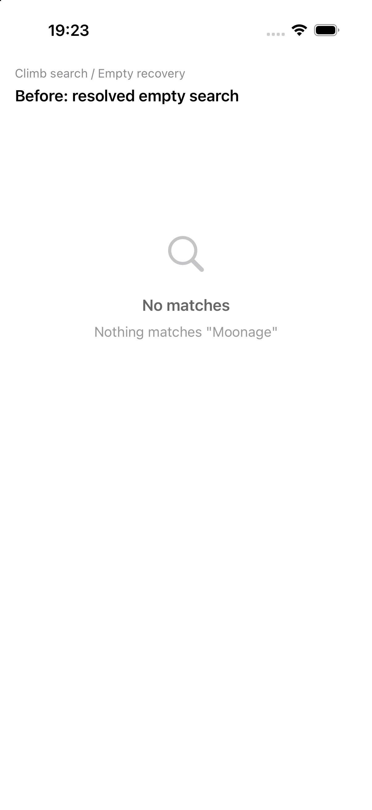
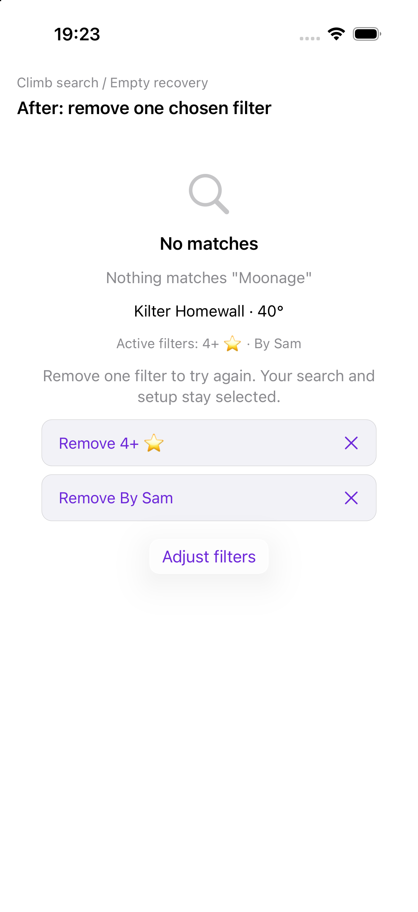

# Mobile climb list

### Mobile implementation boundaries

The route composes board/query state, list chrome, and empty states. Lifecycle ownership lives
under `packages/mobile/src/hooks/climbs/`:

- `useClimbsSearchSession` owns sheet sessions and recent searches; `usePersistedClimbSearch`
  gates queries and saves until the current board/login restore finishes.
- `useClimbsFilterPresentation` derives chips, removable tokens, dimension locks, and grade controls.
- `useClimbsListLifecycle` owns pagination and column-position restoration. A result-set change
  resets both, and request generations prevent old completions from altering a newer fetch.
- Activation captures the selected search for subsequent player pages; onboarding, analytics,
  and prewarming each own their external synchronization separately.

`useDebouncedSearchName` and `useGradeDisclosure` are also used by `useClimbFilterSession`,
which serves playlist and setter screens. Callers retain their policies: Climbs persists grade-row
visibility and flushes pending names on dismissal; playlist screens keep local visibility and
clear an empty typed name immediately. Keep these policies outside the shared primitives.

### Mobile toolbar and board history

The Climbs tab keeps the angle and history one tap away, apart from the list's options. On iOS its
trailing native toolbar reads [angle | history | ⋯]: the current angle ("40°"), a clock-arrow history
button, then an ellipsis menu. History opens the existing board sheet in one tap; its accessibility
label names the active board. The four-square board glyph no longer represents history.

- **Angle:** Liquid Glass (iOS by default) shows the current angle as the first toolbar button,
  inboard of history. Material (Android and the web by default) shows it as the first filter chip
  ("40°", before Filters) instead. The split follows the UI variant, not the platform, so the
  angle shows exactly once in either look. Both open the existing angle picker and speak the value
  ("Board angle, 40°"). Fixed-angle boards show neither, and on iOS the on-the-wall capsule takes
  the freed toolbar slot. The Material app bar's board title drops the angle while the chip shows
  it, and keeps it on a fixed-angle board.
- **History:** `clock.arrow.circlepath` on iOS and `history` on Android. The existing onboarding tip
  points to this control and calls it the clock.
- **Options menu:** View options, then Switch board. Switch board opens the existing board picker.
- **View options:** Pushes the existing climb-list settings within the Climbs navigation stack.
  Back returns to the same list, and settings keep their existing persistence.
- **History sheet:** The pinned Switch board footer is removed so its space belongs to history.
  The header, current climb, stats and history rows keep their existing layout. The iPad history
  column retains its Switch board control.

Use the shared native menu and toolbar primitives so iPhone, Material and iPad share the same
actions with their platform's presentation. The history sheet and iPad column continue to share
their history content.

### Recent chip

The Recent chip (saved searches) has a pin under Climb name in Filters, like every other chip.
That row lists the last 10 searches as chips, newest first; a tap applies one, the same as picking
it from the toolbar chip's menu, and the sheet stays open. With no searches yet, a line says they
will show there. Unpinning hides the toolbar chip and keeps the searches; pinning it again brings
it back. Climbs has no search field on the page, so recent searches live in Filters and the
Recent chip.

### Empty-search recovery

A resolved empty search shows the selected board, angle, and active filter labels. Each removable
restriction has an explicit "Remove …" action that removes only that restriction. The climb name,
board configuration, angle and every other filter stay selected. Removing a status restriction also
keeps the separately selected popularity threshold.

Sort order, other-angle selection and climb type stay outside these recovery actions. Tall/Wide
filters with enforced locks stay selected too. The existing Filters sheet is always available,
including searches with no removable restrictions. Recovery does not broaden angles, change name
matching, invent suggested climbs, or change search analytics.

Loading and placeholder results, query errors, unavailable offline filters, missing or queued
offline catalogs, and an unset Spraywall keep their existing states. A downloaded catalog with a
supported search uses the same recovery actions as online search.

Dev stories under **Climb search / Empty recovery** show the former state, the recovery actions,
and an empty search with no removable filters.

Simulator captures of the dev stories (example query and filters):

| Before | After |
| --- | --- |
|  |  |

## Lists, search, and activation

The native list uses the components under `packages/mobile/src/components/climbs/`
and the Climbs route's hooks under `packages/mobile/src/hooks/climbs/`. List and grid
preferences are app settings, not the deleted web page's IndexedDB preferences.
Use [climb rows](../../product/climb-list-rows.md) for row presentation and actions, and
[lists and queue](../../product/climb-lists-and-queue.md) for list activation and continuation.

Filters are presented by the shared mobile search components. Keep board identity,
angle, saved search, pagination, and account restore gates intact when changing
presentation. Empty results are distinct from failed or unavailable offline reads;
see [offline reads](../../data/offline-reads.md).
