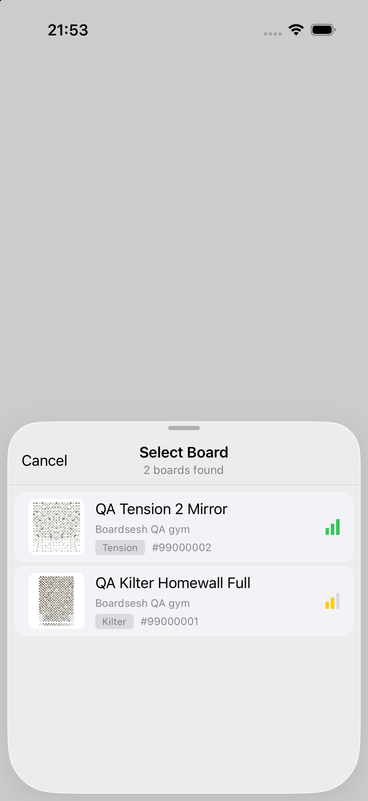
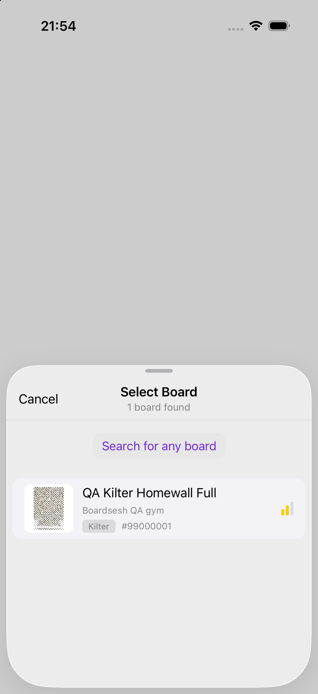

# Mobile Bluetooth integration

`packages/mobile/src/lib/ble/use-board-bluetooth.ts` owns adapter generations and
transport lifetimes. `packages/mobile/src/providers/bluetooth-provider.tsx`
coordinates board identity, presence, lighting, and native background control.
The device picker and controls are `DevicePickerSheet` and `BleControlSheet`
under `packages/mobile/src/components/ble/`.

iOS uses the native adapter/background writer when the module is present and
supports the board's required write mode. If the module is missing, or the
running binary cannot serve an acknowledged-write board such as Woods,
`createBluetoothAdapter` falls back to `RNBleAdapter` (ble-plx). Android uses
ble-plx. Browser-specific implementations follow the platform forks. The app does not use
the retired Next.js Web Bluetooth provider or Capacitor device dialog.

## Connection ownership

A connection handle captures its board configuration and adapter generation.
Delayed board resolution may attach a saved board ID only to that live generation;
a stale callback cannot release or configure a replacement link. Initial writes
can fail before the connected UI appears and still end that transport lifetime.
See [board connection holder](../../boards/board-connection-holder.md) for driving,
reconnection memory, explicit hang-up, and wall confirmation.

**Browser connection errors:** Expo web uses the rendered Material guidance
dialog for failed connections; React Native's `Alert` does not render on web.
Blocked permissions and disabled Web Bluetooth (including Brave) show browser
settings guidance with selectable text. Brave users can enable Web Bluetooth at
`brave://flags/#brave-web-bluetooth-api` and restart the browser. Missing adapters,
services and other failures show their own guidance. Close the dialog and tap
connect again after resolving the problem; the dialog does not start another
connection automatically. The transport still retries eligible GATT handshake
failures once. Only an explicit picker cancellation stays silent.

Chromium uses `NotFoundError` for both cancellation and disabled APIs, denied
scan permission, missing adapters and missing services. The shared classifier
checks the message as well as the name: blocked access is `permission_denied`
(warning-level connection failure), not a `Bluetooth Connection Cancelled` event.

## Picker identity and reconnect

A resolved controller also carries its saved board UUID. Two known,
nonempty UUIDs must agree even when the board type, layout, size and normalized
hold sets are identical (#5430). Missing or anonymous UUIDs retain the existing
configuration-only comparison. A different saved board opens the existing choice
instead of selecting the device immediately, with copy explaining which board's
wall feed receives the climbs; a saved board's name is used when available.
Cancel leaves the picker open, Connect anyway remains an explicit override, and
Switch selects the resolved board before reconnecting to the chosen serial.
Recorded mappings are fetched through `GetBoard`, and the returned canonical UUID
and configuration control the hop. Reconnect waits for that UUID, board type,
layout, size and normalized hold sets to reach the provider, including a change
that affects only the UUID or hold sets. The one-shot still expires and fires once.

Connecting to a known board sorts each controller into one of three groups
(`classifyPickerDevice`). **Target**: its serial resolves to that exact board
UUID, or nothing on record names its board and it is the box this phone
remembers for that board by BLE device id (`PickerBoardTarget.rememberedDeviceId`:
a MoonBoard or a serial-less Kilter-built box, unless a hang-up's 10 minutes
ran out). **Other**: its serial resolves to a different board, or its advertised
board type is not the target's, since Kilter and Tension serial numbers can
overlap. **Unknown**: nothing says either way, which covers every stock
MoonBoard and every bare-name Kilter or Tension box this phone doesn't remember
(they advertise no serial), a serial nobody has recorded, and a recording that
names no board. The picker
lists target rows first, then unknown rows, strongest signal first within each,
and hides only other rows. #7125 first shipped hiding unknown rows too. In the
30 days to 2026-10-31 nothing resolved in 2,521 of 2,522 MoonBoard pickers and
1,265 of 2,512 Android Kilter pickers, so a gym connect there listed nothing but
"Your selected board was not found". The broad scan keeps feeding serial
resolution; a delayed lookup can move a row between groups but never selects it.
"Search for any board" reveals the full scan and keeps that choice through
sheet-host changes for this connect. A new connect starts with its own target
again. Saved-device reconnects keep their existing search and auto-selection;
using their search escape also reveals the full list. "Your selected board was
not found" shows only when every controller heard is another board. That is
distinct from an empty scan, so it does not trigger location-permission or
no-lights advice. `BLE Picker Devices Resolved` counts the three groups as
`targetMatchedDevices`, `targetUnknownDevices` and `targetOtherDevices`. It
counts by serial resolution alone, so a box the sheet lists in the target group
because this phone remembers it by id still counts where its serial puts it.

**Tips while the scan runs.** "Don't see your board?" and its tips come in 5 s
into the scan (`SCAN_TIPS_DELAY_MS` in `lib/ble/scan-tips.ts`), while the scan
goes on, instead of after the 30 s scan ends empty. They show while nothing is
there to pick: no board heard at all, or for a known board nothing listed. Every
listed box may be the climber's, the unknown group included: a MoonBoard or a
Kilter-built box has nothing but its BLE id to tell it apart, a serial is
recorded only on a connect (so the first Boardsesh connect at a board lists its
box as unknown), and a box whose serial lookup is still out is unknown until the
reply lands. A same-type neighbour with an unrecorded serial therefore keeps the
tips off too; that is the rarer case. They stay once the scan ends and go as
soon as a board is there. A `searching` picker shows none; it hands over to the
list at 10 s, where they are already due. One line per tip, in this order:
power, distance, Bluetooth, then another phone. On a MoonBoard (the target's
board, or the active board) another phone comes second, in its own wording: an
older box can keep the first phone until it is switched off and on. The Android
location hints replace the tips from the same 5 s, but only when nothing at all
was heard; once location is sorted their copy asks for a fresh connect, so Scan
again comes with it while the scan still runs. "Browse for now" sits under the
tips: it closes the picker without connecting, so the climber keeps picking
climbs as previews. It is not "This wall has no lights", which still shows only
after an empty scan and takes the wall with no Bluetooth. `BLE Picker Devices
Resolved` carries `tipsShownAtMs` and `browsedForNow`. The sheet opens at a
medium detent, so the hints never sit pinned under the rest: with boards listed
they are the list's footer, and with none the state above them ("No boards
found", "not found", the spinner) scrolls with them. The `/boards` Bluetooth
quickstart sheet showed the same tips until the picker's In range slot replaced
it in 2026-11. The picker shows no tips: a scan that heard nothing draws nothing
at the top (no "No boards in range" line and no Scan again; the next shelf leads),
except where Android is plausibly withholding the results
(`useAndroidScanLocationHint`): a binary built before the manifest
change gets the location grant, and Android 6 to 11 with Location off gets the
switch, each rescanning once it works. A radio the scan could not read
(`unknown`) says "Couldn't reach Bluetooth" with Scan again, never "Turn on
Bluetooth".

**Bluetooth off or not allowed in the picker.** Over 60 days 333 climbers reached
the picker with the radio off and 67 with the permission blocked, so the off line
leads with the fix (`bluetooth-radio.ts`). On Android it says "Bluetooth is off."
with Turn on Bluetooth, which opens the system's own enable dialog
(`ACTION_REQUEST_ENABLE` through `Linking.sendIntent`, JS only). If that can't open
it tries the Bluetooth settings page, then the app's settings page. A radio
already on just scans. When the app comes back from the dialog it reads the radio
once and scans if it is on, whatever the auto-scan switch says. iOS has no way to
turn the radio on, so the line points at Control Center and keeps Scan again.
While the line shows and auto-scan is on, the radio being on (a report, or one
read right after subscribing) starts one scan by itself (`watchBluetoothPoweredOn`),
reported as `trigger = 'picker_tap'` because the trigger type lives in
`lib/ble/use-board-scan.ts`. Never after a pick until the next tap, and a start
held for the app is dropped once the radio came on over 60 s ago. The Continue
card that asks for the permission has Not now. After it the card is one line,
"Boardsesh needs Bluetooth to light climbs on the wall." with Allow Bluetooth, for
good (`pickerBluetoothNotNow`, per device): it never goes away, because a board
can't be lit without Bluetooth.

**A serial nobody saved.** The unknown-setup row keeps, per board type, every
heard serial no saved board answers for and the count of bare-name boxes of that
type. "It's my own board" hands the builder a serial (`/boards/create?serial=`)
only when the lookup has answered every serial heard, exactly one box of the type
was heard (one unsaved serial, no bare-name box) and the scan listened at least
5 s (`builderSerialForRow`). The builder fills the field only when the picker just
offered that serial for that same `presetBoardType` (`heard-serial-offer.ts`, 10
minutes), so a link naming a serial by itself opens with the field empty. The
form says "Serial 751737, from the box in front of you." above the fold, with
Change opening More options, and moving the board type off the one it was heard
as clears it. The builder's own foreign-serial and serial-reuse checks run on a
filled serial as on a typed one. MoonBoards and bare-name boxes advertise no
serial and keep the 10-minute box hold (`pending-board-recognition.ts`).

What the scan hears leads the picker's top only 3 s after it first hears
anything (or once it ends; the permission prompt and a start waiting on the
radio don't count), and only once the serial lookup has named everything heard
so far. What it led with then stays until its results leave the screen (a new
scan, or a phone that links to a board): one gym never gives way to another,
At {gym} never turns back into a hero, and walls heard or listed later join the
end of At {gym} instead of moving the rows above them. A hero has one way out:
At {its own gym}, once a second wall there is named, however many walls another
gym has (`use-steady-picker-top.ts`, `decisionAtDrawnTop`). The hero says "In
front of you" while no box is heard louder, "Nearby" otherwise, from what the
scan hears now.

**Remembered boards.** A connect remembers the box for the board in view: by
serial for Aurora boxes, by BLE device id for a MoonBoard or a serial-less
Kilter-built box named for that board type (`Kilter Board`, `isKilterBuiltBox`).
The next tap on the bulb reconnects to it while the picker shows "searching",
with no board list. A drop, a config switch and Disconnect Bluetooth when
driving ends keep it with no limit. A hang-up keeps it for 10 minutes, then it
is forgotten, the iOS native pairing included, unless the Lock Screen bulb
already reconnected it: that link is kept and the board is remembered again.
That pairing, which lets the Lock Screen bulb reconnect, goes sooner when the
route moves to another board.
A hang-up after a wrong-box connect, and a sign-out, forget it at once. The rules and their reasons are in
`docs/boards/board-connection-holder.md`.

The simulator comparison uses the same resolved QA gym fixtures with a stronger
Tension signal. The [expanded list](../images/7125-picker-all.png) follows an
actual tap on "Search for any board"; the [missing-target state](../images/7125-picker-missing.png)
shows dark Material styling. These captures verify presentation, not radio behavior.

| Before | After |
| --- | --- |
|  |  |

On iOS, adopting a connection restored outside JavaScript waits until reconnect
memory finishes loading, including a failed read (#5429). A named controller's
serial must agree with each known identity: memory for the active board UUID key
and the active saved board's roster serial. A contradictory roster serial rejects
even a previously poisoned matching memory record; unrelated-key memory does not
identify the current wall. Rejection happens before adapter creation, native
configuration, connection callbacks or persistence. Nameless reconnects retain
the existing current-config memory requirement. Explicit connect/disconnect intent
wins over a delayed storage read, so it cannot overwrite a new pairing or restore
a forgotten one. Identity readiness and roster-serial changes refresh the native
subscription/query, and superseded results cannot adopt a connection.

## Frame sending

`sendFramesToBoard` builds a protocol-specific packet and writes through the current adapter:

**Aurora boards:**

1. If `frames` is empty string, sends a clear-all-LEDs packet (no placement data needed).
2. If `mirrored` and board supports mirroring: `convertToMirroredFramesString` maps each hold ID to its `mirroredHoldId` via `holdsData`.
3. Loads LED placement positions via dynamic import of `@boardsesh/board-constants/led-placements` (cached after first load).
4. Calls `getAuroraBluetoothPacket(frames, placementPositions, boardName, apiLevel, ledColorOverrides)`.
5. Handles skipped placements:
   - All placements skipped: shows error feedback "This climb is for a different board configuration", returns `false`.
   - Partial skip: shows warning feedback with count, sends remaining holds.
   - Captures Sentry warnings for both cases with context (climbUuid, layoutId, sizeId, setIds, skip counts).
6. Writes packet via `adapter.write(packet, signal)`.

**MoonBoard:**

1. Empty frames send MoonBoard's clear-all `l##` frame (deliberate clear only — verified against the ArduinoMoonBoardLED community firmware, which clears every LED on each incoming frame; unverified on official Moon controllers, where it is at worst a no-op). An all-placements-skipped climb still refuses to write rather than fall through to this clear.
2. `getMoonboardBluetoothPacket(frames)` produces the packet.
3. If all placements are skipped, shows error feedback and returns `false`.
4. Partial skips are logged to Sentry.
5. User colour overrides are not sent to MoonBoard controllers because the protocol does not carry arbitrary RGB colours; they still affect in-app rendering.

**Mobile accessibility colour overrides:**

- Mobile stores hold-role colour overrides in `useHoldColorOverrides()` for STARTING, HAND, FINISH, and FOOT.
- Default mode stores no value, so Aurora-family packets use the canonical board colours.
- User mode stores RGB colours as hex strings, passes them to `getAuroraBluetoothPacket()`, and pushes the same map through native iOS `configureBoard()` so widget/background sends match the app.
- The auto-sender includes the colour override signature in its dedupe key so changing a colour repaints the currently loaded climb even when the frames did not change.

**Error handling:**

- `AbortError` (from unmount-mid-write) is swallowed silently -- the AutoSender's drain loop handles this.
- Other errors are logged and return `false`.

## Controls

`BleControlSheet` owns the existing lighting and disconnect controls. Hold-role
colours use the app's accessibility settings and native configuration so foreground
and background sends agree. Protocol limitations remain board-specific; a rendered
colour override does not imply the controller can receive arbitrary RGB.

For WLED-equipped spray walls, use [WLED Bluetooth](../../boards/wled-bluetooth.md), which has
its own protocol and per-operation connection lifetime.

## Disconnect handling

**User-initiated disconnect (`disconnect` callback):**

- Updates state synchronously for immediate UI feedback.
- Consumes the active adapter generation exactly once, unsubscribes the adapter disconnect listener, and nulls the adapter ref.
- Fires `Bluetooth Disconnected` analytics with `reason: 'user'`, a low-cardinality `disconnectTrigger` (`explicit_user`, `driving_ended`, `config_switch`, or `connection_replacement`), and `connectionDurationSec`.
- A hang-up (`explicit_user`) keeps the board remembered, and on iOS its native pairing, for 10 minutes. After a wrong-box connect it forgets both at once. `driving_ended` keeps both with no limit; `config_switch` keeps the JS memory and forgets the native pairing.
- Uses the board config and analytics session state captured when that generation started. Its board ID is attached only through the matching generation's guarded resolve, including cached identities for already-bound reconnects, so every holder is released while a config switch still releases the old wall, never the newly rendered route.
- Calls session wall-disconnect cleanup unconditionally against the current queue session (a no-op in solo). This safely handles a connection that opened solo and joined later, or moved from one session to another; the snapshotted session boolean remains analytics-only.

**Unexpected disconnect (`handleDisconnection` callback):**

- Android's pinned `react-native-ble-plx` patch preserves native disconnect errors independently of the already-resolved connect promise. Connection status codes (including 8: timeout and 19: peer termination) reach `disconnectAndroidCode`; genuine ATT operation errors keep their original mapping. Deliberate cancellation and unavailable platform statuses remain unclassified. The patch also preserves setup/MTU timeout errors and safely serializes quoted error descriptions. This requires a new native Android build; older binaries still report null errors. See #5279, whose intermittent disconnect cause remains unconfirmed.

- Fires when native iOS or ble-plx reports a link drop, or when a write failure tears down the connection.
- Consumes only when both adapter identity and generation match, so duplicate or stale callbacks cannot end a replacement link.
- Fires analytics with `reason: 'unexpected'`, `disconnectTrigger: 'link_drop'`, the available platform-specific `disconnect*` fields, and the same `connectionDurationSec` lifetime property. Platform fields and `disconnectCategory` are absent from deliberate disconnects.
- An established link ending with ble-plx `201` and Android status `5` is classified as `authentication_failed` and shows one recovery notice. The same numeric status on an ATT write is a different error domain and does not establish a link authentication failure. A drop during setup uses the existing connection-failed notice instead. Duplicate and stale callbacks stay silent, and the remembered board remains available for a deliberate reconnect.
- Failed writes retain the numeric ble-plx, Android, iOS and ATT codes even when the adapter confirms the link is dead and normalizes the error. `attErrorCode` remains separate from `androidErrorCode`; the normalized error retains no native message or peripheral identifier. This is diagnostic evidence, not proof that a board requires a PIN or that saved pairing is broken.
- Connection diagnostics may finish after the link has ended. The connection flow rechecks the exact adapter generation after that await before emitting success or returning `true`.

**Unmount cleanup:**

- Rejects any pending picker promise.
- Silently consumes the generation, unsubscribes the adapter disconnect listener, aborts pending writes, and calls `adapter.disconnect()`.
- Does not emit `Bluetooth Disconnected` for component teardown; tracked mobile disconnects remain `user` or `unexpected`.

**Status store (`bluetooth-status-store.ts`):**

- Module-level store registers active BLE connections via `registerBluetoothConnection(disconnect)`.
- Allows consumers outside the `BluetoothProvider` tree (root tab bar, board switch guard) to observe connection state and trigger disconnect.
