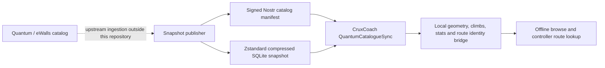

# Quantum and eWalls integration for Boardsesh

Status: proposed implementation, based on CruxCoach source reviewed 19 November 2026.

Boardsesh has the go-ahead to integrate Quantum. CruxCoach is a useful reference for catalog normalization, Quantum Bluetooth control, and sharing a physical controller with eWalls. Its Android app downloads an authorized catalog snapshot; it does **not** contain the upstream eWalls HTTP ingestion client. Obtaining that ingestion contract is the first implementation dependency.

Ship Quantum browsing, offline downloads, Boardsesh logging, and scoped board lighting first. Keep eWalls account synchronization and publishing separate until Quantum supplies supported contracts for them. Permission to integrate is established; the remaining questions concern interface details and supported behavior.

## Reference and evidence boundary

The reference is [CruxCoach/CruxCoach at commit `38ba6b46`](https://github.com/CruxCoach/CruxCoach/tree/38ba6b46d5bc81a74263c269b902a1a5d480e54c). All external source links below are pinned to that revision. This describes source on `main`, not a claim that every behavior exists in a published APK or has passed physical-board testing.

“Quantum” identifies the board family; “eWalls” identifies the vendor app whose model identifiers and controller protocol CruxCoach follows. Its protocol comments reference eWalls 2.0.14. Compatibility with newer eWalls releases needs an explicit check.

The implemented catalog consumer and the snapshot fixture establish the incoming schema. They do not establish an eWalls API host, credentials, request bodies, pagination, ingestion schedule, or the algorithm that generated snapshot climb UUIDs. Those details must not be inferred from the snapshot's provenance string. [Catalog consumer][catalog-sync], [snapshot fixture][snapshot-test].

## How CruxCoach gets Quantum data

The dashed edge is an integration dependency, not a verified HTTP call in this repository. The solid edges are implemented by `QuantumCatalogueSync`, `BlossomSyncManager`, and `BoardDatabaseImporter`.

### Discovery and download

1. Query Nostr relays for kind `30078`, the pinned publisher public key, and d-tag `cruxcoach/quantum-db`. Check the event author, Schnorr signature, recomputed event ID and d-tag. The query filters by kind, but the receive path does not independently recheck it. Choose the newest event across relay responses, breaking timestamp ties by the lower event ID.
2. Require manifest version `1`, board `quantum`, source `ewalls-authorized-snapshot`, compression `zstd`, and exactly one chunk with type `quantum` and name `quantum_snapshot_v1`.
3. Reject stale or unacceptably future-dated manifests. Compare the chunk hash and import-version marker with the locally accepted state. An unchanged accepted chunk needs no import; this is artifact-level change detection, not an eWalls route delta feed.
4. Download from the chunk's HTTPS mirror URLs, verify SHA-256 on the downloaded compressed artifact, decompress to a temporary SQLite file, and import it.
5. Save the accepted manifest timestamp and completed chunk hash after import succeeds. Remove the temporary file and preserve the previous catalog on download or catalog-transaction failure.

The publisher key is `70b2740bff77cf65743a7d6ffa5465b3a27105ae26123458cf5450eafb1bd68d`. The Quantum import preference namespace is `blossom_sync_quantum_v2`; this forces an upgraded importer to refresh semantics even if the downloaded chunk has not changed. The download is public and does not use the climber's eWalls account. The provenance marker is checked **inside a verified signed manifest**; the string alone does not authenticate a source. [Catalog consumer][catalog-sync], [manifest transport][blossom-sync], [manifest types][manifest-types].

### Incoming SQLite contract

The importer requires `PRAGMA user_version = 1` and these five tables. The fixture defines additional source fields beyond the subset imported into CruxCoach.

| Table | Source fields | Purpose |
| --- | --- | --- |
| `quantum_models` | `model`, `layout_id`, `product_size_id`, `name`, `columns`, `rows`, `forced_type`, four edge bounds | Model membership and display bounds |
| `quantum_diodes` | `model`, `diode_uuid`, `placement_id`, `led_node`, `autocad_id`, `hold_type`, `x`, `y`, `z` | Route geometry and physical LED addressing |
| `quantum_routes` | `uuid`, `name`, `setter`, `grade`, `angle`, `rating`, `ascents`, `plays`, timestamps, `disabled`, five rule flags, `tags`, `tips` | Vendor route content |
| `quantum_route_models` | `route_uuid`, `model`, `app_uuid` | Model-specific catalog identity |
| `quantum_route_lights` | `route_uuid`, `model`, `diode_uuid`, `step` | Holds and roles for each route/model |

`autocad_id`, despite its text representation, is the controller LED address. CruxCoach rejects blank, non-digit, negative, and out-of-range values before refreshing the catalog; valid addresses fit an unsigned 16-bit integer. `diode_uuid`, `placement_id`, `led_node`, and `autocad_id` serve different purposes and must not be substituted for one another. [Import implementation][snapshot-import], [snapshot fixture][snapshot-test].

### Models and identity

| Quantum model | Snapshot key | eWalls `forcedType` | Grid columns × rows | CruxCoach layout / size IDs |
| --- | --- | --- | --- | --- |
| XL | `xl` | `big` | 15 × 15 | `9101` / `9201` |
| L | `l` | `medium` | 15 × 12 | `9102` / `9202` |
| M | `m` | `small` | 12 × 12 | `9103` / `9203` |
| S Fitness | `s` | `xsmall` | 8 × 12 | `9104` / `9204` |
| Belay Board | `belay` | `belay` | 8 × 12 | `9105` / `9205` |

These numeric IDs are CruxCoach's app-side allocations, not vendor IDs. The `forcedType` field is explicitly described as an eWalls `routes-delta` parameter, but that comment does not specify a callable endpoint or its request contract. [Quantum model definitions][quantum-protocol].

One vendor route can belong to several models. CruxCoach stores a distinct `app_uuid` for each route/model pair and preserves `(app_uuid, route_uuid, model)` in `quantum_route_refs`. It converts model-local placement IDs to `(layout_id - 9100) * 1,000,000 + placement_id`, and multiplies geometry coordinates and bounds by 1,000 for its integer coordinate storage. These are internal normalization choices, not hardware addressing rules. [Import implementation][snapshot-import].

### Climb content and semantics

| Source content | CruxCoach behavior | Boardsesh requirement |
| --- | --- | --- |
| Route membership and holds | One single-frame climb per route/model; `step=1` → start role `12`, `step=3` → finish role `14`, other steps → intermediate role `13` | Retain raw steps and validate their meaning against supported vendor data |
| `grade`, `angle`, `rating`, `ascents` | Preserve raw grade; map recognized grade buckets to its internal grade numbers; create a stats row at the source angle | Keep vendor grade and provenance; define a Boardsesh mapping independently |
| `campusing`, `edge`, `kickplate`, `matching`, `standard` | Preserve flags and tags; encode missing positive flags in five `hsm` bits for filtering | Store explicit flags; require identical search, count, random and offline filtering |
| Name, setter, tips, disabled state | Tips become description; `disabled` controls listing | Preserve attribution and source status; retain historical tick references |
| Optional beta links | Import embedded `climb_beta_links` or legacy `beta_links` if supplied | Treat media as an optional, separately validated capability |

Example: source grade `[12,13]` becomes CruxCoach difficulty `15`; that number is **not** V15. Unrecognized grade buckets become null rather than a guessed difficulty. A Standard-only route has stored `hsm=15`, so requiring Standard passes `(hsm & 16) = 0`. Multiple required rules are combined with AND. These details are regression-tested. [Grade and rule import][snapshot-import], [snapshot tests][snapshot-test], [filter parity tests][rule-tests].

The catalog replacement transaction updates Quantum catalog rows, geometry, route references and route metadata while leaving personal log/list rows untouched. Optional beta links are replaced **after** that transaction in a separate step; the entire sync is not one atomic transaction including media. Source `plays` and `updated_at` exist in the fixture but are not mapped by the core climb/stats import shown here. [Import implementation][snapshot-import].

### Board rendering

CruxCoach bundles a photograph for each of the five Quantum models. Its `QuantumBoardGeometry` applies model-specific calibration, including nonlinear Y corrections and Belay-specific offsets; a uniform rectangular-grid transform is insufficient for matching its reference images. Boardsesh should obtain approved images and geometry from Quantum and test the renderer and hit targets against the same mapping. Display coordinates must remain independent of LED addresses. [Geometry implementation][geometry], [bundled images][images].

## Other interoperability with eWalls

### Shared physical controller

CruxCoach speaks the Quantum BLE protocol directly. eWalls does not need to be running to download the snapshot or to send an imported route. Its interoperability with eWalls comes from recognizing and preserving state on the same controller.

| Capability | Implemented reference behavior | Limit |
| --- | --- | --- |
| Light an official route | Resolve app climb → vendor route UUID and physical diode addresses; send Quantum commands | A successful GATT write alone does not confirm the wall |
| Observe eWalls activity | Query active controller players and resolve official route UUIDs against the local catalog | Unknown routes remain occupied with unknown geometry |
| Preserve another climber's route | Use four stable installation-owned controller user UUIDs; replace/remove only the targeted owned user's layer | Controller user UUIDs are not eWalls account identities |
| Plan simultaneous climbs | Four local slots, distinct colors, capacity and overlap preflight, then explicit send | Four layers do not prove four simultaneous BLE connections |
| Recover current state | Query on connect, every ten seconds while connected, and when foreground freshness requires it | A disconnected rack is last-known state |

Known foreign geometry participates in overlap checks. Unknown, blank, malformed or wrong-model geometry blocks a new projection conservatively. A community climb with a coincidentally matching UUID cannot identify a foreign eWalls route; official bridge rows are required. [Layer management][layers], [BLE connection][connection], [controller capabilities][controller-capabilities], [external route lookup tests][route-lookup-tests].

### Transport contract

The standard Bluetooth base UUID suffix is `-0000-1000-8000-00805F9B34FB`. CruxCoach uses service `FFE0`, recognizes legacy service `FFF0`, writes commands to `FFF2`, receives notifications on `FFF1`, reads state from `FFF4`, and reads the 41-byte controller record from `FFF5`. Metadata contains model type at byte 34 and big-endian column/row counts at bytes 35–38. Writable setup requires a recognized model with matching dimensions, MTU negotiation, notification routing, and successful CCCD setup. [UUID definitions][ble-uuids], [connection implementation][connection].

| Command | Opcode | Reference use |
| --- | --- | --- |
| Activate route / swipe route | `0x41` / `0x44` | Normal activation uses `0x41`; swipe encoding exists but remains gated |
| Turn off route / user | `0x42` / `0x43` | Scoped replacement/removal uses the owned user UUID |
| Turn off all / turn on all | `0x45` / `0x64` | Global effects; not normal route switching |
| Request active route list | `0x47` | Authoritative request followed by state readback |

Outgoing frames contain protocol byte `0x01`, command, payload, then CRC16/MODBUS over that body, emitted high byte first. Activation payload carries a 16-byte route UUID, 16-byte user UUID, RGB, big-endian 16-bit duration, animation byte, diode-byte count, and big-endian 16-bit diode addresses. The encoder supports chunks of 92 diodes, but the transport rejects routes requiring more than one activation chunk until append/failure semantics are verified. A single accepted activation must fit a complete GATT write. [Packet encoder][quantum-protocol], [transport guards][connection].

Readback player lists have a four-byte header and zero to four 37-byte records: route UUID, user UUID, remaining seconds and RGB. Unlike outgoing commands, these broadcasts have no CRC. Exact frame length, reserved header byte and player limit are checked. `FFF4` may contain a cached response, so a bare read is insufficient: send `REQUEST_USER_ROUTE_LIST`, then read the resulting state under the serialized operation. [Broadcast parser][quantum-protocol], [state request implementation][connection].

The reference's safe replacement flow is:

1. Preflight capacity, colors and overlap; under the BLE write lock refresh state, recheck controller/model identity, and reject changed occupancy.
2. Send `TURN_OFF_BY_USER` for the installation-owned slot UUID.
3. Send `ACTIVATE_WALL` with the route UUID, owned user UUID, chosen color and complete diode list.
4. Request the route list and read fresh state.
5. Confirm only when the requested route/user/color tuple is present and every other pre-existing player's route/user/color tuple remains present.

Its four palette colors are green `#00ff00`, cyan `#00ffff`, magenta `#ff00ff` and yellow `#ffff00`. Occupied colors are unavailable. Stage/preview is local; projecting and removing physical layers require explicit actions. Normal navigation and reconnect do not automatically light Quantum routes. [Layer contract][layer-doc], [layer implementation][layers], [connection implementation][connection].

### Features that are not eWalls synchronization

| Surface | What the reference supports | What this does not establish |
| --- | --- | --- |
| Accounts and logbooks | Quantum catalog download without an eWalls login; CruxCoach-local ascents and history | Importing or uploading eWalls ticks, favorites, profiles or sessions |
| Route creation and edits | Local/community Quantum climb behavior and scoped lighting | Publishing routes, grade votes, comments or changes to the eWalls service |
| App links | CruxCoach `/c/<uuid>` and `/c/<naddr>` links | An eWalls deep-link or installed-app handoff contract |
| Relay and shared sessions | Local Quantum rack; Quantum explicitly excluded from CruxRelay and current multi-layer BoardCell sharing | Transparent forwarding of eWalls commands through CruxCoach |
| Peer copies and backup | CruxCoach v2 local catalog sharing carries Quantum bridge rows; backups carry personal Quantum records | A vendor cloud sync protocol |

The distinction matters for scope: an imported official route can be lit on a Quantum controller while the climber logs the send only in Boardsesh. That does not make the send appear in eWalls. [Share links][share-links], [Android link registrations][android-manifest], [layer contract and exclusions][layer-doc].

### Hardware evidence and conflicting reference prose

The reference records a real Quantum XL HCI capture for `0x47` request → complete `FFF4` roster response without an `FFF1` notification. It still labels the full multi-layer suite `hardware_verified: false`. Model-by-model behavior, timing, long routes, delayed responses and multi-client races remain hardware gates. Its earlier statement that no physical validation exists is stale relative to that narrower XL capture. [Verification status][layer-doc].

Use executable constants when the prose disagrees: `DEFAULT_ROUTE_DURATION_SECONDS` is `0xffff` (65535), with a comment that both `0` and `300` seconds can light LEDs without appearing in the XL active-player list. A later documentation sentence calls this “five-minute”; that is inconsistent with the code. Boardsesh must verify supported duration and tracking semantics with Quantum rather than adopting that sentence. [Duration constant][quantum-protocol], [verification prose][layer-doc].

## Proposed Boardsesh implementation

### Data ownership and boundaries

Put vendor ingestion in `packages/backend`. Fetch the supported Quantum API or export with the access already authorized for Boardsesh; normalize into Postgres using Drizzle, then distribute catalog data through the existing GraphQL/offline-sync and board-snapshot paths. Prefer an export or API owned by Quantum over making production depend on CruxCoach's publisher key, relays or mirror availability. Using their artifact would be a separate operational choice requiring an agreed feed.

This is a board-provider integration. It does not use the OAuth server described in [integration-platform.md](./integration-platform.md), which lets other apps read a climber's Boardsesh data. A future eWalls account connection belongs with board account integrations in [integrations.md](./integrations.md), with its own vendor authentication contract.

| Responsibility | Boardsesh location | Required change |
| --- | --- | --- |
| Catalog ingestion and persistence | `packages/backend`, `packages/db` | Validated adapter, staging/import job, provenance and route/model bridge |
| Board identity and pure domain rules | `packages/shared-schema`, `packages/shared/board-config` | `quantum` board type, explicit capabilities, model membership, grade/rule mapping |
| Catalog distribution | `packages/shared/offline-sync`, backend pull/snapshot export | Geometry and identity parity across live pulls and offline artifacts |
| Protocol encoding and parsing | `packages/shared/ble-protocol` | Pure Quantum frames, CRC and strict roster parser |
| Physical transport and UI | `packages/mobile/src/lib/ble`, mobile board/queue providers and screens | Model verification, serialized scoped writes, live occupancy and honest confirmation states |

Follow [sync-table-manifest.md](./sync-table-manifest.md) and [board-snapshots.md](./board-snapshots.md) for column parity, catalog refresh and old-client compatibility. Generate Postgres migrations through `vp exec drizzle-kit generate`; preserve the existing mobile expand-before-contract policy. Bluetooth implementation requires Fable or Astra review before merge, plus physical checks following [local-board-qa.md](./local-board-qa.md).

### Required normalized data

Preserve vendor identities even when Boardsesh assigns different internal IDs. The primary lookup is `(vendor route UUID, Quantum model)`; controller route lookup needs both. Do not reuse CruxCoach's numeric allocations as if they were vendor identifiers, and do not guess its `app_uuid` generation algorithm.

| Record | Required fields and invariants |
| --- | --- |
| Model | Stable vendor/model key, dimensions, geometry bounds, image reference, verified controller type and supported angles |
| Diode | Model + vendor diode UUID, stable internal placement ID, source coordinates, unsigned 16-bit LED address; unique valid mapping |
| Route | Vendor UUID, content/attribution, raw grade, angle, rule flags, status, source timestamps and stats with provenance |
| Route/model projection | Unique route/model → Boardsesh climb identity; complete ordered hold/role mapping |
| Import generation | Source revision/cursor or artifact hash, schema/import version, completion timestamp, row counts and validation outcome |

Store raw grade alongside any mapped grade. Unknown buckets remain ungraded, and vendor `rating`/`ascents` remain vendor observations rather than Boardsesh-derived consensus. Define supported angle sets and cross-angle search behavior from Quantum's contract before setting capabilities. The reference's `crowdGrade` equivalent or single stats row is insufficient to establish eligibility for the Boardsesh grade model.

An import must validate the entire model/route/diode graph before publishing a new catalog generation. Reject dangling lights, ambiguous route/model mappings and invalid hardware addresses. An interrupted or partial import must leave the last complete generation usable. Preserve tick/playlist references and historical content when vendor routes disappear or become disabled; process removals only from an explicitly complete snapshot or a supported tombstone feed.

### First release behavior

1. Select a supported Quantum model and download its catalog for offline browsing. Show source grades, rules and attribution; apply the same filters online and offline.
2. Add imported climbs to Boardsesh queues/playlists and log ticks in Boardsesh. Keep eWalls publishing/account-sync actions unavailable until their contracts exist.
3. Connect to a verified Quantum controller and show occupied layers, including foreign eWalls entries. Label unresolved geometry as unknown and block writes that cannot pass overlap checks.
4. Light one Boardsesh-owned layer explicitly, preserving every foreign player. Requery before replacement/removal; confirm from controller state, not write callbacks. A send transport error does not trigger an automatic retry of the whole transaction.
5. Recover after reconnect from fresh controller state. Keep full four-layer staging behind a separate gate until its hardware matrix passes; even a one-owned-layer release must understand the controller's four-player capacity.

The controller cannot prove which diode list is lit from route/user/color readback alone. Validate complete geometry before writing and qualify “confirmed” as controller-confirmed identity, not optical proof of every LED. Changing boards during geometry loading must invalidate the pending projection. Unknown foreign geometry, stale state, unavailable color, full occupancy, wrong model, and routes over the verified one-frame bound must fail before any mutation.

### Delivery gates

| Stage | Deliverable | Acceptance |
| --- | --- | --- |
| 1. Vendor contract | Authorized API/export description, model geometry/assets and representative fixtures | Complete import, updates and removals can be replayed without an undocumented assumption |
| 2. Catalog and offline browse | Backend importer, normalized identities, source semantics, mobile catalog download | Stable IDs across refresh; identical online/offline filtering; failed import retains last-good generation and personal records |
| 3. Scoped lighting | Pure protocol adapter, direct transport and one owned projection | iOS and Android physical tests preserve an eWalls route through send, replacement, disconnect and recovery |
| 4. Multi-layer control | Four owned staging slots and overlap-aware UI | All capacity/color/overlap/race cases pass on each supported controller generation |
| 5. Optional vendor account features | Logbook sync, route publishing or app handoff individually | Each has a supported contract, consent model, dedupe rules and replay/error tests |

Protocol fixtures should cover exact outgoing bytes and CRC order, UUID handling, fragmented notifications, malformed roster shapes and the no-CRC receive path. Transport tests should cover stale cached reads, delayed callbacks, missing notifications, foreign occupancy changes, wrong-controller reconnect, partial replacement and more than 92 diodes. Hardware evidence must identify model, firmware, eWalls version, phone platform and capture; a simulator proves protocol expectations, not firmware behavior.

## Contract details to obtain from Quantum

1. Catalog API/export: base URL, supported authentication, scopes, rate limits, complete bootstrap, pagination/cursors, disabled/deleted routes and update frequency. Confirm whether `routes-delta` and the five `forcedType` values remain supported.
2. Data semantics: model membership, diode mapping, grade bucket vocabulary, rule meanings, coordinate units/origin, supported angles, timestamps/timezones and stat scales.
3. Controller contract: model-type codes, firmware generations, GATT properties, duration/tracking behavior, connection capacity, long-route semantics and a supported test controller.
4. Content delivery: approved board images, geometry, attribution and whether Boardsesh should consume Quantum's feed directly or an authorized intermediary snapshot.
5. Optional app features: supported eWalls tick import/export, favorites, route creation/updates and deep links. Decide each separately from the catalog/BLE release.

CruxCoach is a behavioral reference, not a drop-in Kotlin dependency. Its repository is GPL-3.0 and Boardsesh's [LICENSE](../LICENSE) is Apache-2.0; record an explicit licensing decision before copying implementation code or bundled assets. The integration design above can be implemented independently from a supported vendor contract. [CruxCoach license][crux-license].

## Source index

| Source | Useful entry point |
| --- | --- |
| Catalog download | [QuantumCatalogueSync.kt][catalog-sync] |
| Signed manifest transport and schema | [BlossomSyncManager.kt][blossom-sync], [BlossomManifest.kt][manifest-types] |
| Snapshot normalization and fixtures | [BoardDatabaseImporter.kt][snapshot-import], [QuantumSnapshotImportTest.kt][snapshot-test] |
| Grade/rule query parity | [QuantumRuleFilterParityTest.kt][rule-tests] |
| Model and binary protocol | [QuantumBoard.kt][quantum-protocol] |
| Board-image calibration | [QuantumBoardGeometry.kt][geometry] |
| BLE services, transport and capacity | [BoardBleUuids.kt][ble-uuids], [BoardBleConnection.kt][connection], [BoardControllerCapabilities.kt][controller-capabilities] |
| Layer ownership and foreign route resolution | [BoardLayerManager.kt][layers], [QuantumExternalRouteLookupTest.kt][route-lookup-tests] |
| Product contract and hardware limits | [QUANTUM_MULTI_CLIMB.md][layer-doc] |
| App share links | [ClimbShareLink.kt][share-links], [AndroidManifest.xml][android-manifest] |

[catalog-sync]: https://github.com/CruxCoach/CruxCoach/blob/38ba6b46d5bc81a74263c269b902a1a5d480e54c/androidApp/src/main/java/com/cruxcoach/android/data/QuantumCatalogueSync.kt#L34-L104
[blossom-sync]: https://github.com/CruxCoach/CruxCoach/blob/38ba6b46d5bc81a74263c269b902a1a5d480e54c/androidApp/src/main/java/com/cruxcoach/android/data/blossom/BlossomSyncManager.kt
[manifest-types]: https://github.com/CruxCoach/CruxCoach/blob/38ba6b46d5bc81a74263c269b902a1a5d480e54c/androidApp/src/main/java/com/cruxcoach/android/data/blossom/BlossomManifest.kt
[snapshot-import]: https://github.com/CruxCoach/CruxCoach/blob/38ba6b46d5bc81a74263c269b902a1a5d480e54c/androidApp/src/main/java/com/cruxcoach/android/data/BoardDatabaseImporter.kt#L898-L1113
[snapshot-test]: https://github.com/CruxCoach/CruxCoach/blob/38ba6b46d5bc81a74263c269b902a1a5d480e54c/androidApp/src/test/java/com/cruxcoach/android/data/QuantumSnapshotImportTest.kt#L58-L88
[rule-tests]: https://github.com/CruxCoach/CruxCoach/blob/38ba6b46d5bc81a74263c269b902a1a5d480e54c/androidApp/src/test/java/com/cruxcoach/android/data/QuantumRuleFilterParityTest.kt
[quantum-protocol]: https://github.com/CruxCoach/CruxCoach/blob/38ba6b46d5bc81a74263c269b902a1a5d480e54c/shared/src/commonMain/kotlin/com/cruxcoach/domain/board/QuantumBoard.kt
[geometry]: https://github.com/CruxCoach/CruxCoach/blob/38ba6b46d5bc81a74263c269b902a1a5d480e54c/androidApp/src/main/java/com/cruxcoach/android/ui/board/QuantumBoardGeometry.kt
[images]: https://github.com/CruxCoach/CruxCoach/tree/38ba6b46d5bc81a74263c269b902a1a5d480e54c/androidApp/src/main/assets/board_images/quantum
[ble-uuids]: https://github.com/CruxCoach/CruxCoach/blob/38ba6b46d5bc81a74263c269b902a1a5d480e54c/androidApp/src/main/java/com/cruxcoach/android/ble/BoardBleUuids.kt#L11-L20
[connection]: https://github.com/CruxCoach/CruxCoach/blob/38ba6b46d5bc81a74263c269b902a1a5d480e54c/androidApp/src/main/java/com/cruxcoach/android/ble/BoardBleConnection.kt
[controller-capabilities]: https://github.com/CruxCoach/CruxCoach/blob/38ba6b46d5bc81a74263c269b902a1a5d480e54c/androidApp/src/main/java/com/cruxcoach/android/ble/BoardControllerCapabilities.kt#L64-L89
[layers]: https://github.com/CruxCoach/CruxCoach/blob/38ba6b46d5bc81a74263c269b902a1a5d480e54c/androidApp/src/main/java/com/cruxcoach/android/ble/BoardLayerManager.kt
[route-lookup-tests]: https://github.com/CruxCoach/CruxCoach/blob/38ba6b46d5bc81a74263c269b902a1a5d480e54c/androidApp/src/test/java/com/cruxcoach/android/data/QuantumExternalRouteLookupTest.kt
[layer-doc]: https://github.com/CruxCoach/CruxCoach/blob/38ba6b46d5bc81a74263c269b902a1a5d480e54c/docs/QUANTUM_MULTI_CLIMB.md
[share-links]: https://github.com/CruxCoach/CruxCoach/blob/38ba6b46d5bc81a74263c269b902a1a5d480e54c/androidApp/src/main/java/com/cruxcoach/android/util/ClimbShareLink.kt
[android-manifest]: https://github.com/CruxCoach/CruxCoach/blob/38ba6b46d5bc81a74263c269b902a1a5d480e54c/androidApp/src/main/AndroidManifest.xml#L110-L145
[crux-license]: https://github.com/CruxCoach/CruxCoach/blob/38ba6b46d5bc81a74263c269b902a1a5d480e54c/LICENSE
