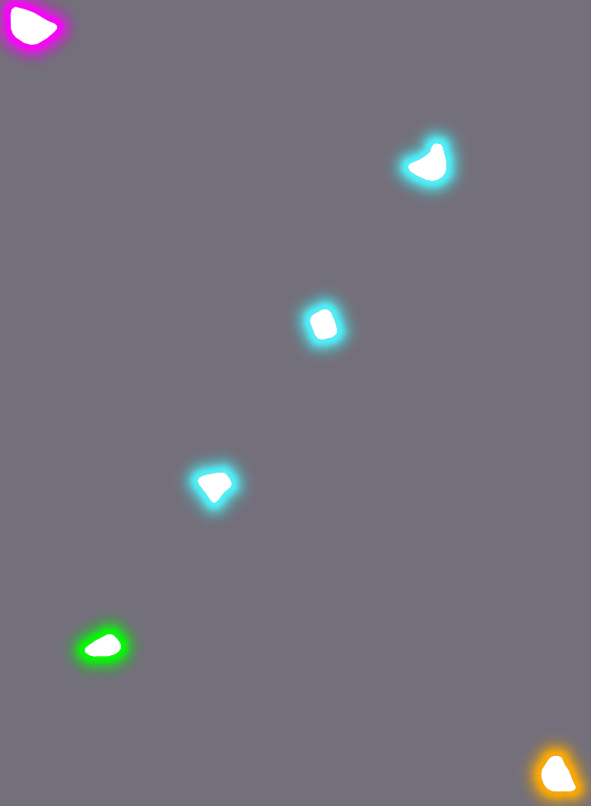
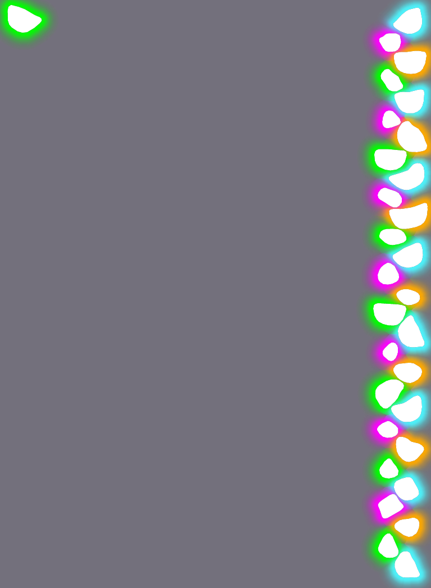
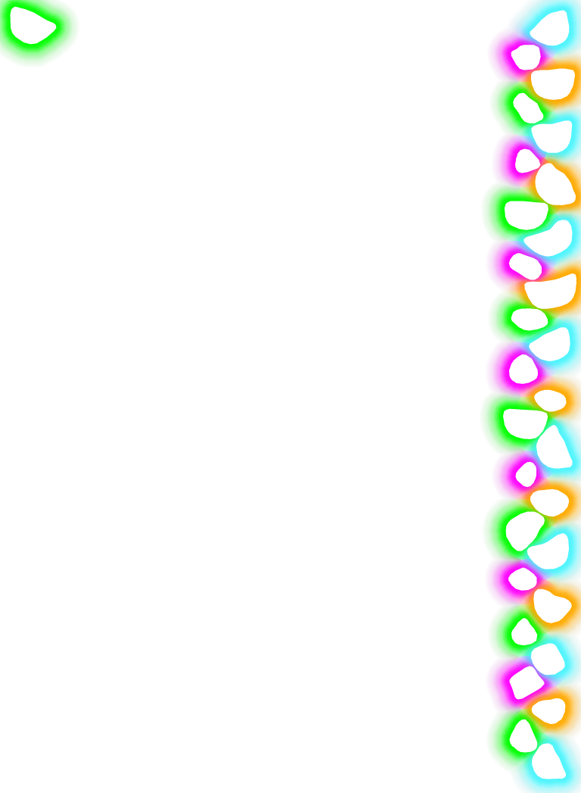
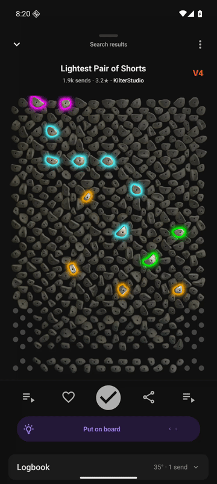
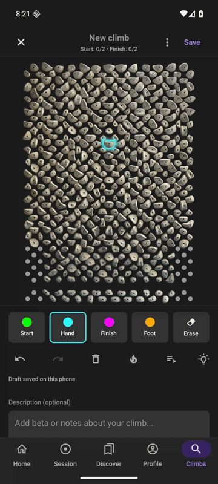

# GPU climb overlay experiment (#7431)

The current shipping path supports Kilter Homewall. Catalogue expansion is held behind the `aura-gpu-enabled` emergency switch and an explicit per-family payload allowlist; an unresolved flag keeps existing Homewall behavior. New catalogue layouts require the forthcoming API 5 native binary. Classic, custom spray walls and filled appearances retain PNG rendering. Full field resolution and the current one-channel-byte parity rule are unchanged; fill remains on PNG for this release. No new product indicator is introduced.

API 5 replaces eager full-layout preparation with lazy lit-hold chunks, bounded GPU residency and ordered tile culling. Descriptor and uniform encoding move into Rust while the Metal and GLES kernels retain their existing pixel math. These native changes require fresh final-build handset verification. Historical full-atlas measurements and rejection/optimization evidence remain source-scoped in [device verification](aura-device-verification.md).

The CDN cache PR is parked and excluded from the shipping stack. There is no asset prefetch or publication in this rollout. Reconsider it only after cold-preparation/fallback telemetry demonstrates a need. [Feature flags](../operations/feature-flags.md) and [render diagnostics](../analytics/board-render-analytics.md) define the JS safety controls and the one-family rollout policy.

GPU first, once the drawing is warm. The first frame a drawing presents in a process pays for work the native side then keeps until the process ends: the Metal/GLES pipeline compiled from source, the Rust packet session (keyed by the full static configuration, four kept per process) and the process-wide CPU cache of rasterized hold chunks (32 MiB). That first presentation took 680–1080 ms to the ready callback on the reference phones; later ones 30–80 ms. So the rule depends on it. JS remembers, in memory only, which drawings have presented in this runtime (`gpu-warm-configs.ts`, keyed by board, layout, size, sets, GPU output width and the resolved drawing signature, which carries the colours, veil and field colour; up to 16). A reload starts cold. Per drawing rather than per layout because a different colour scheme, veil or field colour is a different Rust session with its own role chunks; per process would miss that.

- **Process-cold drawing** (the first open after a launch, or the editor's first open, whose drawing has no veil): as before. The board renders this climb's PNG at once, and the tap prewarm renders it ahead. The PNG shows above the GPU surface until the GPU presents. A board latches cold or warm per climb when its wait begins, so a drawing warming elsewhere never withdraws a render already asked for.
- **Process-warm drawing**: GPU first. The GPU frame is the first and only overlay in the normal case, and no PNG is rendered for it. A full-size PNG of exactly this climb and drawing that is already in the overlay cache costs nothing, so it still shows above the incoming GPU surface until the native drawable presents. While nothing is ready the board shows its photograph without holds, behind the player's first-paint reveal (at most 600 ms, then the bare photograph). A board that already shows a GPU frame keeps that drawable on screen until the next climb's frame is ready. If a request with no frame of its drawing on this board has not presented after 300 ms (`GPU_PNG_HEDGE_DELAY_MS` in `BoardImageNative`), the board hedges: the PNG for that climb renders through the ordinary scheduler and shows until the GPU presents. 300 ms sits above every warm request measured on the reference phones (swipe callbacks 62–80 ms, edits 28–53 ms, [device verification](aura-device-verification.md)). The tap prewarm then only decodes the photo and any cached PNG.
- **Return from the background** counts as warm. Backgrounding (Android `OverlayRenderer.background()`, iOS `suspend()`) calls `releaseGPU()`, which drops the GPU arena and uploaded packet metadata only. The Rust sessions, the CPU chunk cache and the compiled pipeline survive, so the next frame re-uploads chunks without rasterizing them. The 300 ms hedge covers a slow resume. This is read from the code, not measured on a phone.

The upcoming-climb prefetch is off on the stationary GPU carousel whether the drawing is cold or warm: its swipes never show a PNG, and a climb changed before the first frame renders its own PNG at the play rank. Neither the PNG nor the hedge counts as a GPU failure. Row thumbnails cannot bridge this transition: their filled-hold appearance can differ from the full board. A missing module, unsupported configuration, rendering error or the ten-second presentation deadline restores normal PNG rendering; a native error starts it at once. Empty player selections remove the live overlay immediately. The v3 editor retains a transparent empty scene so the very first hold receives the same feedback as later edits. GPU readiness is never written into the PNG cache or snapshot contract. Native rendering pauses while inactive or detached.

## Climber switch

Settings > Board has a **GPU acceleration** switch (MMKV key `gpuAcceleration`, on by default, read synchronously so a board never mounts on the GPU and then drops to PNG). Off sends every surface (player, swipe carousel, Create Climb editor, any other caller of `useGpuClimbOverlayEnabled`) to the PNG renderer at once, mounted boards included; no restart. Precedence is remote kill switch, then this switch, then the rollout: the switch can only turn the GPU off, so a family the rollout has not enabled stays on PNG when it is on. The row is hidden when the binary has no native overlay module (`climbOverlayGpuApiVersion` is 0) or `aura-gpu-enabled` is false, because it would do nothing. A change reports the usual `Setting Changed { page: 'board', key: 'gpuAcceleration', value }`.

## Swipe and edit feedback

Native API v3 supports the stationary play-drawer wall. The photograph stays in one zoomable surface while the existing pager slides the title continuously with the finger and supplies an absolute page position directly from its UI-thread shared values. Current, previous and next hold lists share one atlas. Moving the finger only changes a numeric native property; it does not parse the layout, upload geometry or update React state per frame.

On native API 6 the player uses the **wall swap**. Every hold is one of three kinds between the climb being left and the one arriving: shared (lit with the same role in both), outgoing-only (only in the old climb, or a changed hold's old role) and incoming-only (only in the new climb, or its new role). Shared holds dip with the rest and never go dark: they take the brighter of the outgoing-only and incoming-only weights, never below 40%, so they follow the outgoing holds down while the finger drags, hold 40% through a swap until the incoming holds pass it, and come back with them. That needs native API 7; API 6 keeps them fully lit. While the finger drags, outgoing-only holds dim from 100% to 40% as the board travels to the pager's commit distance (`SWIPE_THRESHOLD`, 80 points) and stay at 40% beyond it; nothing arrives yet, and a hold's position on the wall plays no part. Letting go short of a commit follows the pager's spring back to 100%. A commit starts a 200 ms swap on its own clock: outgoing-only holds fade out over 0–120 ms (ease-in) and incoming-only holds fade in over 60–200 ms (ease-out). Incoming-only holds never appear while outgoing-only ones are above 40%, so a flick that commits before the board has dimmed starts the new holds when the fade reaches 40% (88 ms from undimmed), still ending at 200 ms. A changed hold shows one role at a time, the stronger one. Catching the board mid-swap does not stop the swap: only pulling it back toward the climb being left, 4 points or more past where the finger had it at its most onward, reverses it, easing from the weights on screen to the drag's over 120 ms. A new commit during a swap, a caught board flicked onward included, ends the running swap first, so its arriving climb is whole. A board caught after its swap has ended eases into its dim. A commit whose pair is not the one on screen (pulled back toward one climb, then flicked toward the other) first eases that pair to its leaving climb, whole, over 120 ms, then swaps: switching pairs any sooner would change which holds count as outgoing-only in one frame. Reduce Motion drops the drag dim and keeps shared holds fully lit. It fades old-only holds out and new-only holds in together, linearly over 240 ms. A Next button or queue tap still changes the climb at once.

The timing lives in JS (`play-drawer/wall-swap.ts`, driven on the UI thread by `use-wall-swap.ts`), so it can change over the air. The native view gets a `revealMode` of `swap` and one animated prop, `swapFrame`: the pair's page position, the outgoing-only weight and the incoming-only weight together, so neither platform can draw a new pair with old weights. The position names the pair rather than a progress: the nearest page is the climb being left, and the side it leans to holds the arriving one. A pair beyond the prepared neighbours shows the nearest prepared climb alone, so a lagging scene never lights a third climb.

A step re-prepares the native trio while the swap is still fading (JS hears the step 55–70 ms after a flick and renders 30–66 ms later). Until the replacement is ready, the packet already on screen keeps drawing the swap whenever it holds every climb the frame shows; the hand-over frame then draws the same pages at the same weights from the new packet. These carry-over frames report nothing, so readiness still belongs to the new request. On iOS preparation runs off the main thread, so the swap keeps moving throughout. On Android the Rust plan, chunk and encode phases run on a separate preparer thread, against a copy of the arena's resident chunk handles and placement index that the render thread lends it; GL and the live arena stay on the render thread. Back there it checks that every lent handle is unchanged and that the chunks still land at the encoded offsets, then uploads and hands over. If another preparation, a prefetch or a memory trim moved the arena meanwhile, it encodes again; after two tries it runs on the render thread, where nothing can move. The carried packet keeps its arena pins, buffers and budget share until the hand-over retires it behind its last frame's fence. If it and its replacement together would pass the 128 MiB limit, the carried packet is released first, as before carry-over, and the upload is tried once more. Carried frames get the same 16 ms texture-timestamp re-read as the new request's, armed when the carry starts and whenever a draw is refused for two pending frames, so the two-frame pending limit drains without waiting for a later frame. A carried frame that is still unconsumed after 2 seconds stops the carry (its packet is released) instead of failing the board. Uploading the new descriptors, tile directories and any newly rasterized holds still runs on the render thread, so a swipe that rasterizes a new hold can still delay a frame by the upload time. Rust encodes the mode into uniform `motion.z` and the lower/upper class weights into `viewport.zw` (renamed `swapWeights` in both shaders), keeping the 144-byte uniform and 224-byte descriptor contracts. The renamed `board_renderer_gpu_packet_reveal_uniforms` carries the mode and weights; a stale native archive fails the artifact-contract test and the link instead of shifting arguments. Settled weights (one side whole, the other dark) select the still renderer, so the Rust parity images are unchanged; an empty side's veil follows the other side's weight.

The shared weight is the swap frame's fourth number on native API 7 (`[pagePosition, outgoing, incoming, shared]`); `wall-swap.ts` computes it (`wallSwapSharedWeight`) so it can change over the air, and `GpuClimbOverlay` sends API 6 binaries the three-number frame, which is all they accept. A native view treats a missing or non-finite shared weight as 1. Rust writes it to uniform `tuning2.w` (byte 60), a word no shader read and every earlier build left zero, and only when the weighted swap compositor runs: wipe frames and every frame that selects a still keep API 6's bytes. Dimmed shared holds keep the weighted compositor even at outgoing 1 / incoming 0, because the still renderer draws every hold whole. The shader gives a shared hold the shared weight on its one (lower) side; silhouette coverage, glow ownership, stamps and the veil read that weight the way they read an outgoing-only hold's. The FFI became `board_renderer_gpu_packet_shared_reveal_uniforms`, superseding `..._reveal_uniforms`, so a stale archive again fails the artifact-contract test and the link.

**How a frame reaches the view (#7737).** An animated prop is a Fabric shadow-tree commit. Reanimated 4.7.1 holds its own commits back while a React commit from JS is mounting, and a committed swipe re-renders the player 8–83 ms after the finger lifts, inside the 200 ms fade: in a measured run every frame produced in such a window missed `setSwapFrame` until the mount, then the newest arrived 3–115 ms late as a jump. So a binary that advertises the module constant `swapCommandApi: 1` also takes each frame as a view command. `use-swap-frame-command.ts` runs a UI-thread `useAnimatedReaction` on the swap frame and calls Reanimated's `dispatchCommand(ref, 'swapFrame', [pagePosition, outgoing, incoming, shared, sequence])`, which goes straight to the scheduler delegate without a commit. On iOS `RCTMountingManager` calls the view's `handleCommand:args:` in the same main-thread turn (`ClimbOverlayGPUView.handleViewCommand`, declared with that Objective-C selector because Swift sees Expo's base view as a plain `UIView`; other commands go to `RCTViewComponentView`). On Android the command is queued as a mount item and runs first in the next mount pass, at most one frame later; Expo's view managers dropped commands, so the repo's expo-modules-core patch makes `SimpleViewManagerWrapper` and `GroupViewManagerWrapper` forward `receiveCommand` to a view that implements `ExpoViewCommandReceiver`. The reaction stops sending once the overlay unmounts.

The animated `swapFrame` prop still carries every frame, with the same sequence: it is what a new view applies on mount, and all an older binary gets. Each view keeps the newest sequence it applied and drops any frame at or below it, so the prop copy that lands after its command, or an older value a late React mount delivers, cannot step the fade back. A new view (a remount or a JS reload makes one; Expo views are never recycled) starts with no sequence, so its first frame applies whatever the counter says. The counter lives in `GpuClimbOverlay`, which renders the view, so it cannot restart under a view that outlives it. Frames of three or four numbers carry no sequence and always apply: that is what JS without this change sends. JS sends five numbers only when `swapCommandApi` is present; before the UI thread's first frame the prop holds sequence 0, below every real one. `ClimbOverlayMotion.sequencedSwapFrame` / `SwapFrameSequenceGate` (Swift) and `OverlaySwapCommand` / `SwapFrameSequenceGate` (Kotlin) are the pure halves, tested in the motion and robolectric suites.

**The swap look (iOS and Android, `swapLookVersion` 2).** On a binary that also advertises the module constant `swapLookVersion` 2 (and API 7 and the swap command), the player sends a `swapLook` view prop, `encodeSwapLook(PLAYER_SWAP_LOOK)` from `play-drawer/player-swap-look.ts`, and its swap frames grow to seven numbers: the five above, then an arrival code for the climb being left and for the arriving one (0 leaving, 1 arriving from the right edge, 2 from the left, plus 4 for a flick run's calm arrival). The fourth number is then the floor below which shared holds never go. `ClimbOverlaySwapLook.swift` turns each side's weight into a per-hold mark, glow and reach once per frame and binds them as fragment buffer 5; with no look bound the shader takes the API 7 path byte for byte (42 of 42 golden samples). The state machine above still decides both side weights (`play-drawer/swap-look-driver.ts`). Android draws it too (see "Android implementation and verification"). Its `swapLookVersion` now advertises protocol support without touching EGL or compiling a shader. An eligible visible view requests the look through its gated prop; the render worker tries the optional program once per context and keeps the base swap if compilation fails. Earlier binaries that advertised 0 still receive no look and the shipped frames (five numbers with the sequence). So do older binaries, Reduce Motion and, on iOS, Differentiate Without Color (JS sends no look and native turns any look off) and the `player-swap-look-kill` switch. The view sends its `onSwapLookState` readout only when the `swapLookStateEvents` prop is on, which only the board motion lab sets. What the look draws, and how it was chosen, is in `docs/rendering/board-motion-lab.md`.

The earlier **wipe** remains behind `revealMode: 'wipe'`, which API 5 binaries keep using. A soft directional reveal changes each hold’s lighting as it crosses the stationary wall. Its 22%-wide band uses the hold’s display position, including mirroring. One weighted field combines outgoing and incoming holds without duplicating the veil or same-role holds. Shared holds with the same role remain steady. A hold whose role changes fades its old mark through clear before its new role appears, preserving the meaning of role colours and glyphs. Exact endpoints use the still renderer. Cancelling restores the original endpoint; a committed swipe settles on the next climb. Reduce Motion shows the endpoints only. Unsupported scenes retain the image carousel, which keeps the wall still too: whole PNG boards fade over a bare wall with the same state machine (`play-drawer/png-swap-layers.ts`, see `docs/design/mobile-motion.md`), and slide only under the `png-wall-fade-kill` switch.

In Create Climb, the new role and glyph appear immediately. Added or changed holds expand their glow to 135% reach over 100 ms, then contract to the original edge by 350 ms; removals disappear immediately. The hold geometry, role colour and glyph do not move or change brightness. The pulse starts after the first normal-size drawable is presented, so preparation does not consume its visible duration. Undo and Redo use the same frame-difference treatment. A new edit replaces the previous effect instead of queuing it. Opening an existing climb or changing the layout does not animate; an empty editor records its baseline before preparation finishes, so a fast first tap still gets feedback. Reduce Motion shows the exact committed state directly; Low Power Mode suppresses the optional edit feedback. The native display link stops when the effect ends or the view becomes inactive.

The player passes its actual drawer surface colour into the board backing and veil, including Material tint and Reduce Transparency. GPU/PNG cache identities and opening snapshots include that colour; editor, thumbnail, share and pane defaults remain unchanged.

Both the player and editor preserve their unzoomed board size while allowing zoom to fill the available width. Pan limits use the full viewport. Editor taps and role-menu anchors account for the centred board offset, including mirrored boards.

For repeatable capture, the story URL accepts `gpu=1`, `sample=0` through `4`, `resolution=512|768|1024`, `mode=compare|rust|metal`, and `verify=1`. Invalid inputs use the normal defaults; the unparameterized story keeps GPU drawing off. `verify=1` runs one pixel comparison after that request is ready and logs its metrics and PNG paths with the `[gpu-climb-parity]` prefix. The story harness's `theme=light|dark` parameter sets appearance.

## What the screen compares

Both sides receive identical Rust render configuration for Kilter Homewall layout 8, size 17, sets 26 and 27: real catalogue placements and traced silhouettes, the current shared Aura defaults, and the current light/dark veil. The test climbs are synthetic selections of real holds; they are never saved to the account. Five samples cover six spread holds, 30 spread holds, adjacent same-colour holds, adjacent different-colour holds, and an empty climb.

The story's own switch starts off and enables its optional native view independently of production rendering. A missing native module or rendering error shows the matching Rust image. There is no animation loop, breathing or glide. The story disables drawing on route blur; the native view also handles application/window inactivity.

The initial output width is 768 pixels. The resolution button cycles through 512, 768, and 1024 pixels; both renderers receive the same resolution. A native memory-budget failure is reported and falls back to Rust. This experiment does not establish sharpness under pinch zoom or production rendering speed.

## Read the measurements correctly

Use **Mode: rust** or **Mode: metal** to run one renderer at a time. **Mode: compare** draws both and is for appearance; its timings include competing work. The screen retains the latest 100 sample records, with a **Share measurements** button for the JSON and **Reset readings** for a new sitting.

After the requested render completes, **Validate pixels** makes an offscreen Rust/GPU comparison at the same atlas resolution. The native view pauses while this runs. It reports maximum RGBA channel error, RMSE, and how many pixels differ by more than one byte, and saves both PNGs for inspection. The exported measurements include the snapshot paths and comparison result. These CPU/GPU compute timings exclude the normal PNG display path.

- **Rust API / PNG ready** includes the native API round trip, cache lookup, and any needed render/PNG encode/write. **Fresh Rust PNG** uses a new experiment-owned cache key. **Repeat cached key** reuses the key; the first such request may still miss.
- **Rust image onLoad** is the image-load callback measured from the same request start. It is not a compositor presentation timestamp.
- **GPU callback** is the native ready event round trip (drawable presentation on physical iOS with API v2–v4; command completion on the v1 prototype). The iOS simulator SDK omits the drawable-presentation callback, so simulator builds advertise API v1: the parity story and offscreen comparison work, while the player and editor use their PNG fallback. Simulator checks do not verify live GPU motion or presentation readiness. **Atlas prepare**, **upload**, and **GPU** describe native stages; the atlas hit flag and resident byte count distinguish preparation from reuse. Relaunch the app for a cold in-process atlas. The offscreen comparison still parses its full configuration; its preparation time does not measure the v2 frame-only update path.
- These story readings do not measure the production render scheduler, the player's gestures, or the create editor's tap-to-paint latency. Use the probes in `mobile-visible-performance.md` for those.

Record device, OS/build, output resolution, thermal state, power mode, whether the phone is charging, and sample counts alongside exported results. Compare alternating isolated Rust and Metal runs in the same sitting. iPhone 17 Pro evidence is preliminary; the issue's iPhone 13 Pro comparison remains a separate device run. Simulator images prove appearance only.

## Decision gate

Keep screenshots and exported measurements with the PR evidence. Compare silhouette edges, same-colour merging, different-colour seams, antialias coverage, and veil in both schemes. Report errors and unverified checks explicitly. Check first opening, rapid swipes, editor hold changes and clearing, plus background/resume. Do not infer a production speedup from the existence of the shader.

Initial iPhone 17 Pro evidence at 768 × 1047 pixels: the sparse dark sample differed from Rust by at most one channel byte, with zero pixels differing by more than one and RMSE 0.01375. Offscreen GPU execution was 0.61 ms versus 3.64 ms Rust computation; the original full-config warm preparation was 10.77 ms. These are individual diagnostic samples, not player latency measurements. The original full size-25 layout at 1080 × 1504 used an 84,805,136-byte atlas for 499 holds. Reserving distance-field padding for the 35% editor expansion increases that payload to 120,143,120 bytes (114.58 MiB), 41.67% larger and still below the 128 MiB limit. These payload counts exclude other process allocations and do not establish peak process memory.

The v2 live integration on the same iPhone reported fourteen consecutive cached requests with 0.063–0.157 ms preparation, zero upload time and 2.82–4.44 ms GPU execution. Their active atlas payload was 61,516,448 bytes. These readings confirm reuse across frame updates; they do not include gesture handling, JS scheduling or total time to visible presentation. Cold-start latency and peak process memory remain separate measurements.

## Android implementation and verification

### API 5: selected holds and ordered tiles

Opening a layout creates a bounded Rust session without rasterizing its holds. Each visible current/previous/next selection requests only its missing distance fields, canonical role stamps and required covers. Native code retains their stable GPU offsets in a per-chunk LRU. Reusing resident holds changes descriptors and controls without rasterizing or uploading their pixels. A first edit that introduces a missing hold or role can prepare and upload that chunk; it is measured separately from repeating an edit with resident geometry.

Rust encodes the 224-byte descriptors, 144-byte uniforms and 32-pixel tile lists. Each list retains ascending original contribution order; both shaders keep the existing compositing arithmetic, full-resolution fields, still endpoints and pulse padding. Shared constants come from the versioned packet contract. The Metal and GLES kernels remain separate sources.

The GPU cache has a 32 MiB soft retention target, bounded metadata and the unchanged 128 MiB aggregate application-owned admission ceiling. The ceiling includes mounted scenes, pending commands, descriptors, resources, uniform buffers and old/new arenas during growth. Selected and in-flight chunks stay pinned. These are allocation ceilings rather than reserved storage; driver internals and OS drawables remain outside the accounting. A native-private compressed chunk cache writes after readiness; one invalid chunk regenerates locally. The parked CDN cache does not participate.

At most two distinct, already-loaded adjacent climbs can prepare while the pager is idle. Lookahead does not change request identity or emit readiness, and stops when a gesture, request, inactivity or layout change supersedes it. Resource counters include this work and cancelled jobs. `getClimbOverlayGPUResourceStats` is absent on older binaries, which must report unavailable statistics rather than zero work. API 5 snapshots report cumulative raster attempts, materialization, pixel uploads, arena copies and pending work; a stable drained snapshot is required before claiming a warm operation did no geometry work.

Detachment and cancellation are silent. Finished reusable chunks can outlive a cancelled presentation. Android recreates its EGL surface before retrying the latest scene after context loss; invalid frame data does not evict an otherwise usable layout. JS persists only static configuration failures per installed binary, while frame/context failures leave later climb windows eligible.

The [selected-hold census](aura-lazy-packet-census.md) records host byte/encoder checks for all 51 configurations. Actual Metal/GLES image checks and final alternating iPhone 13 Pro/Pixel 8 Pro runs remain separate gates. No additional family is enabled by these host results.

### Historical full-atlas format v2 census

Native API v4 packs exact squared distance into 24 bits and coverage into eight bits. The all-ones distance sentinel is distinct from every possible distance at the supported 1536 × 2304 bounds. The 135% editing padding and native resolution are preserved. Transparent covers and stamps occupy no pixel storage; nonempty stamps are cropped after rasterization in board coordinates. Outline and glyph stamps preserve CPU drawing order and integer source-over rounding. Equivalent role aliases share a visual identity, so a code alias alone cannot trigger a role-change fade or editing pulse.

Filled appearances (`fill` and `glow-fill`) use PNG. Three rounds of stamp fixes removed coordinate and pass-order defects, but the final raw parity matrix still found two-channel-byte differences on a handful of dense filled pixels. The assumption that cached 8-bit fill passes exactly reproduce every clipped tiny-skia blend remains unproven. Glow, outlines, glyphs and auxiliary annotations keep the GPU path; the fallback preserves filled appearance at native resolution.

Rust hands manifest and pixel allocations to native separately, removing the explicit full-payload concatenation from the production transfer. Both platforms serialize preparation and count atlas, LUT and scene buffers through their retained GPU lifetime, including mounted views and submitted work, against the existing 128 MiB budget. Driver internals and OS drawable pools are not a process-memory bound. Rejected allocations keep the PNG path.

The reference 499-hold atlas falls from 120,143,120 to 56,822,920 pixel bytes (114.58 to 54.19 MiB). All 51 full-resolution configurations pass the requested-buffer size census; the largest is 59.25 MiB before its small LUT and scene descriptors. See [the catalogue census](aura-atlas-census.md) for per-configuration measurements and evidence limits. These host measurements do not establish physical-device peak memory or visible-ready latency.

The Android renderer uses a transparent `TextureView` and an OpenGL ES 3.1 compositor. It keeps the shared player/editor API, the wall swap and directional reveal, and the 135% edit-glow reach. The outer React Native view owns zoom, clipping and mirroring. The shared feature flag now controls both live boards and the stationary carousel.

Android also draws the wall swap's swap look (`swapLookVersion` 2, [board-motion-lab.md](board-motion-lab.md)), with a second GLES program beside the base one. Every frame without the look, which is every frame for a user without it, draws with the base program, whose source is main's byte for byte (`OverlayShaderTest` pins its SHA-256), so those frames meet no new driver code. The look program's source is a second copy with every look edit marked (look-only lines between `// look begin` and `// look end`, a base line the look replaces kept just before them as a `// base: ` comment), and `OverlayShaderTest` checks that undoing the edits gives the base source byte for byte, so a fix to one copy that misses the other fails. The look program (`OverlayShader.lookFragment`) is bound only for a frame that draws the look; it reads the look's 16-bit words from a 2 KB uniform block at binding 1, a uniform block rather than a fifth storage buffer because GLES 3.1 only promises four storage blocks in a fragment shader and the compositor already binds four. `OverlaySwapLook.kt` ports iOS's per-hold math and writes the same words into one array the renderer reuses, so a frame allocates nothing; hold centres, roles and ids are decoded into plain arrays where a packet is encoded (the preparer thread, or the render thread when a preparation runs inline after two tries), for every packet so a live flag change can enable the look without preparing geometry again. The module constant `swapLookVersion` is protocol support only: module creation and JS imports never open EGL, compile shaders or wait for a capability result. `SwapLookProgramState` builds the optional program on the render worker only when a visible, active swap view has a look prop and Reduce Motion is off. A successful program is reused; a failure is logged once and stays on the base program until the EGL context is replaced. Clearing the prop selects the base program immediately. A flag cannot cancel a driver compile already in progress; it prevents a new compile when disabled before the eligible request. Older binaries retain their `swapLookProbe` constant and JS still understands their diagnostics. The view sends `onSwapLookState` only while the `swapLookStateEvents` prop is on (the lab's readout). Remove animations (or the app's Reduce Motion) turns the look off natively; Battery Saver and a thermal status of severe or worse, from one process-wide thermal listener, keep it with glow reach at 1. On an API 36 emulator (ANGLE on SwiftShader, 2026-11-18): variant I's 255 preview frames against Metal with the #7773 shader fixes matched within one byte, 250 identical and 5 differing in at most 24 pixels, none by more than one byte, while the look itself changed 177,000 pixels a frame on average; Kotlin wrote the same words as Swift for all 137 look frames; on the Aura golden's 42 samples the base program and the look program with no look both matched the shader on main byte for byte; and at the swap's two ends (W = (1, 0) and (0, 1), 10 checks on I's pairs) the look program drew the still frame pixel for pixel, where the look program before those fixes differed on 6 of 10 (777 to 1,212 pixels, up to 12/255). Historical startup-probe builds were also tested in the app on that emulator: a look program forced not to compile gave `swapLookVersion` 0 (the lab greyed out I to J) while the board kept drawing on the GPU through scripted swaps, and a look program failing only in the renderer's context left the board on the base program, drawing. With the stored answer, on the same emulator: a look program forced not to compile showed `look off (look shader rejected by this GPU (compile))` in the lab, and on the next launch, which built nothing, `…; kept until the app or GPU driver updates)`; the real program stored `built` and every later launch opened the lab on I with the look ready; a probe held back 30 s gave `look off (probe timeout after 2404 ms; next launch retries)`, stored `built` when it finished, and the next launch offered the look without building it. `scripts/board-motion-preview/README.md` has the runs. That is not phone evidence: the look program has not yet been compiled or drawn on a real Adreno or Mali GPU.

The native bridge transfers ownership of the Rust atlas through a direct buffer, avoiding a Java byte-array copy of the large payload. Cold preparations are serialized and GPU atlas residency is bounded, including entries retained by mounted views. The Rust packing step can still hold both its working storage and its final payload temporarily. Neither the GPU residency limit nor the atlas byte count establishes a peak process-memory bound. Low-memory admission checks and unsupported GPU limits must fall back to PNG rather than retry indefinitely.

On Android, `onTrimMemory` at `RUNNING_LOW` or above and `onLowMemory` release the shared arena only while no view presents from it; a visible board keeps its residency, so the next swipe does not re-upload every chunk beside the copy on screen. A trim that fails resets the context through the normal recovery path instead of throwing on the render thread. Only failures that repeat for this binary, phone and configuration report `static`: a missing GPU feature, a shader the driver rejects cleanly, a packet contract mismatch or a configuration Rust rejects. GL and EGL errors, fence waits, surface loss and the two-second consumption timeout report `context` and fall back for the current frames only.

Android readiness requires both GPU completion and a matching buffer update consumed by `TextureView`, correlated using a monotonic presentation timestamp and request/surface generations. TextureView can notify before HWUI consumes its buffer, so bounded deferred reads wait for the exact timestamp; an unverifiable frame falls back after two seconds. This proves consumption by the view, **not physical display scanout**. The edit pulse starts after the initial normal-reach frame meets that boundary. A destroyed surface, context loss or superseded request must not release the PNG bridge for a newer request. Battery Saver and disabled system animations suppress the optional pulse, alongside the shared reduced-motion setting.

Only genuine, non-disjoint GPU timer results may populate GPU timing. Devices without that facility report unavailable timing; CPU command-submission time must not be labelled GPU execution. Offscreen framebuffer comparisons remain separate from visible presentation measurements.

Android validation must include native lifecycle/ownership tests, shader pixel comparisons in both themes, mirrored and dense hold patterns, rapid edits and cancelled swipes, background/resume and memory pressure. Emulator checks can establish functional behavior but cannot establish physical-device performance or scanout timing. Record actual build, device, parity and memory results with the stacked PR; iPhone measurements above are not Android evidence.

## Initial device parity images

These are the original 768 × 1047 offscreen outputs captured on the iPhone 17 Pro, not screenshots of the later swipe animation. They document still-image parity only.

| Rust reference | Metal output |
| --- | --- |
|  |  |

## Android emulator parity evidence

On 2026-11-15, an owned Android API 36 ARM64 emulator with 4 GiB RAM and ANGLE/SwiftShader GLES 3.1 completed 14 offscreen comparisons: all five fixtures in both themes at 768 pixels, plus the 30-hold fixture in both themes at 512 and 1024 pixels. Every comparison had a maximum channel error of at most one byte and zero pixels differing by more than one byte. RMSE ranged from 0 to 0.04015. GPU duration was reported as unavailable. These are functional and image-comparison results, not physical-device performance measurements.

The first TextureView notification reported timestamp zero. A deferred read subsequently matched the submitted buffer exactly and emitted one ready event. After pausing for comparison, the old timestamp was rejected and the newly submitted buffer was matched on resume. A separate 2 GiB emulator run correctly fell back because available memory was below preparation admission.

The [Android comparison screen](images/gpu-climb-overlay/android-comparison-screen.png) shows the existing PNG renderer beside GPU rendering over the same photographs. The images below are actual 768 × 1047 offscreen overlays. Transparent cutouts reveal the unchanged board photographs when composed in the app.

| Appearance | Rust reference | Android GPU |
| --- | --- | --- |
| Dark |  |  |
| Light |  |  |

The final APK without diagnostic tracing also reported API v3 readiness in the normal player and editor (screenshot mode off, recorded local backend). Player swipes reused the atlas with zero upload time. The first editor hold, later additions, role changes, Undo and Redo reported 350 ms edit feedback; recorded frames show expansion and contraction. Disabled system animations reported reduced motion and zero edit duration. Battery Saver was confirmed on through Android power state and reported zero edit duration with low-power mode active; both system settings were restored afterward. These emulator observations do not establish a hardware frame rate.

| Player swipes | Editor hold feedback |
| --- | --- |
|  |  |

## Physical Adreno: lower scene dropped (#7749)

On a Galaxy S26 Ultra (Adreno 840, driver 0842.19.13) the compositor drew nothing from the lower scene: no lit holds at rest, and no outgoing climb during a swap. The emulator never showed it. A diagnostic build proved the inputs were right: the hold count, the descriptors read back from the GPU, and the tile lookup. Drawing the same still frame through the upper scene lit every hold. The driver dropped the `Hold` that `source_hold` returned straight from `lower[index]`. Copying it into a local before returning fixed both cases on the phone. `scripts/check-android-gpu-shaders.ts` now rejects any `return` that ends on a whole `lower[...]` or `upper[...]` element, because `glslc` compiles that form without complaint.

## Catalogue expansion evidence

The [transition golden](../../scripts/aura-transition-golden/README.md) adds eight wall-swap samples to the 30 wipe and editor samples. On 2026-11-17 the host Metal run (Apple M5 Max) matched the tiled compositor to the amended full-scan reference with a maximum channel error of 0 across all 38 samples; the swap's settled samples reproduced the wipe's still images and stayed within one byte of the Rust still oracle, and the mirrored swap sample equalled the unmirrored one. Because the amended reference copies the production swap branch, the swap's arithmetic is checked separately against the two Rust stills: a side at weight 0 matched the other still within one byte, sides at 0.2–0.6 measured within 0.045 of their weight, and 4,812 shared-hold pixels matched within one byte. Swapping the lower and upper weights in the shader fails that check. Pixel GLES and physical iPhone runs of the swap samples are still owed.

Four more samples (42 in all) dip the shared holds through `tuning2.w`: (0.4, 0, 0.4) at the drag's commit point, (0.25, 0.3, 0.4) mid-swap, (0, 0.6, 0.6) as they come back, and (1, 0, 0), which no gesture produces, to prove dark shared holds keep a settled pair off the still renderer. Dimmed shared holds are measured inside their own bounds, away from other holds' reach, from the bare veil toward the Rust stills; leaving them whole, or giving them a side's weight, fails. On Linux the preparation step matched the independent encoder to Rust's 144 bytes for all 42 controls; the 38 earlier controls kept their bytes except word 15 (1.0) in the six interior swap samples. The host Metal, Pixel GLES and physical iPhone runs of the four new samples are owed.

The [host parity census](aura-gpu-parity.json) records 251 raw Rust/Metal comparisons within one channel byte: all 51 default and mirrored-glyph configurations, 49 outline/glyph configurations, 51 glyph-only configurations, 24 pulse samples, seven MoonBoard auxiliary-only cases and 18 dense glow cases. Two outline/glyph configurations correctly use PNG at the unchanged 128 MiB limit. Filled treatments stay on PNG after the documented dense-fill residual. Selected-set and outline-cap field reconstruction also matches exactly across all 51 configurations.

These are Apple M5 Max host results. [Physical verification](aura-device-verification.md) now records the selected USB iPhone 13 Pro and Pixel 8 Pro baselines, the rejected initial candidate and the replacement's complete primary restart pairs. Native frame, full hardware catalogue/cache checks and final visual sign-off remain separate pending gates. No host timing is presented as a phone speedup.
