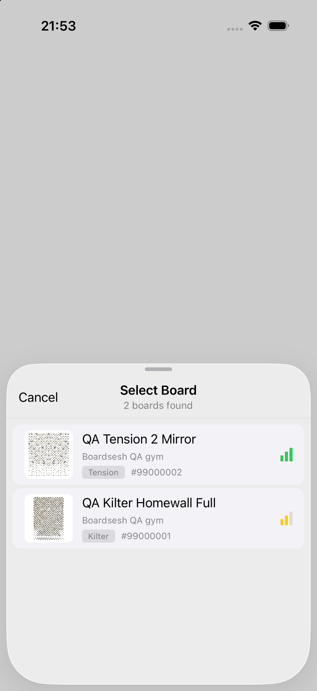
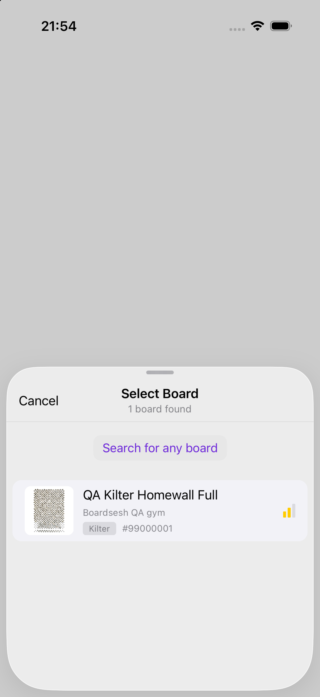

## Bluetooth Integration

### Connection Flow

The BLE connection is managed by `useBoardBluetooth` hook and exposed via `BluetoothProvider` context.

**Step-by-step:**

1. **User initiates connection** -- taps lightbulb or connect button.
2. **Adapter creation** -- `createBluetoothAdapter(boardName, devicePicker)` creates a platform-appropriate adapter:
   - Web: uses Web Bluetooth API (`navigator.bluetooth.requestDevice`).
   - Capacitor (native iOS/Android): uses `react-native-ble-plx` equivalent with a custom `DevicePickerDialog` rendered as a bottom sheet (`Dialog` on web).
3. **Availability check** -- `adapter.isAvailable()` confirms BLE is supported.
4. **Existing adapter cleanup** -- on mobile, if a prior adapter exists, ends that generation with `reason: 'user'` and `disconnectTrigger: 'connection_replacement'`, then disconnects it before the new scan.
5. **Device request and connect** -- `adapter.requestAndConnect(targetSerial)` opens the device picker (OS native on web, custom dialog on Capacitor with RSSI-based signal indicators).
6. **Device name parsing** -- `parseApiLevel(deviceName)` extracts the Aurora API level from the device name (e.g., `Kilter Board#751737@3` yields API level 3). `parseSerialNumber(deviceName)` extracts the serial (e.g., `751737`).
7. **Tracked adapter generation** -- mobile installs the adapter identity and `onDisconnect` listener, then starts one transport lifetime with a snapshot of the full board config (including set IDs) and session state. The connection handle carries that immutable config snapshot, and board presence later attaches its resolved board ID only if that adapter generation is still live.
8. **Board configuration** -- adapters with a native background writer call `adapter.configureBoard()` with board name, layout ID, size ID, API level, device name, and colour overrides.
9. **Initial frames** -- if provided, `sendFramesToBoard(initialFrames, mirrored)` sends the first climb immediately. A link drop during this write still ends the generation even though the UI never reached `isConnected: true`.
10. **Serial recording** -- for Aurora boards, `recordBoardSerial()` POSTs the serial-to-config mapping to `/api/internal/board-serials` for future auto-matching.
11. **Session serial broadcast** -- `onConnectSuccess(parsedSerial, connectionHandle)` fires. `BluetoothProvider` resolves the board using the handle's snapshotted config and calls `setSessionBoardSerial(serial)` if a session is active. An unchanged binding returns its cached ID, while same-key reconnects share an in-flight resolve. Ambiguous serial resolution stays pending through the picker choice. This lets the newest generation attach and later release the holder; stale, cancelled, invalidated, and failed resolutions return `null` and cannot populate another config.
12. **Wake lock** -- `useWakeLock(isConnected)` keeps the screen on while connected.

**Device picker dialog (`DevicePickerDialog`):**

- MUI `Dialog` with "Select a board" title and `BluetoothSearching` icon.
- Lists discovered BLE devices with:
  - Board thumbnail: `BoardThumbnail` for resolved saved boards, `BoardRenderer` for recorded configs, `UnknownBoardPreview` with `HelpOutline` overlay for unknown serials.
  - Board name: saved board name, recorded config display name, or raw device name.
  - Board details: layout/size/set info, location, last connected time.
  - Signal strength: icon (`SignalCellularAlt`) + label (Strong/Good/Weak/Very weak based on RSSI thresholds: -50/-70/-85).
- "Cancel" button in actions.
- Board config mismatch detection: if the resolved config doesn't match the current route's board, a `BoardConfigMismatchDialog` offers "Switch" (navigate to matching route with `?autoConnect` param), "Connect anyway", or "Cancel".

On mobile, a resolved controller also carries its saved board UUID. Two known,
nonempty UUIDs must agree even when the board type, layout, size and normalized
hold sets are identical (#5430). Missing or anonymous UUIDs retain the existing
configuration-only comparison. A different saved board opens the existing choice
instead of selecting the device immediately, with copy explaining which board's
wall feed receives the climbs; a saved board's name is used when available.
Cancel leaves the picker open, Connect anyway remains an explicit override, and
Switch selects the resolved board before reconnecting to the chosen serial.
Recorded mappings are fetched through `GetBoard`, and the returned canonical UUID
and configuration control the hop. Reconnect waits for that UUID, board type,
layout, size and normalized hold sets to reach the provider, including a change
that affects only the UUID or hold sets. The one-shot still expires and fires once.

Connecting to a known board sorts each controller into one of three groups
(`classifyPickerDevice`). **Target**: its serial resolves to that exact board
UUID, or nothing on record names its board and it is the box this phone
remembers for that board by BLE device id (`PickerBoardTarget.rememberedDeviceId`:
a MoonBoard or a serial-less Kilter-built box, unless a hang-up's 10 minutes
ran out). **Other**: its serial resolves to a different board, or its advertised
board type is not the target's, since Kilter and Tension serial numbers can
overlap. **Unknown**: nothing says either way, which covers every stock
MoonBoard and every bare-name Kilter or Tension box this phone doesn't remember
(they advertise no serial), a serial nobody has recorded, and a recording that
names no board. The picker
lists target rows first, then unknown rows, strongest signal first within each,
and hides only other rows. #7125 first shipped hiding unknown rows too. In the
30 days to 2026-10-31 nothing resolved in 2,521 of 2,522 MoonBoard pickers and
1,265 of 2,512 Android Kilter pickers, so a gym connect there listed nothing but
"Your selected board was not found". The broad scan keeps feeding serial
resolution; a delayed lookup can move a row between groups but never selects it.
"Search for any board" reveals the full scan and keeps that choice through
sheet-host changes for this connect. A new connect starts with its own target
again. Saved-device reconnects keep their existing search and auto-selection;
using their search escape also reveals the full list. "Your selected board was
not found" shows only when every controller heard is another board. That is
distinct from an empty scan, so it does not trigger location-permission or
no-lights advice. `BLE Picker Devices Resolved` counts the three groups as
`targetMatchedDevices`, `targetUnknownDevices` and `targetOtherDevices`. It
counts by serial resolution alone, so a box the sheet lists in the target group
because this phone remembers it by id still counts where its serial puts it.

**Tips while the scan runs.** "Don't see your board?" and its tips come in 5 s
into the scan (`SCAN_TIPS_DELAY_MS` in `lib/ble/scan-tips.ts`), while the scan
goes on, instead of after the 30 s scan ends empty. They show while nothing is
there to pick: no board heard at all, or for a known board nothing listed. Every
listed box may be the climber's, the unknown group included: a MoonBoard or a
Kilter-built box has nothing but its BLE id to tell it apart, a serial is
recorded only on a connect (so the first Boardsesh connect at a board lists its
box as unknown), and a box whose serial lookup is still out is unknown until the
reply lands. A same-type neighbour with an unrecorded serial therefore keeps the
tips off too; that is the rarer case. They stay once the scan ends and go as
soon as a board is there. A `searching` picker shows none; it hands over to the
list at 10 s, where they are already due. One line per tip, in this order:
power, distance, Bluetooth, then another phone. On a MoonBoard (the target's
board, or the active board) another phone comes second, in its own wording: an
older box can keep the first phone until it is switched off and on. The Android
location hints replace the tips from the same 5 s, but only when nothing at all
was heard; once location is sorted their copy asks for a fresh connect, so Scan
again comes with it while the scan still runs. "Browse for now" sits under the
tips: it closes the picker without connecting, so the climber keeps picking
climbs as previews. It is not "This wall has no lights", which still shows only
after an empty scan and takes the wall with no Bluetooth. `BLE Picker Devices
Resolved` carries `tipsShownAtMs` and `browsedForNow`. The sheet opens at a
medium detent, so the hints never sit pinned under the rest: with boards listed
they are the list's footer, and with none the state above them ("No boards
found", "not found", the spinner) scrolls with them. The `/boards` Bluetooth
quickstart (`BluetoothQuickstartSheet`) shows the same tips 5 s into its 15 s
scan while it has heard no board, with no Browse for now.

**Remembered boards.** A connect remembers the box for the board in view: by
serial for Aurora boxes, by BLE device id for a MoonBoard or a serial-less
Kilter-built box named for that board type (`Kilter Board`, `isKilterBuiltBox`).
The next tap on the bulb reconnects to it while the picker shows "searching",
with no board list. A drop, a config switch and Disconnect Bluetooth when
driving ends keep it with no limit. A hang-up keeps it for 10 minutes, then it
is forgotten, the iOS native pairing included, unless the Lock Screen bulb
already reconnected it: that link is kept and the board is remembered again.
That pairing, which lets the Lock Screen bulb reconnect, goes sooner when the
route moves to another board.
A hang-up after a wrong-box connect, and a sign-out, forget it at once. The rules and their reasons are in
`docs/board-connection-holder.md`.

The simulator comparison uses the same resolved QA gym fixtures with a stronger
Tension signal. The [expanded list](../images/7125-picker-all.png) follows an
actual tap on "Search for any board"; the [missing-target state](../images/7125-picker-missing.png)
shows dark Material styling. These captures verify presentation, not radio behavior.

| Before | After |
| --- | --- |
|  |  |

On iOS, adopting a connection restored outside JavaScript waits until reconnect
memory finishes loading, including a failed read (#5429). A named controller's
serial must agree with each known identity: memory for the active board UUID key
and the active saved board's roster serial. A contradictory roster serial rejects
even a previously poisoned matching memory record; unrelated-key memory does not
identify the current wall. Rejection happens before adapter creation, native
configuration, connection callbacks or persistence. Nameless reconnects retain
the existing current-config memory requirement. Explicit connect/disconnect intent
wins over a delayed storage read, so it cannot overwrite a new pairing or restore
a forgotten one. Identity readiness and roster-serial changes refresh the native
subscription/query, and superseded results cannot adopt a connection.

**Auto-connect (`AutoConnectHandler`):**

- Reads `?autoConnect={serialNumber}` from URL search params.
- When present and BLE is supported and first search fetch is done: auto-selects the first available climb, initiates BLE connection to the target serial, and removes the param from the URL.
- Fires once per mount via `triggeredRef`.

### Frame Sending

`sendFramesToBoard(frames, mirrored, signal, climbUuid)`:

**Aurora boards:**

1. If `frames` is empty string, sends a clear-all-LEDs packet (no placement data needed).
2. If `mirrored` and board supports mirroring: `convertToMirroredFramesString` maps each hold ID to its `mirroredHoldId` via `holdsData`.
3. Loads LED placement positions via dynamic import of `@boardsesh/board-constants/led-placements` (cached after first load).
4. Calls `getAuroraBluetoothPacket(frames, placementPositions, boardName, apiLevel, ledColorOverrides)`.
5. Handles skipped placements:
   - All placements skipped: shows error snackbar "This climb is for a different board configuration", returns `false`.
   - Partial skip: shows warning snackbar with count, sends remaining holds.
   - Captures Sentry warnings for both cases with context (climbUuid, layoutId, sizeId, setIds, skip counts).
6. Writes packet via `adapter.write(packet, signal)`.
7. Increments BLE send counter and checks feedback prompt threshold.

**MoonBoard:**

1. Empty frames send MoonBoard's clear-all `l##` frame (deliberate clear only — verified against the ArduinoMoonBoardLED community firmware, which clears every LED on each incoming frame; unverified on official Moon controllers, where it is at worst a no-op). An all-placements-skipped climb still refuses to write rather than fall through to this clear.
2. `getMoonboardBluetoothPacket(frames)` produces the packet.
3. If all placements are skipped, shows error snackbar and returns `false`.
4. Partial skips are logged to Sentry.
5. User colour overrides are not sent to MoonBoard controllers because the protocol does not carry arbitrary RGB colours; they still affect in-app rendering.

**Mobile accessibility colour overrides:**

- Mobile stores hold-role colour overrides in `useHoldColorOverrides()` for STARTING, HAND, FINISH, and FOOT.
- Default mode stores no value, so Aurora-family packets use the canonical board colours.
- User mode stores RGB colours as hex strings, passes them to `getAuroraBluetoothPacket()`, and pushes the same map through native iOS `configureBoard()` so widget/background sends match the app.
- The auto-sender includes the colour override signature in its dedupe key so changing a colour repaints the currently loaded climb even when the frames did not change.

**Error handling:**

- `AbortError` (from unmount-mid-write) is swallowed silently -- the AutoSender's drain loop handles this.
- Other errors are logged and return `false`.

### Light Control Drawer

Long-pressing the lightbulb opens the `LightControlDrawer` (`light-control-drawer.tsx`), a bottom `SwipeableDrawer` with height `"auto"`.

**Menu items (MUI `List`):**

| Action              | Icon                                 | Behaviour                                                                                                                                                                                                                                                                                                                |
| ------------------- | ------------------------------------ | ------------------------------------------------------------------------------------------------------------------------------------------------------------------------------------------------------------------------------------------------------------------------------------------------------------------------ |
| Turn off all LEDs   | `LightbulbOutlined`                  | Calls `clearBoard()`. If a light show is active, stops it first (the stop effect auto-clears). Disabled when not connected.                                                                                                                                                                                              |
| Disco mode          | `AutoAwesome` / `StopCircleOutlined` | Toggles `partyMode` between `'disco'` and `'off'`. Requires a climb to be loaded (`hasClimbLoaded`). Randomizes HAND hold colours every 450ms (`DISCO_TICK_MS`). START/FOOT/FINISH holds keep their canonical colours.                                                                                                   |
| Party mode (Glyphs) | `Celebration` / `StopCircleOutlined` | Toggles `partyMode` between `'glyphs'` and `'off'`. Cycles through letters "BOARDSESH" at 600ms per letter (`PARTY_TICK_MS`). Each letter is snapped to hold IDs via `mapGlyphToHolds`. Not available on MoonBoard.                                                                                                      |
| Customise colours   | `Palette`                            | Opens a colour picker `Dialog`. Four customisable LED roles (START, HAND, FOOT, FINISH from `CUSTOMISABLE_LED_ROLES`). Each shows a colour swatch (`<input type="color">`), defaults to the board's canonical role colour from `STATE_TO_PRIMARY_CODE`. "Reset" button clears all overrides. Not available on MoonBoard. |
| Disconnect          | `BluetoothDisabledOutlined`          | Calls `disconnect()` then `onClose()`. Disabled when not connected.                                                                                                                                                                                                                                                      |

**Disco mode effect:**

- Extracts HAND-role placement IDs from the current climb's frames.
- Builds base frames (non-HAND segments preserved as-is).
- Every tick: appends randomized role codes for HAND placements.
- Sends combined frames with the climb's mirrored flag.

**Glyphs mode effect:**

- Pre-computes bitmap-to-hold-ID mapping for each unique letter in "BOARDSESH".
- Cycles through letters, rotating through the board's available role colours.
- Sends frames via `buildPartyFrames(holdIds, stateCode)`.

**Cleanup:**

- Light shows stop automatically when the board disconnects (`useEffect` watches `isConnected`).
- When a light show stops, the wall is cleared once via `clearBoard()`, then the auto-sender resumes and repaints the current climb.

The Android/fallback-iOS adapter owns an established link while it negotiates
MTU and discovers services. If setup fails before the adapter publishes that
link, it cancels the selected peripheral directly and preserves the original
error even if cancellation fails. A retry can scan the board again without
waiting for an untracked OS connection to disappear. Missing UART/RedBearLab
write characteristics use the same cleanup path; MTU negotiation remains
non-fatal.

### Disconnect Handling

**User-initiated disconnect (`disconnect` callback):**

- Updates state synchronously for immediate UI feedback.
- Consumes the active adapter generation exactly once, unsubscribes the adapter disconnect listener, and nulls the adapter ref.
- Fires `Bluetooth Disconnected` analytics with `reason: 'user'`, a low-cardinality `disconnectTrigger` (`explicit_user`, `driving_ended`, `config_switch`, or `connection_replacement`), and `connectionDurationSec`.
- A hang-up (`explicit_user`) keeps the board remembered, and on iOS its native pairing, for 10 minutes. After a wrong-box connect it forgets both at once. `driving_ended` keeps both with no limit; `config_switch` keeps the JS memory and forgets the native pairing.
- Uses the board config and analytics session state captured when that generation started. Its board ID is attached only through the matching generation's guarded resolve, including cached identities for already-bound reconnects, so every holder is released while a config switch still releases the old wall, never the newly rendered route.
- Calls session wall-disconnect cleanup unconditionally against the current queue session (a no-op in solo). This safely handles a connection that opened solo and joined later, or moved from one session to another; the snapshotted session boolean remains analytics-only.

**Unexpected disconnect (`handleDisconnection` callback):**

- Android's pinned `react-native-ble-plx` patch preserves native disconnect errors independently of the already-resolved connect promise. Connection status codes (including 8: timeout and 19: peer termination) reach `disconnectAndroidCode`; genuine ATT operation errors keep their original mapping. Deliberate cancellation and unavailable platform statuses remain unclassified. The patch also preserves setup/MTU timeout errors and safely serializes quoted error descriptions. This requires a new native Android build; older binaries still report null errors. See #5279, whose intermittent disconnect cause remains unconfirmed.

- Fires when native iOS or ble-plx reports a link drop, or when a write failure tears down the connection.
- Consumes only when both adapter identity and generation match, so duplicate or stale callbacks cannot end a replacement link.
- Fires analytics with `reason: 'unexpected'`, `disconnectTrigger: 'link_drop'`, the available platform-specific `disconnect*` fields, and the same `connectionDurationSec` lifetime property. Platform fields and `disconnectCategory` are absent from deliberate disconnects.

**Unmount cleanup:**

- Rejects any pending picker promise.
- Silently consumes the generation, unsubscribes the adapter disconnect listener, aborts pending writes, and calls `adapter.disconnect()`.
- Does not emit `Bluetooth Disconnected` for component teardown; tracked mobile disconnects remain `user` or `unexpected`.

**Status store (`bluetooth-status-store.ts`):**

- Module-level store registers active BLE connections via `registerBluetoothConnection(disconnect)`.
- Allows consumers outside the `BluetoothProvider` tree (root tab bar, board switch guard) to observe connection state and trigger disconnect.

### Mobile Adaptation

- **Web Bluetooth API** is replaced by `react-native-ble-plx` on mobile.
- **Device picker**: custom bottom sheet listing discovered BLE devices with board thumbnails, signal strength, and names. Not the OS-level picker.
- **Auto-pairing**: remembers the last connected serial. When the session's `lastConnectedBoardSerial` is set, mobile clients can auto-connect without manual selection.
- **Haptic feedback**: on unexpected disconnect, trigger haptic feedback via `expo-haptics`.
- **Background BLE**: handle BLE state restoration for iOS background mode.

---
